<!-- posted: 2026-03-19T03:56:15Z -->

## Telemetry

### Summary

| Phase | Agent | Duration | Tokens | Est. Cost |
|-------|-------|----------|--------|-----------|
| Design | sonnet | 2m | 40K | ~$0.24 |
| Build | sonnet | 3m | 60K | ~$0.36 |
| Review | sonnet | 1m 30s | 30K | ~$0.18 |
| **Total** | | **6m 30s** | **130K** | **~$0.78** |

### Breakdown

| Agent | Story | Task | Duration | Tokens | Est. Cost |
|-------|-------|------|----------|--------|-----------|
| Designer (sonnet) | -- | Design Doc (#64) | 2m | 40K | ~$0.24 |
| Builder (sonnet) | E01-S01 | S01 Test Story (#63) | 3m | 60K | ~$0.36 |
| Reviewer (sonnet) | E01-S01 | Review S01 Test Story (#63) | 1m 30s | 30K | ~$0.18 |
| | | **Total (3 dispatches)** | **6m 30s** | **130K** | **~$0.78** |

### Duration

| Metric | Value |
|--------|-------|
| **Duration** | 6m 30s |
| **Actual Duration** _(with parallelism)_ | 6m 30s |

### Timeline

```mermaid
%%{init: {'themeVariables':{
  'taskBkgColor':'#059669',
  'activeTaskBkgColor':'#8b5cf6',
  'doneTaskBkgColor':'#ca8a04',
  'critBkgColor':'#dc2626',
  'taskBorderColor':'#047857',
  'activeTaskBorderColor':'#7c3aed',
  'doneTaskBorderColor':'#a16207',
  'critBorderColor':'#b91c1c'
}}}%%
gantt
    title Full Lifecycle Timeline
    dateFormat HH:mm:ss
    axisFormat %M:%S
    tickInterval 2minute
    Designer (2m)   :active,:t1, 00:00:00, 120s
    E01-S01 Build (3m)   :t2, 00:02:00, 180s
    E01-S01 Review (1m 30s)   :done,:t3, 00:05:00, 90s
```

---
*💡 Cost estimates use [Anthropic's published API token pricing](https://www.anthropic.com/pricing) with a blended rate (75% input / 25% output tokens). Actual costs vary by usage pattern. Subscription plans (Pro, Max, Team, Enterprise) include token allowances and are not charged per-token — these figures represent equivalent API value for reference only.*
