<!-- posted: 2026-03-19T04:10:17Z -->

## Telemetry

### Summary

| Phase | Agent | Duration | Tokens | Est. Cost |
|-------|-------|----------|--------|-----------|
| Design | opus | 6m 17s | 102K | ~$1.03 |
| Plan | opus | 9m 59s | 116K | ~$1.16 |
| Build | sonnet (9 stories) | 62m 10s | 746K | ~$4.48 |
| Review | opus (8 dispatches) | 31m 57s | 672K | ~$6.72 |
| Retro | opus | 7m 56s | 124K | ~$1.25 |
| Fix Cycles | 3 cycles (2 stories) | 18m 48s | 327K | ~$2.57 |
| **Total** | | **118m 20s** | **1.76M** | **~$14.64** |

### Breakdown

| Agent | Story | Task | Duration | Tokens | Est. Cost |
|-------|-------|------|----------|--------|-----------|
| Designer (opus) | -- | Design Doc (#244) | 6m 17s | 102K | ~$1.03 |
| Planner (opus) | -- | Plan Doc (#246) | 9m 59s | 116K | ~$1.16 |
| Builder (sonnet) | -- | Issue #249 | 4m 16s | 102K | ~$0.62 |
| Reviewer (opus) | -- | PR Review (#249) | 2m 54s | 82K | ~$0.83 |
| Builder (sonnet) | -- | Fix (#249) | 1m 18s | 33K | ~$0.20 |
| Reviewer (opus) | -- | Re-review (#249) | 3m 49s | 77K | ~$0.78 |
| Builder (sonnet) | -- | Issue #250 | 13m 10s | 137K | ~$0.83 |
| Builder (sonnet) | -- | Issue #251 | 7m 16s | 108K | ~$0.65 |
| Reviewer (opus) | -- | PR Review (#250) | 4m 16s | 72K | ~$0.73 |
| Reviewer (opus) | -- | PR Review (#251) | 3m 45s | 75K | ~$0.75 |
| Builder (sonnet) | -- | Issue #252 | 15m 15s | 69K | ~$0.42 |
| Builder (sonnet) | -- | Issue #253 | 6m 50s | 100K | ~$0.60 |
| Reviewer (opus) | -- | PR Review (#252) | 4m 23s | 70K | ~$0.71 |
| Reviewer (opus) | -- | PR Review (#253) | 3m 48s | 75K | ~$0.75 |
| Builder (sonnet) | -- | Fix (#253) | 7m 11s | 100K | ~$0.60 |
| Reviewer (opus) | -- | Re-review (#253) | 3m 57s | 73K | ~$0.74 |
| Builder (sonnet) | -- | Fix (#253) | 2m 31s | 42K | ~$0.25 |
| Builder (sonnet) | -- | Issue #248 | 4m 18s | 52K | ~$0.32 |
| Reviewer (opus) | -- | PR Review (#255) | 5m | 143K | ~$1.44 |
| Retro (opus) | -- | Retrospective (#256) | 7m 56s | 124K | ~$1.25 |
| | | **Total (20 dispatches)** | **118m 20s** | **1.76M** | **~$14.64** |

### Duration

| Metric | Value |
|--------|-------|
| **Duration** | 118m 20s |
| **Actual Duration** _(with parallelism)_ | 91m 38s |
| **Time Saved** _(1.3x parallel speedup)_ | 26m 42s |

### Timeline

```mermaid
%%{init: {'themeVariables':{
  'taskBkgColor':'#059669',
  'activeTaskBkgColor':'#8b5cf6',
  'doneTaskBkgColor':'#ca8a04',
  'critBkgColor':'#dc2626',
  'taskBorderColor':'#047857',
  'activeTaskBorderColor':'#7c3aed',
  'doneTaskBorderColor':'#a16207',
  'critBorderColor':'#b91c1c'
}}}%%
gantt
    title Full Lifecycle Timeline
    dateFormat HH:mm:ss
    axisFormat %H:%M
    tickInterval 10minute
    Designer (6m 17s)   :active,:t1, 00:00:00, 377s
    Planner (9m 59s)   :active,:t2, 00:06:17, 599s
    Build (4m 16s)   :t3, 00:16:16, 256s
    PR Review (2m 54s)   :done,:t4, 00:20:33, 174s
    Fix (1m 18s)   :crit,:t5, 00:23:28, 78s
    Re-review (3m 49s)   :crit,:t6, 00:24:46, 229s
    Build (13m 10s)   :t7, 00:28:36, 790s
    Build (7m 16s)   :t8, 00:28:36, 436s
    PR Review (4m 16s)   :done,:t9, 00:41:46, 256s
    PR Review (3m 45s)   :done,:t10, 00:41:46, 225s
    Build (15m 15s)   :t11, 00:46:03, 915s
    Build (6m 50s)   :t12, 00:46:03, 410s
    PR Review (4m 23s)   :done,:t13, 01:01:19, 263s
    PR Review (3m 48s)   :done,:t14, 01:01:19, 228s
    Fix (7m 11s)   :crit,:t15, 01:05:43, 431s
    Re-review (3m 57s)   :crit,:t16, 01:12:54, 237s
    Fix (2m 31s)   :crit,:t17, 01:16:52, 151s
    Build (4m 18s)   :t18, 01:19:23, 258s
    PR Review (5m)   :done,:t19, 01:23:41, 300s
    Retro Agent (7m 56s)   :active,:t20, 01:23:41, 476s
```

Orchestrator overhead: 21m 13s (tokens/cost not measurable from Agent tool).

*Fix cycles: 3 / 6 stories (50% fix rate), adding 18m 48s and ~$2.57 (18% of total cost).*

---
*💡 Cost estimates use [Anthropic's published API token pricing](https://www.anthropic.com/pricing) with a blended rate (75% input / 25% output tokens). Actual costs vary by usage pattern. Subscription plans (Pro, Max, Team, Enterprise) include token allowances and are not charged per-token — these figures represent equivalent API value for reference only.*
