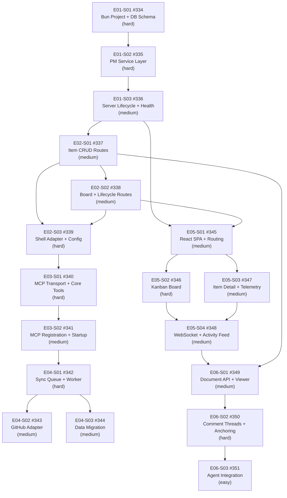

## Overview

**Blocked by:** #111

Persistent local server that powers the workflow's dashboard UI, PM backend, document review, and agent tool access via MCP. Evolved from the original "ephemeral dashboard" concept during brainstorming — the insight is that a server needed for the dashboard should also serve as the PM backend, replacing the fragile file-system adapter.

## Dependency Graph

### Dispatch Plan

| Wave | Stories | Dispatch |
|------|---------|----------|
| **Wave 1** | E01-S01 (#334) | Sequential |
| **Wave 2** | E01-S02 (#335) | Sequential |
| **Wave 3** | E01-S03 (#336) | Sequential |
| **Wave 4** | E02-S01 (#337) | Sequential |
| **Wave 5** | E02-S02 (#338), E05-S01 (#345) | Parallel (2) |
| **Wave 6** | E02-S03 (#339) | Sequential |
| **Wave 7** | E03-S01 (#340), E05-S02 (#346), E05-S03 (#347) | Parallel (3) |
| **Wave 8** | E03-S02 (#341), E05-S04 (#348) | Parallel (2) |
| **Wave 9** | E04-S01 (#342), E06-S01 (#349) | Parallel (2) |
| **Wave 10** | E04-S02 (#343), E04-S03 (#344), E06-S02 (#350) | Parallel (3) |
| **Wave 11** | E06-S03 (#351) | Sequential |

─────────────────────────────────────────────────────────────────────────
## Activity Log

<!-- comment: 2026-03-22T13:16:56Z -->
## Telemetry

### Summary

| Phase | Agent | Duration | Tokens | Est. Cost |
|-------|-------|----------|--------|-----------|
| Design | opus | 9m 25s | 118K | ~$1.18 |
| Plan | opus | 18m 10s | 117K | ~$1.17 |
| Build | mixed (opus, sonnet) (33 stories) | 257m 28s | 3.14M | ~$23.81 |
| Review | opus (33 dispatches) | 128m 50s | 2.68M | ~$26.76 |
| Retro | opus | 43m 24s | 118K | ~$1.18 |
| Fix Cycles | 14 cycles (12 stories) | 92m 55s | 2.02M | ~$17.45 |
| **Total** | | **457m 19s** | **6.17M** | **~$54.10** |

### Breakdown

| Agent | Story | Task | Duration | Tokens | Est. Cost |
|-------|-------|------|----------|--------|-----------|
| Designer (opus) | -- | Design Doc (#323) | 9m 25s | 118K | ~$1.18 |
| Planner (opus) | -- | Plan Doc (#116) | 18m 10s | 117K | ~$1.17 |
| Builder (opus) | -- | Issue #334 | 5m 25s | 86K | ~$0.87 |
| Reviewer (opus) | -- | PR Review (#334) | 4m 17s | 89K | ~$0.90 |
| Builder (opus) | -- | Issue #335 | 6m 59s | 80K | ~$0.80 |
| Reviewer (opus) | -- | PR Review (#335) | 3m 42s | 81K | ~$0.82 |
| Builder (opus) | -- | Fix (#335) | 6m 31s | 100K | ~$1.00 |
| Reviewer (opus) | -- | Re-review (#335) | 2m 53s | 89K | ~$0.90 |
| Builder (sonnet) | -- | Issue #336 | 4m 19s | 88K | ~$0.53 |
| Reviewer (opus) | -- | PR Review (#336) | 5m 45s | 89K | ~$0.90 |
| Builder (sonnet) | -- | Fix (#336) | 4m 20s | 71K | ~$0.43 |
| Reviewer (opus) | -- | Re-review (#336) | 2m 47s | 79K | ~$0.79 |
| Builder (sonnet) | -- | Fix (#336) | 1m 38s | 52K | ~$0.31 |
| Reviewer (opus) | -- | Re-review (#336) | 1m 50s | 47K | ~$0.48 |
| Builder (sonnet) | -- | Issue #337 | 5m 52s | 106K | ~$0.64 |
| Reviewer (opus) | -- | PR Review (#337) | 5m 23s | 73K | ~$0.74 |
| Builder (sonnet) | -- | Fix (#337) | 4m 40s | 87K | ~$0.53 |
| Reviewer (opus) | -- | Re-review (#337) | 2m 11s | 53K | ~$0.54 |
| Builder (sonnet) | -- | Issue #338 | 5m 51s | 109K | ~$0.66 |
| Builder (sonnet) | -- | Issue #345 | 9m 21s | 127K | ~$0.76 |
| Reviewer (opus) | -- | PR Review (#338) | 4m 23s | 85K | ~$0.86 |
| Reviewer (opus) | -- | PR Review (#345) | 5m 5s | 116K | ~$1.16 |
| Builder (sonnet) | -- | Fix (#338) | 2m 30s | 72K | ~$0.43 |
| Builder (sonnet) | -- | Fix (#345) | 2m 41s | 61K | ~$0.37 |
| Reviewer (opus) | -- | Re-review (#338) | 2m 59s | 75K | ~$0.76 |
| Reviewer (opus) | -- | Re-review (#345) | 1m 59s | 71K | ~$0.71 |
| Builder (opus) | -- | Issue #339 | 43m 48s | 146K | ~$1.46 |
| Reviewer (opus) | -- | PR Review (#339) | 3m 53s | 88K | ~$0.89 |
| Builder (opus) | -- | Fix (#339) | 10m 1s | 107K | ~$1.07 |
| Reviewer (opus) | -- | Re-review (#339) | 3m 34s | 85K | ~$0.86 |
| Builder (opus) | -- | Issue #340 | 7m 10s | 118K | ~$1.18 |
| Builder (opus) | -- | Issue #346 | 6m 28s | 78K | ~$0.78 |
| Builder (sonnet) | -- | Issue #347 | 8m 4s | 114K | ~$0.69 |
| Reviewer (opus) | -- | PR Review (#340) | 6m 4s | 96K | ~$0.97 |
| Reviewer (opus) | -- | PR Review (#346) | 4m 28s | 73K | ~$0.73 |
| Reviewer (opus) | -- | PR Review (#347) | 5m 4s | 90K | ~$0.91 |
| Builder (sonnet) | -- | Issue #341 | 35m 30s | 101K | ~$0.61 |
| Builder (sonnet) | -- | Issue #348 | 11m 6s | 125K | ~$0.75 |
| Reviewer (opus) | -- | PR Review (#341) | 4m 24s | 91K | ~$0.92 |
| Reviewer (opus) | -- | PR Review (#348) | 5m 24s | 108K | ~$1.08 |
| Builder (sonnet) | -- | Fix (#348) | 4m 6s | 75K | ~$0.46 |
| Reviewer (opus) | -- | Re-review (#348) | 2m 51s | 70K | ~$0.71 |
| Builder (sonnet) | -- | Fix (#348) | 1m 11s | 43K | ~$0.26 |
| Reviewer (opus) | -- | Re-review (#348) | 2m 29s | 57K | ~$0.58 |
| Builder (opus) | -- | Issue #342 | 7m 50s | 109K | ~$1.09 |
| Builder (sonnet) | -- | Issue #349 | 9m 18s | 129K | ~$0.78 |
| Reviewer (opus) | -- | PR Review (#342) | 4m 27s | 76K | ~$0.76 |
| Reviewer (opus) | -- | PR Review (#349) | 5m 53s | 90K | ~$0.90 |
| Builder (opus) | -- | Fix (#342) | 3m 45s | 83K | ~$0.83 |
| Builder (sonnet) | -- | Fix (#349) | 2m 29s | 75K | ~$0.46 |
| Reviewer (opus) | -- | Re-review (#342) | 2m 59s | 53K | ~$0.53 |
| Reviewer (opus) | -- | Re-review (#349) | 2m 58s | 61K | ~$0.62 |
| Builder (sonnet) | -- | Issue #343 | 6m 40s | 92K | ~$0.55 |
| Builder (sonnet) | -- | Issue #344 | 6m 41s | 96K | ~$0.58 |
| Builder (opus) | -- | Issue #350 | 7m 42s | 118K | ~$1.19 |
| Reviewer (opus) | -- | PR Review (#343) | 3m 59s | 92K | ~$0.93 |
| Reviewer (opus) | -- | PR Review (#344) | 4m 8s | 86K | ~$0.87 |
| Reviewer (opus) | -- | PR Review (#350) | 5m 18s | 86K | ~$0.86 |
| Builder (sonnet) | -- | Fix (#343) | 3m 8s | 62K | ~$0.38 |
| Builder (sonnet) | -- | Fix (#344) | 3m 35s | 86K | ~$0.52 |
| Builder (opus) | -- | Fix (#350) | 3m 52s | 89K | ~$0.89 |
| Reviewer (opus) | -- | Re-review (#343) | 2m 43s | 61K | ~$0.62 |
| Reviewer (opus) | -- | Re-review (#344) | 3m 53s | 86K | ~$0.87 |
| Reviewer (opus) | -- | Re-review (#350) | 2m 8s | 55K | ~$0.56 |
| Builder (sonnet) | -- | Issue #351 | 6m 17s | 117K | ~$0.71 |
| Reviewer (opus) | -- | PR Review (#351) | 3m 38s | 68K | ~$0.68 |
| Reviewer (opus) | -- | PR Review (#116) | 5m 8s | 137K | ~$1.37 |
| Retro (opus) | -- | Retrospective (#352) | 43m 24s | 118K | ~$1.18 |
| Builder (opus) | -- | Issue #116 | 8m 24s | 123K | ~$1.24 |
| | | **Total (69 dispatches)** | **457m 19s** | **6.17M** | **~$54.10** |

### Duration

| Metric | Value |
|--------|-------|
| **Duration** | 457m 19s |
| **Actual Duration** _(with parallelism)_ | 347m 52s |
| **Time Saved** _(1.3x parallel speedup)_ | 109m 27s |

### Timeline

```mermaid
%%{init: {'themeVariables':{
  'taskBkgColor':'#059669',
  'activeTaskBkgColor':'#8b5cf6',
  'doneTaskBkgColor':'#ca8a04',
  'critBkgColor':'#dc2626',
  'taskBorderColor':'#047857',
  'activeTaskBorderColor':'#7c3aed',
  'doneTaskBorderColor':'#a16207',
  'critBorderColor':'#b91c1c'
}}}%%
gantt
    title Full Lifecycle Timeline
    dateFormat HH:mm:ss
    axisFormat %H:%M
    tickInterval 10minute
    Designer (9m 25s)   :active,:t1, 00:00:00, 565s
    Planner (18m 10s)   :active,:t2, 00:09:25, 1090s
    Build (5m 25s)   :t3, 00:27:35, 325s
    PR Review (4m 17s)   :done,:t4, 00:33:01, 257s
    Build (6m 59s)   :t5, 00:37:18, 419s
    PR Review (3m 42s)   :done,:t6, 00:44:18, 222s
    Fix (6m 31s)   :crit,:t7, 00:48:00, 391s
    Re-review (2m 53s)   :crit,:t8, 00:54:32, 173s
    Build (4m 19s)   :t9, 00:57:25, 259s
    PR Review (5m 45s)   :done,:t10, 01:01:45, 345s
    Fix (4m 20s)   :crit,:t11, 01:07:30, 260s
    Re-review (2m 47s)   :crit,:t12, 01:11:51, 167s
    Fix (1m 38s)   :crit,:t13, 01:14:38, 98s
    Re-review (1m 50s)   :crit,:t14, 01:16:16, 110s
    Build (5m 52s)   :t15, 01:18:06, 352s
    PR Review (5m 23s)   :done,:t16, 01:23:59, 323s
    Fix (4m 40s)   :crit,:t17, 01:29:22, 280s
    Re-review (2m 11s)   :crit,:t18, 01:34:03, 131s
    Build (5m 51s)   :t19, 01:36:14, 351s
    Build (9m 21s)   :t20, 01:36:14, 561s
    PR Review (4m 23s)   :done,:t21, 01:45:35, 263s
    PR Review (5m 5s)   :done,:t22, 01:45:35, 305s
    Fix (2m 30s)   :crit,:t23, 01:50:41, 150s
    Fix (2m 41s)   :crit,:t24, 01:50:41, 161s
    Re-review (2m 59s)   :crit,:t25, 01:53:22, 179s
    Re-review (1m 59s)   :crit,:t26, 01:53:22, 119s
    Build (43m 48s)   :t27, 01:56:22, 2628s
    PR Review (3m 53s)   :done,:t28, 02:40:10, 233s
    Fix (10m 1s)   :crit,:t29, 02:44:04, 601s
    Re-review (3m 34s)   :crit,:t30, 02:54:06, 214s
    Build (7m 10s)   :t31, 02:57:41, 430s
    Build (6m 28s)   :t32, 02:57:41, 388s
    Build (8m 4s)   :t33, 02:57:41, 484s
    PR Review (6m 4s)   :done,:t34, 03:05:45, 364s
    PR Review (4m 28s)   :done,:t35, 03:05:45, 268s
    PR Review (5m 4s)   :done,:t36, 03:05:45, 304s
    Build (35m 30s) [stalled]   :t37, 03:11:49, 2130s
    Build (11m 6s)   :t38, 03:11:49, 666s
    PR Review (4m 24s)   :done,:t39, 03:47:19, 264s
    PR Review (5m 24s)   :done,:t40, 03:47:19, 324s
    Fix (4m 6s)   :crit,:t41, 03:52:43, 246s
    Re-review (2m 51s)   :crit,:t42, 03:56:49, 171s
    Fix (1m 11s)   :crit,:t43, 03:59:41, 71s
    Re-review (2m 29s)   :crit,:t44, 04:00:53, 149s
    Build (7m 50s)   :t45, 04:03:22, 470s
    Build (9m 18s)   :t46, 04:03:22, 558s
    PR Review (4m 27s)   :done,:t47, 04:12:40, 267s
    PR Review (5m 53s)   :done,:t48, 04:12:40, 353s
    Fix (3m 45s)   :crit,:t49, 04:18:34, 225s
    Fix (2m 29s)   :crit,:t50, 04:18:34, 149s
    Re-review (2m 59s)   :crit,:t51, 04:22:20, 179s
    Re-review (2m 58s)   :crit,:t52, 04:22:20, 178s
    Build (6m 40s)   :t53, 04:25:19, 400s
    Build (6m 41s)   :t54, 04:25:19, 401s
    Build (7m 42s)   :t55, 04:25:19, 462s
    PR Review (3m 59s)   :done,:t56, 04:33:02, 239s
    PR Review (4m 8s)   :done,:t57, 04:33:02, 248s
    PR Review (5m 18s)   :done,:t58, 04:33:02, 318s
    Fix (3m 8s)   :crit,:t59, 04:38:20, 188s
    Fix (3m 35s)   :crit,:t60, 04:38:20, 215s
    Fix (3m 52s)   :crit,:t61, 04:38:20, 232s
    Re-review (2m 43s)   :crit,:t62, 04:42:13, 163s
    Re-review (3m 53s)   :crit,:t63, 04:42:13, 233s
    Re-review (2m 8s)   :crit,:t64, 04:42:13, 128s
    Build (6m 17s)   :t65, 04:46:06, 377s
    PR Review (3m 38s)   :done,:t66, 04:52:23, 218s
    PR Review (5m 8s)   :done,:t67, 04:56:02, 308s
    Retro Agent (43m 24s) [stalled]   :active,:t68, 04:56:02, 2604s
    Build (8m 24s)   :t69, 05:39:27, 504s
```

*Timeline compressed: 1 gap removed (10m idle). X-axis shows agent running time, not wall-clock time.*
*2 stalled dispatches detected (< 50 tok/s throughput). Duration may include usage limit waits or API throttling.*

Known issue: E05-S04 W6 addressed in PR fix cycle. C2/C3 from PR review were false positives.

*Fix cycles: 14 / 19 stories (74% fix rate), adding 92m 55s and ~$17.45 (32% of total cost).*

---
*💡 Cost estimates use [Anthropic's published API token pricing](https://www.anthropic.com/pricing) with a blended rate (75% input / 25% output tokens). Actual costs vary by usage pattern. Subscription plans (Pro, Max, Team, Enterprise) include token allowances and are not charged per-token — these figures represent equivalent API value for reference only.*

---
