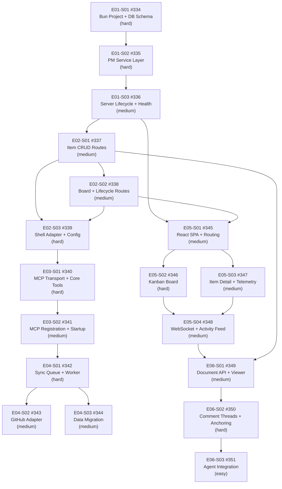

## Overview

**Blocked by:** #111

Persistent local server that powers the workflow's dashboard UI, PM backend, document review, and agent tool access via MCP. Evolved from the original "ephemeral dashboard" concept during brainstorming — the insight is that a server needed for the dashboard should also serve as the PM backend, replacing the fragile file-system adapter.

## Dependency Graph

### Dispatch Plan

| Wave | Stories | Dispatch |
|------|---------|----------|
| **Wave 1** | E01-S01 (#334) | Sequential |
| **Wave 2** | E01-S02 (#335) | Sequential |
| **Wave 3** | E01-S03 (#336) | Sequential |
| **Wave 4** | E02-S01 (#337) | Sequential |
| **Wave 5** | E02-S02 (#338), E05-S01 (#345) | Parallel (2) |
| **Wave 6** | E02-S03 (#339) | Sequential |
| **Wave 7** | E03-S01 (#340), E05-S02 (#346), E05-S03 (#347) | Parallel (3) |
| **Wave 8** | E03-S02 (#341), E05-S04 (#348) | Parallel (2) |
| **Wave 9** | E04-S01 (#342), E06-S01 (#349) | Parallel (2) |
| **Wave 10** | E04-S02 (#343), E04-S03 (#344), E06-S02 (#350) | Parallel (3) |
| **Wave 11** | E06-S03 (#351) | Sequential |
