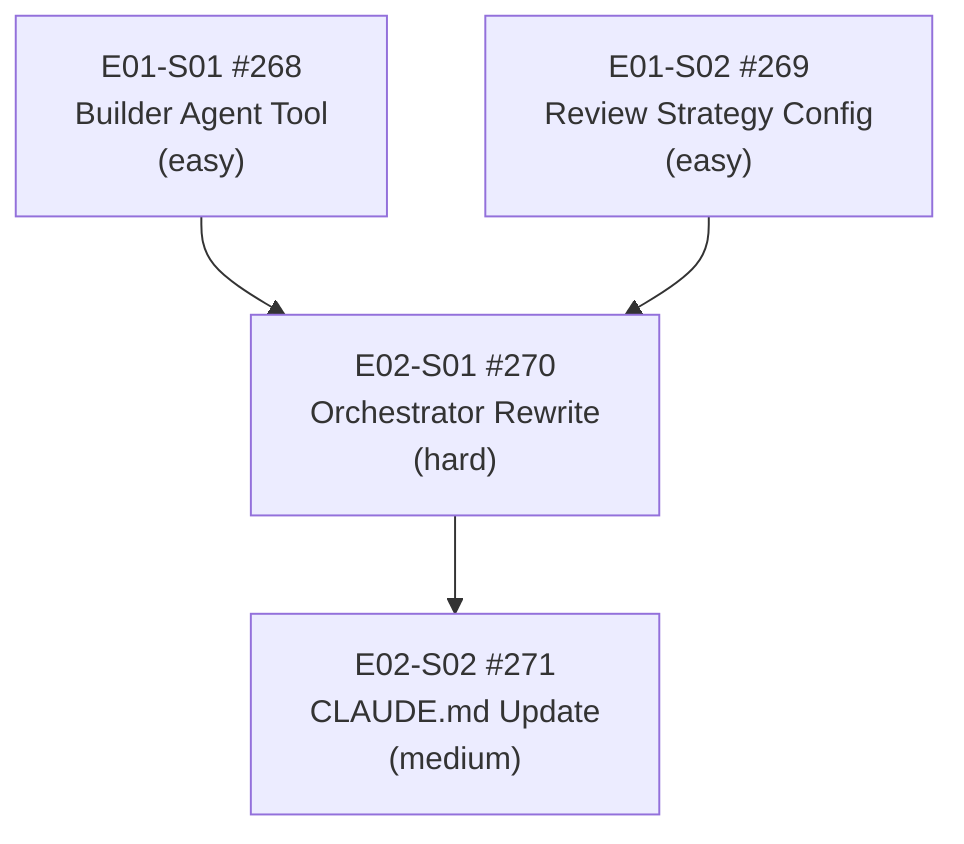

## Overview

**Blocked by:** none

Restructure the orchestrator's dispatch model so that each story's full lifecycle (build → review → fix cycle) runs as a single parallel unit within a wave, and implement tiered review strategy based on difficulty. This is the highest-impact structural optimization identified in the workflow optimization analysis (`docs/1-discovery/2026-03-19-workflow-optimization-analysis.md` § 11.2, § 11.4, § 13 items 5 and 7).

Combined, these changes reduce wave duration by ~39% and save ~84K tokens + 5-7m per test run by skipping unnecessary per-story reviews on easy stories.

## Problem: Current Dispatch Model

The orchestrator treats building and reviewing as separate sequential phases:

```
Phase 5: Dispatch all builders in parallel wave → wait for ALL to complete
Phase 6: Dispatch reviewers sequentially, one at a time → merge sequentially
```

This forces wave time = `max(builds) + sum(reviews)`. For a typical 3-story wave:
- Build: parallel, takes `max(2m30s, 2m10s, 1m50s)` = 2m 30s
- Review: sequential, takes `1m10s + 1m10s + 1m10s` = 3m 30s
- **Wave total: 6m 00s**

Additionally, per-story reviews on easy test stories have zero demonstrated value — no easy story has ever triggered a fix cycle from a real quality issue across 40+ stories and 14 runs.

## Proposed: Phase Restructuring

### New wave model

Each story's full lifecycle runs as one parallel unit:

```
[build S01 → review S01 | build S02 → review S02 | build S03 → review S03] → merge
                        all parallel (~3m 40s each)
```

Wave time = `max(build + review per story)` = 3m 40s. **Savings: 2m 20s per wave (39%).**

For a run with 3 waves, that's ~7 minutes saved — larger than any other single optimization.

### Tiered review strategy

Not all stories need per-story review. The PR review is the real cross-story quality gate.

| Story type | Per-story lifecycle | Rationale |
|-----------|-------------------|-----------|
| Easy (test content) | build → done (skip review) | 0 fix cycles across 40+ easy stories. PR review catches anything. |
| Medium/hard stories | build → review → (fix cycle) → done | Reviews have caught real issues on medium/hard stories. |
| All infrastructure stories | build → review → (fix cycle) → done | Higher fix rate (28.6% avg). Reviews justified. |

Configurable via `agentic-sdlc-config.json` — e.g., `"skipReviewForEasy": true` or a `reviewStrategy` section.

Risk of skipping easy reviews: format violations would only surface at the PR review, where they're harder to isolate. Mitigated by the existing builder AC validation instructions (builder.md L120-125) and potentially a future scripted validation step.

### Proposed phase model

| Phase | Name | What happens |
|-------|------|-------------|
| 0 | Setup | Detect mode, create integration branch, check existing artifacts |
| 1 | Design | *(conditional)* Dispatch designer, auto-merge PR |
| 2 | Plan | Dispatch planner, read plan, create branches |
| 3 | **Implementation** | Dispatch waves. Each story's full lifecycle (build → review → fix cycles) runs inside the wave in parallel. Wave completes when all stories are done. |
| 4 | Merge + Open PR | Merge branches, open backlog PR |
| 5 | **Review** | PR review (cross-story quality gate) |
| 6 | Retro + Telemetry | *(conditional)* Retro, changelog, telemetry |

Reduces phase count from 12 to 7. Eliminates the artificial boundary between build and review.

## Implementation Approaches

Three approaches were identified in the analysis (§ 11.2):

### Approach A: Add review dispatch to builder agent

The builder agent itself dispatches the reviewer after implementation is complete.

- **Pro:** No new files, minimal orchestrator changes
- **Con:** Builders become responsible for review dispatch logic, fix cycle handling, and telemetry — scope creep for an agent that should focus on implementation

### Approach B: Story-implementer wrapper agent (recommended)

A thin wrapper agent that sequences: build → review → fix cycle loop. Returns only when the story is fully validated or max fix cycles reached.

- **Pro:** Clean separation — builder builds, reviewer reviews, wrapper orchestrates the per-story lifecycle
- **Con:** New agent file, slightly more complex dispatch

### Approach C: Orchestrator sequences within parallel slot

The orchestrator dispatches builder and reviewer as sequential tasks within each parallel Agent tool call.

- **Pro:** No new agents, orchestrator retains full control
- **Con:** May not be possible with the Agent tool's current API — unclear if sequential sub-dispatches within a parallel slot are supported

### Recommendation

**Approach B** is cleanest. The wrapper agent is a thin coordination layer (~50-100 lines) that:
1. Calls `item-start.sh` (board → In Progress)
2. Dispatches builder via Agent tool
3. Checks review tier — if skip, calls `item-review.sh` and returns
4. Dispatches reviewer via Agent tool
5. If REQUEST_CHANGES: re-dispatches builder, then re-reviews (max 2 cycles)
6. Calls `item-review.sh` (board → In Review) and returns

The orchestrator's job simplifies: dispatch N story-implementers in parallel per wave, wait for all to complete, merge.

## Acceptance criteria

- [ ] Each story's build → review → fix cycle runs as one parallel unit within a wave
- [ ] Wave duration ≈ `max(build + review per story)`, not `max(builds) + sum(reviews)`
- [ ] Easy test stories skip per-story review when configured
- [ ] Medium/hard stories and all infrastructure stories always get per-story review
- [ ] Fix cycles handled within the story lifecycle (builder re-dispatched, reviewer re-dispatched, max 2 cycles)
- [ ] Telemetry captured for all dispatches (builder, reviewer, fix cycles) within each story
- [ ] Board transitions (In Progress → In Review) handled within the story lifecycle
- [ ] PR review remains as cross-story quality gate after all stories merge
- [ ] Orchestrator state file records per-story lifecycle dispatches in the dispatch log
- [ ] Config flag for review tier (`skipReviewForEasy` or similar)

## Telemetry impact

- Orchestrator overhead should decrease (fewer sequential dispatch/wait cycles)
- Per-wave duration should decrease ~39%
- Total tokens unchanged (same reviews happen, just scheduled differently)
- Fix cycle handling becomes internal to the story lifecycle — orchestrator no longer needs to track fix cycle state

## Evidence

- Workflow optimization analysis § 11.2: phase restructuring design and velocity calculations
- Workflow optimization analysis § 11.4: tiered review data (0 fix cycles on 40+ easy stories)
- Workflow optimization analysis § 4.2: reviewer model analysis (all reviews now use inherited model)
- Workflow optimization analysis § 9.2: 66% of fix cycles are format violations (mechanical, not quality)
- Streaming reviews worked naturally in R8/R12/R13 before "after all complete" language was added in R14

## Files to modify

- `.claude/agents/orchestrator.md` — Phase 5/6 rewrite (merge into single Implementation phase)
- `CLAUDE.md` — Dispatch protocol update (story lifecycle model, tiered reviews)
- `.claude/agentic-sdlc-config.json` — Add review strategy config
- New: `.claude/agents/story-implementer.md` (if Approach B)
- `scripts/lib/config.sh` — Read review strategy config
- `docs/1-discovery/2026-03-19-workflow-optimization-analysis.md` — Mark items 5 and 7 as done


## Dependency Graph



### Dispatch Plan

| Wave | Stories | Dispatch |
|------|---------|----------|
| **Wave 1** | E01-S01 (#268), E01-S02 (#269) | Parallel |
| **Wave 2** | E02-S01 (#270) | Sequential (depends on E01-S01, E01-S02) |
| **Wave 3** | E02-S02 (#271) | Sequential (depends on E02-S01) |
─────────────────────────────────────────────────────────────────────────
## Activity Log

<!-- comment: 2026-03-19T10:01:27Z -->
## Implementation Approach Decision

After discussing the three approaches in the issue plus two additional approaches explored in conversation, we're going with **Approach E: Orchestrator-driven prompt augmentation**.

### What was considered

| Approach | Description | Verdict |
|----------|-------------|---------|
| A | Builder dispatches reviewer (modify builder.md) | Rejected — scope creep for builder agent |
| B | Story-implementer wrapper agent | Rejected — new agent file + untested 3-level nesting complexity |
| C | Orchestrator sequences within parallel slot | Rejected — unclear Agent tool support |
| D | Parallel reviews (batch dispatch after all builds) | Rejected — reviews are ALREADY parallel (confirmed via Gantt chart). The real bottleneck is the **wait gate**, not review sequencing. |
| **E** | **Orchestrator-driven prompt augmentation** | **Selected** |

### Key insight from Gantt chart analysis

The Gantt chart from the last run shows reviews already dispatched in parallel after all builds complete. The real bottleneck is the **wait gate** — all reviewers must wait for the slowest builder in the wave. In a wave with builds of 13m10s and 7m16s, the fast builder's reviewer sits idle for ~6 minutes.

The Agent tool's foreground parallel dispatch is the fundamental constraint: dispatch N agents, block until ALL N return. You can't react to individual completions. Lifecycle coupling within each parallel slot is the only way to eliminate the wait gate.

### Approach E: How it works

The orchestrator extends its dispatch prompt to include the full story lifecycle:

1. **builder.md stays unchanged** (focused on building)
2. **Builder agents get `Agent` added to their tool list** (to dispatch reviewers)
3. **orchestrator.md's dispatch prompt** includes post-build lifecycle instructions:
   - Easy stories (config says skip review): build only, call item-review.sh, return
   - Medium/hard stories: build → dispatch reviewer → handle fix cycles (max 2) → item-review.sh
4. **No new agent files** — the prompt IS the wrapper

### Why this is better

- No new agent file maintenance burden
- Lifecycle logic lives in orchestrator.md (where dispatch coordination belongs)
- Same nesting depth as Approach B (orchestrator → builder → reviewer) but without a separate wrapper
- Orchestrator can dynamically vary the lifecycle per story via prompt (easy vs hard, test vs infra)
- builder.md stays clean and focused on TDD implementation

### Additional changes

- `agentic-sdlc-config.json`: Add review strategy config (`review.perStory` by difficulty)
- Phase restructuring: Merge current Phases 5+6 into single Implementation phase
- Tiered reviews: Easy test stories skip per-story review when configured

---

<!-- comment: 2026-03-19T20:48:39Z -->
## Telemetry

### Summary

| Phase | Agent | Duration | Tokens | Est. Cost |
|-------|-------|----------|--------|-----------|
| Plan | opus (2 dispatches) | 16m 22s | 221K | ~$2.21 |
| Design | opus (2 dispatches) | 18m 10s | 259K | ~$2.60 |
| Build | sonnet (4 stories) | 520m 14s | 250K | ~$1.51 |
| Review | opus (3 dispatches) | 13m 33s | 256K | ~$2.57 |
| **Total** | | **568m 19s** | **989K** | **~$8.89** |

### Breakdown

| Agent | Story | Task | Duration | Tokens | Est. Cost |
|-------|-------|------|----------|--------|-----------|
| Planner (opus) | -- | Plan Doc (#244) | 9m 28s | 125K | ~$1.26 |
| Designer (opus) | -- | Design Doc (#245) | 7m 14s | 105K | ~$1.06 |
| Designer (opus) | -- | Design Doc (#273) | 10m 55s | 154K | ~$1.54 |
| Planner (opus) | -- | Plan Doc (#273) | 6m 54s | 95K | ~$0.96 |
| Builder (sonnet) | E01-S01 | S01 Review Strategy Config (#276) | 16m 12s | 37K | ~$0.23 |
| Builder (sonnet) | E01-S02 | S02 Config Sh Review Vars (#277) | 9m 58s | 49K | ~$0.29 |
| Builder (sonnet) | E02-S01 | S01 Orchestrator Phase Rewrite (#278) | 490m 20s | 85K | ~$0.51 |
| Reviewer (opus) | E02-S01 | Review S01 Orchestrator Phase Rewrite (#278) | 3m 59s | 69K | ~$0.69 |
| Builder (sonnet) | E02-S02 | S02 Claude Md Dispatch Update (#279) | 3m 42s | 78K | ~$0.47 |
| Reviewer (opus) | E02-S02 | Review S02 Claude Md Dispatch Update (#279) | 4m 26s | 65K | ~$0.65 |
| Reviewer (opus) | -- | PR Review (#243) | 5m 6s | 122K | ~$1.22 |
| | | **Total (11 dispatches)** | **568m 19s** | **989K** | **~$8.89** |


### Duration

| Metric | Value |
|--------|-------|
| **Duration** | 568m 19s |
| **Actual Duration** _(with parallelism)_ | 568m 19s |

### Timeline

```mermaid
%%{init: {'themeVariables':{
  'taskBkgColor':'#059669',
  'activeTaskBkgColor':'#8b5cf6',
  'doneTaskBkgColor':'#ca8a04',
  'critBkgColor':'#dc2626',
  'taskBorderColor':'#047857',
  'activeTaskBorderColor':'#7c3aed',
  'doneTaskBorderColor':'#a16207',
  'critBorderColor':'#b91c1c'
}}}%%
gantt
    title Full Lifecycle Timeline
    dateFormat HH:mm:ss
    axisFormat %H:%M
    tickInterval 10minute
    Planner (9m 28s)   :active,:t1, 00:00:00, 568s
    Designer (7m 14s)   :active,:t2, 00:09:28, 434s
    Designer (10m 55s)   :active,:t3, 00:16:42, 655s
    Planner (6m 54s)   :active,:t4, 00:27:38, 414s
    E01-S01 Build (16m 12s) [stalled]   :t5, 00:34:32, 972s
    E01-S02 Build (9m 58s)   :t6, 00:50:44, 598s
    E02-S01 Build (490m 20s) [stalled]   :t7, 01:00:43, 29420s
    E02-S01 Review (3m 59s)   :done,:t8, 09:11:04, 239s
    E02-S02 Build (3m 42s)   :t9, 09:15:03, 222s
    E02-S02 Review (4m 26s)   :done,:t10, 09:18:46, 266s
    PR Review (5m 6s)   :done,:t11, 09:23:13, 306s
```



*Timeline compressed: 3 gaps removed (39m, 17m, 7m idle). X-axis shows agent running time, not wall-clock time.*
*2 stalled dispatches detected (< 50 tok/s throughput). Duration may include usage limit waits or API throttling.*

Orchestrator overhead: 76m 21s (tokens/cost not measurable).
*Note: E02-S01 builder duration (490m) is inflated by a rate limit/stall — actual productive work was ~5-10 minutes based on 85K tokens.*

---
*💡 Cost estimates use [Anthropic's published API token pricing](https://www.anthropic.com/pricing) with a blended rate (75% input / 25% output tokens). Actual costs vary by usage pattern. Subscription plans (Pro, Max, Team, Enterprise) include token allowances and are not charged per-token — these figures represent equivalent API value for reference only.*

---
