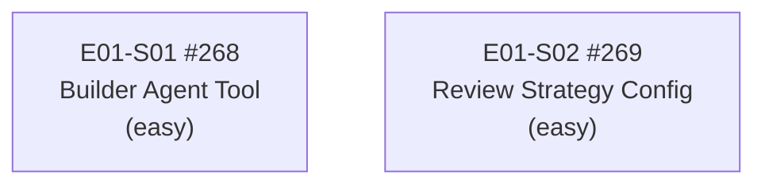

## Overview

Establishes the prerequisites for the orchestrator rewrite: builder Agent tool capability and review strategy configuration.

**Blocked by:** none

## Stories

- [ ] E01-S01: Add Agent Tool to Builder and Variants
- [ ] E01-S02: Add Review Strategy Config and Config Reader

## Epic Dependency Graph

All stories in this epic are independent -- parallel dispatch.
