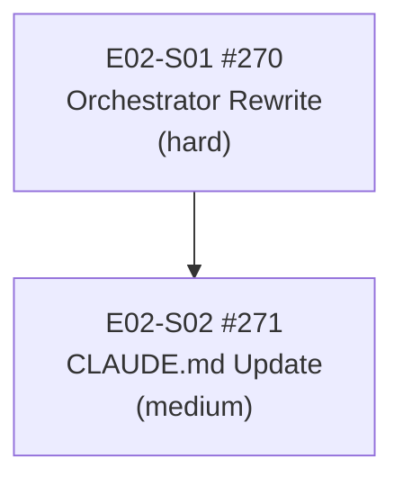

## Overview

Rewrites the orchestrator dispatch model to use prompt augmentation for story lifecycles and propagates all convention changes to CLAUDE.md.

**Blocked by:** none

## Stories

- [ ] E02-S01: Rewrite orchestrator.md Phase Model
- [ ] E02-S02: Update CLAUDE.md Dispatch Protocol and Conventions

## Epic Dependency Graph

Stories are sequential -- E02-S02 must read finalized orchestrator.md from E02-S01 to propagate conventions accurately.
