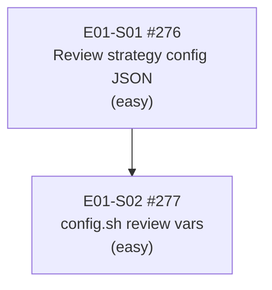

## Overview

Add the `reviewStrategy` config section to `.claude/agentic-sdlc-config.json` and extend `scripts/lib/config.sh` to expose the new settings as shell variables.

**Blocked by:** none

## Stories

- [ ] [E01-S01] Add reviewStrategy to config JSON
- [ ] [E01-S02] Extend config.sh with review strategy variables

## Epic Dependency Graph

E01-S01 must complete before E01-S02 (config.sh reads fields from the JSON schema). Sequential dispatch.
