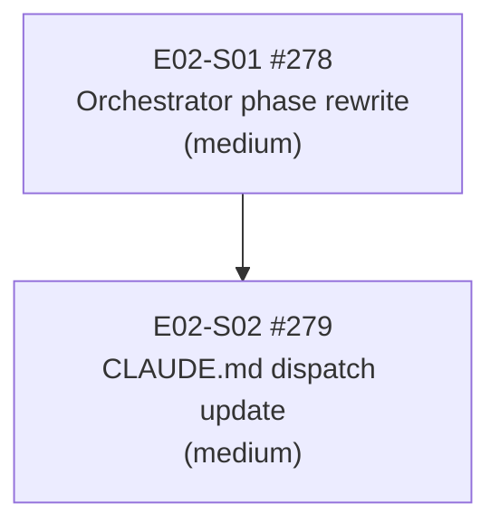

## Overview

Rewrite the orchestrator's phase model from 10+ phases to 7 phases (Approach H from design doc). Update CLAUDE.md's Dispatch Protocol section to match.

**Blocked by:** none

## Stories

- [ ] [E02-S01] Rewrite orchestrator.md phases
- [ ] [E02-S02] Update CLAUDE.md Dispatch Protocol

## Epic Dependency Graph

E02-S01 must complete before E02-S02 (CLAUDE.md describes what orchestrator.md implements). Sequential dispatch. Both stories depend on E01 completing first (config.sh variables must exist for orchestrator.md references).
