## Overview

**Blocked by:** none

Test run to validate the workflow changes from backlog #243 (phase restructuring, tiered review strategy, agent tool inheritance, agent attribution). Uses a creative content workload: adoption listings and care guides for a supernatural pet adoption agency.

## What this run validates

1. **Tiered review strategy** — easy stories should skip per-story review (first run with \`reviewStrategy.skipPerStoryReview.enabled: true\`)
2. **Parallel review dispatch** — medium stories should have reviewers dispatched in parallel
3. **Agent tool inheritance** — all agents should have access to WebSearch, WebFetch, MCP servers, LSP (tools field omitted from all agents)
4. **Agent attribution** — all issues should show \`Created by: <agent>\` metadata on GitHub
5. **Phase 3 (Implementation)** — unified build + review phase with review tier logic
6. **Research-first principle** — designer should do real research during exploration

## Creative Brief: Supernatural Pet Adoption Agency

**Theme:** "Eternally Yours Adoption Agency" — a pet adoption agency that specializes in supernatural, mythological, and interdimensional pets. Each listing is written as a genuine adoption profile, complete with temperament notes, care requirements, dietary needs, and compatibility warnings.

**Tone:** Warm and professional (like a real adoption agency) but with absurd content played completely straight. No winking at the camera — treat phoenix dietary needs with the same seriousness as a real pet's food allergies.

### Epic 1: Adoption Listings (2 stories, easy)

Short-form adoption profiles for supernatural pets. Each profile includes: name, species, age, temperament, special abilities, dietary needs, housing requirements, and compatibility notes.

- **E01-S01 (easy):** Write 3 adoption listings for fire-elemental pets (phoenix, salamander, ember sprite). 300-500 words each. Include a "WARNING" section for each pet about fire safety.
- **E01-S02 (easy):** Write 3 adoption listings for aquatic-supernatural pets (kraken hatchling, selkie pup, deep-sea leviathan juvenile). 300-500 words each. Include a "TANK REQUIREMENTS" section for each.

### Epic 2: Care Guides (3 stories, 2 easy + 1 medium)

Longer-form care guides for new supernatural pet owners.

- **E02-S01 (easy):** "So You Adopted a Phoenix: A First-Time Owner's Guide" — 600-800 words covering molting/rebirth cycles, ash cleanup, emotional bonding during resurrection, and what to do when your phoenix sets off the smoke alarm.
- **E02-S02 (easy):** "Interdimensional Pet-Proofing Your Home" — 600-800 words. A practical guide covering portal-sealing, void-pocket prevention, temporal displacement alarms, and what to do when your pet phases through walls.
- **E02-S03 (medium):** "The Comprehensive Supernatural Pet Nutrition Guide" — 800-1200 words. Cross-references the pets from E01 by name. Covers dietary needs for fire-elementals (volcanic minerals, charcoal supplements), aquatic-supernaturals (deep-sea bioluminescent plankton, moonlight-infused water), and interdimensional pets (void essence, temporal crumbs). Include a weekly meal plan table.

### File naming

All content files: \`content/supernatural-pets/\`
- \`fire-elemental-adoptions.md\`
- \`aquatic-supernatural-adoptions.md\`
- \`phoenix-care-guide.md\`
- \`interdimensional-pet-proofing.md\`
- \`supernatural-nutrition-guide.md\`

### Labels

Apply \`test-agentic-sdlc\` to ALL child issues (epics, stories, doc issues). Prefix doc filenames with \`test-agentic-sdlc-\`.

### Difficulty distribution

- 4 easy stories (E01-S01, E01-S02, E02-S01, E02-S02) — should skip per-story review
- 1 medium story (E02-S03) — should get per-story review with cross-reference validation

─────────────────────────────────────────────────────────────────────────
## Activity Log

<!-- comment: 2026-03-20T00:53:35Z -->
## Telemetry

### Summary

| Phase | Agent | Duration | Tokens | Est. Cost |
|-------|-------|----------|--------|-----------|
| Design | opus | 7m 29s | 77K | ~$0.78 |
| Plan | opus | 11m 5s | 87K | ~$0.87 |
| Build | sonnet (6 stories) | 35m 36s | 399K | ~$2.40 |
| Review | opus (3 dispatches) | 7m 26s | 185K | ~$1.86 |
| Retro | opus | 7m 18s | 126K | ~$1.27 |
| Fix Cycles | 1 cycle (1 story) | 2m 51s | 85K | ~$0.71 |
| **Total** | | **68m 56s** | **877K** | **~$7.17** |

### Breakdown

| Agent | Story | Task | Duration | Tokens | Est. Cost |
|-------|-------|------|----------|--------|-----------|
| Designer (opus) | -- | Design Doc (#291) | 7m 29s | 77K | ~$0.78 |
| Planner (opus) | -- | Plan Doc (#293) | 11m 5s | 87K | ~$0.87 |
| Builder (sonnet) | E01-S01 | S01 Fire Elemental Adoptions (#295) | 7m 15s | 65K | ~$0.39 |
| Builder (sonnet) | E01-S02 | S02 Aquatic Supernatural Adoptions (#296) | 8m 15s | 74K | ~$0.45 |
| Builder (sonnet) | E02-S01 | S01 Phoenix Care Guide (#297) | 5m 29s | 65K | ~$0.39 |
| Builder (sonnet) | E02-S02 | S02 Interdimensional Pet Proofing (#298) | 3m 55s | 73K | ~$0.44 |
| Builder (sonnet) | E02-S03 | S03 Supernatural Nutrition Guide (#299) | 9m 48s | 85K | ~$0.51 |
| Reviewer (opus) | E02-S03 | Review S03 Supernatural Nutrition Guide (#299) | 2m 18s | 50K | ~$0.50 |
| Builder (sonnet) | E02-S03 | Fix S03 Supernatural Nutrition Guide (#299) | 52s | 35K | ~$0.21 |
| Reviewer (opus) | E02-S03 | Re-review S03 Supernatural Nutrition Guide (#299) | 1m 59s | 49K | ~$0.50 |
| Reviewer (opus) | -- | PR Review (#301) | 3m 8s | 85K | ~$0.86 |
| Retro (opus) | -- | Retrospective (#302) | 7m 18s | 126K | ~$1.27 |
| | | **Total (12 dispatches)** | **68m 56s** | **877K** | **~$7.17** |

### Duration

| Metric | Value |
|--------|-------|
| **Duration** | 68m 56s |
| **Actual Duration** _(with parallelism)_ | 49m 7s |
| **Time Saved** _(1.4x parallel speedup)_ | 19m 49s |

### Timeline

```mermaid
%%{init: {'themeVariables':{
  'taskBkgColor':'#059669',
  'activeTaskBkgColor':'#8b5cf6',
  'doneTaskBkgColor':'#ca8a04',
  'critBkgColor':'#dc2626',
  'taskBorderColor':'#047857',
  'activeTaskBorderColor':'#7c3aed',
  'doneTaskBorderColor':'#a16207',
  'critBorderColor':'#b91c1c'
}}}%%
gantt
    title Full Lifecycle Timeline
    dateFormat HH:mm:ss
    axisFormat %M:%S
    tickInterval 5minute
    Designer (7m 29s)   :active,:t1, 00:00:00, 449s
    Planner (11m 5s)   :active,:t2, 00:07:29, 665s
    E01-S01 Build (7m 15s)   :t3, 00:18:34, 435s
    E01-S02 Build (8m 15s)   :t4, 00:18:34, 495s
    E02-S01 Build (5m 29s)   :t5, 00:18:34, 329s
    E02-S02 Build (3m 55s)   :t6, 00:18:34, 235s
    E02-S03 Build (9m 48s)   :t7, 00:26:49, 588s
    E02-S03 Review (2m 18s)   :done,:t8, 00:36:38, 138s
    E02-S03 Fix (52s)   :crit,:t9, 00:38:56, 52s
    E02-S03 Re-review (1m 59s)   :crit,:t10, 00:39:48, 119s
    PR Review (3m 8s)   :done,:t11, 00:41:48, 188s
    Retro Agent (7m 18s)   :active,:t12, 00:41:48, 438s
```

Orchestrator overhead: 15m 12s (tokens/cost not measurable from Agent tool).
*First production test of tiered review strategy (skipPerStoryReview.enabled: true). 4/5 stories SKIP tier, 1/5 REVIEW tier with 1 fix cycle.*

*Fix cycles: 1 / 5 stories (20% fix rate), adding 2m 51s and ~$0.71 (10% of total cost).*

---
*💡 Cost estimates use [Anthropic's published API token pricing](https://www.anthropic.com/pricing) with a blended rate (75% input / 25% output tokens). Actual costs vary by usage pattern. Subscription plans (Pro, Max, Team, Enterprise) include token allowances and are not charged per-token — these figures represent equivalent API value for reference only.*

---
