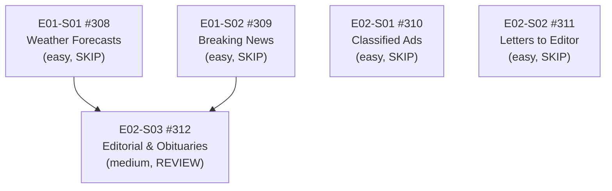

## Overview

**Blocked by:** none

Test run to validate the full e2e workflow pipeline with ultra-short content. Uses a creative content workload: a Trisolaran newspaper ("Three-Body Survival Gazette") inspired by Liu Cixin's *The Three-Body Problem* universe.

## Dependency Graph

### Dispatch Plan

| Wave | Stories | Dispatch |
|------|---------|----------|
| **Wave 1** | E01-S01 (#308), E01-S02 (#309), E02-S01 (#310), E02-S02 (#311) | Parallel (4 builders, SKIP tier) |
| **Wave 2** | E02-S03 (#312) | Sequential (depends on E01 content, REVIEW tier) |

─────────────────────────────────────────────────────────────────────────
## Activity Log

<!-- comment: 2026-03-20T05:57:57Z -->
## Telemetry

### Summary

| Phase | Agent | Duration | Tokens | Est. Cost |
|-------|-------|----------|--------|-----------|
| Design | opus | 7m 57s | 74K | ~$0.74 |
| Plan | opus | 11m 8s | 97K | ~$0.98 |
| Build | sonnet (5 stories) | 14m 3s | 284K | ~$1.70 |
| Review | opus (2 dispatches) | 7m 13s | 122K | ~$1.23 |
| Retro | opus | 7m 19s | 121K | ~$1.22 |
| **Total** | | **47m 43s** | **700K** | **~$5.87** |

### Breakdown

| Agent | Story | Task | Duration | Tokens | Est. Cost |
|-------|-------|------|----------|--------|-----------|
| Designer (opus) | -- | Design Doc (#305) | 7m 57s | 74K | ~$0.74 |
| Planner (opus) | -- | Plan Doc (#292) | 11m 8s | 97K | ~$0.98 |
| Builder (sonnet) | -- | Issue #308 | 2m 33s | 58K | ~$0.35 |
| Builder (sonnet) | -- | Issue #309 | 2m 4s | 38K | ~$0.23 |
| Builder (sonnet) | -- | Issue #310 | 4m 49s | 82K | ~$0.50 |
| Builder (sonnet) | -- | Issue #311 | 2m 24s | 56K | ~$0.34 |
| Builder (sonnet) | -- | Issue #312 | 2m 11s | 47K | ~$0.28 |
| Reviewer (opus) | -- | PR Review (#312) | 2m 38s | 53K | ~$0.54 |
| Reviewer (opus) | -- | PR Review (#303) | 4m 35s | 68K | ~$0.69 |
| Retro (opus) | -- | Retrospective (#315) | 7m 19s | 121K | ~$1.22 |
| | | **Total (10 dispatches)** | **47m 43s** | **700K** | **~$5.87** |

### Duration

| Metric | Value |
|--------|-------|
| **Duration** | 47m 43s |
| **Actual Duration** _(with parallelism)_ | 36m 6s |
| **Time Saved** _(1.3x parallel speedup)_ | 11m 37s |

### Timeline

```mermaid
%%{init: {'themeVariables':{
  'taskBkgColor':'#059669',
  'activeTaskBkgColor':'#8b5cf6',
  'doneTaskBkgColor':'#ca8a04',
  'critBkgColor':'#dc2626',
  'taskBorderColor':'#047857',
  'activeTaskBorderColor':'#7c3aed',
  'doneTaskBorderColor':'#a16207',
  'critBorderColor':'#b91c1c'
}}}%%
gantt
    title Full Lifecycle Timeline
    dateFormat HH:mm:ss
    axisFormat %M:%S
    tickInterval 5minute
    Designer (7m 57s)   :active,:t1, 00:00:00, 477s
    Planner (11m 8s)   :active,:t2, 00:07:57, 668s
    Build (2m 33s)   :t3, 00:19:06, 153s
    Build (2m 4s)   :t4, 00:19:06, 124s
    Build (4m 49s)   :t5, 00:19:06, 289s
    Build (2m 24s)   :t6, 00:19:06, 144s
    Build (2m 11s)   :t7, 00:23:56, 131s
    PR Review (2m 38s)   :done,:t8, 00:26:07, 158s
    PR Review (4m 35s)   :done,:t9, 00:28:46, 275s
    Retro Agent (7m 19s)   :active,:t10, 00:28:46, 439s
```

*Timeline compressed: 1 gap removed (6m idle). X-axis shows agent running time, not wall-clock time.*

Orchestrator overhead: 16m 18s (tokens/cost not measurable from Agent tool)

---
*💡 Cost estimates use [Anthropic's published API token pricing](https://www.anthropic.com/pricing) with a blended rate (75% input / 25% output tokens). Actual costs vary by usage pattern. Subscription plans (Pro, Max, Team, Enterprise) include token allowances and are not charged per-token — these figures represent equivalent API value for reference only.*

---
