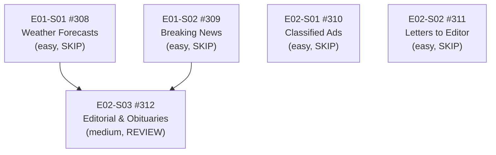

## Overview

**Blocked by:** none

Test run to validate the full e2e workflow pipeline with ultra-short content. Uses a creative content workload: a Trisolaran newspaper ("Three-Body Survival Gazette") inspired by Liu Cixin's *The Three-Body Problem* universe.

## Dependency Graph

### Dispatch Plan

| Wave | Stories | Dispatch |
|------|---------|----------|
| **Wave 1** | E01-S01 (#308), E01-S02 (#309), E02-S01 (#310), E02-S02 (#311) | Parallel (4 builders, SKIP tier) |
| **Wave 2** | E02-S03 (#312) | Sequential (depends on E01 content, REVIEW tier) |
