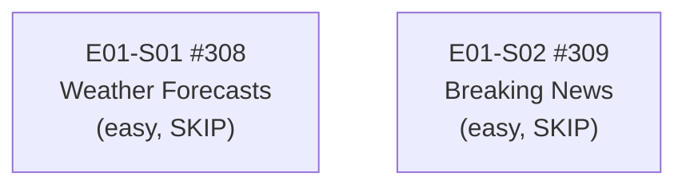

**Blocked by:** none

## Overview

Short-form newspaper content for the Three-Body Survival Gazette: weather reports and breaking news articles. 2 stories, both easy, both SKIP tier.

## Stories

- [ ] [E01-S01] Weather and Disaster Forecasts (easy, SKIP)
- [ ] [E01-S02] Front Page Headlines and Breaking News (easy, SKIP)

## Files

- `test-output/test-agentic-sdlc-three-body-gazette/weather-forecasts.md`
- `test-output/test-agentic-sdlc-three-body-gazette/breaking-news.md`

## Branch

`epic/e01-news-weather`

## Epic Dependency Graph

All stories in this epic are independent -- parallel dispatch in Wave 1.
