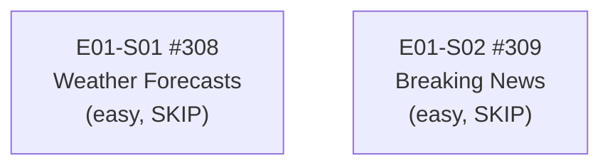

**Blocked by:** none

## Overview

Short-form newspaper content for the Three-Body Survival Gazette: weather reports and breaking news articles. 2 stories, both easy, both SKIP tier.

## Stories

- [ ] [E01-S01] Weather and Disaster Forecasts (easy, SKIP)
- [ ] [E01-S02] Front Page Headlines and Breaking News (easy, SKIP)

## Files

- `test-output/test-agentic-sdlc-three-body-gazette/weather-forecasts.md`
- `test-output/test-agentic-sdlc-three-body-gazette/breaking-news.md`

## Branch

`epic/e01-news-weather`

## Epic Dependency Graph

All stories in this epic are independent -- parallel dispatch in Wave 1.

─────────────────────────────────────────────────────────────────────────
## Activity Log

<!-- comment: 2026-03-20T05:37:23Z -->
## Telemetry

### Summary

| Phase | Agent | Duration | Tokens | Est. Cost |
|-------|-------|----------|--------|-----------|
| Design | opus | 7m 57s | 74K | ~$0.74 |
| Plan | opus | 11m 8s | 97K | ~$0.98 |
| Build | sonnet (4 stories) | 11m 51s | 236K | ~$1.42 |
| **Total** | | **30m 58s** | **408K** | **~$3.14** |

### Breakdown

| Agent | Story | Task | Duration | Tokens | Est. Cost |
|-------|-------|------|----------|--------|-----------|
| Designer (opus) | -- | Design Doc (#305) | 7m 57s | 74K | ~$0.74 |
| Planner (opus) | -- | Plan Doc (#292) | 11m 8s | 97K | ~$0.98 |
| Builder (sonnet) | -- | Issue #308 | 2m 33s | 58K | ~$0.35 |
| Builder (sonnet) | -- | Issue #309 | 2m 4s | 38K | ~$0.23 |
| Builder (sonnet) | -- | Issue #310 | 4m 49s | 82K | ~$0.50 |
| Builder (sonnet) | -- | Issue #311 | 2m 24s | 56K | ~$0.34 |
| | | **Total (6 dispatches)** | **30m 58s** | **408K** | **~$3.14** |

### Duration

| Metric | Value |
|--------|-------|
| **Duration** | 30m 58s |
| **Actual Duration** _(with parallelism)_ | 23m 56s |
| **Time Saved** _(1.3x parallel speedup)_ | 7m 2s |

---
*💡 Cost estimates use [Anthropic's published API token pricing](https://www.anthropic.com/pricing) with a blended rate (75% input / 25% output tokens). Actual costs vary by usage pattern. Subscription plans (Pro, Max, Team, Enterprise) include token allowances and are not charged per-token — these figures represent equivalent API value for reference only.*

---
