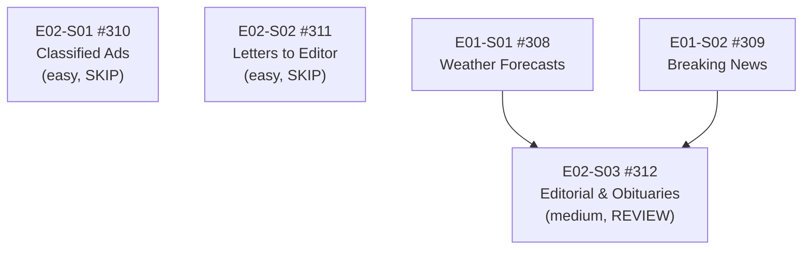

**Blocked by:** none

## Overview

Community newspaper content for the Three-Body Survival Gazette: classified ads, letters to the editor, and a guest editorial with obituaries. 3 stories (2 easy + 1 medium). E02-S03 has a cross-epic dependency on E01 content.

## Stories

- [ ] [E02-S01] Classified Ads (easy, SKIP)
- [ ] [E02-S02] Letters to the Editor (easy, SKIP)
- [ ] [E02-S03] Guest Editorial and Obituaries (medium, REVIEW)

## Files

- `test-output/test-agentic-sdlc-three-body-gazette/classifieds.md`
- `test-output/test-agentic-sdlc-three-body-gazette/letters-to-editor.md`
- `test-output/test-agentic-sdlc-three-body-gazette/editorial-obituaries.md`

## Branch

`epic/e02-community-lifestyle`

## Epic Dependency Graph

E02-S01 and E02-S02 are independent -- dispatched in Wave 1 (parallel).
E02-S03 depends on E01-S01 and E01-S02 -- dispatched in Wave 2 (after E01 merges).

─────────────────────────────────────────────────────────────────────────
## Activity Log

<!-- comment: 2026-03-20T05:45:17Z -->
## Telemetry

### Summary

| Phase | Agent | Duration | Tokens | Est. Cost |
|-------|-------|----------|--------|-----------|
| Design | opus | 7m 57s | 74K | ~$0.74 |
| Plan | opus | 11m 8s | 97K | ~$0.98 |
| Build | sonnet (5 stories) | 14m 3s | 284K | ~$1.70 |
| Review | opus | 2m 38s | 53K | ~$0.54 |
| **Total** | | **35m 48s** | **509K** | **~$3.96** |

### Breakdown

| Agent | Story | Task | Duration | Tokens | Est. Cost |
|-------|-------|------|----------|--------|-----------|
| Designer (opus) | -- | Design Doc (#305) | 7m 57s | 74K | ~$0.74 |
| Planner (opus) | -- | Plan Doc (#292) | 11m 8s | 97K | ~$0.98 |
| Builder (sonnet) | -- | Issue #308 | 2m 33s | 58K | ~$0.35 |
| Builder (sonnet) | -- | Issue #309 | 2m 4s | 38K | ~$0.23 |
| Builder (sonnet) | -- | Issue #310 | 4m 49s | 82K | ~$0.50 |
| Builder (sonnet) | -- | Issue #311 | 2m 24s | 56K | ~$0.34 |
| Builder (sonnet) | -- | Issue #312 | 2m 11s | 47K | ~$0.28 |
| Reviewer (opus) | -- | PR Review (#312) | 2m 38s | 53K | ~$0.54 |
| | | **Total (8 dispatches)** | **35m 48s** | **509K** | **~$3.96** |

### Duration

| Metric | Value |
|--------|-------|
| **Duration** | 35m 48s |
| **Actual Duration** _(with parallelism)_ | 28m 46s |
| **Time Saved** _(1.2x parallel speedup)_ | 7m 2s |

---
*💡 Cost estimates use [Anthropic's published API token pricing](https://www.anthropic.com/pricing) with a blended rate (75% input / 25% output tokens). Actual costs vary by usage pattern. Subscription plans (Pro, Max, Team, Enterprise) include token allowances and are not charged per-token — these figures represent equivalent API value for reference only.*

---
