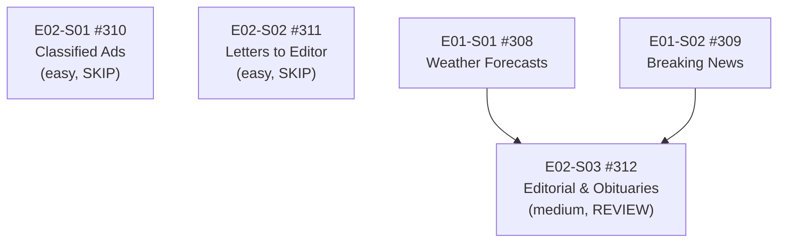

**Blocked by:** none

## Overview

Community newspaper content for the Three-Body Survival Gazette: classified ads, letters to the editor, and a guest editorial with obituaries. 3 stories (2 easy + 1 medium). E02-S03 has a cross-epic dependency on E01 content.

## Stories

- [ ] [E02-S01] Classified Ads (easy, SKIP)
- [ ] [E02-S02] Letters to the Editor (easy, SKIP)
- [ ] [E02-S03] Guest Editorial and Obituaries (medium, REVIEW)

## Files

- `test-output/test-agentic-sdlc-three-body-gazette/classifieds.md`
- `test-output/test-agentic-sdlc-three-body-gazette/letters-to-editor.md`
- `test-output/test-agentic-sdlc-three-body-gazette/editorial-obituaries.md`

## Branch

`epic/e02-community-lifestyle`

## Epic Dependency Graph

E02-S01 and E02-S02 are independent -- dispatched in Wave 1 (parallel).
E02-S03 depends on E01-S01 and E01-S02 -- dispatched in Wave 2 (after E01 merges).
