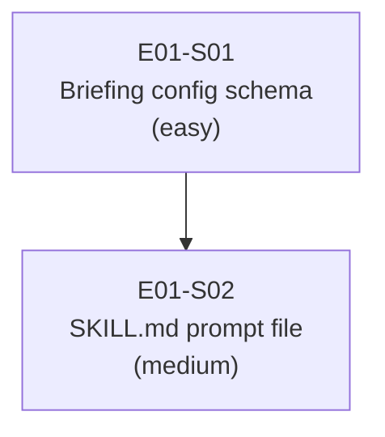

## Summary

A Claude Code skill (`/briefing`) that provides structured project orientation, adapting its output based on the current state of the workflow. One command, two modes:

- **Briefing mode** (between cycles): strategic awareness — roadmap status, what happened last, outstanding issues, suggested next action
- **Debrief mode** (PR open / cycle just completed): merge-readiness assessment — what happened, reviewer findings, retro insights, what needs attention before merge

## Key Design Decisions

- **Pure AI-driven skill** (no scripts) — model improvements directly improve briefing quality
- **Three-tier data source discovery**: frontmatter-driven (Tier 1), fixed-path (Tier 2), CLAUDE.md-referenced (Tier 3)
- **Configurable depth**: `/briefing quick`, `/briefing`, `/briefing deep`
- **Read-only** — no side effects, safe to run anytime
- **SBAR-inspired structure** (from healthcare shift handoffs) for the debrief mode

## Prerequisites

- Design doc frontmatter standardization (completed in e5261f8)

## References

- Design doc: `docs/2-design/2026-03-22-briefing-skill.md`

**Blocked by:** none

## Dependency Graph

### Dispatch Plan

| Wave | Stories | Dispatch |
|------|---------|----------|
| **Wave 1** | E01-S01 | Sequential (solo) |
| **Wave 2** | E01-S02 | Sequential (depends on E01-S01) |

─────────────────────────────────────────────────────────────────────────
## Activity Log

<!-- comment: 2026-03-22T06:56:05Z -->
## Telemetry

### Summary

| Phase | Agent | Duration | Tokens | Est. Cost |
|-------|-------|----------|--------|-----------|
| Plan | opus | 4m 51s | 67K | ~$0.67 |
| Build | sonnet (2 stories) | 8m 8s | 103K | ~$0.62 |
| Review | opus (3 dispatches) | 9m 17s | 190K | ~$1.90 |
| Retro | opus | 5m 45s | 104K | ~$1.04 |
| **Total** | | **28m 3s** | **465K** | **~$4.24** |

### Breakdown

| Agent | Story | Task | Duration | Tokens | Est. Cost |
|-------|-------|------|----------|--------|-----------|
| Planner (opus) | -- | Plan Doc (#317) | 4m 51s | 67K | ~$0.67 |
| Builder (sonnet) | -- | Issue #319 | 4m 19s | 38K | ~$0.23 |
| Reviewer (opus) | -- | PR Review (#319) | 1m 13s | 48K | ~$0.49 |
| Builder (sonnet) | -- | Issue #320 | 3m 48s | 64K | ~$0.39 |
| Reviewer (opus) | -- | PR Review (#320) | 2m 55s | 68K | ~$0.68 |
| Reviewer (opus) | -- | PR Review (#316) | 5m 8s | 73K | ~$0.73 |
| Retro (opus) | -- | Retrospective (#325) | 5m 45s | 104K | ~$1.04 |
| | | **Total (7 dispatches)** | **28m 3s** | **465K** | **~$4.24** |

### Duration

| Metric | Value |
|--------|-------|
| **Duration** | 28m 3s |
| **Actual Duration** _(with parallelism)_ | 22m 54s |
| **Time Saved** _(1.2x parallel speedup)_ | 5m 8s |

### Timeline

```mermaid
%%{init: {'themeVariables':{
  'taskBkgColor':'#059669',
  'activeTaskBkgColor':'#8b5cf6',
  'doneTaskBkgColor':'#ca8a04',
  'critBkgColor':'#dc2626',
  'taskBorderColor':'#047857',
  'activeTaskBorderColor':'#7c3aed',
  'doneTaskBorderColor':'#a16207',
  'critBorderColor':'#b91c1c'
}}}%%
gantt
    title Full Lifecycle Timeline
    dateFormat HH:mm:ss
    axisFormat %M:%S
    tickInterval 2minute
    Planner (4m 51s)   :active,:t1, 00:00:00, 291s
    Build (4m 19s)   :t2, 00:04:51, 259s
    PR Review (1m 13s)   :done,:t3, 00:09:11, 73s
    Build (3m 48s)   :t4, 00:10:24, 228s
    PR Review (2m 55s)   :done,:t5, 00:14:12, 175s
    PR Review (5m 8s)   :done,:t6, 00:17:08, 308s
    Retro Agent (5m 45s)   :active,:t7, 00:17:08, 345s
```

Orchestrator overhead: 9m 14s (tokens/cost not measurable from Agent tool).

---
*💡 Cost estimates use [Anthropic's published API token pricing](https://www.anthropic.com/pricing) with a blended rate (75% input / 25% output tokens). Actual costs vary by usage pattern. Subscription plans (Pro, Max, Team, Enterprise) include token allowances and are not charged per-token — these figures represent equivalent API value for reference only.*

---
