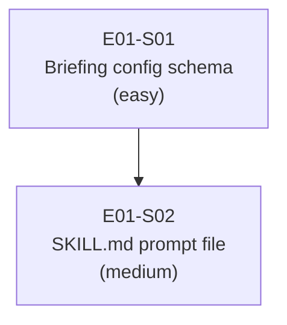

## Epic: Briefing Skill Implementation

Build the `/briefing` skill file and its config schema support.

**Blocked by:** none

## Stories

- [ ] [E01-S01] Add briefing config section to agentic-sdlc-config.json
- [ ] [E01-S02] Create SKILL.md for /briefing skill

## Epic Dependency Graph

E01-S02 depends on E01-S01 (config schema must exist before the skill file can reference it). Sequential dispatch.
