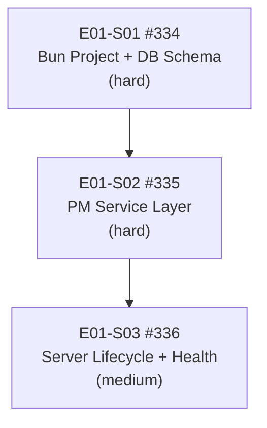

## Summary

Establishes the Bun project, SQLite database with Drizzle ORM, PM service layer, and daemon lifecycle management. After this epic, the server starts, creates/reads/writes items in SQLite, and exposes a health endpoint.

**Blocked by:** none

## Stories

- [ ] E01-S01: Bun Project Setup and Database Schema (hard)
- [ ] E01-S02: PM Service Layer (hard)
- [ ] E01-S03: Server Lifecycle and Health Endpoint (medium)

## Epic Dependency Graph

All stories in this epic are strictly sequential.
