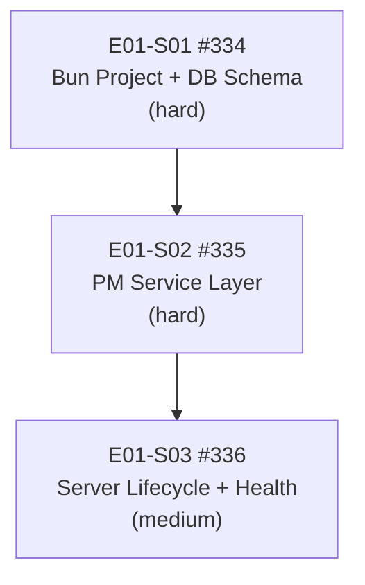

## Summary

Establishes the Bun project, SQLite database with Drizzle ORM, PM service layer, and daemon lifecycle management. After this epic, the server starts, creates/reads/writes items in SQLite, and exposes a health endpoint.

**Blocked by:** none

## Stories

- [ ] E01-S01: Bun Project Setup and Database Schema (hard)
- [ ] E01-S02: PM Service Layer (hard)
- [ ] E01-S03: Server Lifecycle and Health Endpoint (medium)

## Epic Dependency Graph

All stories in this epic are strictly sequential.

─────────────────────────────────────────────────────────────────────────
## Activity Log

<!-- comment: 2026-03-22T08:11:11Z -->
## Telemetry

### Summary

| Phase | Agent | Duration | Tokens | Est. Cost |
|-------|-------|----------|--------|-----------|
| Design | opus | 9m 25s | 118K | ~$1.18 |
| Plan | opus | 18m 10s | 117K | ~$1.17 |
| Build | mixed (opus, sonnet) (6 stories) | 29m 15s | 480K | ~$3.95 |
| Review | opus (6 dispatches) | 21m 15s | 477K | ~$4.78 |
| Fix Cycles | 3 cycles (2 stories) | 20m | 441K | ~$3.92 |
| **Total** | | **78m 6s** | **1.19M** | **~$11.08** |

### Breakdown

| Agent | Story | Task | Duration | Tokens | Est. Cost |
|-------|-------|------|----------|--------|-----------|
| Designer (opus) | -- | Design Doc (#323) | 9m 25s | 118K | ~$1.18 |
| Planner (opus) | -- | Plan Doc (#116) | 18m 10s | 117K | ~$1.17 |
| Builder (opus) | -- | Issue #334 | 5m 25s | 86K | ~$0.87 |
| Reviewer (opus) | -- | PR Review (#334) | 4m 17s | 89K | ~$0.90 |
| Builder (opus) | -- | Issue #335 | 6m 59s | 80K | ~$0.80 |
| Reviewer (opus) | -- | PR Review (#335) | 3m 42s | 81K | ~$0.82 |
| Builder (opus) | -- | Fix (#335) | 6m 31s | 100K | ~$1.00 |
| Reviewer (opus) | -- | Re-review (#335) | 2m 53s | 89K | ~$0.90 |
| Builder (sonnet) | -- | Issue #336 | 4m 19s | 88K | ~$0.53 |
| Reviewer (opus) | -- | PR Review (#336) | 5m 45s | 89K | ~$0.90 |
| Builder (sonnet) | -- | Fix (#336) | 4m 20s | 71K | ~$0.43 |
| Reviewer (opus) | -- | Re-review (#336) | 2m 47s | 79K | ~$0.79 |
| Builder (sonnet) | -- | Fix (#336) | 1m 38s | 52K | ~$0.31 |
| Reviewer (opus) | -- | Re-review (#336) | 1m 50s | 47K | ~$0.48 |
| | | **Total (14 dispatches)** | **78m 6s** | **1.19M** | **~$11.08** |

### Duration

| Metric | Value |
|--------|-------|
| **Duration** | 78m 6s |
| **Actual Duration** _(with parallelism)_ | 78m 6s |

*Fix cycles: 3 / 3 stories (100% fix rate), adding 20m and ~$3.92 (35% of total cost).*

---
*💡 Cost estimates use [Anthropic's published API token pricing](https://www.anthropic.com/pricing) with a blended rate (75% input / 25% output tokens). Actual costs vary by usage pattern. Subscription plans (Pro, Max, Team, Enterprise) include token allowances and are not charged per-token — these figures represent equivalent API value for reference only.*

---
