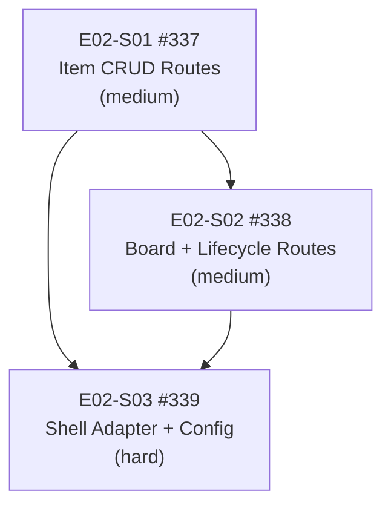

## Summary

Adds Hono route handlers for all PM operations and creates the server PM shell adapter so existing shell scripts can call the HTTP API instead of the file system. After this epic, shell scripts work against the server.

**Blocked by:** none

## Stories

- [ ] E02-S01: Item CRUD and Query Routes (medium)
- [ ] E02-S02: Board, Lifecycle, Comment, and Hierarchy Routes (medium)
- [ ] E02-S03: Server PM Shell Adapter and Config Migration (hard)

## Epic Dependency Graph

E02-S01 and E02-S02 are sequential. E02-S03 depends on both.
