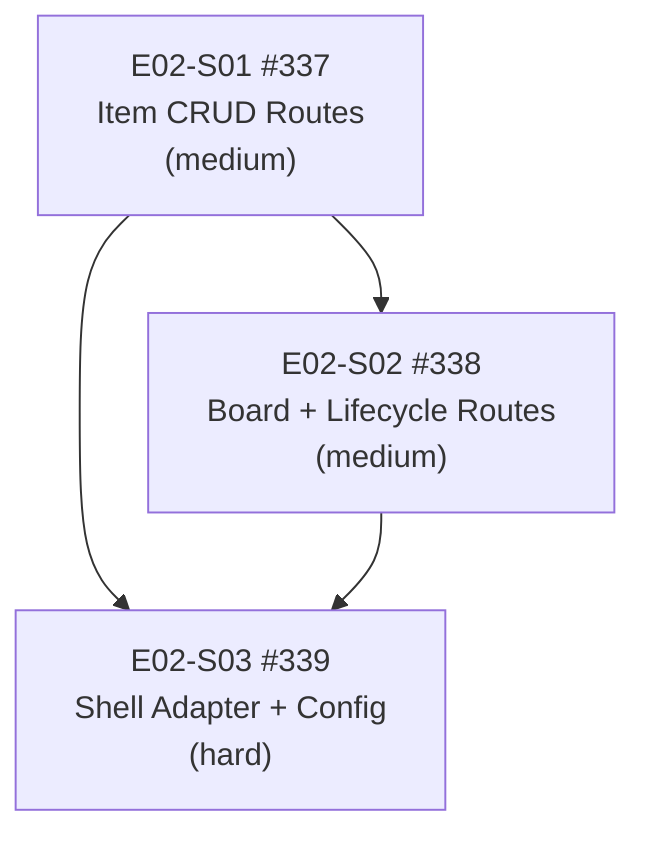

## Summary

Adds Hono route handlers for all PM operations and creates the server PM shell adapter so existing shell scripts can call the HTTP API instead of the file system. After this epic, shell scripts work against the server.

**Blocked by:** none

## Stories

- [ ] E02-S01: Item CRUD and Query Routes (medium)
- [ ] E02-S02: Board, Lifecycle, Comment, and Hierarchy Routes (medium)
- [ ] E02-S03: Server PM Shell Adapter and Config Migration (hard)

## Epic Dependency Graph

E02-S01 and E02-S02 are sequential. E02-S03 depends on both.

─────────────────────────────────────────────────────────────────────────
## Activity Log

<!-- comment: 2026-03-22T09:57:34Z -->
## Telemetry

### Summary

| Phase | Agent | Duration | Tokens | Est. Cost |
|-------|-------|----------|--------|-----------|
| Design | opus | 9m 25s | 118K | ~$1.18 |
| Plan | opus | 18m 10s | 117K | ~$1.17 |
| Build | mixed (opus, sonnet) (14 stories) | 114m 4s | 1.30M | ~$9.87 |
| Review | opus (14 dispatches) | 50m 45s | 1.13M | ~$11.29 |
| Fix Cycles | 7 cycles (6 stories) | 50m 40s | 1.06M | ~$9.18 |
| **Total** | | **192m 25s** | **2.66M** | **~$23.52** |

### Breakdown

| Agent | Story | Task | Duration | Tokens | Est. Cost |
|-------|-------|------|----------|--------|-----------|
| Designer (opus) | -- | Design Doc (#323) | 9m 25s | 118K | ~$1.18 |
| Planner (opus) | -- | Plan Doc (#116) | 18m 10s | 117K | ~$1.17 |
| Builder (opus) | -- | Issue #334 | 5m 25s | 86K | ~$0.87 |
| Reviewer (opus) | -- | PR Review (#334) | 4m 17s | 89K | ~$0.90 |
| Builder (opus) | -- | Issue #335 | 6m 59s | 80K | ~$0.80 |
| Reviewer (opus) | -- | PR Review (#335) | 3m 42s | 81K | ~$0.82 |
| Builder (opus) | -- | Fix (#335) | 6m 31s | 100K | ~$1.00 |
| Reviewer (opus) | -- | Re-review (#335) | 2m 53s | 89K | ~$0.90 |
| Builder (sonnet) | -- | Issue #336 | 4m 19s | 88K | ~$0.53 |
| Reviewer (opus) | -- | PR Review (#336) | 5m 45s | 89K | ~$0.90 |
| Builder (sonnet) | -- | Fix (#336) | 4m 20s | 71K | ~$0.43 |
| Reviewer (opus) | -- | Re-review (#336) | 2m 47s | 79K | ~$0.79 |
| Builder (sonnet) | -- | Fix (#336) | 1m 38s | 52K | ~$0.31 |
| Reviewer (opus) | -- | Re-review (#336) | 1m 50s | 47K | ~$0.48 |
| Builder (sonnet) | -- | Issue #337 | 5m 52s | 106K | ~$0.64 |
| Reviewer (opus) | -- | PR Review (#337) | 5m 23s | 73K | ~$0.74 |
| Builder (sonnet) | -- | Fix (#337) | 4m 40s | 87K | ~$0.53 |
| Reviewer (opus) | -- | Re-review (#337) | 2m 11s | 53K | ~$0.54 |
| Builder (sonnet) | -- | Issue #338 | 5m 51s | 109K | ~$0.66 |
| Builder (sonnet) | -- | Issue #345 | 9m 21s | 127K | ~$0.76 |
| Reviewer (opus) | -- | PR Review (#338) | 4m 23s | 85K | ~$0.86 |
| Reviewer (opus) | -- | PR Review (#345) | 5m 5s | 116K | ~$1.16 |
| Builder (sonnet) | -- | Fix (#338) | 2m 30s | 72K | ~$0.43 |
| Builder (sonnet) | -- | Fix (#345) | 2m 41s | 61K | ~$0.37 |
| Reviewer (opus) | -- | Re-review (#338) | 2m 59s | 75K | ~$0.76 |
| Reviewer (opus) | -- | Re-review (#345) | 1m 59s | 71K | ~$0.71 |
| Builder (opus) | -- | Issue #339 | 43m 48s | 146K | ~$1.46 |
| Reviewer (opus) | -- | PR Review (#339) | 3m 53s | 88K | ~$0.89 |
| Builder (opus) | -- | Fix (#339) | 10m 1s | 107K | ~$1.07 |
| Reviewer (opus) | -- | Re-review (#339) | 3m 34s | 85K | ~$0.86 |
| | | **Total (30 dispatches)** | **192m 25s** | **2.66M** | **~$23.52** |

### Duration

| Metric | Value |
|--------|-------|
| **Duration** | 192m 25s |
| **Actual Duration** _(with parallelism)_ | 177m 41s |
| **Time Saved** _(1.1x parallel speedup)_ | 14m 44s |

*Fix cycles: 7 / 7 stories (100% fix rate), adding 50m 40s and ~$9.18 (39% of total cost).*

---
*💡 Cost estimates use [Anthropic's published API token pricing](https://www.anthropic.com/pricing) with a blended rate (75% input / 25% output tokens). Actual costs vary by usage pattern. Subscription plans (Pro, Max, Team, Enterprise) include token allowances and are not charged per-token — these figures represent equivalent API value for reference only.*

---
