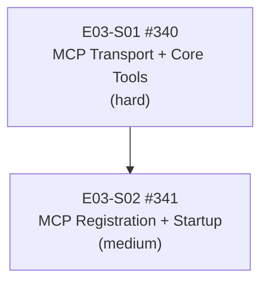

## Summary

Adds MCP protocol support so Claude Code agents can call PM operations as native tools via stdio transport. After this epic, agents can use MCP tools for PM operations.

**Blocked by:** none

## Stories

- [ ] E03-S01: MCP Transport and Core Tool Registration (hard)
- [ ] E03-S02: MCP Registration and Dual-Mode Startup (medium)

## Epic Dependency Graph

All stories in this epic are strictly sequential.
