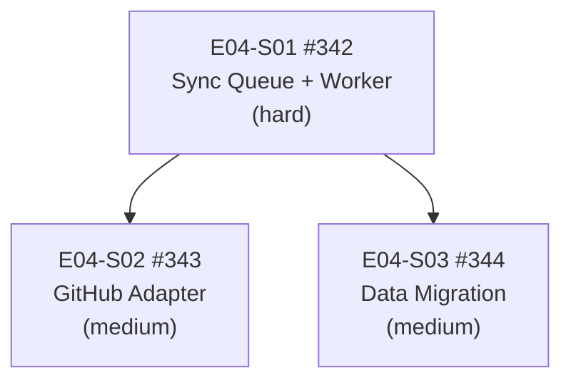

## Summary

Replaces the fire-and-forget external PM sync with a durable retry queue backed by the sync_queue table. After this epic, the server replaces the dual-write layer entirely.

**Blocked by:** none

## Stories

- [ ] E04-S01: Sync Queue and Worker (hard)
- [ ] E04-S02: GitHub External Adapter (medium)
- [ ] E04-S03: Data Migration Script (medium)

## Epic Dependency Graph

E04-S02 and E04-S03 are independent after E04-S01 -- parallel dispatch.
