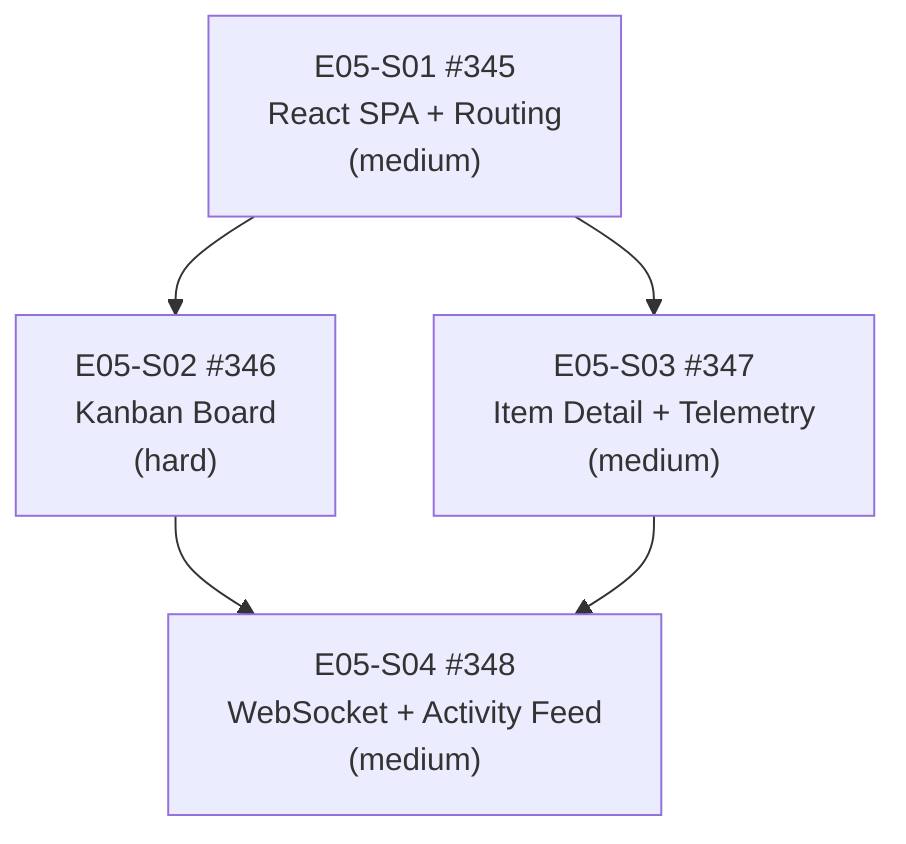

## Summary

React SPA served by the Bun server, providing visual workflow monitoring with Kanban board, item detail, telemetry summary, WebSocket real-time updates, and activity feed.

**Blocked by:** none

## Stories

- [ ] E05-S01: React SPA Scaffolding and Static Serving (medium)
- [ ] E05-S02: Kanban Board (hard)
- [ ] E05-S03: Item Detail and Telemetry Summary (medium)
- [ ] E05-S04: WebSocket Integration and Activity Feed (medium)

## Epic Dependency Graph

E05-S02 and E05-S03 can run in parallel after E05-S01. E05-S04 depends on both.
