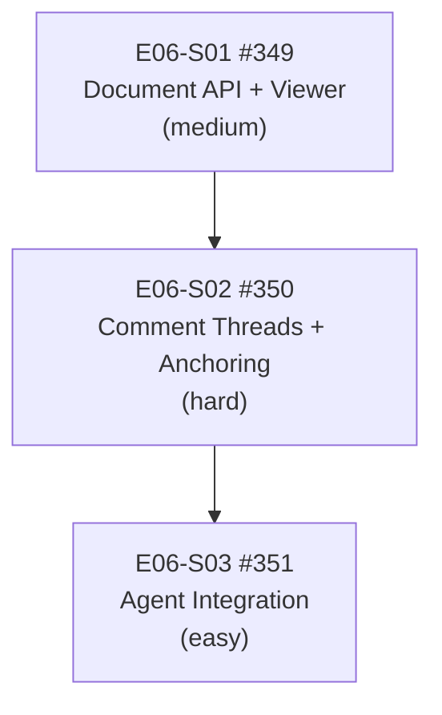

## Summary

Extends the dashboard with markdown document preview and inline comment threads for design doc review. Includes paragraph anchoring, Mermaid rendering, and MCP tool integration for agents.

**Blocked by:** none

## Stories

- [ ] E06-S01: Document API Routes and Markdown Viewer (medium)
- [ ] E06-S02: Comment Threads and Paragraph Anchoring (hard)
- [ ] E06-S03: Document Comment Agent Integration (easy)

## Epic Dependency Graph

All stories in this epic are strictly sequential.
