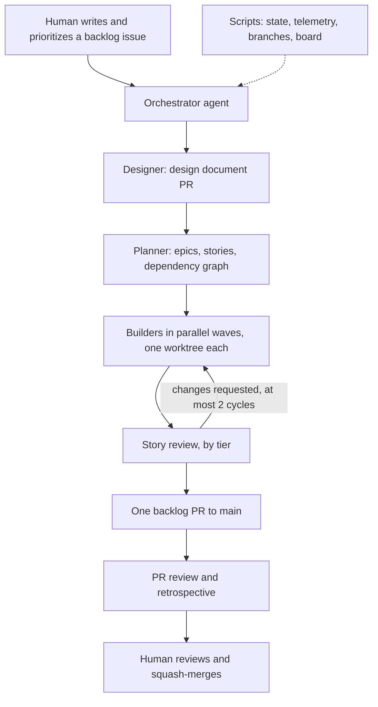

# Agentic SDLC Workflow

A human-governed agentic SDLC for Claude Code: an orchestrator agent carries one backlog item through design, planning, dependency-ordered parallel builds, review and a retrospective, and opens one pull request that a human reviews and merges.

**Status:** Experimental. A March 2026 implementation of a human-governed agentic SDLC, repaired in November 2026 for a safe first run. The method is maintained in [agentic-toolkit](https://github.com/carlosboeing/agentic-toolkit) and [crossrev](https://github.com/carlosboeing/crossrev).

## What it is

This repository engineers the development system around coding agents, not the agents themselves. Specialized agents do the design, code and review work; tested scripts own state, telemetry, branch and board operations; a human owns every merge to `main` and every other step that cannot be undone. In short: scripts compute, models judge, humans own the irreversible gates.

The approach comes from applying the controls of large engineering organisations (design review, decomposition, isolation, separation of duties in review, CI, telemetry, blameless retrospectives) to coding agents, then running the result and measuring it.

## In two minutes

- **What ran.** In March 2026 the workflow carried 21 backlog items in this repository from issue to merged pull request: 10 synthetic content runs that exercise orchestration paths, and 11 items that changed the workflow's own scripts and runtime service. The full record stays with the repository: 296 issues, 68 pull requests, 51 lesson files and 26 retrospectives.
- **Handoffs are artifacts, not chat history.** Backlog issue, design document, plan with epic and story issues and a dependency graph, one branch per story, one pull request per backlog item. Each step reads the previous step's files.
- **Control model.** Code computes wall-clock, critical path, cost, run state and board reconciliation. Models write designs, code and review verdicts. Pre-declared halts (merge conflict, third fix cycle, open dependency, repeated dispatch failure) hand control back to a human.
- **Execution model.** Independent stories run in parallel waves, one git worktree per agent, branched from one recorded commit. Review depth is tiered by difficulty, fix cycles stop at two, and difficulty labels route builders to models.
- **A decision the evidence reversed.** Cheaper reviewers for easy stories were expected to save 15 to 20 percent. Telemetry showed twice the tokens and time for the same outcome on that workload, so the routing was removed ([case study 1](docs/case-studies.md#1-a-cost-saving-hypothesis-that-telemetry-disproved)).
- **A failure the pipeline missed.** A retrospective commit silently reverted about 1,000 lines of reviewed code, and with no CI it reached `main`. It was found in November 2026, fixed, and closed with CI, a retro scope guard and a post-retro test run ([case study 2](docs/case-studies.md#2-a-retrospective-commit-that-reverted-reviewed-code)).
- **Not yet proven.** No run on real tasks outside the workflow itself, small samples, no external users, and control flow that is prompt-driven rather than tested code. See [Limitations](#limitations).

## How it works



| Role | Does | Must not |
|---|---|---|
| Orchestrator | Runs Phases 0 to 6, dispatches subagents, manages GitHub state, posts telemetry | Write code, designs, plans or reviews; merge the backlog PR |
| Designer | Compares two or three approaches, checks platform facts against current docs, writes the design | Plan or implement |
| Planner | Splits the design into epics and stories with difficulty labels, dependencies and an ADR when needed | Implement |
| Builder | Implements one story test-first on its own branch and worktree | Merge its own story |
| Reviewer | Reads the diff, criteria and design, runs the tests, returns severity-ranked findings and a verdict | Edit files |
| Retro | Turns lessons, telemetry and findings into a retrospective and proposed convention changes | Change code (checked by a guard since November 2026) |

Agent definitions live in [`.claude/agents/`](.claude/agents/). The full design is in [docs/architecture.md](docs/architecture.md).

## Who decides what

| Decision | Humans | Deterministic code | Models |
|---|---|---|---|
| What to build | Write and prioritize the backlog issue | Parse `Blocked by` and halt on an open dependency | |
| Design and plan | Approve by merging the PR (interactive mode) | | Write them; in autonomous mode the orchestrator merges them into the integration branch, which is agent approval, not human approval |
| Build order and isolation | | One git worktree per dispatch; the base commit recorded in the state file | The planner draws the dependency graph; the orchestrator groups waves, creates branches and sequences phases by following its prompt |
| Story quality | | Tests the builder and reviewer run | Review verdict and findings, bounded fix cycles |
| Run accounting | | Wall-clock, critical path, tokens and estimated cost from the state file | |
| Stop the line | Resolve conflicts, exhausted fix cycles and repeated failures | Retro scope guard and the CI `required` gate | Recognize a pre-declared halt condition |
| Merge to `main` | Review and squash-merge every backlog PR | | Never |
| Change the method | Adopt or decline each retrospective proposal by merging it | | Propose changes with evidence |

The halts are written into the orchestrator prompt, so a model has to recognize them. Moving them into tested code is item A09 on the [real-task backlog](docs/3-plans/2026-11-20-real-task-backlog-plan.md).

## Evidence

Every number below is scoped to the runs it came from. The [case studies](docs/case-studies.md) give the full failure, diagnosis, change and outcome for each.

### 1. A cost-saving hypothesis that telemetry disproved

- **Hypothesis (backlog item 105).** Routing easy-story reviews from Opus to the cheaper Sonnet would cut review cost by 15 to 20 percent.
- **Measurement.** On easy synthetic stories, 4 Sonnet reviews in one run averaged 57K tokens and 2m 20s; 15 Opus reviews across six earlier runs averaged 28K tokens and 1m 10s. Neither set triggered a fix cycle ([analysis, section 4](docs/1-discovery/2026-03-19-workflow-optimization-analysis.md)).
- **Decision.** Routing removed in commit `d6e8799`, leaving one reviewer agent. The cost goal was later pursued by skipping per-story review for easy stories (backlog item 243), with the PR-level review kept.
- **Scope.** Small samples from different runs, prose workloads, the March 2026 Opus and Sonnet models at March prices. On infrastructure stories (about 18 Sonnet and 25 Opus reviews) Sonnet used fewer tokens, so the result does not generalize. Zero fix cycles measures neither missed defects nor review quality.

### 2. A retrospective commit that reverted reviewed code

- **Failure.** In backlog item 116 the retrospective ran in parallel with the PR review. Its commit `4d3ab9b`, labelled `docs(retro)`, landed 55 seconds after a review fix (`4634d58`) and reverted it, together with about 1,000 lines across 37 files: a document API schema and route, frontend fixes, a script fallback, part of a startup-wiring test and the CHANGELOG entry. The PR reviewer had read an earlier snapshot, the repository had no CI, and the squash merge carried the revert to `main`.
- **How it was found.** In November 2026, running the server suite from a clean export showed 623 of 635 tests passing, 12 failing and 2 files unable to load. Diffing each suspect commit against its parent pointed at `4d3ab9b`.
- **Fix and controls.** Restored in `72f7476` (server 681 of 681 passing). CI with a single `required` gate (`ab3d57e`). A retro scope guard, `scripts/check-retro-scope.sh`, that fails any `docs(retro)` or `docs(conventions)` commit touching code, run in CI and in the orchestrator after the retro, followed by a full test run before the PR proceeds (`b5a4212`).
- **What remains.** The guard keys on the commit subject. A check that a retro commit's parent is the current branch head is planned, not built.

### More case studies

3. [Parallel builders collided, then isolation tightened in four steps](docs/case-studies.md#3-parallel-builders-collided-then-isolation-tightened-in-four-steps)
4. [Board status drift traced to a GitHub automation](docs/case-studies.md#4-board-status-drift-traced-to-a-github-automation)
5. [A wall-clock bug that produced the determinism-first rule](docs/case-studies.md#5-a-wall-clock-bug-that-produced-the-determinism-first-rule)
6. [A design invalidated by a platform limit](docs/case-studies.md#6-a-design-invalidated-by-a-platform-limit)
7. [A 67 percent fix-cycle rate from an untested startup path](docs/case-studies.md#7-a-67-percent-fix-cycle-rate-from-an-untested-startup-path)

A traced example from issue to merge: backlog [issue #364](https://github.com/carlosboeing/agentic-sdlc-workflow/issues/364), its [design](docs/2-design/2026-03-23-github-sqlite-sync.md) and [plan](docs/3-plans/2026-03-23-github-sqlite-sync-plan.md), 5 stories with one fix cycle, [pull request #376](https://github.com/carlosboeing/agentic-sdlc-workflow/pull/376), its [retrospective](docs/4-reviews/lessons/364-github-sqlite-sync/2026-03-23-e01-e02-github-sqlite-sync-retro.md), squash commit `d6e6330`.

## How it maps to current practice

Most practices here are classical engineering applied to agents. The [methodology mapping](docs/methodology.md) traces each one.

| Practice in this repository | Classical lineage | November 2026 term |
|---|---|---|
| Scripts compute, models judge | Separation of mechanism from policy | Harness engineering: computational and inferential sensors |
| Design doc, plan, tasks before code | Design docs, ADRs, work breakdown | Spec-driven development |
| Orchestrator with role subagents | Chief programmer team | Orchestrator-workers |
| Dependency waves in worktrees | Critical-path scheduling, isolated workspaces | Wave execution, worktree isolation |
| Severity-ranked review with bounded fix loops | Fagan inspection, separation of duties | Evaluator-optimizer loop |
| Human merge authority and halt conditions | Four-eyes principle, stop the line | Risk-tiered human oversight, human-on-the-loop |
| Retrospectives with an adoption tracker | Kaizen, blameless postmortems | Feedback flywheel |

**Is this an "AI software factory"?** In the process sense, yes: sequenced stations, specialized roles, isolated work cells, inspection gates, a stop-the-line rule and line telemetry. In the 2026 autonomy sense, no: a "dark factory" removes human code review, and here a human reviews and merges every backlog PR. The honest label is a factory-style pipeline with human merge authority.

## November 2026 revision

Eight months later, most of the hand-built mechanics ship as platform features. The [architecture](docs/architecture.md#november-2026-revision) records the full assessment, based on the [state-of-practice research](docs/1-discovery/2026-11-20-state-of-practice-research.md).

| Holds | Now a platform feature | Changes |
|---|---|---|
| Durable lifecycle records as handoffs | Worktree-isolated subagents and automatic sweeps | Control flow moves from a 662-line prompt to a tested script |
| The determinism-first boundary | Wave execution of dependent tasks | Gates follow risk and reversibility, not one "autonomous" keyword |
| Human merge authority and pre-declared halts | Per-call model and effort selection | Role boundaries enforced by tool permissions, not instructions |
| Bounded fix loops and review tiers | Native OpenTelemetry cost and token metrics | A short instruction file plus path-scoped rules |
| Retrospectives with recorded adoption | Built-in multi-agent code review | Raw run records kept so analyses can be recomputed |

The March implementation receives the fixes a safe first run needs. New work goes through the [real-task evaluation](docs/ROADMAP.md) first.

## Try it safely

The first run is offline. It needs `python3` and touches no network, no Claude session and no GitHub state:

```bash
python3 scripts/lib/compute-dispatches.py --from-state tests/fixtures/telemetry/state.json --gantt
```

It prints JSON holding the telemetry tables and a Mermaid Gantt timeline for a three-dispatch fixture. Cost shows as a dash because no pricing data is cached. Then run the three offline test suites, the same ones CI runs:

```bash
cd server && bun install --frozen-lockfile && bun test && cd ..   # 681 tests
python3 -m pytest scripts/lib/test_compute_dispatches.py -q          # 252 tests
./scripts/run-offline-tests.sh                                     # 34 shell suites
```

A real run creates issues, branches and pull requests with your `gh` credentials and spends model tokens. Before trying one, read the [running-safely guide](docs/5-guides/running-safely-guide.md): it covers a supervised interactive run, the `dontAsk` allowlist for unattended runs, what mutates GitHub and how to clean up. Unattended runs belong in a disposable clone inside a container.

## Repository map

| Path | Contents |
|---|---|
| [`.claude/agents/`](.claude/agents/) | Orchestrator, designer, planner, builder and its model variants, reviewer, retro |
| [`CLAUDE.md`](CLAUDE.md) | The operating brief the agents load: conventions, branch rules, telemetry rules |
| [`scripts/`](scripts/) | Work-item wrappers, state file, PM abstraction and adapters, telemetry, board reconciliation, guards |
| [`server/`](server/) | Experimental optional runtime service: Bun, SQLite, HTTP API, MCP tools, dashboard |
| [`tests/`](tests/) | Shell tests and fixtures for the deterministic layer |
| [`docs/`](docs/) | Lifecycle records: discovery, designs, plans, reviews and lessons, guides, ADRs |
| [`docs/case-studies.md`](docs/case-studies.md) | Failure-driven case studies with evidence links |
| [`blueprint/`](blueprint/) | The reference design written before the implementation, historical and unexecuted |

## Related projects

- [agentic-toolkit](https://github.com/carlosboeing/agentic-toolkit): the maintained lifecycle conventions, phase skills and hooks that carry this method forward across harnesses.
- [crossrev](https://github.com/carlosboeing/crossrev): a cross-model pull request review loop, where one model reviews and another resolves.
- [penmark](https://github.com/carlosboeing/penmark): Markdown review with comments stored in the file, for reviewing agent-written documents.
- [quotacap](https://github.com/carlosboeing/quotacap): tracks subscription usage windows across AI providers and advises which plan to use next.
- [copydesk](https://github.com/carlosboeing/copydesk): a cross-harness prose gate that applies writing rules before generation, at write time and at commit.
- [chat-harness](https://github.com/carlosboeing/chat-harness): the same harness discipline applied to chat assistants used for work other than coding.

## Limitations

- **Synthetic workloads behind the early metrics.** 10 of the 21 executed backlog items were controlled prose workloads judged by an LLM reviewer against structural criteria. They test orchestration, not code quality. Their outputs were removed from the tree and remain in Git history.
- **Small samples.** Most comparisons rest on 4 to 25 observations from runs that also changed the harness. Fix-cycle rates averaged 7.8 percent across 9 synthetic runs and 28.6 percent across 5 infrastructure runs, and reached 67 percent (12 of 18 stories) on the largest build.
- **No real-task evaluation and no external users.** The [real-task backlog](docs/3-plans/2026-11-20-real-task-backlog-plan.md) defines one; it has not run.
- **Prompt-driven control flow.** Phase order, wave dispatch and halts depend on the orchestrator following a long prompt. Most role boundaries are instructions; the exceptions are the retro scope guard and the reviewer, which has no edit tools.
- **Estimated cost.** Cost is tokens times a blended rate, reported as estimated API-equivalent value. Prompt caching and orchestrator tokens are not counted.
- **Raw run state was deleted after each merge.** The March analyses can be checked against issue and PR telemetry comments, but not recomputed from source data.
- **Experimental runtime service.** It must be started by hand, and the scripts fall back to local files when it is down.

## License

[MIT](LICENSE).
