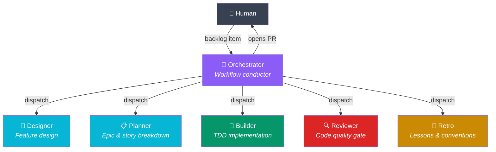
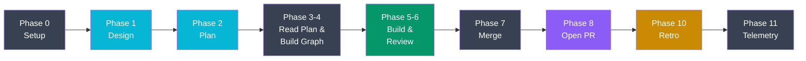
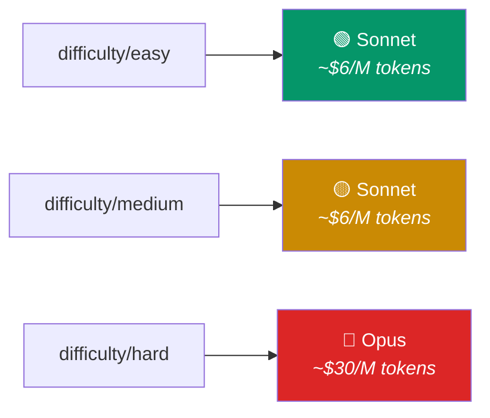
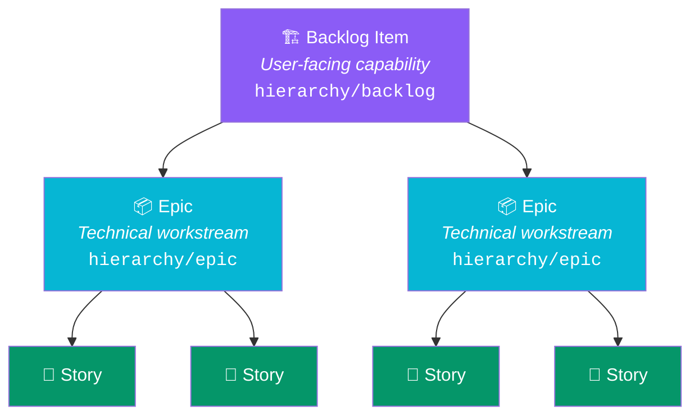

# Agentic SDLC Workflow

> A fully autonomous software development lifecycle powered by AI agents — from design to deployed PR, with zero human intervention.

This project implements an **agentic software development lifecycle (SDLC)** where specialized AI agents collaborate to deliver features end-to-end. An orchestrator dispatches designer, planner, builder, reviewer, and retro agents — each with a defined role, running as [Claude Code](https://claude.ai/code) subagents. The entire workflow runs autonomously: a single command produces a reviewed, tested, merge-ready pull request.

```bash
claude --agent orchestrator --dangerously-skip-permissions \
  "autonomous — Execute backlog item #42."
```

That's it. One command. The orchestrator reads the backlog item, designs the feature, creates an implementation plan, builds every story, reviews the code, writes a retrospective, and opens a PR — all without human input.

---

## How It Works

### The Agent Team

Six specialized agents collaborate through the orchestrator, each with a focused responsibility:



| Agent | What it does | Inputs | Outputs |
|-------|-------------|--------|---------|
| **Orchestrator** | Conducts the entire workflow. Dispatches agents, manages GitHub state, tracks telemetry, opens the final PR. Never writes code. | Backlog issue number | Reviewed PR ready for human merge |
| **Designer** | Explores approaches, evaluates trade-offs, writes a design document. In interactive mode, asks the human clarifying questions. | Backlog issue | Design doc + PR |
| **Planner** | Decomposes the design into epics and stories with difficulty labels. Creates GitHub Issues, dependency graphs, and the implementation plan. | Design doc | Plan doc + GitHub Issues + PR |
| **Builder** | Implements a single story via TDD. Creates the branch, writes code, runs tests, commits. Model variants (sonnet/opus) routed by difficulty. | Story issue + branch | Working code on story branch |
| **Reviewer** | Reviews every story and the final PR. Posts structured findings with severity levels. Can trigger fix cycles (re-dispatch builder → re-review). | Story branch or PR | Review verdict (APPROVE / REQUEST_CHANGES) |
| **Retro** | Synthesizes lessons from the run, proposes convention changes, updates the changelog. | Completed epic | Retro doc + convention PRs |

### The Workflow Phases

The orchestrator executes these phases in order. Each phase has verification gates before proceeding to the next.



**Phase 0 — Setup:** Create an integration branch from `main`, add the backlog issue to the project board, initialize the orchestrator state file.

**Phase 1 — Design:** Dispatch the designer agent. It explores approaches, documents trade-offs, and writes a design doc. The design PR is auto-merged into the integration branch.

**Phase 2 — Plan:** Dispatch the planner agent. It reads the design, decomposes the feature into epics and stories, assigns difficulty labels, creates GitHub Issues with a dependency graph, and opens a plan PR. Auto-merged into the integration branch.

**Phases 3-4 — Read Plan & Build Graph:** Parse the plan's dependency graph to determine which stories can run in parallel. Create epic and story branches.

**Phases 5-6 — Build & Review:** For each wave of stories:
1. Set board status to In Progress
2. Dispatch builders (parallel for independent stories, sequential for dependent ones)
3. Post telemetry on each story issue
4. Dispatch a reviewer for every story (mandatory — no story merges without review)
5. If the reviewer requests changes → re-dispatch builder → re-review (max 2 cycles)

**Phase 7 — Merge:** Merge story branches into epic branches, then epic branches into the integration branch. Clean up merged branches.

**Phase 8 — Open PR:** Open ONE pull request from the integration branch to `main`. The PR includes everything — design docs, plans, code, retro, changelog. The PR body lists `Closes #N` for every issue so merging auto-closes them all. **The orchestrator never auto-merges this PR** — it stays open for human review.

**Phase 10 — Retro:** Dispatch the retro agent to synthesize lessons, propose convention changes, and update the changelog.

**Phase 11 — Telemetry:** Post a full lifecycle telemetry summary on the backlog issue and PR, covering every agent dispatch across all phases.

### Model Routing

Builders are routed to different Claude models based on story difficulty:



| Difficulty | Model | Use case |
|-----------|-------|----------|
| `difficulty/easy` | Sonnet | Single-file, config, docs, simple tests |
| `difficulty/medium` | Sonnet | Multi-file, standard patterns, migrations |
| `difficulty/hard` | Opus | Cross-project, new abstractions, security |

Routing is configurable via `.claude/agentic-sdlc-config.json`. Sonnet replaced Haiku as the default for easy stories based on telemetry showing Haiku uses 3-4x more tokens for comparable output at similar cost.

The planner assigns difficulty labels when creating story issues. The orchestrator reads the label and dispatches the matching builder variant. Non-builder agents (designer, planner, reviewer, retro) inherit the orchestrator's model.

### Parallel Dispatch

Independent stories run in parallel using git worktree isolation:

```mermaid
gantt
    title Example: Run 9 — CIA Cat Reports (5 stories, 3 waves)
    dateFormat HH:mm:ss
    axisFormat %M:%S
    tickInterval 5minute
    Designer (3m32s)             :active, design, 00:00:00, 212s
    Planner (4m56s)              :active, plan, after design, 296s
    E01-S01 Kitchen Counter (2m30s) :active, w1s1, after plan, 150s
    E01-S02 Red Dot (2m09s)      :active, w1s2, after plan, 129s
    E01-S03 Midnight Zoomies (4m45s) :active, w1s3, after plan, 285s
    Review E01-S01 (0m36s)       :crit, r1, after w1s3, 36s
    Review E01-S02 (0m40s)       :crit, r2, after w1s3, 40s
    Review E01-S03 (1m14s)       :crit, r3, after w1s3, 74s
    E02-S01 Asset Profile (1m21s) :active, w2, after r3, 81s
    Review E02-S01 (0m41s)       :crit, r4, after w2, 41s
    E02-S02 Feline Threat (2m00s) :active, w3, after r4, 120s
    Review E02-S02 (1m08s)       :crit, r5, after w3, 68s
    Retro Agent (3m43s)          :active, retro, after r5, 223s
    PR Review (2m18s)            :crit, prr, after retro, 138s
```



Wave 1 runs three builders simultaneously, each in its own git worktree. The orchestrator waits for all three to complete before reviewing and merging. Dependent stories (Wave 2 and 3) run sequentially.

---

## Work Item Hierarchy

All work is organized into exactly three levels:



| Level | Name | What it represents | Who creates it |
|-------|------|--------------------|----------------|
| **1** | **Backlog Item** | A user-facing feature. One orchestrator run. One PR to `main`. | Human |
| **2** | **Epic** | A technical workstream within a backlog item. Groups related stories. | Planner |
| **3** | **Story** | The smallest unit of work. One builder, one branch. | Planner |

### Branch Strategy

Everything flows through a single integration branch per backlog item:

```
main
└── backlog/42-my-feature              ← integration branch (ONE PR to main)
    ├── docs/design-doc                ← designer's PR (merged into integration)
    ├── docs/plan                      ← planner's PR (merged into integration)
    ├── epic/e01-first-workstream      ← epic branch
    │   ├── e01-s01/story-one          ← story branch (merged into epic)
    │   └── e01-s02/story-two          ← story branch (merged into epic)
    └── epic/e02-second-workstream     ← epic branch
        └── e02-s01/another-story      ← story branch (merged into epic)
```

Stories merge into epics. Epics merge into the integration branch. The integration branch becomes one squash-merged PR to `main`. Branches are deleted after merging.

### Board Tracking

Every issue moves through a Kanban-style workflow on the [GitHub Project board](https://github.com/users/carlosboeing/projects/7):

```
Backlog → Ready → In Progress → In Review → Done
```

The orchestrator manages all transitions automatically, including keeping epic status in sync with its stories (e.g., if all stories are In Review, the epic moves to In Review).

---

## Telemetry

The orchestrator tracks token usage, duration, and estimated cost for every agent dispatch. Telemetry is posted at three levels:

### Per-Story (on each story issue)

```
Model: haiku | Duration: 2m 30s | Tokens: 114K
Speed: 760 tokens/s | Est. Cost: ~$0.23
Commit: 40a3ceb
```

### Per-Epic (on each epic issue)

| Agent | Task | Duration | Tokens | Est. Cost |
|-------|------|----------|--------|-----------|
| Builder (haiku) | E01-S01 Kitchen Counter | 2m 30s | 114K | ~$0.23 |
| Builder (haiku) | E01-S02 Red Dot | 2m 09s | 109K | ~$0.22 |
| Builder (sonnet) | E01-S03 Midnight Zoomies | 4m 45s | 38K | ~$0.23 |
| | **Total (3 dispatches)** | **~9m** | **260K** | **~$0.68** |

### Full Lifecycle (on backlog issue + PR description)

The complete summary covers all phases — design, plan, build, review, and retro:

| Phase | Agent | Duration | Tokens | Est. Cost |
|-------|-------|----------|--------|-----------|
| Design | designer (opus) | 3m 32s | 38K | ~$0.38 |
| Plan | planner (opus) | 4m 56s | 64K | ~$0.64 |
| Build | builders (5 stories) | 12m 44s | 320K | ~$1.16 |
| Review | reviewers (6 dispatches) | 6m 37s | 161K | ~$1.61 |
| Retro | retro (opus) | 3m 43s | 66K | ~$0.66 |
| **Total** | | **31m 31s** | **649K** | **~$4.44** |

The Gantt timeline is generated automatically, showing parallel dispatch visually:

```
Designer ████████                                          3m 32s
Planner         ██████████                                 4m 56s
E01-S01 (haiku)           █████                            2m 30s  ┐
E01-S02 (haiku)           ████                             2m 09s  ├ Wave 1 (parallel)
E01-S03 (sonnet)          █████████                        4m 45s  ┘
Reviews                            ██                      1m 14s
E02-S01 (sonnet)                     ███                   1m 21s  Wave 2
Review                                  █                  0m 41s
E02-S02 (opus)                            ████             2m 00s  Wave 3
Review                                        ██           1m 08s
Retro                                           ████████   3m 43s
PR Review                                               ████ 2m 18s
```

---

## Running the Workflow

### Prerequisites

- [Claude Code CLI](https://claude.ai/code) installed and authenticated
- `gh` CLI authenticated with repo access
- Repository cloned locally

### Full Autonomous Run

```bash
# Run the complete lifecycle — design, plan, build, review, retro
claude --agent orchestrator --dangerously-skip-permissions \
  "autonomous — Execute backlog item #42."
```

### Skip Phases

```bash
# Skip design and plan (if they already exist)
claude --agent orchestrator --dangerously-skip-permissions \
  "autonomous — Execute backlog item #42. Skip design and plan."
```

### Interactive Mode

```bash
# Designer and planner ask clarifying questions
# Human approves design/plan PRs before proceeding
claude --agent orchestrator \
  "Execute backlog item #42."
```

### Individual Agent Dispatch

```bash
# Design only
claude --agent designer "Design a feature for backlog item #42."

# Plan only
claude --agent planner "Create an implementation plan for backlog item #42."

# Build a specific story
claude --agent builder "Implement story #55."

# Review a story branch
claude --agent reviewer "Review story #55 on branch e01-s01/my-story."
```

---

## Safety & Quality Gates

The workflow enforces several safety mechanisms:

- **Mandatory review** — Every story and the final PR must pass review before merging. No exceptions.
- **Fix cycles** — If a reviewer requests changes, the builder is re-dispatched to fix. Up to 2 cycles before escalating to human intervention.
- **Branch isolation** — Parallel builders run in separate git worktrees to prevent cross-contamination.
- **No auto-merge to main** — The backlog PR is always left open for human review. The orchestrator never merges to `main`.
- **Idempotent restart** — The orchestrator can be re-run safely on partially completed work. It detects completed stories and resumes from where it left off.

---

## Project Structure

```
.claude/
  agents/                  ← Agent definitions (9 files: orchestrator, designer,
                             planner, builder + 3 variants, reviewer, retro)
  hooks/                   ← Claude Code hooks (logging)
  agentic-sdlc-config.json ← Workflow configuration (model routing, board IDs, pricing)
  settings.json            ← Permissions and hook registration

.agentic-workflow/         ← Runtime data (gitignored)
  pricing.json             ← Cached API pricing (fetched live each run)
  runs/<backlog>/          ← Per-run orchestrator state
  logs/                    ← Diagnostic logs (board status, drift detection)

scripts/
  issue-set-status.sh     ← Board status transitions
  issue-start.sh          ← Mark story as started
  issue-review.sh         ← Mark story as ready for review
  issue-telemetry.sh      ← Post telemetry to issues/PRs
  issue-close.sh          ← Close issue and set board to Done
  issue-create-backlog.sh ← Create backlog item with board setup
  fetch-pricing.sh        ← Fetch current Anthropic API pricing
  cleanup-post-merge.sh   ← Post-merge branch and state cleanup
  check-board-drift.sh    ← Detect board status persistence drift
  dispatch-story.sh       ← CLI dispatch for standalone use
  dispatch-workflow.sh    ← CLI full lifecycle dispatch
  lib/config.sh           ← Shared config reader
  templates/telemetry.md  ← Telemetry comment template

docs/
  1-discovery/     ← Research, analysis, and roadmap
  2-design/        ← Feature design documents
  3-plans/         ← Implementation plans
  4-reviews/       ← Retros, reviews, and lessons
  5-guides/        ← Architecture and technical guides
  6-adrs/          ← Architecture decision records
  CHANGELOG.md     ← Build history
```

---

## Self-Improving System

The workflow improves itself over each run:

1. **Lessons** — Agents write lesson files when they encounter bugs, unexpected behaviour, or missing conventions. These are scoped by epic and tagged for discovery.

2. **Retro** — After each run, the retro agent synthesizes lessons into a retrospective document and proposes convention changes to `CLAUDE.md` and agent files.

3. **Convention propagation** — Changes are committed on the integration branch and reviewed as part of the backlog PR. Approved changes become part of the codebase for future runs.

For example, Run 9 discovered a cross-contamination bug in parallel dispatch and automatically added a new convention: *"Before dispatching a parallel wave, create all story branches from the same epic branch commit."* This rule now prevents the same issue in future runs.

---

## Test Runs

14 test runs have validated the workflow across progressively complex scenarios. Runs 1-7 were in the original NeuralNorris repo; Runs 8-14 are in this repo.

| Run | Backlog | Theme | Primary Test | Stories | Cost |
|-----|---------|-------|-------------|---------|------|
| 14 | [#83](https://github.com/carlosboeing/agentic-sdlc-workflow/issues/83) | Interdimensional Health Inspections | Fix cycle validation, cross-epic merge | 12 | ~$11.34 |
| 13 | [#69](https://github.com/carlosboeing/agentic-sdlc-workflow/issues/69) | Alien Tourist Bureau | Runtime data, live pricing, dispatches-from-state | 6 | ~$4.83 |
| 12 | [#56](https://github.com/carlosboeing/agentic-sdlc-workflow/issues/56) | Time Traveler's Yelp Reviews | Configurable settings, model routing | 5 | ~$2.59 |
| 11 | [#41](https://github.com/carlosboeing/agentic-sdlc-workflow/issues/41) | Board Drift Detection + Fairy Tale HR | Board drift detection, 3-way parallel | 6 | ~$6.57 |
| 10 | [#27](https://github.com/carlosboeing/agentic-sdlc-workflow/issues/27) | Orchestrator Logging + Nature Doc S2 | Orchestrator logging infrastructure | 6 | ~$5.50 |
| 9 | [#14](https://github.com/carlosboeing/agentic-sdlc-workflow/issues/14) | CIA Cat Field Reports | Full autonomous lifecycle | 5 | ~$4.44 |
| 8 | [#1](https://github.com/carlosboeing/agentic-sdlc-workflow/issues/1) | Office Nature Documentary | Worktree isolation | 5 | ~$3.50 |

---

## License

This project is a research exploration of agentic software development workflows. See the repository for details.
