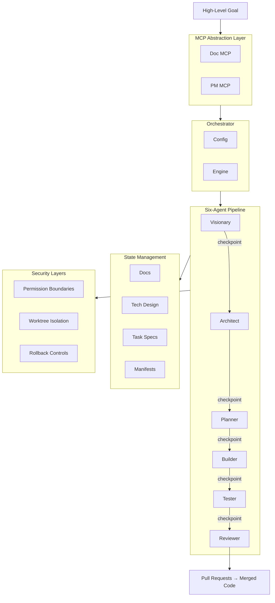

# Agentic SDLC Blueprint

**End-to-end agentic software development lifecycle — from product vision to merged PR.**

---

## Overview

Modern AI coding assistants have demonstrated remarkable capability at the individual task level — generating functions, writing tests, reviewing diffs. However, software development is not a single task; it is a pipeline. Requirements must be gathered, architecture defined, work decomposed, code written, tests executed, and reviews completed before anything ships. Without a structured approach, teams applying AI assistants to this pipeline encounter fragmented context, inconsistent quality, and manual handoff overhead that erodes most of the productivity gain.

This blueprint defines a complete agentic software development lifecycle (SDLC) that automates the full pipeline using Claude Code. It specifies a six-agent pipeline with clean role separation — Visionary, Architect, Planner, Builder, Tester, Reviewer — each with defined inputs, outputs, permissions, and context boundaries. The orchestration engine coordinates these agents through a DAG-aware execution model with parallel task dispatch, structured checkpoints, retry logic, and escalation paths. MCP (Model Context Protocol) integrations provide a unified abstraction over documentation and project management backends, while a defense-in-depth security model enforces least-privilege access, worktree isolation, and rollback capabilities at every layer.

The core design is deliberately backend-agnostic. The eight design documents in this repository define the architecture, agent contracts, orchestration algorithms, context strategy, integration interfaces, security model, state management, and scaling considerations independent of any specific toolstack. Pluggable implementation guides then map these abstractions onto concrete backends — GitHub Issues, Notion, Linear, Jira, and others — so teams can adopt the blueprint with the tools they already use.

## System Architecture

## Document Map

| # | Document | Description | Audience |
|---|----------|-------------|----------|
| 01 | [Architecture Overview](docs/01-architecture-overview.md) | System context, components, data flow, design principles, entry points | All |
| 02 | [Agent Pipeline](docs/02-agent-pipeline.md) | Per-agent specs: role, I/O, permissions, model, context, prompt design | Engineers, Tech Leads |
| 03 | [Orchestration Engine](docs/03-orchestration-engine.md) | DAG algorithm, retry/escalation, Bash to SDK to Actions tiers, manifests | Engineers |
| 04 | [Context Strategy](docs/04-context-strategy.md) | Token budgets, 3-tier loading, per-agent context tables, RAG migration | Engineers, Architects |
| 05 | [Integration Layer](docs/05-integration-layer.md) | MCP abstraction, unified tool interface, backend matrix, configs | Engineers, DevOps |
| 06 | [Security Model](docs/06-security-model.md) | 5-layer defense, per-layer spec, worktree isolation, rollback | All |
| 07 | [State Management](docs/07-state-management.md) | Task spec format, traceability, status files, run manifests, audit trail | Engineers |
| 08 | [Monitoring & Scaling](docs/08-monitoring-scaling.md) | Telemetry, cost tracking, expectations, solo to team scaling | Tech Leads, Managers |

## Quick Start

1. Start with the [Architecture Overview](docs/01-architecture-overview.md) for the big picture — system context, component responsibilities, and data flow across the pipeline.
2. Choose an [implementation guide](docs/implementations/) that matches your toolstack (e.g., GitHub-native, Notion + Linear, Confluence + Jira).
3. Copy `reference/` into your project and customize `CLAUDE.md` and `.mcp.json` to match your repository structure and backend configuration.

## Implementation Guides

| Implementation | Doc Backend | PM Backend | Status |
|---|---|---|---|
| [GitHub Native](docs/implementations/github-native/) | Repository MD files | GitHub Issues + Projects | Available |
| Notion + Linear | Notion pages | Linear issues | Planned |
| Confluence + Jira | Confluence pages | Jira issues | Planned |

## Reference Implementation

The `reference/` directory contains a working reference implementation including agent definitions, prompt templates, orchestration scripts, and configuration files. It is designed to be forked or copied directly into a target project and then customized. The reference provides concrete, runnable examples of every abstraction defined in the design documents — from agent role contracts and context-loading logic to checkpoint validation and state-file schemas.

## Reading Order by Audience

- **Engineers**: 01 → 02 → 03 → 07 → Implementation Guide
- **Tech Leads**: 01 → 02 → 04 → 08 → Implementation Guide
- **Managers / Stakeholders**: 01 → 06 → 08

## License

MIT
