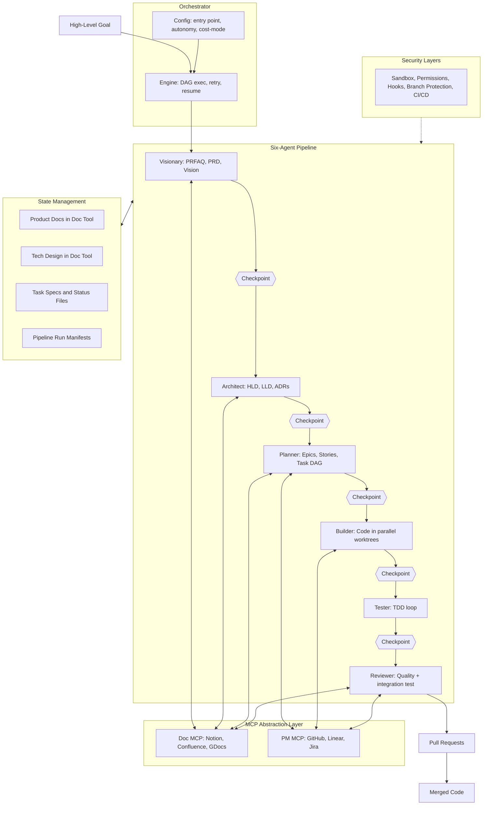
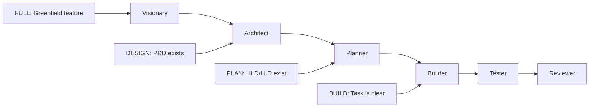

# Architecture Overview

> Historical reference design (March 2026), written before the implementation. Tool names, flags and prices reflect that date. For the system as built, see [the implementation architecture](../docs/architecture.md).

This document defines the high-level architecture of the Agentic SDLC Blueprint, a system that transforms a high-level product goal into a merged pull request through a pipeline of six specialized AI agents. Unlike task-level AI assistants that operate on isolated coding requests, this architecture treats software development as a directed pipeline with discrete stages, structured handoffs, and configurable entry points. The system is written for a solo developer; the team-scaling guidance in [Monitoring and Scaling](08-monitoring-scaling.md) is untested.

## 1. Design Principles

The architecture is governed by seven foundational principles. All component-level decisions trace back to this set.

| # | Principle | Description |
|---|-----------|-------------|
| 1 | Single Responsibility | Each agent owns exactly one cognitive mode and produces exactly one artifact type. No agent combines product thinking with code generation. |
| 2 | Backend-Agnostic Integrations | All document and project management access is mediated through MCP abstraction layers. With unified wrapper servers (not provided), swapping Notion for Confluence or GitHub Issues for Linear is intended to need only configuration changes. |
| 3 | Structured Context over RAG | Agents load only the documents and sections they require, governed by a per-agent context matrix. RAG infrastructure is deferred until corpus size exceeds native search capabilities. |
| 4 | Defense-in-Depth | Five complementary security layers (OS sandbox, tool permissions, hook guards, branch protection, CI/CD gates) reduce the chance and impact of destructive operations. They are not independent and do not guarantee prevention. |
| 5 | DAG-Aware Parallelism | Task execution respects the dependency graph produced by the Planner agent. Independent tasks execute in parallel across isolated git worktrees; dependent tasks queue until prerequisites complete. |
| 6 | Retry with Escalation | Failed agent invocations retry with progressively expanded context and, on final attempt, escalate to a higher-capability model before surfacing to a human operator. |
| 7 | Configurable Entry Points | The pipeline supports four entry modes (Full, Design, Plan, Build) and resume-from-stage, enabling operators to skip completed stages or re-enter at any checkpoint. |

## 2. System Architecture

### 2.1 System Context

The following diagram illustrates the end-to-end flow from a high-level goal to merged code, including the orchestrator, agent pipeline, MCP integration layer, state stores, and security boundaries.



### 2.2 Component Diagram

The system comprises five primary subsystems:

**Orchestrator.** Accepts configuration (entry point, autonomy level, cost mode), computes execution waves from the task dependency DAG, manages retry with model escalation, and tracks pipeline state via run manifests. See [Orchestration Engine](03-orchestration-engine.md).

**Agent Pipeline.** Six agents execute sequentially with checkpoint gates between stages. Each agent is defined as a markdown file specifying its name, tools, model, and permission mode. See [Agent Pipeline](02-agent-pipeline.md).

**MCP Integration Layer.** Two logical MCP server groups (Document Management, Project Management) provide a unified tool interface over pluggable backends. See [Integration Layer](05-integration-layer.md).

**State Store.** Product and technical documents persist in the doc tool. Task specifications, status files, and run manifests persist on the local filesystem under `.claude/context/`. See [State Management](07-state-management.md).

**Security Subsystem.** Five layers operate independently: OS sandbox, per-agent tool permissions, PreToolUse hook guards, git branch protection rules, and CI/CD gates. See [Security Model](06-security-model.md).

### 2.3 Data Flow

The pipeline processes a goal through the following stages, with checkpoint gates between each:

1. **Goal Ingestion.** The orchestrator receives a high-level goal string and configuration flags.
2. **Product Definition (Visionary).** The Visionary agent produces PRFAQ, PRD, and Product Vision documents in the doc tool. Outputs a JSON manifest of document IDs and URLs.
3. **Checkpoint 1.** Human reviews product documents: approve, edit and re-run, or abort.
4. **Technical Design (Architect).** The Architect agent reads approved product documents, explores the codebase, and produces HLD, LLD, and ADR documents. Outputs a technical design manifest.
5. **Checkpoint 2.** Human reviews technical design.
6. **Engineering Planning (Planner).** The Planner agent reads all documents, creates epics and stories in the PM tool, writes task specifications with a dependency DAG to the filesystem. Outputs a task manifest with DAG.
7. **Checkpoint 3.** Human reviews the implementation plan.
8. **Implementation (Builder).** The orchestrator computes execution waves from the DAG. Independent tasks execute in parallel, each in an isolated git worktree. Failed tasks retry with model escalation.
9. **Checkpoint 4.** Human reviews implementations.
10. **Testing (Tester).** Tester agents execute in parallel across worktrees, writing tests and iterating until the suite passes.
11. **Checkpoint 5.** Human reviews test results.
12. **Review (Reviewer).** The Reviewer agent checks code against design documents, performs security review, merges branches into a temporary integration branch, and runs the full test suite. Outputs structured review verdicts.
13. **Merge.** Approved pull requests merge to main.

## 3. Configurable Entry Points

Not every task requires all six stages. The orchestrator supports four entry modes and resume-from-stage capability.

| Entry Mode | Starts At | Use Case | Prerequisite |
|------------|-----------|----------|--------------|
| `full` | Visionary | Greenfield feature, no prior documentation | None |
| `design` | Architect | PRD already exists in the doc tool | `--docs <doc-manifest>` |
| `plan` | Planner | HLD/LLD already exist in the doc tool | `--docs <doc-manifest>` |
| `build` | Builder | Task specification is fully defined | `--task <spec-file>` |

**Resume-from-stage** allows re-entering the pipeline at any checkpoint after editing artifacts externally. The orchestrator skips all stages prior to the specified stage and uses existing state.



### CLI Examples

```bash
# Full pipeline for a greenfield feature
./sdlc-pipeline.sh --entry full "Add Stripe billing integration"

# Skip Visionary; PRD already exists
./sdlc-pipeline.sh --entry design --docs "notion-page-abc123"

# Skip Visionary and Architect; HLD/LLD exist
./sdlc-pipeline.sh --entry plan --docs "notion-page-ghi789,notion-page-jkl012"

# Skip to build; task spec is fully defined
./sdlc-pipeline.sh --entry build --task ".claude/context/tasks/fix-timezone-bug.md"

# Resume from a specific stage after editing documents
./sdlc-pipeline.sh --resume-from architect "Add Stripe billing integration"
```

## 4. Integration Points

### MCP Servers

The system integrates with external services exclusively through Model Context Protocol (MCP) servers, organized into two functional groups:

- **Document Management MCP.** Provides `create_page`, `update_page`, `get_page`, and `search` operations. Backends: Notion (`makenotion/notion-mcp-server`), Confluence (`sooperset/mcp-atlassian`), Google Docs (`anthropics/google-drive-mcp`), GitHub repository markdown files (`filesystem` + `github-mcp-server`). See [Integration Layer](05-integration-layer.md).
- **Project Management MCP.** Provides `create_task`, `update_task`, `list_tasks`, and `add_comment` operations. Backends: GitHub Issues, Linear, Jira, Trello, Azure DevOps, Asana. See [Integration Layer](05-integration-layer.md).
- **RAG MCP (optional).** Provides `search(query, top_k)` for semantic retrieval over large document corpora. See [Context Strategy](04-context-strategy.md).

### Git

- **Worktrees.** Each parallel Builder agent operates in an isolated git worktree branched from `main`. Worktrees share the `.git` object store, minimizing disk usage. See [Security Model](06-security-model.md).
- **Branches.** Naming convention: `feat/<task-id>-<short-description>`. All agent work occurs on feature branches; direct commits to `main` are prohibited.
- **Pull Requests.** The Reviewer agent posts structured review comments. AI-generated PRs are labeled `ai-generated`.

### CI/CD

The pipeline integrates with CI/CD at two levels:

- **Per-PR gates.** Automated tests, linting, and SAST execute on every pull request. Human approval is required for merge.
- **GitHub Actions orchestration (Tier 3).** `anthropics/claude-code-action@v1` enables label-triggered pipeline stages with environment-based approval gates.

## 5. Security Considerations

The system implements a defense-in-depth model comprising five complementary security layers. Each layer can block a destructive action, but the layers are not fully independent and the pattern-based hook guard is a tripwire, not a boundary.

| Layer | Mechanism | Scope |
|-------|-----------|-------|
| 1 | OS Sandboxing (bubblewrap, Seatbelt, Docker) | Filesystem and network restriction |
| 2 | Per-Agent Tool Permissions | Least-privilege tool access per agent role |
| 3 | PreToolUse Hook Guards | Destructive command blocking (`rm -rf`, `git push main`, `DROP TABLE`) |
| 4 | Git Branch Protection | Feature branches only, PRs required, `ai-generated` labels |
| 5 | CI/CD Gates | Automated tests, lint, SAST, human approval |

**Trust boundaries.** Agents operate within their declared permission modes (`plan`, `acceptEdits`, `full`). No agent has direct write access to the `main` branch. All code changes flow through pull requests with CI validation and human approval.

For the complete security specification, see [Security Model](06-security-model.md).

## 6. Document Map

### Design Documents

| Document | Type | Description |
|----------|------|-------------|
| [01 Architecture Overview](01-architecture-overview.md) | HLD | System context, principles, entry points, integration summary (this document) |
| [02 Agent Pipeline](02-agent-pipeline.md) | LLD | Six-agent specifications, tool permissions, model tiers, inter-agent contracts |
| [03 Orchestration Engine](03-orchestration-engine.md) | LLD | DAG execution, retry/escalation, three orchestration tiers, pipeline manifests |
| [04 Context Strategy](04-context-strategy.md) | LLD | Per-agent context loading, three-tier context architecture, token optimization |
| [05 Integration Layer](05-integration-layer.md) | HLD+LLD | Dual MCP architecture, doc/PM backends, abstraction strategies, configuration |
| [06 Security Model](06-security-model.md) | HLD | Five-layer defense-in-depth, worktree isolation, rollback mechanisms |
| [07 State Management](07-state-management.md) | LLD | Inter-agent state flow, task spec format, status files, run manifests, templates |
| [08 Monitoring and Scaling](08-monitoring-scaling.md) | HLD | Telemetry, cost tracking, performance expectations, team scaling, CLAUDE.md config |

### Implementation References

| Reference | Path | Description |
|-----------|------|-------------|
| Pipeline Script | `starter-kit/scripts/sdlc-pipeline.sh` | Tier 1 Bash orchestrator |
| Agent Definitions | `starter-kit/.claude/agents/` | Per-agent markdown definition files |
| Document Templates | `starter-kit/.claude/templates/` | Standardized PRFAQ, PRD, HLD, LLD, ADR templates |
| MCP Configuration | `starter-kit/.mcp.json` | Doc and PM backend configuration |
| Hook Configuration | `starter-kit/.claude/settings.json` | PreToolUse hook guards |
| Project Context | `starter-kit/CLAUDE.md` | Example CLAUDE.md for pipeline compatibility |

### Reading Order by Audience

**Product/Engineering Leadership.** 01 (this document) -> 08 (monitoring/scaling) -> 06 (security).

**System Architects.** 01 -> 02 (agent pipeline) -> 03 (orchestration) -> 05 (integration) -> 04 (context strategy).

**Developers Implementing the Pipeline.** 01 -> 03 -> 02 -> 07 (state management) -> 05 -> 06.

**Security/Compliance Reviewers.** 06 -> 01 -> 03 -> 07.

## Related Documents

- [Agent Pipeline](02-agent-pipeline.md) -- Agent specifications, tool permissions, and inter-agent contracts
- [Orchestration Engine](03-orchestration-engine.md) -- DAG execution, retry strategy, and orchestration tiers
- [Context Strategy](04-context-strategy.md) -- Per-agent context loading and token optimization
- [Integration Layer](05-integration-layer.md) -- MCP architecture and backend configuration
- [Security Model](06-security-model.md) -- Defense-in-depth security layers
- [State Management](07-state-management.md) -- Inter-agent state flow and data formats
- [Monitoring and Scaling](08-monitoring-scaling.md) -- Operational concerns and team scaling
