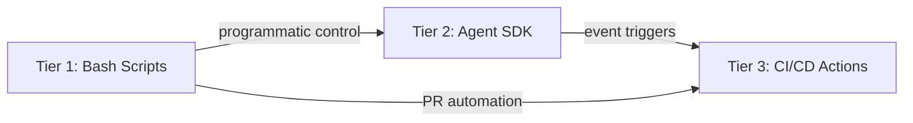
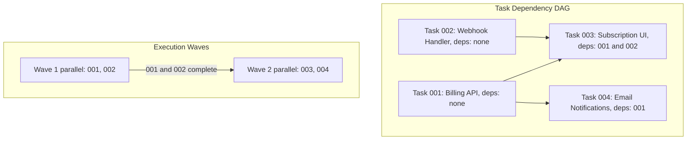
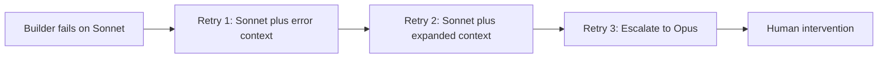

# Orchestration Engine

> Historical reference design (March 2026), written before the implementation. Tool names, flags and prices reflect that date. For the system as built, see [the implementation architecture](../docs/architecture.md).

This document specifies the orchestration engine that drives the six-agent pipeline. The engine manages pipeline configuration, DAG-aware parallel execution, retry with model escalation, checkpoint gates, and run manifest tracking. Three implementation tiers are defined, progressing from Bash scripts to the Agent SDK to GitHub Actions.

## 1. Overview

The orchestration engine is responsible for:

- Parsing pipeline configuration (entry point, cost mode, autonomy level, resume state)
- Invoking agents in the correct sequence with appropriate model and tool assignments
- Computing execution waves from the Planner's dependency DAG
- Managing retry with progressive context expansion and model escalation
- Presenting checkpoint gates for human review
- Tracking pipeline state in run manifests for audit and cost analysis

### Orchestration Tier Progression



| Tier | Implementation | When to Adopt |
|------|---------------|---------------|
| 1 | Bash scripts invoking `claude -p` | Solo developer, initial adoption |
| 2 | TypeScript/Python Agent SDK | Programmatic control, structured retry, real-time cost tracking |
| 3 | GitHub Actions with `claude-code-action@v1` | Team workflows, label-triggered automation, environment approval gates |

## 2. DAG-Aware Execution

### Dependency Graph Format

The Planner agent outputs a task manifest containing a dependency DAG as a JSON object. Each key is a task ID; its value is an array of task IDs that must complete before execution.

```json
{
  "tasks": [
    { "id": "001", "spec": ".claude/context/tasks/001-billing-api.md" },
    { "id": "002", "spec": ".claude/context/tasks/002-webhook-handler.md" },
    { "id": "003", "spec": ".claude/context/tasks/003-subscription-ui.md" },
    { "id": "004", "spec": ".claude/context/tasks/004-email-notifications.md" }
  ],
  "dag": {
    "001": [],
    "002": [],
    "003": ["001", "002"],
    "004": ["001"]
  }
}
```

### Wave Computation Algorithm

The orchestrator computes execution waves using topological sort:

1. Identify all tasks with zero unresolved dependencies. These constitute the current wave.
2. Execute all tasks in the current wave in parallel, each in an isolated git worktree.
3. On completion, add the completed task IDs to the resolved set.
4. Repeat from step 1 until all tasks are resolved or a task fails beyond retry limits.



### Parallel Execution with Git Worktrees

Each task in a wave executes in a separate git worktree branched from `main`. Worktrees share the `.git` object store, minimizing disk usage while providing full filesystem isolation between agents.

```bash
# Create worktrees for Wave 1
git worktree add ../wt-001 -b feat/001-billing-api main
git worktree add ../wt-002 -b feat/002-webhook-handler main

# Execute agents in parallel
(cd ../wt-001 && run_with_retry ".claude/context/tasks/001.md") &
(cd ../wt-002 && run_with_retry ".claude/context/tasks/002.md") &
wait

# Cleanup after merge
git worktree remove ../wt-001 && git worktree prune
git worktree remove ../wt-002 && git worktree prune
```

See [Security Model](06-security-model.md) for worktree isolation guarantees.

## 3. Retry and Model Escalation

### Strategy

When a Builder agent fails (tests do not pass, lint errors persist, or the agent exceeds its turn limit), the orchestrator applies a progressive retry strategy:



| Attempt | Model | Context Modification |
|---------|-------|---------------------|
| 1 (initial) | Sonnet | Task spec only |
| 2 (retry 1) | Sonnet | Task spec + error output from attempt 1 |
| 3 (retry 2) | Sonnet | Task spec + error output from attempts 1-2 + expanded context |
| 4 (retry 3) | Opus (escalated) | Task spec + full error history |
| 5 | Human | Agent output + error history surfaced to operator |

### Implementation

```bash
run_with_retry() {
  local task_file="$1"
  local model="sonnet"
  local max_retries=3
  local error_context=""

  for attempt in $(seq 1 $((max_retries + 1))); do
    # Escalate to Opus on final attempt
    if [ $attempt -gt $max_retries ]; then
      model="opus"
      echo "Escalating to Opus for task $(basename "$task_file")"
    fi

    result=$(claude -p "Implement task from spec: $task_file. $error_context" \
      --model "$model" \
      --allowedTools "Read" "Write" "Edit" "Bash(npm run *)" "Bash(git add *)" "Bash(git commit *)" \
      --permission-mode acceptEdits \
      --max-turns 50 \
      --output-format json 2>&1)

    if echo "$result" | jq -e '.success == true' > /dev/null 2>&1; then
      return 0
    fi

    error_context="Previous attempt failed with: $(echo "$result" | jq -r '.error // .result' | tail -20). Fix the issues."
    echo "Attempt $attempt failed for $(basename "$task_file"). Retrying..."
  done

  echo "Task $(basename "$task_file") failed after $((max_retries + 1)) attempts including Opus escalation"
  return 1
}
```

### Configuration

Retry behavior is configurable via environment variables or pipeline flags:

| Parameter | Default | Description |
|-----------|---------|-------------|
| `MAX_RETRIES` | 3 | Number of retries before escalation |
| `ESCALATION_MODEL` | opus | Model to escalate to on final attempt |
| `MAX_TURNS` | 50 | Maximum agent turns per attempt |

## 4. Tier 1: Bash Orchestration

The Bash orchestrator is a single shell script that invokes `claude -p` for each pipeline stage. It is the recommended starting point for solo developers.

### Flag Reference

| Flag | Values | Default | Description |
|------|--------|---------|-------------|
| `--entry` | `full`, `design`, `plan`, `build` | `full` | Pipeline entry point |
| `--cost-mode` | `standard`, `economy` | `standard` | Model tier selection |
| `--autonomy` | `supervised`, `autonomous` | `supervised` | Checkpoint behavior |
| `--docs` | Document manifest or IDs | (none) | Pre-existing document references |
| `--resume-from` | Stage name | (none) | Re-enter pipeline at specified stage |
| `--task` | File path | (none) | Task spec for `--entry build` |

### Pipeline Script Structure

The Bash orchestrator (`starter-kit/scripts/sdlc-pipeline.sh`) implements the following control flow:

1. **Configuration parsing.** Parse CLI flags and set defaults for entry point, cost mode, autonomy, and resume state.
2. **Model selection.** A `model_for` function maps agent names to model identifiers based on the cost mode.
3. **Checkpoint handling.** A `run_checkpoint` function presents approve/edit/abort options. In autonomous mode, checkpoints are skipped.
4. **Stage gating.** A `should_run` function determines whether each stage should execute based on entry point and resume-from settings.
5. **Run manifest initialization.** Creates a JSON manifest in `.claude/context/runs/` with the run ID, feature, and timestamp.
6. **Sequential stage execution.** Stages 1-3 (Visionary, Architect, Planner) execute sequentially with checkpoint gates.
7. **DAG-aware parallel execution.** Stage 4 (Builder) computes waves from the Planner's DAG and executes each wave in parallel using git worktrees.
8. **Parallel testing.** Stage 5 (Tester) executes in parallel across all implementation branches.
9. **Review.** Stage 6 (Reviewer) executes as a single agent reviewing all branches.

See [Agent Pipeline](02-agent-pipeline.md) for per-agent tool permissions and model assignments.

### Agent Invocation Pattern

Each agent is invoked via `claude -p` with the following parameters:

```bash
claude -p "<system prompt and task>" \
  --model "$(model_for <agent>)" \
  --output-format json \
  --allowedTools "<tool1>" "<tool2>" ... \
  --permission-mode <mode> \
  --max-turns <limit>
```

## 5. Tier 2: Agent SDK

The Agent SDK (TypeScript or Python) provides programmatic control over the pipeline with the following capabilities beyond Bash:

- **`canUseTool` callbacks.** Custom permission logic per tool call, enabling dynamic authorization decisions based on agent state or tool parameters.
- **`Promise.all` per wave.** Structured parallel execution of DAG waves with native async/await patterns.
- **Structured retry with `try/catch`.** Per-agent error handling with typed error objects and programmatic escalation decisions.
- **Real-time cost tracking.** `total_cost_usd` property on each query response enables in-flight budget enforcement.
- **JSON schema validation.** Validate inter-agent manifest contracts at each handoff point.
- **Session management.** Persistent agent sessions with state continuity across retries.

The SDK is the recommended tier when any of the following conditions apply:
- The pipeline requires custom permission logic beyond static tool lists
- Real-time cost tracking with budget enforcement is required
- Inter-agent manifests require schema validation
- The team needs programmatic integration with other systems

## 6. Tier 3: GitHub Actions

GitHub Actions orchestration uses `anthropics/claude-code-action@v1` to integrate the pipeline with GitHub's workflow system. Key capabilities:

- **Label-triggered stages.** Labels such as `ai-design`, `ai-plan`, and `ai-implement` trigger corresponding pipeline stages.
- **Environment-based approval gates.** GitHub Environments with required reviewers serve as checkpoint gates between stages.
- **Event-driven execution.** Issue creation, PR events, and label changes trigger pipeline stages automatically.
- **Team-scale orchestration.** Multiple developers can trigger pipeline stages independently with shared configuration.

This tier is recommended when:
- The team has more than 2-3 developers using the pipeline
- Pipeline stages should be triggerable from the GitHub UI
- Audit trails and approval workflows must integrate with existing GitHub processes

## 7. Pipeline Manifest

Every pipeline run produces a run manifest for cost tracking, debugging, and compliance auditing. The manifest is written to `.claude/context/runs/<run_id>.json`.

### Schema

```json
{
  "run_id": "<string>",
  "feature": "<string>",
  "started_at": "<ISO 8601 timestamp>",
  "completed_at": "<ISO 8601 timestamp>",
  "entry_point": "<full|design|plan|build>",
  "cost_mode": "<standard|economy>",
  "stages": [
    {
      "agent": "<string>",
      "model": "<string>",
      "status": "<completed|failed|skipped>",
      "tokens": {
        "input": "<number>",
        "output": "<number>",
        "cached": "<number>"
      },
      "cost_usd": "<number>",
      "duration_seconds": "<number>",
      "checkpoint": {
        "approved_by": "<human|autonomous>",
        "approved_at": "<ISO 8601 timestamp>"
      },
      "artifacts": [
        {
          "type": "<string>",
          "id": "<string>",
          "url": "<string>"
        }
      ],
      "task": "<string, optional, for Builder stages>",
      "attempts": "<number, optional>",
      "escalated": "<boolean, optional>",
      "branch": "<string, optional>",
      "pr": "<number, optional>"
    }
  ],
  "total_cost_usd": "<number>",
  "total_tokens": {
    "input": "<number>",
    "output": "<number>"
  }
}
```

### Example

```json
{
  "run_id": "run_abc123",
  "feature": "Add Stripe billing",
  "started_at": "2025-02-19T10:30:00Z",
  "completed_at": "2025-02-19T11:45:00Z",
  "entry_point": "full",
  "cost_mode": "standard",
  "stages": [
    {
      "agent": "visionary",
      "model": "opus",
      "status": "completed",
      "tokens": { "input": 15420, "output": 8930, "cached": 3200 },
      "cost_usd": 0.42,
      "duration_seconds": 180,
      "checkpoint": { "approved_by": "human", "approved_at": "2025-02-19T10:35:00Z" },
      "artifacts": [
        { "type": "prfaq", "id": "notion-abc", "url": "https://notion.so/..." },
        { "type": "prd", "id": "notion-def", "url": "https://notion.so/..." }
      ]
    },
    {
      "agent": "builder",
      "task": "001-billing-api",
      "model": "sonnet",
      "status": "completed",
      "attempts": 2,
      "escalated": false,
      "cost_usd": 0.38,
      "branch": "feat/001-billing-api",
      "pr": 42
    }
  ],
  "total_cost_usd": 8.45,
  "total_tokens": { "input": 245000, "output": 89000 }
}
```

See [State Management](07-state-management.md) for the complete state tracking specification.

## Related Documents

- [Architecture Overview](01-architecture-overview.md) -- System context and entry point configuration
- [Agent Pipeline](02-agent-pipeline.md) -- Agent specifications and tool permissions
- [Context Strategy](04-context-strategy.md) -- Per-agent context loading that affects agent invocation
- [Security Model](06-security-model.md) -- Worktree isolation and hook guards
- [State Management](07-state-management.md) -- Run manifests and status file formats
- [Monitoring and Scaling](08-monitoring-scaling.md) -- Cost tracking and telemetry integration
