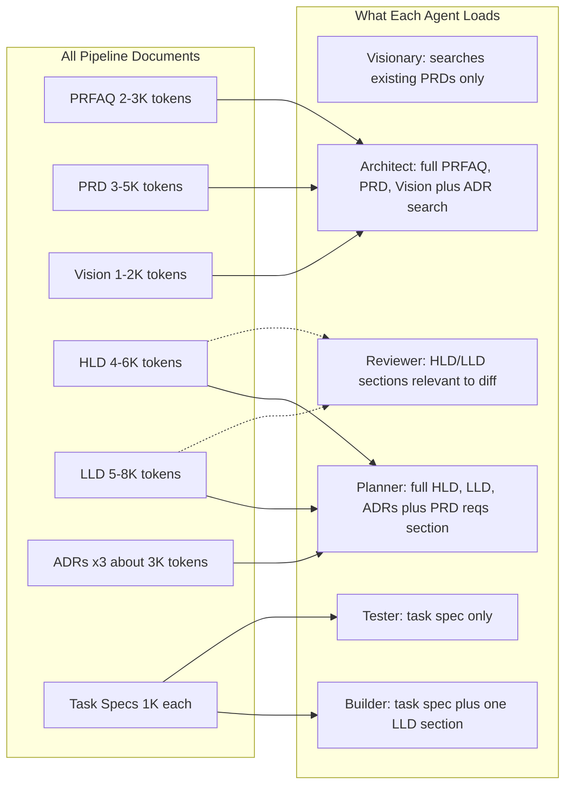

# Context Strategy

This document specifies the three-tier context loading architecture that governs which documents and sections each agent receives. The strategy addresses the problem of token waste and focus degradation: loading all pipeline documents into every agent consumes unnecessary tokens and dilutes the agent's attention across irrelevant content. The architecture progresses from zero-infrastructure structured loading to doc-tool native search to vector-based RAG, scaling with corpus size.

## 1. Overview

A full pipeline run produces seven or more documents (PRFAQ, PRD, Vision, HLD, LLD, ADRs, task specs) totaling 20,000-30,000 tokens. Loading all documents into every agent invocation wastes 40-60% of the context window on content the agent does not need. More critically, irrelevant context degrades agent focus and increases the probability of hallucinated cross-domain responses (e.g., a Builder agent making product decisions).

The context strategy enforces three principles:

1. **Minimum viable context.** Each agent loads only the documents and sections required for its cognitive mode.
2. **Progressive enrichment.** Context tiers scale with corpus size, from static loading to semantic search.
3. **Planner-directed context.** The Planner agent's task specs include a `Relevant Files` section that constrains the Builder's codebase exploration, preventing unnecessary context expansion.

### Context Loading by Agent



## 2. Per-Agent Context Loading

### Context Loading Matrix

The following matrix specifies, for each agent and document type, the loading granularity: Full (entire document), Section (specific sections only), Search (query-based retrieval), or Skip (not loaded).

| Agent | PRFAQ | PRD | Vision | HLD | LLD | ADRs | Task Specs |
|-------|-------|-----|--------|-----|-----|------|------------|
| Visionary | Skip | Skip | Skip | Skip | Skip | Skip | N/A |
| Architect | Full | Full | Full | Skip | Skip | Search | N/A |
| Planner | Skip | Section (requirements) | Skip | Full | Full | Full | N/A |
| Builder | Skip | Skip | Skip | Skip | Section (referenced in spec) | Skip | Full (assigned only) |
| Tester | Skip | Skip | Skip | Skip | Skip | Skip | Full (assigned only) |
| Reviewer | Skip | Skip | Skip | Section (relevant to diff) | Section (relevant to diff) | Search (decisions in scope) | Skip |

**Visionary context note.** The Visionary agent uses `mcp__docs__search` to discover existing PRDs for competitive context, but does not load any pipeline documents. Its primary inputs are the high-level goal string and web research.

**Builder context note.** The Builder reads only its assigned task spec. If the task spec references a specific LLD section (e.g., "See LLD Section 4.1: API Contract for POST /api/billing"), the Builder loads that section via `mcp__docs__get_page` with a section reference. All other documents are skipped.

**Reviewer context note.** The Reviewer loads HLD and LLD sections relevant to the diffs under review, not the complete documents. ADR searches are scoped to decisions that affect the code being reviewed.

### Token Budget Estimates

| Agent | Without Strategy | With Strategy | Reduction |
|-------|-----------------|---------------|-----------|
| Visionary | ~20K (all docs) | ~2K (search results) | ~90% |
| Architect | ~20K (all docs) | ~12K (product docs + ADR results) | ~40% |
| Planner | ~20K (all docs) | ~15K (tech docs + PRD section) | ~25% |
| Builder | ~20K (all docs) | ~3K (task spec + LLD section) | ~85% |
| Tester | ~20K (all docs) | ~1K (task spec) | ~95% |
| Reviewer | ~20K (all docs) | ~8K (relevant HLD/LLD sections + ADR results) | ~60% |

Aggregate token savings across a full pipeline run: approximately 40-60% reduction compared to loading all documents into every agent.

## 3. Tier 1: Structured Loading

Structured loading requires zero additional infrastructure. Each agent's prompt and the orchestrator's invocation logic determine which documents to load and at what granularity.

### Implementation Mechanisms

**Full load.** The orchestrator passes document IDs from the inter-agent manifest to the agent, which retrieves them via `mcp__docs__get_page(id)`.

**Section-level load.** The agent retrieves a specific section of a document. For doc tools that support section anchors (Notion blocks, Confluence headings), the agent uses `mcp__docs__get_page(id, section)`. For tools without section support, the agent retrieves the full page and extracts the relevant section.

**Search.** The agent uses `mcp__docs__search(query)` to find relevant documents or sections. This is the primary mechanism for the Visionary (existing PRDs) and Architect (past ADRs).

**Skip.** The orchestrator does not pass document IDs for skipped documents, and the agent prompt does not instruct retrieval.

### Task Spec "Relevant Files" for Builder Context

The Planner agent includes a `Relevant Files` section in each task spec that lists the specific files and directories the Builder should examine. This serves as a directed context loading mechanism that prevents the Builder from wasting tokens on exploratory codebase searches.

```markdown
## Relevant Files
- app/api/billing/ (existing billing routes for patterns)
- lib/stripe.ts (existing Stripe client)
- prisma/schema.prisma (current billing models)
```

The Builder agent is instructed to read only its task spec and the files listed in `Relevant Files`. See [Agent Pipeline](02-agent-pipeline.md) for the Builder specification.

## 4. Tier 2: Doc Tool Native Search

When the document corpus grows beyond approximately 20 features (100+ documents), structured loading alone becomes insufficient because agents cannot enumerate all potentially relevant documents. At this scale, the doc tool's native search API provides a lightweight retrieval layer.

### Supported Search Mechanisms

| Doc Tool | Search Mechanism | Query Syntax |
|----------|-----------------|--------------|
| Notion | Notion Search API | Natural language or title matching |
| Confluence | CQL (Confluence Query Language) | Structured field-based queries |
| GitHub | Repository search API | Code and file content search |
| Google Docs | Drive search API | Full-text search with metadata filters |

### Usage Patterns

- **Architect.** Searches "past billing decisions" across all ADRs to find prior decisions that constrain the current design.
- **Reviewer.** Searches "webhook patterns" to find relevant prior designs and validate consistency.
- **Planner.** Searches existing task specs to avoid duplicating work already planned.

### Integration

This capability is already built into the MCP tool interface. Agents call `mcp__docs__search(query)` with no additional infrastructure. The doc tool MCP server translates the query into the backend's native search syntax.

### When to Adopt Tier 2

- The project has accumulated 20+ features worth of documentation
- Agents need to discover documents they were not explicitly told about
- ADR search is returning too many or too few results with title-based matching

## 5. Tier 3: Vector RAG via MCP

When the document corpus exceeds what native search handles effectively (approximately 100+ documents, or when queries require semantic matching rather than keyword matching), a dedicated RAG MCP server provides vector-based retrieval.

### Architecture

The RAG server is deployed as an additional MCP server alongside the existing doc and PM servers. It exposes a single tool (`mcp__rag__search`) that accepts a natural language query and returns semantically relevant document chunks with source references.

```json
{
  "mcpServers": {
    "rag": {
      "command": "node",
      "args": ["./mcp-servers/rag-server/index.js"],
      "env": {
        "VECTOR_DB": "chroma",
        "EMBEDDING_MODEL": "voyage-3",
        "CHROMA_PATH": "./.vector-db"
      }
    }
  }
}
```

### Configuration

| Parameter | Options | Description |
|-----------|---------|-------------|
| `VECTOR_DB` | `chroma`, `pinecone`, `weaviate` | Vector database backend |
| `EMBEDDING_MODEL` | `voyage-3`, `text-embedding-3-small` | Embedding model for document vectorization |
| `CHROMA_PATH` | File path | Local ChromaDB storage path (for `chroma` backend) |

### Tool Interface

```
mcp__rag__search(query: string, top_k: number) -> ChunkResult[]
```

Each `ChunkResult` contains:
- `content`: The text chunk
- `source_doc_id`: Reference to the source document in the doc tool
- `source_section`: Section identifier within the source document
- `relevance_score`: Semantic similarity score

### Migration Path

Adopting Tier 3 does not require changes to agent prompts. The operator adds `mcp__rag__search` to the allowed tools list for agents that perform document search (Architect, Reviewer). The agent can then use both `mcp__docs__search` (keyword) and `mcp__rag__search` (semantic) depending on the query type.

### When to Adopt Tier 3

- Native search returns excessive irrelevant results
- The Architect needs to find "decisions similar to this tradeoff" across hundreds of ADRs
- The team is building a corpus of design patterns that should inform future features
- Queries require semantic understanding (e.g., "approaches to eventual consistency") rather than keyword matching

For most teams, Tier 1 combined with Tier 2 is sufficient for the first 12+ months of pipeline operation.

## Related Documents

- [Architecture Overview](01-architecture-overview.md) -- Structured context over RAG design principle
- [Agent Pipeline](02-agent-pipeline.md) -- Per-agent context loading requirements
- [Integration Layer](05-integration-layer.md) -- MCP tool interfaces for document retrieval
- [State Management](07-state-management.md) -- Task spec format including Relevant Files section
- [Monitoring and Scaling](08-monitoring-scaling.md) -- Token usage tracking and cost optimization
