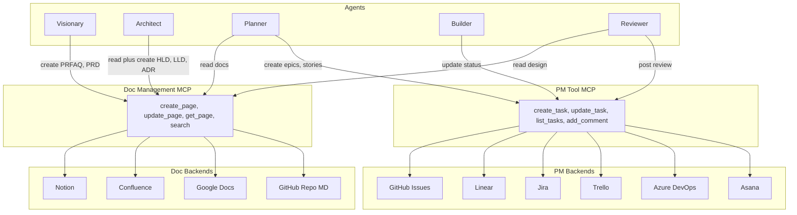

# Integration Layer

This document specifies the MCP-based integration architecture that provides backend-agnostic access to document management and project management services. The architecture ensures that agent prompts and orchestration logic remain invariant when the underlying doc or PM tool changes. Two logical MCP server groups (Document Management and Project Management) expose unified tool interfaces over pluggable backends.

## 1. Overview

The integration layer implements the backend-agnostic integration principle defined in [Architecture Overview](01-architecture-overview.md). All agent interactions with external services are mediated through Model Context Protocol (MCP) servers that expose canonical tool names. Swapping Notion for Confluence, or GitHub Issues for Linear, requires only a configuration change in `.mcp.json`; no agent prompt or orchestration logic modifications are necessary.

### Dual MCP Architecture

The system defines two functional MCP server groups:

- **Document Management MCP.** Handles creation, retrieval, update, and search of product and technical documents (PRFAQ, PRD, HLD, LLD, ADRs).
- **Project Management MCP.** Handles creation, retrieval, update, and search of engineering work items (epics, stories, tasks) and review comments.

## 2. Architecture



### Tool Name Conventions

All MCP tools follow a namespaced convention: `mcp__<server>__<operation>`. Agents reference tools by their canonical names (e.g., `mcp__docs__create_page`), which map to backend-specific API calls within the MCP server implementation.

| Canonical Tool | Operation |
|---------------|-----------|
| `mcp__docs__create_page` | Create a new document |
| `mcp__docs__update_page` | Update an existing document |
| `mcp__docs__get_page` | Retrieve a document by ID |
| `mcp__docs__search` | Search documents by query |
| `mcp__pm__create_issue` | Create a work item (epic, story, task) |
| `mcp__pm__update_issue` | Update a work item's status or fields |
| `mcp__pm__list_issues` | List work items with filters |
| `mcp__pm__search_issues` | Search work items by query |
| `mcp__pm__add_comment` | Add a comment to a work item |

## 3. Doc Management MCP

### Unified Tool Interface

| Tool | Parameters | Returns | Description |
|------|-----------|---------|-------------|
| `create_page` | `title`, `content`, `parent_id?`, `template?` | `{ id, url }` | Creates a document from optional template |
| `update_page` | `id`, `content`, `section?` | `{ id, url }` | Updates full document or specific section |
| `get_page` | `id`, `section?` | `{ id, title, content, url }` | Retrieves document or section by ID |
| `search` | `query`, `filters?` | `[{ id, title, snippet, url }]` | Searches documents by content or metadata |

### Backend Comparison

| Capability | Notion | Confluence | Google Docs | GitHub Repo MD |
|-----------|--------|------------|-------------|----------------|
| Structured pages | Block-based | Wiki pages | Document format | Markdown files |
| Section-level access | Block IDs | Heading anchors | Named ranges | Line ranges |
| Native search | Notion Search API | CQL | Drive Search API | GitHub Search API |
| Version history | Page history | Page versions | Revision history | Git history |
| Collaboration | Real-time | Real-time | Real-time | PR-based |
| API maturity | Production | Production | Production | Production |
| Offline access | Limited | Limited | Limited | Full (local clone) |

### Available MCP Servers

| Platform | Server | Maturity | Notes |
|----------|--------|----------|-------|
| Notion | `makenotion/notion-mcp-server` (official) | Production | Official Notion MCP server with full API coverage |
| Confluence | `sooperset/mcp-atlassian` | Mature | Supports Confluence Cloud and Server/DC |
| Google Docs | `anthropics/google-drive-mcp` | Production | Google Drive integration including Docs, Sheets |
| GitHub Repo MD | `filesystem` + `github-mcp-server` | Production | Markdown files in repository; uses filesystem for local, GitHub MCP for remote |

### GitHub Repository as Doc Backend

For teams that prefer to keep documentation in the repository alongside code, GitHub repository markdown files serve as a viable doc backend. In this configuration:

- Documents are stored as markdown files in a designated directory (e.g., `docs/product/`, `docs/design/`)
- The `filesystem` MCP server handles local read/write operations
- The `github-mcp-server` handles remote operations (PR-based document updates)
- Version history is provided by git
- Search is provided by GitHub Search API or local grep

This approach eliminates external service dependencies at the cost of reduced real-time collaboration capabilities.

## 4. Project Management MCP

### Unified Tool Interface

| Tool | Parameters | Returns | Description |
|------|-----------|---------|-------------|
| `create_issue` | `title`, `body`, `type`, `parent_id?`, `labels?`, `assignee?` | `{ id, url, number }` | Creates an epic, story, or task |
| `update_issue` | `id`, `status?`, `fields?` | `{ id, url }` | Updates status or custom fields |
| `list_issues` | `filters`, `sort?`, `limit?` | `[{ id, title, status, url }]` | Lists issues with filtering |
| `search_issues` | `query` | `[{ id, title, status, url }]` | Full-text search across issues |
| `add_comment` | `issue_id`, `body` | `{ id, url }` | Adds a comment to an issue |

### Available MCP Servers

| Platform | Server | Maturity | Notes |
|----------|--------|----------|-------|
| GitHub Issues/Projects | `github/github-mcp-server` (official) | Production | Official GitHub MCP server; covers issues, PRs, projects |
| Jira Cloud | Atlassian Rovo MCP (official) | Beta | Official Atlassian MCP; JQL support |
| Jira Server/DC | `cosmix/jira-mcp` | Mature | Community server for on-premise Jira |
| Linear | Official Linear MCP | Production | Official Linear integration; GraphQL-based |
| Trello | `delorenj/mcp-server-trello` | Mature | Board, list, and card operations |
| Azure DevOps | `@azure-devops/mcp` (Microsoft) | Production | Work items, boards, sprints |
| Asana | Official Asana MCP | Production | Tasks, projects, sections |

### Agent-to-PM-Tool Mapping

| Agent | PM Tool Operations | Purpose |
|-------|-------------------|---------|
| Planner | `create_issue` (epic, stories) | Creates engineering work items from design documents |
| Planner | `search_issues` | Checks for existing work items to avoid duplication |
| Builder | `update_issue` (status) | Reports task progress (in_progress, completed, failed) |
| Reviewer | `add_comment` | Posts structured review comments on work items |

## 5. Abstraction Strategies

Three strategies exist for achieving backend-agnostic integration. The choice depends on team size, expected backend changes, and tolerance for prompt fragility.

### Option A: Thin Unified MCP Servers (Recommended)

Build lightweight MCP wrapper servers (~200 lines of code each) that expose canonical tool names and translate calls to backend-specific APIs.

**Advantages:**
- Agent prompts never change when backends are swapped
- Type-safe tool interfaces with consistent parameter shapes
- Centralized error handling and retry logic
- Testable in isolation

**Disadvantages:**
- Requires building and maintaining two small services (doc + PM)
- Adds a translation layer that can introduce bugs

**Implementation.** Each unified server accepts calls to canonical tools (e.g., `create_page`) and dispatches to the configured backend's native MCP server. Configuration is via environment variables.

### Option B: Prompt-Level Abstraction via CLAUDE.md

Define backend-specific tool mappings in the project's CLAUDE.md file. Agent prompts reference abstract operations; CLAUDE.md provides the concrete tool names.

```markdown
## Tool Mapping
- "Create a document" = call mcp__notion__create_page
- "Search documents" = call mcp__notion__search
- "Create an issue" = call mcp__github__create_issue
```

**Advantages:**
- Zero additional code; configuration only
- Simple to understand and modify

**Disadvantages:**
- Fragile; agents may not consistently follow indirect mappings
- Every backend swap requires CLAUDE.md updates and validation
- No type safety or parameter validation

### Option C: Environment Variable URL Swaps

For backends with similar API schemas (e.g., different Jira instances), use environment variables to swap connection URLs without changing tool names.

**Advantages:**
- Minimal configuration; suitable for same-platform migrations
- No code or prompt changes

**Disadvantages:**
- Only works for backends with identical API schemas
- Does not address cross-platform swaps (e.g., Notion to Confluence)

### Recommendation

Option A (thin unified MCP servers) is recommended for teams that anticipate backend changes or operate across multiple projects with different tool stacks. Option B (prompt-level abstraction) is acceptable for solo developers or teams with a stable, single-backend configuration. Option C applies only to within-platform migrations.

## 6. Configuration

MCP servers are configured in `.mcp.json` at the project root. Each server entry specifies the command, arguments, and environment variables required to start the server process.

### Schema

```json
{
  "mcpServers": {
    "<server_name>": {
      "command": "<string>",
      "args": ["<string>", ...],
      "env": {
        "<KEY>": "<VALUE>"
      }
    }
  }
}
```

For HTTP-based MCP servers:

```json
{
  "mcpServers": {
    "<server_name>": {
      "type": "http",
      "url": "<string>",
      "headers": {
        "<KEY>": "<VALUE>"
      }
    }
  }
}
```

### Example: Notion + GitHub

```json
{
  "mcpServers": {
    "docs": {
      "command": "npx",
      "args": ["-y", "@notionhq/notion-mcp-server"],
      "env": {
        "OPENAPI_MCP_HEADERS": "{\"Authorization\":\"Bearer ${NOTION_API_KEY}\",\"Notion-Version\":\"2022-06-28\"}"
      }
    },
    "pm": {
      "type": "http",
      "url": "https://api.githubcopilot.com/mcp/",
      "headers": { "Authorization": "Bearer ${GITHUB_PAT}" }
    }
  }
}
```

### Example: Confluence + Linear

```json
{
  "mcpServers": {
    "docs": {
      "command": "npx",
      "args": ["-y", "mcp-atlassian"],
      "env": {
        "CONFLUENCE_URL": "${CONFLUENCE_URL}",
        "CONFLUENCE_USERNAME": "${CONFLUENCE_USERNAME}",
        "CONFLUENCE_API_TOKEN": "${CONFLUENCE_API_TOKEN}"
      }
    },
    "pm": {
      "command": "npx",
      "args": ["-y", "@linear/mcp-server"],
      "env": {
        "LINEAR_API_KEY": "${LINEAR_API_KEY}"
      }
    }
  }
}
```

### Example: GitHub Repository MD (No External Services)

```json
{
  "mcpServers": {
    "docs": {
      "command": "npx",
      "args": ["-y", "@anthropic/filesystem-mcp-server", "./docs"],
      "env": {}
    },
    "pm": {
      "type": "http",
      "url": "https://api.githubcopilot.com/mcp/",
      "headers": { "Authorization": "Bearer ${GITHUB_PAT}" }
    }
  }
}
```

### Credential Management

Credentials are referenced via environment variable interpolation (`${VARIABLE_NAME}`) in `.mcp.json`. Actual values are stored in:

- `.claude/settings.local.json` (gitignored; per-developer secrets)
- Environment variables set in the shell profile
- CI/CD secret stores (for GitHub Actions orchestration)

Credentials must never be committed to the repository. See [Security Model](06-security-model.md).

## Related Documents

- [Architecture Overview](01-architecture-overview.md) -- Backend-agnostic integration design principle
- [Agent Pipeline](02-agent-pipeline.md) -- Per-agent tool permissions and MCP usage
- [Context Strategy](04-context-strategy.md) -- Document search via MCP tools
- [Security Model](06-security-model.md) -- Credential management and tool permission enforcement
- [State Management](07-state-management.md) -- Document and work item state tracking
