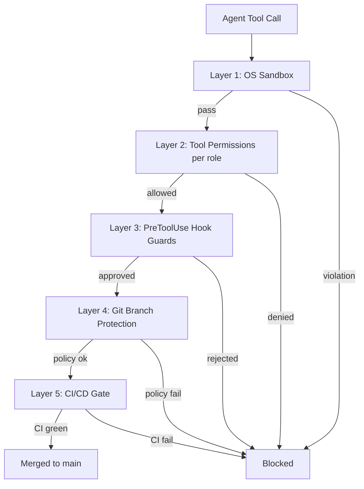
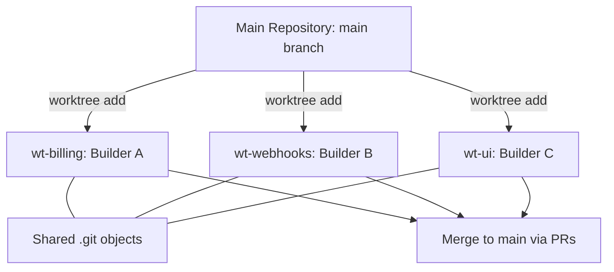

# Security Model

> Historical reference design (March 2026), written before the implementation. Tool names, flags and prices reflect that date. For the system as built, see [the implementation architecture](../docs/architecture.md).

This document specifies the defense-in-depth security architecture that governs all agent operations within the pipeline. Five complementary controls reduce the chance and impact of a destructive action on production assets. They are not fully independent and do not guarantee prevention: layers 2 and 3 run in the same agent process, and the pattern-based hook guard is a tripwire, not a boundary. Additionally, git worktree isolation provides filesystem-level separation for parallel agent execution, and rollback mechanisms enable recovery at multiple granularity levels.

## 1. Overview

The security model is predicated on the principle that AI agents are untrusted execution environments. Each agent operates within a constrained permission envelope, and every action is intended to pass through multiple validation layers before it can affect production state.

### Trust Model

- **Agents are untrusted.** No agent has implicit authority to perform destructive operations.
- **Tools are gated.** Each agent declares its required tools; the runtime enforces the declared set.
- **Branches are ephemeral.** All agent work occurs on feature branches that are disposable by design.
- **Main is protected.** No agent can write directly to the `main` branch. All code reaches `main` through pull requests with CI validation and human approval.
- **State is auditable.** Every pipeline action is recorded in run manifests for post-hoc review.

### Defense-in-Depth Flow

An agent tool call is intended to pass through all five layers to affect production state. Failure at any layer is intended to block the action; the layers are complementary rather than independent.



## 2. Layer 1: OS Sandboxing

The outermost security layer restricts the agent's access to the operating system's filesystem and network at the process level.

### Platform-Specific Implementations

| Platform | Technology | Capabilities |
|----------|-----------|-------------|
| Linux | bubblewrap (`bwrap`) | Filesystem namespace isolation, network restriction, mount filtering |
| macOS | Seatbelt (`sandbox-exec`) | Filesystem path restrictions, network access control, process isolation |
| Containers | Docker microVMs | Full filesystem isolation, network policy, resource limits |

### Restrictions

- **Filesystem.** Agents can access only the project directory and designated temporary directories. System directories, user home directories (except `.claude/`), and other project directories are inaccessible.
- **Network.** Agents can access only allowlisted domains required for MCP server communication and web research. Direct access to production databases, internal APIs, and cloud provider endpoints is blocked.

### Impact

Anthropic reported that sandboxing reduced permission prompts by 84% in its internal usage ([Claude Code sandboxing](https://www.anthropic.com/engineering/claude-code-sandboxing)). This figure was not measured here. The mechanism is that the sandbox preemptively blocks operations that would otherwise require runtime approval.

## 3. Layer 2: Tool Permissions

Each agent is granted access to a specific set of tools determined by its role. The runtime enforces this set; tool calls outside the declared set are rejected without execution.

### Per-Agent Permission Matrix

| Agent | Read/Grep | Write | Bash | Git | Doc MCP | PM MCP | Web |
|-------|-----------|-------|------|-----|---------|--------|-----|
| Visionary | Allowed | Denied | Denied | Denied | Read/Write | Denied | Allowed |
| Architect | Allowed | Denied | `find`, `tree`, `wc` | Denied | Read/Write | Denied | Allowed |
| Planner | Allowed | Specs only | `find`, `tree` | Denied | Read | Read/Write | Denied |
| Builder | Allowed | Allowed | Build, lint, test | Branch, commit | Denied | Status updates | Denied |
| Tester | Allowed | Tests only | Test runners | Commit | Denied | Denied | Denied |
| Reviewer | Allowed | Denied | `git diff`, `git merge` | Denied | Read | Comments | Denied |

See [Agent Pipeline](02-agent-pipeline.md) for complete per-agent specifications.

### Permission Modes

The `permissionMode` field in the agent definition file controls runtime approval behavior:

| Mode | Behavior | Applicable Agents |
|------|----------|-------------------|
| `plan` | All tool calls require human approval before execution | Visionary, Architect, Planner, Reviewer |
| `acceptEdits` | File edits execute without approval; other tools require approval | Builder, Tester |
| `full` | All declared tools execute without approval | Not recommended for standard operation |

### Least Privilege Enforcement

Each agent's tool set is the minimum required for its cognitive mode:

- The Visionary cannot write code, execute shell commands, or interact with the PM tool.
- The Builder cannot read design documents, create work items, or access the web.
- The Reviewer cannot edit code; it posts comments but does not modify files.
- No agent can push to `main` or delete branches.

## 4. Layer 3: Hook Guards

PreToolUse hooks intercept tool calls before execution and apply pattern-based filtering to block destructive operations.

### Configuration

Hook guards are defined in `.claude/settings.json` and point at a small script. The hook receives the tool call as JSON on stdin (the command is at `.tool_input.command`), so the script reads stdin rather than an environment variable:

```json
{
  "hooks": {
    "PreToolUse": [{
      "matcher": "Bash",
      "hooks": [{
        "type": "command",
        "command": "\"$CLAUDE_PROJECT_DIR\"/.claude/hooks/guard-bash.sh"
      }]
    }]
  }
}
```

An illustrative script is in [`starter-kit/.claude/hooks/guard-bash.sh`](starter-kit/.claude/hooks/guard-bash.sh). It denies a short list of destructive patterns and prints nothing otherwise, so Claude Code's normal permission flow still applies. Earlier drafts of this section used a variable that does not exist and returned an approve decision for every command, which would have bypassed permission prompts; that was a defect in the original design text.

### Blocked Patterns

| Pattern | Risk | Action |
|---------|------|--------|
| `rm -rf` | Recursive filesystem deletion | Block |
| `git push.*main` | Direct push to protected branch | Block |
| `DROP TABLE` | Database schema destruction | Block |
| `git push --force` | Force push overwriting history | Block |
| `chmod 777` | Excessive permission grants | Block |

### Commit Hooks

In addition to PreToolUse hooks, git commit hooks enforce:

- All committed code must pass linting
- All committed code must pass existing tests
- Commit messages must follow Conventional Commits format
- Sensitive files (`.env`, credentials) must not be committed

### Hook Response Format

To block a call, a PreToolUse hook prints this JSON and exits 0 (alternatively, it exits 2 with the reason on stderr). To take no position, it exits 0 with no output. See the [hooks reference](https://code.claude.com/docs/en/hooks).

```json
{
  "hookSpecificOutput": {
    "hookEventName": "PreToolUse",
    "permissionDecision": "deny",
    "permissionDecisionReason": "Destructive command blocked: rm -rf detected"
  }
}
```

## 5. Layer 4: Git Branch Protection

Git branch protection rules ensure that agent-generated code follows a controlled path to production.

### Rules

- **Feature branches only.** All agent work occurs on branches with the naming convention `feat/<task-id>-<short-description>`.
- **Pull requests required.** Direct commits to `main` are prohibited. All changes must go through pull requests.
- **AI-generated labels.** Pull requests created by agents are labeled `ai-generated` for identification and filtering.
- **Branch naming enforcement.** The orchestrator creates branches following the convention; agents cannot create arbitrarily named branches.

### Naming Convention

```
feat/<task-id>-<short-description>
```

Examples:
- `feat/001-billing-api`
- `feat/002-webhook-handler`
- `feat/003-subscription-ui`

## 6. Layer 5: CI/CD Gates

The final security layer is the CI/CD pipeline that validates every pull request before merge.

### Automated Checks

| Check | Tool | Purpose |
|-------|------|---------|
| Unit tests | Jest, pytest, etc. | Functional correctness |
| Integration tests | Playwright, Cypress | End-to-end behavior |
| Linting | ESLint, Prettier | Code style and quality |
| Type checking | TypeScript compiler | Type safety |
| SAST | Semgrep, CodeQL | Security vulnerability detection |
| Dependency audit | `npm audit`, Dependabot | Known vulnerability detection |

### Human Approval

After all automated checks pass, a human reviewer must approve the pull request before merge. This is the final gate and the only point where a human is strictly required in the code-to-production path.

### Environment-Based Gates

For Tier 3 orchestration (GitHub Actions), environment-based approval gates provide stage-level human authorization:

- Each pipeline stage maps to a GitHub Environment
- Environments require designated reviewers for approval
- Approval is required before the stage's GitHub Actions job executes

## 7. Git Worktree Isolation

Git worktrees provide filesystem-level isolation for parallel agent execution. Each Builder agent operates in a separate worktree with its own working directory, while sharing the repository's `.git` object store.

### Architecture



### Lifecycle

| Phase | Command | Description |
|-------|---------|-------------|
| Create | `git worktree add ../wt-<task-id> -b feat/<task-id> main` | Creates isolated worktree with feature branch |
| Work | `cd ../wt-<task-id> && claude -p "..." --permission-mode acceptEdits` | Agent executes in worktree |
| Merge | Pull request from `feat/<task-id>` to `main` | Code review and CI validation |
| Cleanup | `git worktree remove ../wt-<task-id> && git worktree prune` | Removes worktree after merge |

### Isolation Guarantees

- **Filesystem isolation.** Each worktree has its own working directory. File modifications in one worktree do not affect others.
- **Branch isolation.** Each worktree checks out a unique branch. Branch operations in one worktree do not affect others.
- **Shared objects.** All worktrees share the same `.git` object database, minimizing disk usage and enabling efficient cross-branch operations.
- **Concurrent execution.** Multiple agents can execute simultaneously across worktrees without filesystem conflicts.

### Example

```bash
# Create worktrees for parallel agents
git worktree add ../wt-billing feat/001 main
git worktree add ../wt-webhooks feat/002 main

# Execute agents in parallel
(cd ../wt-billing && claude -p "..." --permission-mode acceptEdits) &
(cd ../wt-webhooks && claude -p "..." --permission-mode acceptEdits) &
wait

# Cleanup after merge
git worktree remove ../wt-billing && git worktree prune
git worktree remove ../wt-webhooks && git worktree prune
```

## 8. Rollback Mechanisms

The system provides rollback capabilities at three granularity levels.

### Session-Level Rollback

The `/rewind` command within an interactive Claude Code session reverts the agent's most recent actions. This is applicable during supervised pipeline operation where a human operator is monitoring agent execution.

### SDK-Level Rollback

The Agent SDK provides the `rewindFiles()` function, which programmatically reverts file changes made by the current agent session. This is used in Tier 2 orchestration for automated rollback on failure.

### Pipeline-Level Rollback

The orchestrator uses status files in `.claude/context/status/` to track per-task completion state. The `--resume-from <stage>` flag allows re-entering the pipeline at any stage, effectively rolling back to a previous checkpoint. Previous stage outputs (documents, task specs) are preserved and can be modified before re-execution.

| Level | Mechanism | Scope | Tier |
|-------|-----------|-------|------|
| Session | `/rewind` | Current agent's recent actions | Tier 1 (interactive) |
| SDK | `rewindFiles()` | Current agent's file changes | Tier 2 |
| Pipeline | `--resume-from <stage>` | Re-execute from specified stage | Tier 1, 2, 3 |

## Related Documents

- [Architecture Overview](01-architecture-overview.md) -- Defense-in-depth design principle
- [Agent Pipeline](02-agent-pipeline.md) -- Per-agent tool permissions and permission modes
- [Orchestration Engine](03-orchestration-engine.md) -- Retry logic and worktree management
- [State Management](07-state-management.md) -- Status files for pipeline-level rollback
- [Monitoring and Scaling](08-monitoring-scaling.md) -- Security audit via run manifests
