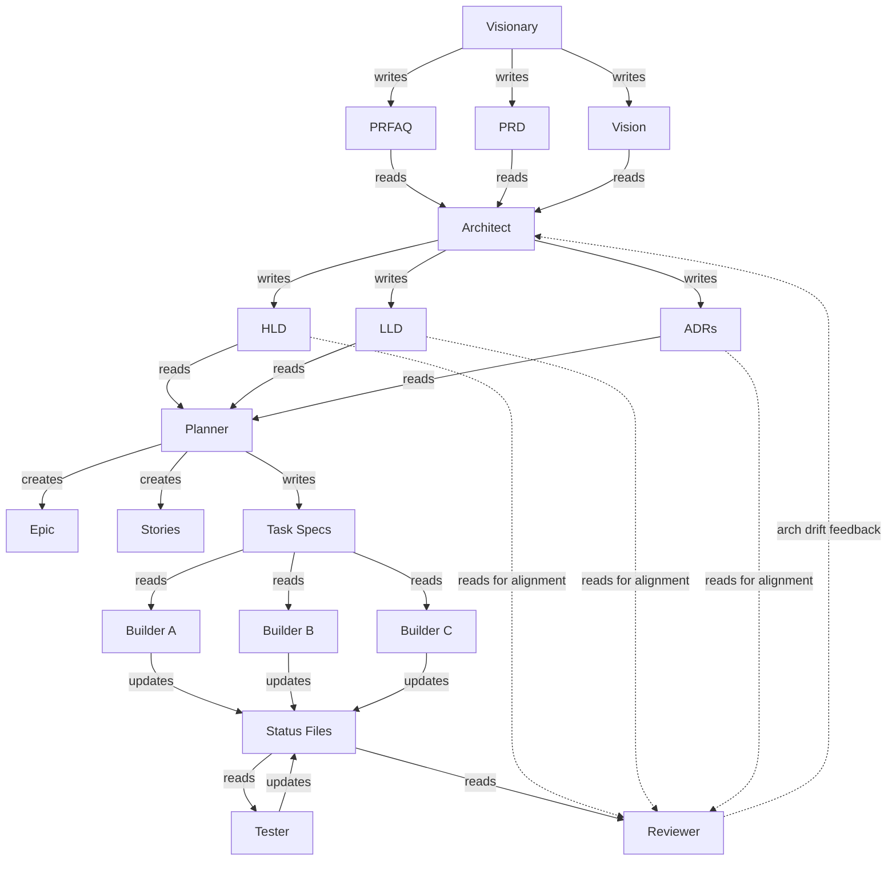

# State Management

This document specifies the inter-agent state flow, data formats, and storage locations that enable structured communication between pipeline stages. State is distributed across four storage locations: the doc tool (product and technical documents), the PM tool (epics, stories, work items), the local filesystem (task specs, status files), and run manifests (pipeline execution audit trail).

## 1. Overview

The six-agent pipeline requires a well-defined state contract between stages. Each agent reads state produced by upstream agents and writes state consumed by downstream agents. Unlike shared-memory architectures, all inter-agent communication is mediated through persistent, inspectable artifacts: documents in the doc tool, issues in the PM tool, markdown files on the filesystem, and JSON status/manifest files.

### State Storage Locations

| Location | Content | Written By | Read By |
|----------|---------|-----------|---------|
| Doc Tool (Notion, Confluence, etc.) | PRFAQ, PRD, Vision, HLD, LLD, ADRs | Visionary, Architect | Architect, Planner, Reviewer |
| PM Tool (GitHub Issues, Linear, etc.) | Epics, stories, task status, review comments | Planner, Builder, Reviewer | Planner, Builder, Reviewer |
| `.claude/context/tasks/` | Task specification markdown files | Planner | Builder, Tester |
| `.claude/context/status/` | Per-task status JSON files | Builder, Tester, Orchestrator | Orchestrator, Reviewer |
| `.claude/context/runs/` | Pipeline run manifest JSON files | Orchestrator | Orchestrator, human operators |

## 2. Inter-Agent State Flow

The following diagram illustrates the complete state flow between all six agents, including the feedback loop from Reviewer to Architect.



### Per-Agent State Operations

| Agent | Reads | Writes |
|-------|-------|--------|
| Visionary | Existing PRDs (via search) | PRFAQ, PRD, Vision (doc tool); product manifest JSON (stdout) |
| Architect | PRFAQ, PRD, Vision, past ADRs (doc tool) | HLD, LLD, ADRs (doc tool); tech design manifest JSON (stdout) |
| Planner | HLD, LLD, ADRs, PRD requirements section (doc tool) | Epics, stories (PM tool); task specs (filesystem); task manifest with DAG (stdout) |
| Builder | Assigned task spec (filesystem); referenced LLD section (doc tool) | Code, changelog, docs (git worktree); status file (filesystem); status update (PM tool) |
| Tester | Task spec (filesystem); implementation branch (git) | Test files (git worktree); status file update (filesystem) |
| Reviewer | HLD, LLD, ADRs (doc tool); all feature branches (git); status files (filesystem) | Review comments (PM tool); review verdict JSON (stdout); drift report (stdout) |

## 3. Task Spec Format

Task specifications are markdown files written by the Planner agent to `.claude/context/tasks/`. Each task spec is a self-contained work unit with full traceability to source documents.

### Specification

```markdown
# Task <ID>: <Title>

## Source Documents
- PRD: <doc-id> (Section <ref>: <section-title>)
- HLD: <doc-id> (Component: <component-name>)
- LLD: <doc-id> (API: <endpoint-or-contract>)
- ADR-<NNN>: <doc-id> (<decision-title>)

## Parent Story
- PM Issue #<number>: "<story-title>"

## Relevant Files
- <path> (<rationale for inclusion>)
- <path> (<rationale for inclusion>)

## Objective
<1-2 sentence description of what the task accomplishes>

## Acceptance Criteria
- [ ] <criterion 1>
- [ ] <criterion 2>
- [ ] <criterion N>

## Dependencies
- <dependency description, or "None (Wave N -- parallelizable)">
```

### Field Definitions

| Field | Required | Description |
|-------|----------|-------------|
| Task ID | Yes | Unique identifier (e.g., `001`, `002`). Used in file naming, branch naming, and DAG references. |
| Title | Yes | Concise description of the task deliverable. |
| Source Documents | Yes | References to the PRD section, HLD component, LLD contract, and ADRs that govern this task. Each reference includes the doc-tool ID and a section locator. |
| Parent Story | Yes | The PM tool issue ID and title of the user story this task implements. |
| Relevant Files | Yes | List of files and directories the Builder should examine. Includes rationale for each entry. This field is critical for Builder context loading (see [Context Strategy](04-context-strategy.md)). |
| Objective | Yes | Brief statement of the task's purpose and deliverable. |
| Acceptance Criteria | Yes | Checkboxes defining the conditions for task completion. Each criterion is independently verifiable. |
| Dependencies | Yes | List of task IDs that must complete before this task can begin. If none, the task is marked as parallelizable with its wave number. |

### Example

```markdown
# Task 001: Billing API Endpoint

## Source Documents
- PRD: notion-def456 (Section 3.2: Subscription Creation)
- HLD: notion-ghi789 (Component: Billing Service)
- LLD: notion-jkl012 (API: POST /api/billing/create-subscription)
- ADR-001: notion-adr001 (Stripe API over Paddle)

## Parent Story
- PM Issue #42: "As a user, I can subscribe to a plan"

## Relevant Files
- app/api/billing/ (existing billing routes for patterns)
- lib/stripe.ts (existing Stripe client)
- prisma/schema.prisma (current billing models)

## Objective
Create POST /api/billing/create-subscription endpoint

## Acceptance Criteria
- [ ] Accepts { priceId, customerId } body
- [ ] Validates input with Zod (per LLD Section 4.1)
- [ ] Creates Stripe subscription via lib/stripe.ts (per ADR-001)
- [ ] Returns { subscriptionId, clientSecret }
- [ ] 400 on invalid input, 500 on Stripe error (per LLD Section 4.3)
- [ ] Unit tests for happy path plus errors
- [ ] CHANGELOG.md updated

## Dependencies
- None (Wave 1 -- parallelizable)
```

## 4. Status Files

Per-task status files track execution state and are written to `.claude/context/status/`. The orchestrator reads status files to determine which tasks are complete, in progress, or failed.

### Schema

```json
{
  "task_id": "<string>",
  "status": "<pending|in_progress|completed|failed>",
  "agent": "<builder|tester>",
  "model": "<string>",
  "started_at": "<ISO 8601 timestamp>",
  "completed_at": "<ISO 8601 timestamp | null>",
  "attempts": "<number>",
  "branch": "<string>",
  "error": "<string | null>"
}
```

### Field Definitions

| Field | Type | Description |
|-------|------|-------------|
| `task_id` | string | Matches the task spec ID (e.g., `001`) |
| `status` | enum | Current execution state |
| `agent` | string | The agent type currently or last operating on this task |
| `model` | string | The model used for the current or most recent attempt |
| `started_at` | ISO 8601 | Timestamp of first execution attempt |
| `completed_at` | ISO 8601 or null | Timestamp of successful completion, or null if not yet complete |
| `attempts` | number | Total number of execution attempts including retries |
| `branch` | string | Git branch name (e.g., `feat/001-billing-api`) |
| `error` | string or null | Error message from the most recent failed attempt, or null if no failure |

### Status Transitions

```
pending --> in_progress --> completed
                       \-> failed --> in_progress (retry)
                                  \-> failed (max retries exceeded)
```

| Transition | Trigger |
|-----------|---------|
| `pending` to `in_progress` | Orchestrator dispatches task to Builder agent |
| `in_progress` to `completed` | Agent reports success (tests pass, lint clean) |
| `in_progress` to `failed` | Agent reports failure or exceeds turn limit |
| `failed` to `in_progress` | Orchestrator retries with expanded context or escalated model |

### Example

```json
{
  "task_id": "001",
  "status": "completed",
  "agent": "builder",
  "model": "sonnet",
  "started_at": "2025-02-19T10:45:00Z",
  "completed_at": "2025-02-19T11:02:00Z",
  "attempts": 2,
  "branch": "feat/001-billing-api",
  "error": null
}
```

## 5. Pipeline Run Manifests

Every pipeline run produces a manifest file for cost tracking, debugging, and compliance auditing. Manifests are written to `.claude/context/runs/<run_id>.json`.

### Schema

```json
{
  "run_id": "<string>",
  "feature": "<string>",
  "started_at": "<ISO 8601 timestamp>",
  "completed_at": "<ISO 8601 timestamp>",
  "entry_point": "<full|design|plan|build>",
  "cost_mode": "<standard|economy>",
  "stages": [
    {
      "agent": "<string>",
      "model": "<string>",
      "status": "<completed|failed|skipped>",
      "tokens": {
        "input": "<number>",
        "output": "<number>",
        "cached": "<number>"
      },
      "cost_usd": "<number>",
      "duration_seconds": "<number>",
      "checkpoint": {
        "approved_by": "<human|autonomous>",
        "approved_at": "<ISO 8601 timestamp>"
      },
      "artifacts": [
        {
          "type": "<string>",
          "id": "<string>",
          "url": "<string>"
        }
      ],
      "task": "<string, optional>",
      "attempts": "<number, optional>",
      "escalated": "<boolean, optional>",
      "branch": "<string, optional>",
      "pr": "<number, optional>"
    }
  ],
  "total_cost_usd": "<number>",
  "total_tokens": {
    "input": "<number>",
    "output": "<number>"
  }
}
```

### Per-Stage Tracking Fields

| Field | Applicable Stages | Description |
|-------|-------------------|-------------|
| `agent` | All | Agent type (visionary, architect, planner, builder, tester, reviewer) |
| `model` | All | Model used (opus, sonnet) |
| `status` | All | Completion status |
| `tokens` | All | Token usage breakdown |
| `cost_usd` | All | Cost for this stage |
| `duration_seconds` | All | Wall-clock execution time |
| `checkpoint` | Visionary, Architect, Planner | Checkpoint approval details |
| `artifacts` | Visionary, Architect | Document references produced |
| `task` | Builder, Tester | Task ID being executed |
| `attempts` | Builder | Number of retry attempts |
| `escalated` | Builder | Whether model escalation occurred |
| `branch` | Builder, Tester | Git branch for this task |
| `pr` | Builder | Pull request number if created |

### Cost and Token Aggregation

The `total_cost_usd` and `total_tokens` fields at the manifest root aggregate values across all stages. This enables:

- Per-feature cost tracking
- Per-agent cost attribution
- Token usage trend analysis
- Budget enforcement via the Agent SDK (see [Monitoring and Scaling](08-monitoring-scaling.md))

### Example

```json
{
  "run_id": "run_abc123",
  "feature": "Add Stripe billing",
  "started_at": "2025-02-19T10:30:00Z",
  "completed_at": "2025-02-19T11:45:00Z",
  "entry_point": "full",
  "cost_mode": "standard",
  "stages": [
    {
      "agent": "visionary",
      "model": "opus",
      "status": "completed",
      "tokens": { "input": 15420, "output": 8930, "cached": 3200 },
      "cost_usd": 0.42,
      "duration_seconds": 180,
      "checkpoint": { "approved_by": "human", "approved_at": "2025-02-19T10:35:00Z" },
      "artifacts": [
        { "type": "prfaq", "id": "notion-abc", "url": "https://notion.so/..." },
        { "type": "prd", "id": "notion-def", "url": "https://notion.so/..." }
      ]
    },
    {
      "agent": "builder",
      "task": "001-billing-api",
      "model": "sonnet",
      "status": "completed",
      "attempts": 2,
      "escalated": false,
      "cost_usd": 0.38,
      "branch": "feat/001-billing-api",
      "pr": 42
    }
  ],
  "total_cost_usd": 8.45,
  "total_tokens": { "input": 245000, "output": 89000 }
}
```

## 6. Document Templates

Standardized templates in `.claude/templates/` ensure that every document produced by the pipeline follows a consistent structure. This consistency enables reliable downstream parsing: the Planner knows exactly where to find API contracts in every LLD, and the Reviewer knows where to check security considerations in every HLD.

### Template Purpose

| Template | Agent | Purpose |
|----------|-------|---------|
| `prfaq-template.md` | Visionary | Press release, external/internal FAQ, open questions |
| `prd-template.md` | Visionary | Personas, use cases, requirements, success metrics |
| `hld-template.md` | Architect | Architecture, data flow, integrations, security, scalability, migration |
| `lld-template.md` | Architect | API contracts, schemas, algorithms, error handling, observability |
| `adr-template.md` | Architect | Status, context, decision, consequences, alternatives considered |

### Standardization Rationale

Templates serve three functions:

1. **Structural consistency.** Every HLD has the same section layout, enabling agents to locate specific content (e.g., "Security Considerations") by section heading rather than semantic search.
2. **Completeness enforcement.** Template sections act as a checklist. An agent that skips a section (e.g., "Migration Strategy" in the HLD) produces a visibly incomplete document that is catchable at the checkpoint gate.
3. **Downstream parsing.** The Planner's context loading strategy depends on predictable document structure. When the Planner reads "PRD requirements section," it relies on that section existing under a known heading.

### Template File References

All templates are located in the `starter-kit/.claude/templates/` directory:

- `starter-kit/.claude/templates/prfaq-template.md`
- `starter-kit/.claude/templates/prd-template.md`
- `starter-kit/.claude/templates/hld-template.md`
- `starter-kit/.claude/templates/lld-template.md`
- `starter-kit/.claude/templates/adr-template.md`

See [Agent Pipeline](02-agent-pipeline.md) for how each agent loads and applies its assigned templates.

## Related Documents

- [Architecture Overview](01-architecture-overview.md) -- System context and state store overview
- [Agent Pipeline](02-agent-pipeline.md) -- Per-agent inputs, outputs, and inter-agent contracts
- [Orchestration Engine](03-orchestration-engine.md) -- Run manifest tracking and DAG execution state
- [Context Strategy](04-context-strategy.md) -- How agents selectively load state documents
- [Integration Layer](05-integration-layer.md) -- Doc and PM tool interfaces for state persistence
- [Security Model](06-security-model.md) -- Status files for pipeline-level rollback
