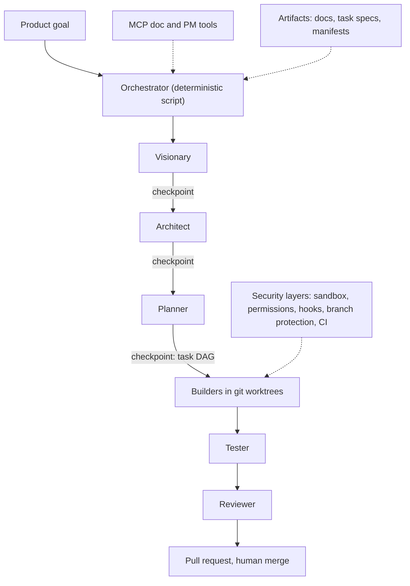

# Agentic SDLC blueprint

> Status: reference design, March 2026. Written before the implementation and not run as a standalone kit. The implementation is the rest of this repository: see [the repository README](../README.md) and [the implementation architecture](../docs/architecture.md).

## Thesis

Coding agents do well on single tasks, but software delivery is a pipeline: requirements, design, planning, implementation, testing and review. The blueprint treats the development system around the agents as the thing to engineer: role contracts, scoped context, inspectable artifacts, dependency-aware execution, verification, and explicit human authority. It is a design written on paper first.

## What it is and is not

| It is | It is not |
|---|---|
| A reference design and vocabulary for an artifact-centred agentic SDLC, written in March 2026 | A runnable product or a maintained kit |
| Specification-style documents: role contracts, context loading, orchestration, security layers, state formats | Evidence that the design works: nothing here was run end to end or measured |
| Preserved with its self-audit and a proposal that anticipated later changes | A claim that role-based agent pipelines are new |

Figures in the documents are third-party numbers or illustrative estimates unless a document says otherwise. Tool names, flags, package names, prices and maturity ratings reflect March 2026 and are partly stale.

## Architecture at a glance

## Design principles

- **Roles with contracts.** One role per cognitive mode and one artifact type per role, each with defined inputs, outputs, tools, model and context.
- **Deterministic and probabilistic boundary.** The orchestrator is ordinary code: it sequences stages, resolves the dependency graph, retries, enforces budgets and records manifests. Models do the judgment work inside each stage. The boundary matters because the model-produced task DAG that the orchestrator consumes is unvalidated input, so it needs schema checks before it drives anything.
- **Context is an engineering resource.** Each role loads only the documents and sections it needs, directed by the Planner. (A later critique in [internal/](internal/) argues for a more generous default; the question is open.)
- **Artifacts, not conversation.** Handoffs go through inspectable documents, task specs with traceability to design sections, and manifests.
- **Isolation.** One git worktree per parallel task.
- **Verification as a stage.** Testing and review are separate roles, and review can return an architecture-drift verdict to design instead of failing the task.
- **Human authority.** Supervised by default, autonomous as an opt-in that skips stage checkpoints only. A human always approves the merge.
- **Layered, not absolute, safety.** The security layers are complementary controls. The pattern-based hook is a tripwire, not a boundary.

## How the design evolved in the implementation

The implementation in the repository root was not built from this blueprint as a direct derivation. The two overlap, and several ideas changed or were dropped when they met real runs.

| Blueprint concept | Implementation mechanism | Relationship |
|---|---|---|
| Visionary and Architect | Designer | Consolidated, as the [proposed improvements](internal/designs/2026-03-07-proposed-improvements.md) suggested |
| Planner with a task DAG | Planner using GitHub Issues and dependency graphs | Kept, with GitHub Issues as the source of truth |
| Builder and Tester | Builder with TDD and difficulty-based model routing | Tester folded into the Builder |
| Reviewer with a drift verdict | Reviewer with severity findings and fix cycles | Kept and extended with fix and re-review loops |
| Shell orchestrator | Orchestrator agent | Replaced |
| Run manifests | Telemetry phase | Implemented in a different form |
| (not in the blueprint) | Retrospective agent and lessons | Added by the implementation |

## Document map

| # | Document | Content | Status |
|---|---|---|---|
| 01 | [Architecture Overview](01-architecture-overview.md) | System context, components, data flow, principles, entry points | Historical |
| 02 | [Agent Pipeline](02-agent-pipeline.md) | Per-role contracts: inputs, outputs, permissions, model, context | Historical |
| 03 | [Orchestration Engine](03-orchestration-engine.md) | DAG waves, retry and escalation, implementation tiers | Historical, embedded code is illustrative |
| 04 | [Context Strategy](04-context-strategy.md) | Three-tier loading, per-role context tables | Historical, token figures are estimates |
| 05 | [Integration Layer](05-integration-layer.md) | MCP abstraction and backend options | Historical, server and package tables are stale |
| 06 | [Security Model](06-security-model.md) | Five layers, worktree isolation, rollback | Historical, hook example corrected |
| 07 | [State Management](07-state-management.md) | Task spec format, status files, manifests, templates | Historical, examples are illustrative |
| 08 | [Monitoring and Scaling](08-monitoring-scaling.md) | Telemetry, cost, scaling | Historical, figures are third-party assumptions |
| | [Implementation guides](implementations/) | GitHub-native mapping of the abstractions | Illustrative, known stale inputs and tool names |
| | [Starter kit](starter-kit/README.md) | Agent definitions, templates, scripts | Illustrative, not maintained, not run |
| | [Internal materials](internal/README.md) | Self-audit (with errata) and proposed improvements | Historical |

Reading order: 01, 02, 03, 07 for engineers; 01, 02, 04, 08 for tech leads; 01, 06, 08 for stakeholders.

## Related work

The blueprint draws on well-established ideas and does not claim novelty for them: role specialization across agents, orchestrator and worker patterns, evaluator and reviewer loops, context engineering, and older software-engineering practice (design documents, ADRs, PRFAQ, DAG schedulers, git worktrees). Contemporary agent frameworks and vendor guidance cover much of the same ground.

## License

MIT, see [the repository license](../LICENSE).
