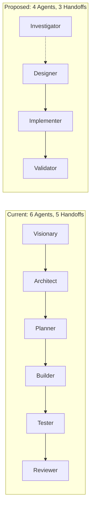
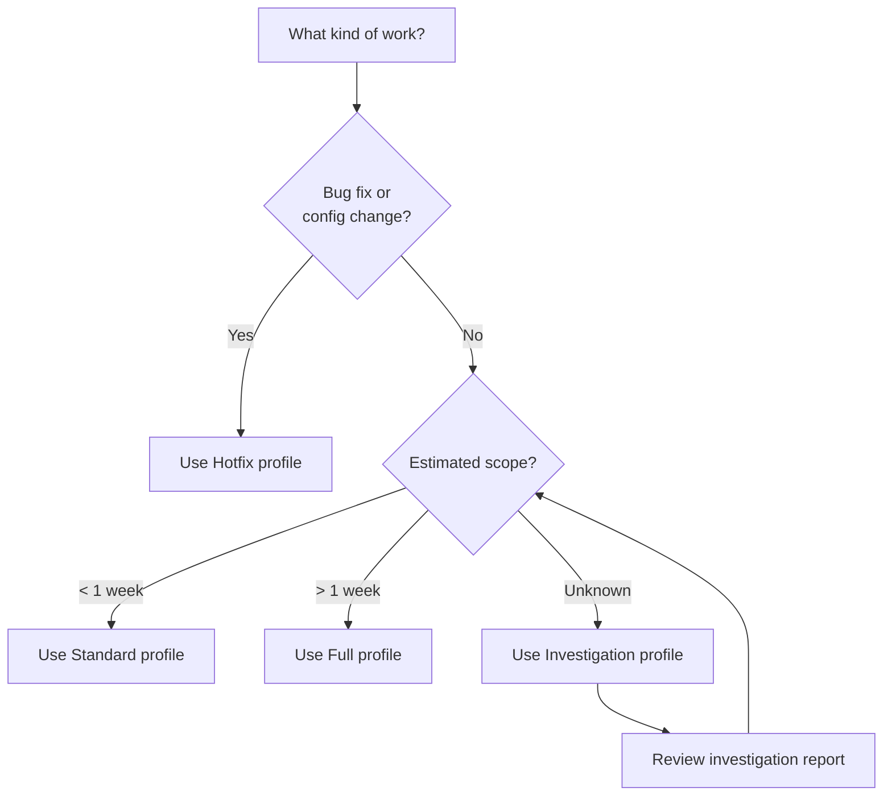

# Proposed Improvements

This document proposes a set of architectural and operational improvements to the Agentic SDLC Blueprint, informed by critical analysis of the current design. The proposals address four areas: adoption friction, pipeline reliability, workflow rigidity, and observability gaps. Each section states the problem, proposes a solution, and identifies tradeoffs.

## 1. Workflow Profiles

### 1.1 Problem

The current pipeline treats all work as a single flow through up to six agents. In practice, most engineering work falls into distinct categories with different process needs. A two-line bug fix should not require a PRFAQ. A large cross-cutting feature should not skip architecture review. The existing entry points (Full, Design, Plan, Build) partially address this, but they are framed as "skip stages" rather than as purpose-built workflows with selection criteria.

Teams resist standardization when it feels disproportionate to the task. A junior engineer assigned a bug fix who sees a six-stage pipeline will either skip the process entirely or waste cycles producing unnecessary artifacts.

### 1.2 Proposed Solution

Define four workflow profiles as first-class concepts. Each profile specifies which agents run, which checkpoints are blocking, and which artifacts are produced.

| Profile | Trigger Criteria | Agents | Blocking Checkpoints | Artifacts Produced |
|---------|-----------------|--------|---------------------|--------------------|
| **Hotfix** | Bug fix, patch, config change; estimated < 2 hours | Builder, Validator | Post-Review only | Task spec (lightweight), PR |
| **Standard** | Small feature, refactor, enhancement; estimated < 1 week | Designer, Implementer, Validator | Post-Design, Post-Review | PRD (brief), HLD (brief), task specs, PR |
| **Full** | New feature, new system, cross-cutting change; estimated > 1 week | Designer, Implementer, Validator | Post-Design, Post-Review | PRFAQ, PRD, HLD, LLD, ADRs, task DAG, PR |
| **Investigation** | Performance issue, incident, feasibility study; scope unknown | Investigator | Post-Investigation | Investigation report, recommended next profile |

The profile is selected at pipeline entry — either explicitly by the operator or inferred from ticket metadata (labels, story points, issue type). The orchestrator validates that the selected profile matches the work scope and warns if mismatched (e.g., a profile marked Hotfix with 15 files changed).

### 1.3 Agent Consolidation

The current six agents consolidate into four, reducing handoff boundaries and information loss.



**Investigator.** Exploratory agent for ambiguous work. Reads codebase, runs profiling, queries logs, and produces a structured investigation report with a recommended workflow profile and scope estimate. Does not produce design artifacts. Uses Opus. Not invoked by Standard or Hotfix profiles.

**Designer** (merges Visionary + Architect). Holds full product-to-architecture context. Produces product documents (PRFAQ, PRD) and technical design (HLD, LLD, ADRs) in a single session. Eliminates the product-intent-to-technical-design handoff, which is the most lossy boundary in the current pipeline. Uses Opus. Skipped by Hotfix profile.

**Implementer** (merges Planner + Builder). Decomposes work into tasks and executes them. When a plan proves wrong during implementation, the agent adapts without requiring re-orchestration. For large features, the orchestrator runs multiple Implementer instances in parallel via the existing DAG/worktree mechanism. Uses Sonnet for standard tasks, Opus for complex tasks or retry escalation.

**Validator** (merges Tester + Reviewer). Tests code, reviews for quality and architecture drift, and produces a pass/fail verdict with actionable feedback. Can fix trivial test issues (missing imports, assertion format) without re-invoking the Implementer. Uses Opus for review judgment, Sonnet for test execution.

### 1.4 Impact on Existing Architecture

- **Orchestration engine:** Profile selection becomes the first step. DAG execution, retry, and checkpoints remain unchanged.
- **Context strategy:** Fewer agents means fewer context matrices. Designer loads product + technical context together (larger context window, but eliminates a handoff).
- **Security model:** All five layers remain. Tool permissions update to four agent definitions instead of six.
- **State management:** Same four state locations. Fewer artifact types per profile reduces filesystem clutter.
- **Integration layer:** MCP abstraction unchanged. Fewer agents consuming it simplifies debugging.

### 1.5 Tradeoffs

- Consolidated agents have larger prompts and broader responsibilities, increasing per-invocation token cost.
- Designer combining product and architecture thinking may produce weaker output in one area if the model lacks domain expertise. Mitigation: prompt structure separates the two phases within a single session.
- Hotfix profile with minimal process may be overused by teams avoiding documentation. Mitigation: orchestrator warns when Hotfix scope exceeds thresholds (files changed, lines added, new dependencies).

## 2. Prescriptive Templates with Quality Criteria

### 2.1 Problem

Current templates are structural skeletons with `[Placeholder]` markers. They define sections but not depth, quality, or completeness expectations. A junior engineer filling in a PRD template has no guidance on whether their two-sentence persona description is sufficient or whether their success metrics need time horizons.

For the standardization goal, templates must do more than define structure — they must teach what good looks like.

### 2.2 Proposed Solution

Each template gains three additions:

**Minimum quality criteria** embedded as HTML comments within each section. These are visible to the agent filling the template but do not appear in the rendered output.

```markdown
## 2. User Personas

<!-- QUALITY CRITERIA:
- Minimum 2 personas, maximum 5
- Each persona must include: role, goal, pain point, success condition
- At least one persona must represent a non-happy-path user (admin, new user, edge case)
-->
```

**Worked example** as a companion file alongside each template. Not a placeholder-filled version of the template, but a realistic, complete example based on a concrete feature (e.g., "Add team billing to a SaaS product").

```
starter-kit/.claude/templates/
  prd.md              # Template with quality criteria
  prd-example.md      # Worked example: Team Billing PRD
  hld.md
  hld-example.md      # Worked example: Team Billing HLD
  ...
```

**Validation rules** as a structured section in each template that the Validator agent checks during review.

```markdown
## Validation Rules

- [ ] Every persona references at least one use case by ID
- [ ] Success metrics include a target value and measurement method
- [ ] Out of Scope section lists at least 2 items with rationale
- [ ] All cross-references to HLD/LLD sections resolve to existing sections
```

### 2.3 Tradeoffs

- Worked examples risk becoming "copy-paste starters" that reduce original thinking. Mitigation: examples use a domain (SaaS billing) unlikely to match adopters' projects.
- Quality criteria add template complexity. Mitigation: criteria are HTML comments, invisible in rendered docs.
- Validation rules may reject legitimately minimal documents. Mitigation: Hotfix and Standard profiles use subset criteria.

## 3. Reliability Improvements

### 3.1 Problem

The current design accepts a 33% first-attempt success rate and addresses it with retry-and-escalation. For a system designed to level up less experienced engineers, this failure rate is a barrier. Junior engineers will spend more time debugging pipeline failures than learning from the process.

### 3.2 Root Cause Analysis

Most failures trace to three sources:

1. **Insufficient context.** Agents operate with minimum viable context to save tokens. When the minimum is insufficient, the agent fails and retries with more context. This is a predictable, preventable failure.
2. **Ambiguous task specs.** No schema validation between agents. Format mismatches cause downstream failures that surface as mysterious errors.
3. **Mismatched expectations.** Lossy handoffs mean downstream agents interpret upstream artifacts differently than intended.

### 3.3 Proposed Solutions

**3.3.1 Generous Context by Default**

Replace "minimum viable context" with "relevant context, generously scoped." The cost difference is marginal — loading 3-4 extra documents adds ~2,000 tokens (~$0.03 per invocation). The retry cost of insufficient context is 2-3x the original invocation cost plus human debugging time.

Concrete change: remove the per-agent context matrix. Instead, each agent receives:
- Full CLAUDE.md (always)
- All design documents produced so far in the pipeline (cumulative)
- Task-specific files (task spec, relevant source files)

This increases first-invocation token cost by an estimated 20-30% but should reduce retry rate significantly. The economy cost mode can retain the current minimum-context strategy for cost-sensitive teams.

**3.3.2 Schema Validation at Handoff Points**

Define JSON Schema for all inter-agent contracts:

| Artifact | Schema Validates |
|----------|-----------------|
| Design manifest | Required fields: feature_name, prfaq_ref, prd_ref, hld_ref, lld_ref, adr_refs[] |
| Task DAG | Required fields per task: id, title, dependencies[], relevant_files[], acceptance_criteria[] |
| Task status | Required fields: task_id, status enum, agent, model, branch, attempts, errors[] |
| Run manifest | Required fields: run_id, profile, stages[], total_cost, total_tokens |

The orchestrator validates each artifact against its schema before passing it to the next agent. Schema violations are reported with specific field-level errors, not generic "retry" instructions.

**3.3.3 Pre-flight Validation**

Before each agent invocation, the orchestrator runs pre-flight checks:

- MCP servers are reachable (doc tool, PM tool)
- Referenced documents exist and are readable
- Referenced source files exist in the repository
- Task DAG is acyclic (for Implementer stage)
- Git working tree is clean (for Builder/Implementer)
- Required environment variables are set

Pre-flight failures produce actionable error messages and abort before wasting tokens.

### 3.4 Success Rate Target

With these changes, target **60% first-attempt success rate** for Standard and Full profiles, **80% for Hotfix** profile. Measure and report success rate per profile and per stage in run manifests to identify remaining failure patterns.

### 3.5 Tradeoffs

- Generous context increases baseline cost. Mitigation: economy mode retains minimum-context strategy.
- Schema validation adds orchestrator complexity. Mitigation: schemas are simple (flat JSON, no nesting beyond one level).
- Pre-flight checks add latency (~2-5 seconds per stage). Mitigation: checks run in parallel.

## 4. Observability Dashboard

### 4.1 Problem

Run manifests capture rich execution data but have no consumption layer. A team lead cannot answer basic questions: How many features are in flight? Which stage is each at? What is our cost per feature? Where does the pipeline fail most? The visibility and tracking goal requires a dashboard, not just data files.

### 4.2 Proposed Solution

A lightweight dashboard generated from run manifests and pipeline state files. Two implementation options aligned with the existing orchestration tiers.

**Option A: CLI Dashboard (Tier 1)**

A terminal-based status view for solo developers and small teams. Implemented as a script (`starter-kit/scripts/sdlc-dashboard.sh`) that reads `.claude/context/runs/` and `.claude/context/status/` and renders a summary.

```
Feature Pipeline Status
========================
feature/team-billing    [████████░░] Design ✓  Implement ◆  Validate ○
feature/api-v2          [██████████] Design ✓  Implement ✓  Validate ✓  MERGED
hotfix/null-check       [██████████] Implement ✓  Validate ✓  MERGED

Cost Summary (last 30 days)
============================
Total: $127.40 | Features: 8 | Avg cost/feature: $15.93
First-attempt success rate: 58%

Stage Failure Rates
====================
Designer:    12% failure (3/25 invocations)
Implementer: 31% failure (8/26 invocations)
Validator:    8% failure (2/24 invocations)
```

**Option B: GitHub Pages Dashboard (Tier 3)**

A static site generated by a GitHub Action on each pipeline run. Reads run manifests from the repository and renders HTML with:
- Feature kanban board (which stage each feature is at)
- Cost attribution per feature and per developer
- Success rate trends over time
- Stage-level failure analysis with common error categories

The Action commits the generated site to `gh-pages` branch, viewable at `https://<org>.github.io/<repo>/pipeline/`.

### 4.3 Dashboard Data Model

Extend the run manifest schema with fields required for dashboard rendering:

```json
{
  "run_id": "run-2026-03-07-001",
  "feature": "team-billing",
  "profile": "full",
  "started_at": "2026-03-07T10:00:00Z",
  "completed_at": "2026-03-07T14:23:00Z",
  "status": "completed",
  "stages": [
    {
      "agent": "designer",
      "status": "completed",
      "model": "opus",
      "attempts": 1,
      "tokens": 45200,
      "cost_usd": 2.14,
      "duration_seconds": 180,
      "artifacts": ["prfaq-001", "prd-001", "hld-001"],
      "checkpoint": { "action": "approved", "reviewer": "carlos", "timestamp": "..." }
    }
  ],
  "total_cost_usd": 15.93,
  "total_tokens": 312000
}
```

### 4.4 Tradeoffs

- CLI dashboard requires terminal access and doesn't aggregate across developers. Sufficient for Tier 1, insufficient for teams.
- GitHub Pages dashboard requires CI/CD setup and adds a build step. Acceptable for Tier 3 teams already using Actions.
- Dashboard data is only as good as run manifest completeness. Requires strict manifest generation in the orchestrator.

## 5. Onboarding Experience

### 5.1 Problem

The blueprint's target audience includes engineers who are "just scratching the surface" with AI coding tools. The current repo contains eight specification-grade design documents, six agent definitions, and orchestration scripts — all written for an advanced audience. A junior engineer opening this repo would not know where to start, what to run first, or how to validate that their setup works.

The system designed to democratize AI usage is currently only accessible to advanced practitioners.

### 5.2 Proposed Solution

**5.2.1 Quickstart Guide**

A single document (`docs/quickstart.md`) that takes an engineer from zero to running their first pipeline in under 30 minutes. Structure:

1. Prerequisites (Claude Code installed, GitHub repo, MCP server configured)
2. Copy reference files into your project (with exact commands)
3. Configure `.mcp.json` for your doc/PM tools
4. Run a Hotfix profile end-to-end on a sample bug fix
5. Run a Standard profile on a small feature
6. Understand the output (where are the artifacts? what do they mean?)

No theory, no architecture explanation — just steps and expected output.

**5.2.2 End-to-End Worked Example**

A directory (`docs/example-walkthrough/`) containing the complete artifacts from a realistic feature flowing through the Full profile. The example feature: "Add webhook notifications to a task management API."

```
docs/example-walkthrough/
  README.md                    # Narrative walkthrough with commentary
  01-investigation-report.md   # Investigator output
  02-prfaq.md                  # Designer output: product framing
  03-prd.md                    # Designer output: requirements
  04-hld.md                    # Designer output: architecture
  05-lld.md                    # Designer output: detailed design
  06-adr-001.md                # Designer output: decision record
  07-task-dag.json             # Implementer input: task breakdown
  08-task-spec-001.md          # Implementer input: individual task
  09-test-report.md            # Validator output: test results
  10-review-report.md          # Validator output: review verdict
  11-run-manifest.json         # Pipeline output: execution record
```

Each file is annotated with commentary explaining what the agent did, why it made specific choices, and what "good" looks like in that artifact.

**5.2.3 Decision Tree**

A visual guide for selecting the right workflow profile:



### 5.3 Tradeoffs

- Worked examples require ongoing maintenance as the blueprint evolves. Mitigation: example is self-contained and versioned with the blueprint.
- Quickstart guide may oversimplify, leading to misconfigured setups. Mitigation: include verification steps at each stage.
- Decision tree is reductive (real work doesn't always fit four categories). Mitigation: tree is guidance, not policy; teams can override.

## 6. Implementation Priority

Proposed sequencing based on impact and dependency order:

| Priority | Improvement | Rationale |
|----------|------------|-----------|
| P0 | Workflow profiles + agent consolidation | Foundation for all other changes; reduces scope of template/dashboard/onboarding work |
| P0 | Schema validation at handoffs | Directly improves reliability; small implementation surface |
| P1 | Prescriptive templates with examples | Depends on finalized agent list and profile definitions |
| P1 | Onboarding quickstart + worked example | Depends on finalized profiles and templates |
| P2 | Observability dashboard | Depends on finalized run manifest schema |
| P2 | Generous context defaults | Configuration change; can be done independently |
| P3 | Pre-flight validation | Incremental reliability improvement; low urgency |

## 7. Open Questions

1. **Agent consolidation scope.** Should the Investigator be a separate agent or a mode of the Designer? A separate agent is cleaner but adds a fourth role to learn.
2. **Profile enforcement.** Should teams be able to create custom profiles, or are four fixed profiles sufficient? Custom profiles add flexibility but fragment standardization.
3. **Template validation strictness.** Should quality criteria be enforced (pipeline blocks if criteria unmet) or advisory (warnings only)? Enforcement ensures quality but may slow teams down.
4. **Dashboard hosting.** For teams not using GitHub Actions, should the dashboard support alternative hosting (Vercel, Netlify, local server)?
5. **Backward compatibility.** Should the six-agent pipeline remain available as a "legacy" option, or should the consolidation be a clean break? Legacy support adds maintenance burden but eases migration.

## Related Documents

- [Architecture Overview](../../01-architecture-overview.md)
- [Agent Pipeline](../../02-agent-pipeline.md)
- [Orchestration Engine](../../03-orchestration-engine.md)
- [Context Strategy](../../04-context-strategy.md)
- [Integration Layer](../../05-integration-layer.md)
- [Security Model](../../06-security-model.md)
- [State Management](../../07-state-management.md)
- [Monitoring and Scaling](../../08-monitoring-scaling.md)
