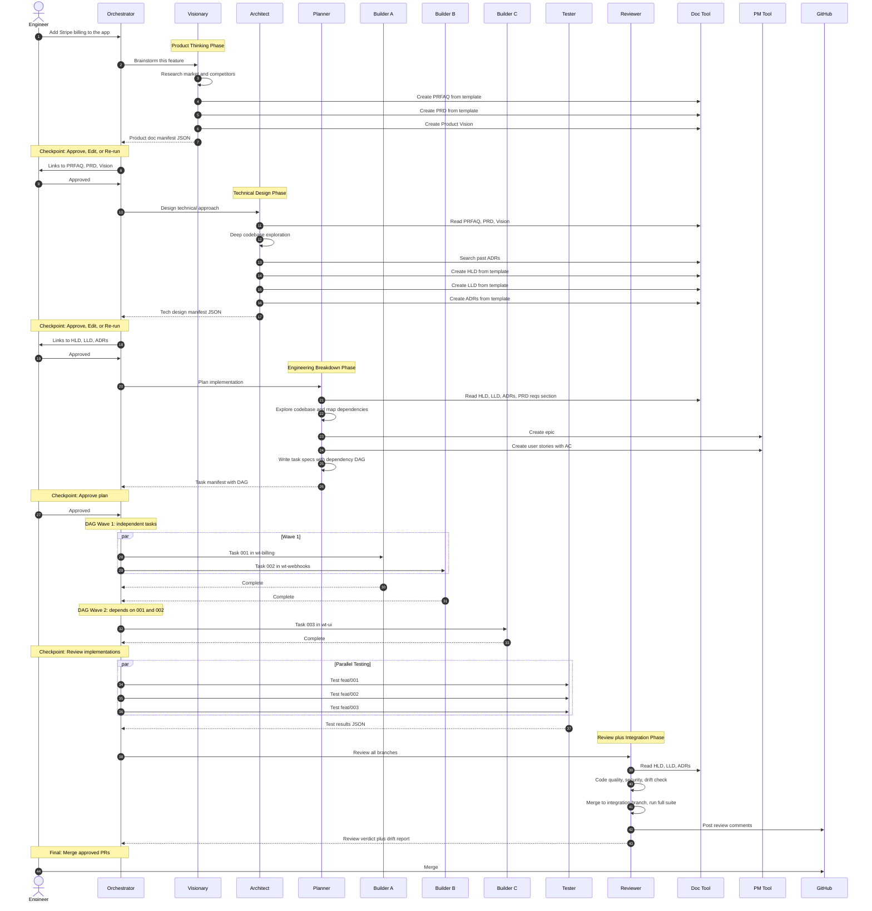
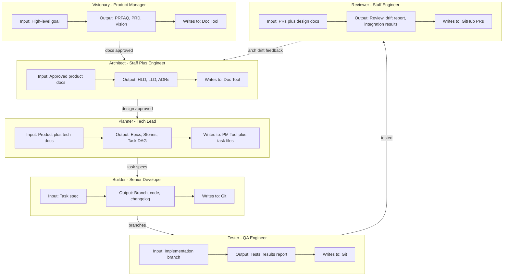

# Agent Pipeline

This document specifies the six-agent pipeline that transforms a high-level product goal into reviewed, tested pull requests. Each agent maps to a distinct cognitive mode and produces a single artifact type. Agents execute sequentially with checkpoint gates between stages, and inter-agent communication is mediated through structured JSON manifests and shared document stores.

## 1. Overview

The pipeline enforces a strict separation of concerns: one agent per cognitive mode, one artifact type per agent. This constraint ensures that product thinking never contaminates implementation, that architecture decisions are explicit rather than emergent, and that task specifications carry full traceability to design documents.

### Pipeline Sequence



### Agent Responsibilities



## 2. Agent Specifications

### 2.1 Visionary (Product Manager)

**Cognitive Mode.** Product thinking. Focuses on user needs, market positioning, and feature scoping. Addresses "what" and "why" exclusively; never prescribes implementation approach.

**Inputs.** High-level goal string (e.g., "Add Stripe billing integration"). Optionally, existing product documents for reference via doc tool search.

**Outputs.** Three documents written to the doc tool: PRFAQ (from `prfaq-template.md`), PRD (from `prd-template.md`), and Product Vision. Returns a JSON manifest containing document IDs and URLs.

**Tool Permissions.**

| Tool Category | Access | Constraints |
|---------------|--------|-------------|
| Read/Grep | Allowed | Codebase read for understanding current product capabilities |
| Write | Denied | No filesystem write access |
| Bash | Denied | No shell execution |
| Git | Denied | No repository operations |
| Doc MCP | Read/Write | Create and update product documents |
| PM MCP | Denied | No project management access |
| Web | Allowed | Market research, competitor analysis |

**Model Selection.** Standard mode: Opus. Economy mode: Sonnet. Simple feature requests with well-understood domains are candidates for economy mode.

**Context Loading.** Searches existing PRDs only (via `mcp__docs__search`). Skips HLD, LLD, and ADR documents entirely. See [Context Strategy](04-context-strategy.md).

**Agent Definition File.** `reference/.claude/agents/visionary.md`

**Prompt Design Notes.** The agent is instructed to be opinionated and recommend a single approach rather than presenting a menu of options. Assumptions and open questions must be flagged explicitly. The agent is prohibited from producing technical designs, epics, or task breakdowns.

### 2.2 Architect (Staff+ Engineer)

**Cognitive Mode.** Technical design. Performs deep codebase exploration, evaluates multiple architectural approaches with explicit tradeoffs, and makes decisive recommendations.

**Inputs.** Approved product document manifest (PRFAQ, PRD, Vision document IDs). Access to the full codebase and existing ADR corpus.

**Outputs.** Three document types written to the doc tool: HLD (from `hld-template.md`), LLD (from `lld-template.md`), and ADRs (from `adr-template.md`, one per significant decision). Returns a technical design manifest JSON.

**Tool Permissions.**

| Tool Category | Access | Constraints |
|---------------|--------|-------------|
| Read/Grep | Allowed | Full codebase read access |
| Write | Denied | No filesystem write access |
| Bash | Allowed | `find`, `tree`, `wc` only |
| Git | Denied | No repository operations |
| Doc MCP | Read/Write | Read product docs, create/update design docs, search ADRs |
| PM MCP | Denied | No project management access |
| Web | Allowed | External API research, library evaluation |

**Model Selection.** Standard mode: Opus. Economy mode: Opus. Architecture decisions require maximum reasoning depth regardless of cost mode.

**Context Loading.** Full load of PRFAQ, PRD, and Vision. Searches past ADRs for relevant prior decisions. See [Context Strategy](04-context-strategy.md).

**Agent Definition File.** `reference/.claude/agents/architect.md`

**Prompt Design Notes.** The agent must evaluate 2-3 architectural approaches with explicit tradeoffs, then select one and defend the decision. Every significant decision requires an ADR with rationale. References to specific files and code paths are mandatory. The agent designs for the current codebase state, not a theoretical ideal.

### 2.3 Planner (Tech Lead)

**Cognitive Mode.** Engineering decomposition. Translates product requirements and technical designs into discrete, implementable work units with dependency relationships.

**Inputs.** Complete document manifest (product + technical design docs). Access to the codebase for validation.

**Outputs.** Epics and user stories created in the PM tool. Task specification files written to `.claude/context/tasks/`. A task manifest JSON containing the full task list and dependency DAG. See [State Management](07-state-management.md) for task spec format.

**Tool Permissions.**

| Tool Category | Access | Constraints |
|---------------|--------|-------------|
| Read/Grep | Allowed | Full codebase read access |
| Write | Allowed | Task spec files only |
| Bash | Allowed | `find`, `tree` only |
| Git | Denied | No repository operations |
| Doc MCP | Read | Read product and design docs |
| PM MCP | Read/Write | Create epics, stories; search existing issues |
| Web | Denied | No web access |

**Model Selection.** Standard mode: Opus. Economy mode: Sonnet. Inputs are well-defined and the task is structured decomposition, making it a candidate for economy mode.

**Context Loading.** Full load of HLD, LLD, and ADRs. Section-level load of PRD (requirements section only). Skips PRFAQ and Vision. See [Context Strategy](04-context-strategy.md).

**Agent Definition File.** `reference/.claude/agents/planner.md`

**Prompt Design Notes.** Each task must be scoped to a maximum of 2 hours. The `Relevant Files` section in each task spec is critical because the Builder agent uses it for context loading. The dependency DAG must explicitly distinguish parallelizable tasks from sequential ones and mark the critical path.

### 2.4 Builder (Senior Developer)

**Cognitive Mode.** Implementation. Executes a single task specification in an isolated git worktree. Focused, scoped, and deterministic.

**Inputs.** A single task specification file path. The task spec contains all necessary context: source document references, relevant files, acceptance criteria, and dependencies.

**Outputs.** A feature branch (`feat/<task-id>-<short-description>`) containing implementation code, updated CHANGELOG.md, updated API documentation, and migration notes where applicable. Commits follow Conventional Commits format referencing the task ID.

**Tool Permissions.**

| Tool Category | Access | Constraints |
|---------------|--------|-------------|
| Read/Grep | Allowed | Full codebase read access |
| Write | Allowed | Unrestricted within worktree |
| Bash | Allowed | Build commands, lint, test runners |
| Git | Allowed | Branch creation, commits only; no push to main |
| Doc MCP | Denied | No document access |
| PM MCP | Allowed | Status updates only |
| Web | Denied | No web access |

**Model Selection.** Standard mode: Sonnet. Economy mode: Sonnet. Well-specified tasks do not require Opus-level reasoning. On failure after maximum retries, the orchestrator escalates to Opus. See [Orchestration Engine](03-orchestration-engine.md).

**Context Loading.** Reads only the assigned task spec file. If the spec references an LLD section, reads that section only. Skips all other documents. See [Context Strategy](04-context-strategy.md).

**Agent Definition File.** `reference/.claude/agents/builder.md`

**Prompt Design Notes.** The agent reads only its assigned task spec and must not explore the codebase beyond files listed in the `Relevant Files` section. Implementation proceeds incrementally with lint and test execution after each logical unit. Files outside the task scope must not be modified.

### 2.5 Tester (QA Engineer)

**Cognitive Mode.** Test design and execution. Writes unit and integration tests, runs the full test suite, and iterates until all tests pass (TDD loop).

**Inputs.** An implementation branch produced by the Builder agent.

**Outputs.** Test files committed to the implementation branch. Test results report.

**Tool Permissions.**

| Tool Category | Access | Constraints |
|---------------|--------|-------------|
| Read/Grep | Allowed | Full codebase read access |
| Write | Allowed | Test files only |
| Bash | Allowed | Test runners (`npm run test`, `pytest`) |
| Git | Allowed | Commits only |
| Doc MCP | Denied | No document access |
| PM MCP | Denied | No project management access |
| Web | Denied | No web access |

**Model Selection.** Standard mode: Sonnet. Economy mode: Sonnet. Test writing is well-scoped and does not require Opus-level reasoning.

**Context Loading.** Reads the task spec only. Skips all other documents. See [Context Strategy](04-context-strategy.md).

**Agent Definition File.** Tester agent is invoked inline by the orchestrator (no separate definition file). Uses the same permission set as the Builder with restricted write scope.

**Prompt Design Notes.** The agent writes comprehensive tests covering happy paths, error cases, and edge cases. It runs the full test suite and iterates on failures until the suite is green. The agent does not modify implementation code.

### 2.6 Reviewer (Staff Engineer)

**Cognitive Mode.** Quality assurance and architecture alignment. Reviews diffs against design documents, checks for security vulnerabilities, and validates cross-branch integration.

**Inputs.** All feature branches produced by Builder and Tester agents. HLD, LLD, and ADR documents from the doc tool.

**Outputs.** Structured review JSON with per-branch verdicts (APPROVE, REQUEST_CHANGES, ARCHITECTURE_DRIFT), issues with severity classification (critical, major, minor, nit), integration test results, and architecture drift reports with specific design document references.

**Tool Permissions.**

| Tool Category | Access | Constraints |
|---------------|--------|-------------|
| Read/Grep | Allowed | Full codebase read access |
| Write | Denied | Read-only; posts comments, does not edit code |
| Bash | Allowed | `git diff`, `git merge`, test runners |
| Git | Denied | No direct git operations (uses Bash for read-only git commands) |
| Doc MCP | Read | Read HLD, LLD, ADRs for alignment checks |
| PM MCP | Allowed | Post review comments only |
| Web | Denied | No web access |

**Model Selection.** Standard mode: Opus. Economy mode: Opus. Security review and architecture alignment require maximum reasoning depth regardless of cost mode.

**Context Loading.** Section-level load of HLD and LLD (sections relevant to the diff under review). Searches ADRs for decisions relevant to the code in scope. Skips PRFAQ, PRD, and Vision. See [Context Strategy](04-context-strategy.md).

**Agent Definition File.** `reference/.claude/agents/reviewer.md`

**Prompt Design Notes.** The agent reviews six dimensions: architecture alignment, code quality, security (OWASP Top 10), error handling, test coverage, and convention compliance. Architecture drift is not automatically treated as a defect; the agent flags it for human or Architect review and notes whether the drift may represent an improvement. Security issues are always classified as critical severity.

## 3. Inter-Agent Contracts

Agents communicate through structured JSON manifests passed via the orchestrator. Each manifest contains the artifact identifiers and metadata required by the next stage.

### Visionary to Architect

```json
{
  "stage": "visionary",
  "status": "completed",
  "artifacts": [
    { "type": "prfaq", "id": "notion-abc", "url": "https://notion.so/..." },
    { "type": "prd", "id": "notion-def", "url": "https://notion.so/..." },
    { "type": "vision", "id": "notion-ghi", "url": "https://notion.so/..." }
  ]
}
```

### Architect to Planner

```json
{
  "stage": "architect",
  "status": "completed",
  "artifacts": [
    { "type": "hld", "id": "notion-jkl", "url": "https://notion.so/..." },
    { "type": "lld", "id": "notion-mno", "url": "https://notion.so/..." },
    { "type": "adr", "id": "notion-pqr", "url": "https://notion.so/...", "title": "ADR-001: Stripe over Paddle" },
    { "type": "adr", "id": "notion-stu", "url": "https://notion.so/...", "title": "ADR-002: Webhook idempotency" }
  ]
}
```

### Planner to Builder

```json
{
  "stage": "planner",
  "status": "completed",
  "epic_id": "PM-42",
  "tasks": [
    { "id": "001", "spec": ".claude/context/tasks/001-billing-api.md", "story_id": "PM-43" },
    { "id": "002", "spec": ".claude/context/tasks/002-webhook-handler.md", "story_id": "PM-44" },
    { "id": "003", "spec": ".claude/context/tasks/003-subscription-ui.md", "story_id": "PM-45" }
  ],
  "dag": {
    "001": [],
    "002": [],
    "003": ["001", "002"]
  }
}
```

### Reviewer Feedback Loop

When the Reviewer detects architecture drift from the HLD/LLD, it flags the deviation with specific document references rather than simply blocking the pull request. The orchestrator can then re-engage the Architect agent to either update the design documents (if the drift represents an intentional improvement) or guide the Builder agent back on track.

```json
{
  "stage": "reviewer",
  "verdict": "ARCHITECTURE_DRIFT",
  "drift_details": {
    "hld_section": "Component: Billing Service",
    "expected": "Event-driven webhook processing via queue",
    "actual": "Synchronous webhook processing in request handler",
    "assessment": "Drift may introduce latency under load. Recommend Architect review."
  }
}
```

## 4. Model Tier Strategy

The orchestrator supports two cost modes that determine model assignment per agent. The `--cost-mode` flag selects between them.

| Agent | Standard Mode | Economy Mode | Rationale |
|-------|--------------|--------------|-----------|
| Visionary | Opus | Sonnet | Simple features with well-understood domains require less creative reasoning |
| Architect | Opus | Opus | Architecture decisions require maximum depth regardless of feature complexity |
| Planner | Opus | Sonnet | With well-defined inputs, structured decomposition is feasible with Sonnet |
| Builder | Sonnet | Sonnet | Task specifications are fully defined; implementation is well-scoped |
| Tester | Sonnet | Sonnet | Test writing against defined acceptance criteria is well-scoped |
| Reviewer | Opus | Opus | Security review and architecture alignment require maximum depth |

```bash
# Economy mode for simple features
./sdlc-pipeline.sh --cost-mode economy "Add dark mode toggle"

# Standard mode for complex features
./sdlc-pipeline.sh --cost-mode standard "Add Stripe billing"
```

## 5. Checkpoint Gates

Between each pipeline stage, the orchestrator presents a checkpoint where the human operator can:

| Option | Behavior |
|--------|----------|
| **Approve** (`y`) | Proceed to the next stage with the current artifacts |
| **Edit + Re-run** (`e`) | Pause the pipeline. The operator edits documents externally (in Notion, Confluence, etc.), then re-enters the pipeline at the current stage using `--resume-from <stage>` |
| **Abort** (`n`) | Terminate the pipeline. State is preserved for future resumption |

### Supervised vs. Autonomous Modes

**Supervised (default).** The pipeline halts at every checkpoint and awaits human input. This is the recommended mode for all production use.

**Autonomous.** The pipeline skips all checkpoints and proceeds without human intervention. Enabled via `--autonomy autonomous`. Appropriate only for well-understood, low-risk changes in environments with robust CI/CD gates.

## 6. Agent Definition File Format

Each agent is defined as a markdown file in `.claude/agents/`. The file uses YAML frontmatter for metadata and markdown body for the system prompt.

### Frontmatter Schema

```yaml
---
name: <string>            # Agent identifier (e.g., "visionary", "architect")
description: <string>     # One-line description of agent purpose
tools: <comma-separated>  # Allowed tool names (e.g., "Read, Grep, Glob, WebFetch")
model: <string>           # Default model ("opus" or "sonnet")
permissionMode: <string>  # One of: "plan", "acceptEdits", "full"
---
```

### Permission Modes

| Mode | Behavior |
|------|----------|
| `plan` | Agent proposes tool calls; requires human approval for execution |
| `acceptEdits` | Agent can execute file edits without approval; other tools require approval |
| `full` | Agent executes all allowed tools without approval |

### Prompt Structure Conventions

The markdown body following the frontmatter follows this structure:

1. **Role statement.** A single sentence establishing the agent's persona and expertise level.
2. **Invocation protocol.** A numbered list describing the sequence of operations the agent performs when invoked.
3. **Rules.** A bulleted list of constraints and prohibitions governing the agent's behavior.

The prompt must not contain instructions outside the agent's declared cognitive mode. For example, the Visionary prompt must never reference implementation patterns, and the Builder prompt must never reference product strategy.

## Related Documents

- [Architecture Overview](01-architecture-overview.md) -- System context and design principles
- [Orchestration Engine](03-orchestration-engine.md) -- DAG execution, retry strategy, checkpoint implementation
- [Context Strategy](04-context-strategy.md) -- Per-agent context loading matrix
- [Integration Layer](05-integration-layer.md) -- MCP tool interfaces used by agents
- [Security Model](06-security-model.md) -- Per-agent tool permission enforcement
- [State Management](07-state-management.md) -- Task spec format and inter-agent state flow
