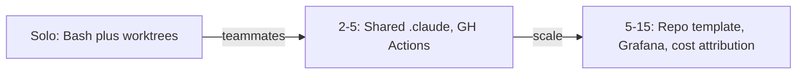

# Monitoring and Scaling

This document specifies the operational concerns for running the agentic SDLC pipeline: telemetry collection, cost tracking, performance expectations, and team scaling strategies. It also defines the CLAUDE.md configuration requirements for pipeline compatibility.

## 1. Overview

Operating an agentic SDLC pipeline introduces operational concerns distinct from traditional CI/CD: token-based cost accumulation, model-specific performance variance, and configuration management across team members. This document addresses these concerns across three dimensions: observability (what to measure), economics (what it costs), and scaling (how to grow from solo to team).

## 2. Telemetry

### OpenTelemetry Integration

Claude Code supports native OpenTelemetry (OTel) export for tracing, metrics, and logging. Enable telemetry by setting the environment variable:

```bash
export CLAUDE_CODE_ENABLE_TELEMETRY=1
```

### Metrics

The following metrics are available per agent invocation:

| Metric | Unit | Source | Description |
|--------|------|--------|-------------|
| Token usage (input) | tokens | OTel span attributes | Input tokens consumed by the agent |
| Token usage (output) | tokens | OTel span attributes | Output tokens generated by the agent |
| Token usage (cached) | tokens | OTel span attributes | Tokens served from prompt cache |
| Duration | seconds | OTel span duration | Wall-clock execution time |
| Cost | USD | Computed from token usage | Per-invocation cost |
| Tool calls | count | OTel span events | Number of tool invocations per agent |
| Retry count | count | Pipeline manifest | Number of retry attempts per task |
| Model escalation | boolean | Pipeline manifest | Whether model escalation occurred |

### Trace Structure

Each pipeline run produces a trace with the following span hierarchy:

```
pipeline_run (root span)
  +-- stage_visionary
  +-- stage_architect
  +-- stage_planner
  +-- stage_builder_001
  |     +-- attempt_1
  |     +-- attempt_2 (retry)
  +-- stage_builder_002
  +-- stage_tester_001
  +-- stage_tester_002
  +-- stage_reviewer
```

Spans include attributes for agent name, model, token counts, cost, and completion status.

## 3. Cost Tracking

Cost tracking operates at three levels, each providing increasing organizational visibility.

### SDK-Level (Per-Query)

The Agent SDK exposes `total_cost_usd` on each query response object. This enables real-time cost tracking and budget enforcement within Tier 2 orchestration.

```typescript
const result = await agent.query("Implement task...");
console.log(`Cost: $${result.total_cost_usd}`);

if (runningTotal + result.total_cost_usd > BUDGET_LIMIT) {
  throw new BudgetExceededError();
}
```

### Local (Per-Developer)

The `ccusage` CLI tool provides per-developer cost and usage reports:

```bash
npx ccusage@latest
```

This reports total tokens, cost, and usage breakdown by model and time period for the local developer's Claude Code sessions.

### Organization (Cross-Team)

The Anthropic Usage API provides organization-level usage data, enabling:

- Per-team cost attribution
- Monthly budget tracking
- Usage trend analysis
- Cost anomaly detection

### Pipeline Manifest Aggregation

Pipeline run manifests (see [State Management](07-state-management.md)) track per-stage cost and token usage. Aggregating across manifests provides:

- Per-feature cost (total cost of a full pipeline run)
- Per-agent cost distribution (identifying which agents consume the most tokens)
- Cost-mode comparison (standard vs. economy for similar features)
- Retry cost overhead (additional cost from failed attempts and model escalation)

## 4. Performance Expectations

The following metrics represent empirically observed performance characteristics of agentic SDLC pipelines based on production deployments.

| Metric | Value | Notes |
|--------|-------|-------|
| First-attempt autonomous success rate | ~33% | Percentage of tasks completed correctly on first attempt without human intervention |
| Productivity gain | 10-30% | Overall engineering productivity improvement, measured by throughput |
| Cost per engineer | ~$1,000-1,500/mo | Token costs for active pipeline usage per developer |
| New operational bottleneck | Reviewing diffs | The rate-limiting step shifts from writing code to reviewing AI-generated code |

### Implications

- **The 33% success rate is expected, not a deficiency.** The retry and escalation strategy (see [Orchestration Engine](03-orchestration-engine.md)) is designed to handle the remaining 67% through progressive context expansion, model escalation, and human intervention.
- **The bottleneck shift to diff review is structural.** Teams should plan for increased review capacity, including tooling for efficient AI-generated diff review and potentially dedicated review time allocation.
- **Cost scales with usage, not headcount.** Economy mode (see [Agent Pipeline](02-agent-pipeline.md)) reduces cost for simple features; standard mode is reserved for complex features requiring Opus-level reasoning.

## 5. Team Scaling

The pipeline is designed for progressive adoption from solo developer to growing team. Each scale introduces additional infrastructure and configuration requirements.



### Solo Developer (1 person)

**Orchestration.** Tier 1 Bash scripts invoking `claude -p`. See [Orchestration Engine](03-orchestration-engine.md).

**Parallelism.** Git worktrees on the local machine for parallel Builder agents.

**Configuration.** Local `.claude/` directory with agent definitions, templates, and settings. `.mcp.json` with personal API keys in `.claude/settings.local.json` (gitignored).

**Cost tracking.** `npx ccusage@latest` for personal usage reports. Pipeline manifests for per-feature cost analysis.

**Requirements:**
- Local Claude Code installation
- Git worktree support
- MCP server configuration for doc and PM tools

### Small Team (2-5 people)

**Orchestration.** Tier 1 Bash scripts for local development. Tier 3 GitHub Actions for shared workflows.

**Configuration.** Shared `.claude/` directory committed to the repository. Agent definitions, templates, and hook guards are standardized across the team.

**Conventions.** Standardized CLAUDE.md, shared agent definitions, consistent MCP configuration. Code review conventions for AI-generated PRs.

**Cost tracking.** Anthropic Usage API for team-level cost visibility. Pipeline manifests aggregated for team reporting.

**Requirements (additional):**
- Shared `.claude/` directory in version control
- GitHub Actions workflows for label-triggered pipeline stages
- Agreed-upon conventions for entry points, cost modes, and review processes

### Growing Team (5-15 people)

**Orchestration.** Tier 2 Agent SDK for programmatic control. Tier 3 GitHub Actions for standardized workflows.

**Infrastructure.** Repository template containing the full `.claude/` directory, CLAUDE.md, `.mcp.json`, and pipeline scripts. New projects inherit the standard configuration.

**Observability.** Grafana dashboards consuming OpenTelemetry data for:
- Per-team token usage and cost
- Per-agent success rates and retry frequency
- Pipeline throughput and duration trends
- Cost-mode effectiveness comparison

**Cost attribution.** Per-team or per-project cost allocation using Anthropic Usage API tags and pipeline manifest aggregation.

**Requirements (additional):**
- Repository template with standardized pipeline configuration
- Grafana or equivalent dashboarding for OTel data
- Cost attribution process integrated with finance reporting
- Tier 2 SDK adoption for teams requiring custom orchestration logic

## 6. CLAUDE.md Configuration

The `CLAUDE.md` file at the project root provides essential context to all Claude Code sessions, including pipeline agent invocations. A well-structured CLAUDE.md is a prerequisite for pipeline compatibility.

### Required Sections

| Section | Purpose | Example Content |
|---------|---------|-----------------|
| Project Identity | One-line description for agent context | "MyApp -- Next.js 14 SaaS Platform" |
| Stack | Technology stack enumeration | "Next.js 14 (App Router), TypeScript strict, Prisma ORM, PostgreSQL" |
| Commands | Build, test, lint, and deploy commands | "`npm run dev`, `npm run test`, `npm run lint`" |
| Architecture | Directory structure and module boundaries | "`/app` -- Pages and layouts, `/lib` -- Business logic" |
| Conventions | Code style, naming, and commit conventions | "Named exports only, Conventional Commits" |
| Security | Security constraints and prohibited patterns | "Never commit .env, Zod for all input validation" |
| Docs | Document tool workspace and organization | "Notion workspace 'MyApp Product'; PRFAQs in 'Product Requirements'" |

### Example

```markdown
# MyApp -- Next.js 14 SaaS Platform

## Stack
Next.js 14 (App Router), TypeScript strict, Prisma ORM, PostgreSQL,
Stripe billing, Tailwind CSS, Jest + Playwright.

## Commands
- `npm run dev` -- port 3000
- `npm run test` -- Jest
- `npm run test:e2e` -- Playwright
- `npm run lint` -- ESLint + Prettier
- `npm run db:migrate` -- Prisma

## Architecture
- `/app` -- Pages and layouts
- `/lib` -- Business logic, API clients
- `/components/ui` -- UI primitives
- `/prisma` -- Schema, migrations

## Conventions
- Named exports only, TypeScript return types on all functions
- API routes: { data, error } shape
- Conventional Commits, tests required for /lib

## Security
- Never commit .env, Stripe webhooks validate signatures, Zod for all input

## Docs
- Notion workspace "MyApp Product"
- PRFAQs/PRDs in "Product Requirements", HLD/LLD in "Technical Design", ADRs in "Architecture Decisions"
```

### Pipeline Compatibility Requirements

For the CLAUDE.md to function correctly within the agentic pipeline:

1. **Commands section must be executable.** The Builder and Tester agents use commands from this section to run builds, tests, and linters. Commands must work from the project root without additional setup.
2. **Architecture section must be accurate.** The Architect and Planner agents reference this section to understand the current codebase structure. Outdated architecture descriptions lead to misaligned design documents.
3. **Conventions section must be enforced.** The Builder agent follows conventions from this section. The Reviewer agent validates against them. Inconsistencies between CLAUDE.md conventions and actual codebase patterns cause review churn.
4. **Docs section must reference the configured doc tool.** Agent prompts reference document locations from this section. The workspace name and organizational structure must match the actual doc tool configuration in `.mcp.json`.

### Reference

See `reference/CLAUDE.md` for a complete example of a pipeline-compatible CLAUDE.md file.

## Related Documents

- [Architecture Overview](01-architecture-overview.md) -- System context and design principles
- [Agent Pipeline](02-agent-pipeline.md) -- Per-agent model tiers and cost-mode behavior
- [Orchestration Engine](03-orchestration-engine.md) -- Pipeline manifest generation and retry cost tracking
- [Context Strategy](04-context-strategy.md) -- Token usage optimization strategies
- [Security Model](06-security-model.md) -- Audit trail via run manifests
- [State Management](07-state-management.md) -- Run manifest schema and cost aggregation
