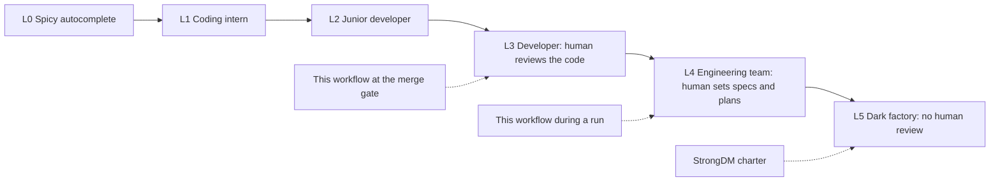

# Methodologies in the agentic SDLC and how they map to current practice

> Research record, 2026-11-21. Findings describe this repository at commit `5c4b571`, before the November 2026 release preparation added CI, the retro scope guard and the `dontAsk` permission profile. The condensed, maintained view is [methodology](../methodology.md).

## TLDR

- **It is a factory-style pipeline, not an "AI software factory" in the 2026 sense.** In 2026 the phrase means either a managed system of agents with stations, isolation, automated verification and a merge gate [5][6][7], or the "dark factory" at the top of the autonomy ladder, where no human writes or reviews code [1][3]. The workflow matches the first on stations, gates and line telemetry. It rejects the second on purpose: a human owns every merge to `main`, and pre-declared halt conditions stop the line.
- **Almost every practice is classical engineering applied to coding agents.** Design documents and ADRs, a Scrum-style backlog hierarchy, critical-path scheduling and Amdahl's law, integration branches, inspection-style review with separation of duties, kaizen and blameless postmortems, and least privilege all appear in the repositories with file evidence (section 1).
- **The 2026 names for the same ideas** are agentic engineering for the practice as a whole [11], harness engineering for the determinism-first boundary with its guides and sensors [20], context engineering for role-scoped context [19], spec-driven development for design, plan and tasks [16], Anthropic's orchestrator-workers, routing and evaluator-optimizer patterns for dispatch and review [14], risk-tiered human oversight and human-on-the-loop for the gates [24][22], and compound engineering or the feedback flywheel for retrospectives [32][27].
- **Table stakes versus synthesis.** Subagents, worktree-isolated waves, spec-plan-tasks, model routing and automated review now ship in products. What remains distinctive is the combination: recorded authority at gates tied to reversibility, measured verification (planted defects, falsified hypotheses, an Amdahl ceiling), and retrospectives whose convention changes are tracked to adoption or rejection. The weak points are also clear: no CI, role boundaries enforced only by instructions, and mostly synthetic workloads.
- **Recommended framing:** "A human-governed agentic SDLC: classical engineering practice applied to coding agents, with measured verification and human merge authority." Avoid "fully autonomous" or "zero human intervention", an unqualified "AI software factory" or "dark factory", and "self-improving" or "self-healing".

## How to read this document

- **Scope.** This document maps practices to their lineage and to current terms. It reuses the platform and field findings of the [state-of-practice research](2026-11-20-state-of-practice-research.md) and the [public release assessment](../4-reviews/2026-11-20-public-release-assessment.md) and does not repeat them.
- **Accessed.** Web sources were accessed on 2026-11-20 (reused) or 2026-11-21 (new). Pages without a publication date are marked "accessed".
- **Evidence labels.** **V** = verified against a primary source fetched for this or the prior research. **S** = secondary source only (news, blog, aggregator or search snippet). **U** = unverified or conflicting. **B** = classical book or paper cited from the bibliographic record; its content was not re-read for this research (DOIs were checked against Crossref where given).
- **Inference.** Statements prefixed "Inference:" are the author's reading of the evidence, not a sourced fact.
- **Paths.** `workflow:` is this repository at commit `5c4b571`. `blueprint:` is the reference design, imported into this repository under `blueprint/` from its own history at `cce3012`. `toolkit:` is agentic-toolkit at `8e94b75` and `crossrev:` is CrossRev at `e5366d6`, the maintained successor tools. Quoted names refer to section headings in the file.
- **Status values in section 1.** **Built** = implemented and exercised in the workflow. **Partial** = implemented with a known gap. **Designed** = specified in the blueprint only. **Successor** = carried forward in the toolkit or CrossRev. **Proposed** = analyzed but not built. **Gap** = missing.

## 1. Inventory of the methodologies in use

The workflow implements most lifecycle, execution and learning practices. The blueprint designs the governance layer more completely than the workflow enforces it. The successor tools carry the authority and review rules forward. Practice IDs (L, E, Q, O, G) are reused in sections 2 and 3.

### 1.1 Lifecycle and planning

| ID | Practice | What the system does | Evidence | Status |
|---|---|---|---|---|
| L1 | Phase-gated lifecycle | The orchestrator runs Phases 0 to 6: setup, design, plan, implementation waves, backlog PR, review with retro, telemetry. Each phase ends with a verification step. The blueprint defines six stages (Visionary, Architect, Planner, Builder, Tester, Reviewer) with a checkpoint between each. The toolkit recasts phases as selectable responsibilities, not a fixed chain. | `workflow: .claude/agents/orchestrator.md` "Workflow Phases"; `blueprint: blueprint/02-agent-pipeline.md` sections 1 and 5; `toolkit: guides/guide-project-structure-and-conventions.md` section 2.5 | Built; Designed; Successor |
| L2 | Right-sized entry | Design and plan are skipped when their artifacts exist or the prompt says so, with a rule to run design by default for complex work. The blueprint has Full, Design, Plan and Build entry modes plus resume-from-stage. The toolkit adds a "document test": write a document only when it records a decision, needs review across sessions, or supports large or risky work. | `workflow: orchestrator.md` Phase 0 steps 6 and 7, Phase 1 "Skip if"; `blueprint: blueprint/01-architecture-overview.md` section 3; `toolkit: skills/start-implementation/SKILL.md` "Plan file or in-session plan" | Built; Designed; Successor |
| L3 | Product framing documents | The blueprint's Visionary writes a PRFAQ, a PRD and a product vision. The workflow starts from a backlog issue and has no PRD step. The toolkit's requirements phase persists a brief or PRD for new capabilities. | `blueprint: blueprint/02-agent-pipeline.md` section 2.1; `toolkit: skills/start-requirements/SKILL.md` | Designed; Successor |
| L4 | Design document with alternatives and a feasibility check | The designer generates 2 or 3 approaches with trade-offs and must include "Approaches Considered", "Assumptions & Open Questions" and "Feasibility & Verification" sections. It must verify platform capabilities against current documentation and challenge approaches handed to it as decided. The repository holds 20 design documents. | `workflow: .claude/agents/designer.md` "Research & Feasibility Verification (MANDATORY)"; `workflow: docs/2-design/` | Built |
| L5 | Architecture decision records | Numbered ADRs record context, decision and alternatives: model routing, shadow-stack migration, Bun runtime, server PM adapter. The planner writes ADRs. | `workflow: docs/6-adrs/`; `workflow: .claude/agents/planner.md`; `toolkit: guides/guide-project-structure-and-conventions.md` section 2.6 | Built |
| L6 | Approval by merging a document PR | Design and plan documents go through PRs into the integration branch: "Merging the PR = approval." Autonomous mode auto-merges them. Interactive mode waits for the human. | `workflow: CLAUDE.md` "Documentation Conventions"; `orchestrator.md` "Autonomous Mode" | Built |
| L7 | Three-level backlog hierarchy | Backlog item, epic and story, linked as GitHub sub-issues with hierarchy labels and `[#N/E01-S01]` naming. Exactly three levels by rule; a feature too large for three levels becomes several backlog items. | `workflow: CLAUDE.md` "Work Item Hierarchy"; `workflow: docs/2-design/2026-03-11-agentic-sdlc-workitem-taxonomy.md` | Built |
| L8 | Declared dependencies and a dependency graph | Every item carries a machine-parsed `**Blocked by:**` line, and the orchestrator halts on an open blocker. The planner appends a Mermaid dependency graph and a wave table to the backlog and epic issues. The blueprint specifies wave computation by topological sort. | `workflow: orchestrator.md` Phase 0 step 2; `planner.md` "Dependency Diagrams on Issues"; `blueprint: blueprint/03-orchestration-engine.md` section 2 | Built; Designed |
| L9 | Difficulty sizing, kept separate from size | Stories get an easy, medium or hard difficulty label from a six-question checklist ("When in doubt, classify one level harder"). Backlog items get t-shirt size labels for the roadmap. Difficulty drives model routing and the review tier. | `workflow: planner.md` "Assigning Difficulty Labels"; `CLAUDE.md` "GitHub Conventions" | Built |
| L10 | Acceptance criteria as the binding contract | When the criteria and the story description conflict, builders satisfy the criteria, and they verify measurable criteria before marking a story complete. The blueprint's task spec links each task to its source documents, parent story, relevant files and dependencies. | `workflow: .claude/agents/builder.md` "Before Starting Any Story" step 5, "After Story Complete"; `blueprint: blueprint/07-state-management.md` section 3 | Built; Designed |
| L11 | Safe migration and namespaced extension points | "Think Long Term, Execute Short Term": design the interface, build one adapter, namespace folders for later layers. Core scripts change through a shadow stack: build alongside, optionally shadow-verify, then swap. | `workflow: CLAUDE.md` "Design Philosophy: Think Long Term, Execute Short Term"; `workflow: docs/6-adrs/0004-shadow-stack-migration.md` | Built |
| L12 | Contract-first parallelism | A proposal to break dependency chains with thin "contract stories" that define interfaces first, estimated to cut the largest run's critical path from about 348 to about 100 minutes. | `workflow: docs/1-discovery/2026-03-23-workflow-speed-quality-architecture.md` section 3 | Proposed |

### 1.2 Execution

| ID | Practice | What the system does | Evidence | Status |
|---|---|---|---|---|
| E1 | Role specialization with phase boundaries | Six roles, each with a "Phase Boundary (CRITICAL)" list of what it must not do, plus builder variants per model. The blueprint makes single responsibility its first principle: one cognitive mode and one artifact type per agent. | `workflow: .claude/agents/*.md`; `CLAUDE.md` "Agents"; `blueprint: blueprint/01-architecture-overview.md` section 1 | Built; Designed |
| E2 | Orchestrator-workers | The orchestrator never writes code, designs, plans or reviews. It dispatches subagents through the Agent tool, manages GitHub state and owns telemetry. Its control flow is a 656-line prompt. | `workflow: orchestrator.md` "Phase Boundary (CRITICAL)", "Two Dispatch Modes" | Built |
| E3 | Dependency waves with a parallelism cap | Stories with no shared dependencies run in parallel waves. Reviewers, fix builders and re-reviewers also run in parallel per wave. The cap `maxParallelBuilders` is 3 and is enforced by the prompt only. | `workflow: CLAUDE.md` "Parallel dispatch"; `workflow: .claude/agentic-sdlc-config.json` `workflow.maxParallelBuilders` | Partial |
| E4 | Worktree isolation from a recorded base | Every autonomous dispatch uses `isolation: "worktree"`. All epic and story branches are created up front from one recorded base SHA. Worktree debris is cleaned before merges and fix cycles, and git commands run as one chained call with explicit paths. Each rule cites the run that caused it. | `workflow: CLAUDE.md` "In-session dispatch (primary)", "Post-worktree cleanup (REQUIRED)"; `orchestrator.md` Phase 2 step 7; `workflow: docs/4-reviews/lessons/` | Built |
| E5 | Integration branch per backlog item | `backlog/<N>-<slug>` holds the design, plan, epic and story branches, retro and changelog. Internal merges use `--no-ff`. One PR per backlog item goes to `main`, and a human squash-merges it. | `workflow: CLAUDE.md` "Branch Conventions", "Backlog PR Strategy" | Built |
| E6 | Model routing by difficulty, escalation on failure | The difficulty label selects a builder variant (easy and medium to Sonnet, hard to Opus). Other roles inherit the orchestrator's model. The blueprint adds cost modes and a retry ladder: retry with the error, retry with more context, escalate to Opus, then a human. The toolkit's rule: "Escalate when you observe complexity, not when a task merely sounds important." | `workflow: CLAUDE.md` "Model routing"; `workflow: docs/6-adrs/0002-agentic-sdlc-builder-agent-model-routing.md`; `blueprint: blueprint/02-agent-pipeline.md` section 4, `blueprint/03-orchestration-engine.md` section 3; `toolkit: guides/guide-ai-model-and-effort-routing.md` | Built; Designed; Successor |
| E7 | Durable run state and idempotent restart | A JSON state file with a schema and an append-only `dispatches[]` log. Telemetry comments on issues are described as "the write-ahead log". Restart skips stories that have a "Ready for Review" comment. Full reconstruction from GitHub is a stub. | `workflow: scripts/state.sh`; `scripts/schemas/orchestrator-state.v1.json`; `CLAUDE.md` "Design Philosophy: Fault Tolerance"; `orchestrator.md` "Idempotent Restart" | Partial |
| E8 | Backend-agnostic project-management layer | Scripts call one PM interface with adapters (GitHub, local files, a SQLite server), dual-write and fire-and-forget sync. The blueprint specifies document and PM access through MCP abstraction servers. | `workflow: scripts/lib/pm.sh`; `workflow: docs/6-adrs/0006-server-pm-adapter-pattern.md`; `workflow: server/`; `blueprint: blueprint/05-integration-layer.md` | Built; Designed |

### 1.3 Quality

| ID | Practice | What the system does | Evidence | Status |
|---|---|---|---|---|
| Q1 | Test-driven development | Builders read the acceptance criteria and test plan, write failing tests, implement, refactor, and commit tests separately from code. The blueprint adds a separate Tester role. | `workflow: builder.md` "TDD Approach (REQUIRED)", "Commit Rules"; `blueprint: blueprint/02-agent-pipeline.md` section 2.5; `toolkit: skills/tdd/` | Built; Designed; Successor |
| Q2 | Review tiers | Each story is REVIEW or SKIP by a configured maximum difficulty and a required backlog label. The PR-level review always runs. The default is to review every story. | `workflow: CLAUDE.md` "Review Tier Logic"; `.claude/agentic-sdlc-config.json` `reviewStrategy` | Built |
| Q3 | Structured findings with severity and a verdict | The reviewer reads the diff, the acceptance criteria and the design, runs build and tests, and posts Critical, Warning and Suggestion tables with APPROVE or REQUEST_CHANGES. It must not edit files. | `workflow: .claude/agents/reviewer.md` "Review Process", "Convention Checklist", "Findings Format" | Built |
| Q4 | Bounded fix loops | REQUEST_CHANGES triggers fix builders and then re-review, for at most two cycles; after that a human is needed. CrossRev generalizes this into a reviewer and resolver loop that ends when it converges, reaches a limit, or needs a person. | `workflow: orchestrator.md` "Review Rejection"; `crossrev: README.md` "Review loop" | Built; Successor |
| Q5 | Evidence-backed override | The orchestrator may override a review verdict only when the fix is committed and inspectable, documented on the issue, and marked in telemetry. | `workflow: orchestrator.md` "Orchestrator Override Pattern" | Built |
| Q6 | Planted defects | Test runs planted known bugs to force the review and fix paths. In Run 14, four were planted: two triggered fix cycles and two were neutralized because builders followed the acceptance criteria. | `workflow: docs/4-reviews/retro-recommendations.md` observation ix; the synthetic run outputs (removed from the tree in November 2026, kept in Git history) | Built (small samples) |
| Q7 | Determinism-first boundary | "When a value can be computed deterministically from existing data, compute it." State, telemetry, wall-clock, cost and board reconciliation are scripts. Design, content, failure recovery and review are model judgment. The rule followed a run that reported sequential time as wall-clock. The telemetry module has 252 offline tests. | `workflow: CLAUDE.md` "Design Philosophy: Determinism First"; `scripts/lib/compute-dispatches.py`; `scripts/lib/test_compute_dispatches.py` | Built (computation only) |
| Q8 | Repeated and independent review passes | A five-pass review experiment found that the first reviewer caught the only blocking bug, that two later judgment-based passes by the orchestrator had 40% and 67% error rates, and that the orchestrator dismissed the same valid finding twice: "confirmation bias persists across passes." | `workflow: docs/1-discovery/2026-03-16-multi-pass-review-research.md` "Key Observations" | Built (one experiment) |
| Q9 | Cross-model review loop | Reviewer and resolver agents run on separately configured harnesses and models. The resolver verifies each finding, then fixes or disputes it. The reviewer reads the new revision. GitHub credentials stay out of the model process. | `crossrev: README.md` | Successor |
| Q10 | Convention propagation check | "No change is complete until a grep verification confirms all references are consistent." The orchestrator runs a documentation pass once the code is final. | `workflow: CLAUDE.md` "Convention Change Propagation" | Partial (drift recurred) |
| Q11 | CI and enforcement gaps | No CI workflow exists, so tests run only when an agent or the human runs them. A parallel retro commit reverted code fixes on the integration branch and left 12 failing server tests and 2 unloadable test files on `main`, undetected. The blueprint designs a CI gate as its fifth security layer. | `workflow:` no `.github/` directory; commit `4d3ab9b`; public release assessment; `blueprint: blueprint/06-security-model.md` section 6 | Gap |

### 1.4 Operations and learning

| ID | Practice | What the system does | Evidence | Status |
|---|---|---|---|---|
| O1 | Per-dispatch telemetry | Duration, tokens and tool uses from every dispatch are posted per story, per epic and per backlog item, including failed and resumed dispatches. The backlog PR body is "the single source of truth for the run." | `workflow: CLAUDE.md` "Telemetry is mandatory", "PR telemetry placement"; `scripts/item-telemetry.sh`; `scripts/templates/telemetry.md` | Built |
| O2 | Cost accounting | Live pricing fetch, a blended rate, and a disclaimer that figures are "equivalent API value". Analyses treat cost as secondary to tokens and duration. A budget-check library exists but is not called, and `maxCostPerRun` is null. | `workflow: scripts/fetch-pricing.sh`; `scripts/templates/telemetry.md`; `scripts/lib/cost-budget.sh`; `docs/1-discovery/2026-03-19-workflow-optimization-analysis.md` methodology note | Partial |
| O3 | Gantt timeline, critical path and overhead | Wall-clock is computed from dispatch timestamps: dispatches in one parallel wave take the maximum, sequential ones add up. Orchestrator overhead is wall-clock minus the critical path. A Mermaid Gantt chart renders from the state file, with fix cycles marked. | `workflow: CLAUDE.md` "Wall-clock auto-computation", "Capturing orchestrator overhead"; `scripts/lib/compute-dispatches.py`; `docs/2-design/2026-03-19-gantt-chart-readability.md` | Built |
| O4 | Amdahl ceiling analysis | Across the 14 analyzed runs, the average speedup was 1.22x and the best 1.39x; the eight runs with parallel waves listed in section 8 average 1.29x. A 60% sequential fraction, assumed rather than measured, gives a ceiling of about 1.36x for 3-way parallelism. | `workflow: docs/1-discovery/2026-03-19-workflow-optimization-analysis.md` section 8 | Built |
| O5 | Fix-cycle rate as the quality signal | Per-run fix rate about 9% on 8 synthetic content runs against about 24% on 6 infrastructure items, recomputed from the analysis's master table (its summary says 7.8% and 28.6%), and 67% (12 of 18 stories) on the largest build. | `workflow: docs/1-discovery/2026-03-19-workflow-optimization-analysis.md` section 10; `docs/1-discovery/2026-03-23-workflow-speed-quality-architecture.md` section 1 | Built |
| O6 | Hypotheses tested and reverted | Cheaper reviewers on easy stories used about twice the tokens and time with the same outcomes across 14 backlog items, so reviewer routing was removed (commit `d6e8799`). A pricing "correction" was shown to be wrong and reversed. | `workflow: docs/1-discovery/2026-03-19-workflow-optimization-analysis.md` "Executive Summary" | Built |
| O7 | Lessons captured during work | Any agent writes one file per lesson (frontmatter, "What happened", "Root cause", "Prevention") in per-feature and per-epic folders, so parallel agents do not collide. Tags support discovery, and retention moves from active to compiled to archived. About 50 lesson files and 27 retrospectives exist. | `workflow: CLAUDE.md` "Lesson Conventions"; `workflow: docs/4-reviews/lessons/` | Built |
| O8 | Evidence-only retrospective with convention proposals | The retro agent gathers lessons, git log, telemetry and review findings, and all data must come from those artifacts. It proposes convention changes only for patterns seen in 3 or more stories or for critical failures, adds rather than removes, and commits them on the integration branch for human review in the backlog PR. | `workflow: .claude/agents/retro.md` "Retro Doc Output", "Convention Change Proposals" | Built |
| O9 | Convention adoption tracker | One tracker lists outstanding recommendations with source and recurrence, implemented ones, and "Observations (no convention change warranted)", including declined recommendations with reasons. It is updated by hand after each retro. | `workflow: docs/4-reviews/retro-recommendations.md` | Built |
| O10 | Blameless framing | Lessons name causes and prevention in the system, not people. The successor states it outright: retrospectives "Keep the assessment blameless", and debugging supports "a blameless incident review". | `workflow: CLAUDE.md` "Lesson Conventions"; `toolkit: skills/start-retrospective/SKILL.md` step 2; `toolkit: skills/start-debugging/SKILL.md` | Built; Successor |
| O11 | Instruction architecture | The working instructions are long: `CLAUDE.md` has 827 lines and the orchestrator prompt 656. A three-layer model (plugin agent files, a project workflow file, read-only user instructions) was proposed. The toolkit uses a short global brief plus skills that load only when needed. | `workflow: CLAUDE.md`; `workflow: docs/1-discovery/2026-03-23-workflow-speed-quality-architecture.md` section 2; `toolkit: README.md` "What it solves" | Proposed; Successor |

### 1.5 Governance

| ID | Practice | What the system does | Evidence | Status |
|---|---|---|---|---|
| G1 | Human merge authority | "Nothing merges to `main` until the human reviews the final PR", and the orchestrator never auto-merges the backlog PR. The blueprint keeps `main` behind PRs, CI and human approval. The toolkit treats commit, push, PR, merge and rollout as separate permissions and never presents a branch SHA as a merge SHA. | `workflow: CLAUDE.md` "Branch Conventions"; `orchestrator.md` Phase 4; `blueprint: blueprint/06-security-model.md` "Trust Model"; `toolkit: skills/start-implementation/SKILL.md` "Delivery states" | Built; Designed; Successor |
| G2 | Halt conditions | Pre-declared stops: an open `Blocked by` dependency; a second designer or planner failure (abort); a second builder failure; a third fix cycle; a merge conflict ("Do NOT resolve automatically"); a failed auto-merge ("Do NOT force-merge"). | `workflow: orchestrator.md` Phase 0 step 2, "Designer/Planner Dispatch Failure", "Builder Dispatch Failure", "Review Rejection", Phase 3 merge steps, "Autonomous Mode" | Built |
| G3 | Supervised and autonomous modes | The word "autonomous" in the prompt switches on auto-merge of design and plan PRs. Without it, the designer and planner ask questions and the orchestrator waits for the human. The `autoMergeDesignPR` and `autoMergePlanPR` config keys are not read by any script. The blueprint makes supervised mode the default, offers approve, edit and re-run, or abort at each checkpoint, and limits autonomous mode to low-risk changes with strong CI gates. | `workflow: orchestrator.md` "Autonomous Mode"; `workflow: .claude/agentic-sdlc-config.json`; `blueprint: blueprint/02-agent-pipeline.md` section 5 | Partial; Designed |
| G4 | Least privilege and defense in depth | The blueprint specifies five layers (OS sandbox, per-role tool permissions, hook guards, branch protection, CI gates) and a per-agent permission matrix. The workflow removed per-agent tool lists in favor of instructions, allows all `git` and `gh` commands, and its documented unattended run uses `--dangerously-skip-permissions`. | `blueprint: blueprint/06-security-model.md` sections 1 to 6; `workflow: .claude/settings.json`; commit `3dcfad7`; `workflow: README.md` quick start | Designed; Gap in the workflow |
| G5 | Separation of duties | Builders never merge their own story ("Premature self-merging bypasses the review gate"). Reviewers do not modify code. The orchestrator does not write code. The toolkit adds that a serial self-check "is valid limited evidence, never independent review." | `workflow: builder.md` "Branch Strategy"; `reviewer.md` "Phase Boundary (CRITICAL)"; `toolkit: skills/start-review/SKILL.md` step 3 | Built (by instruction); Successor |
| G6 | Authority and review recorded in records | The toolkit's rules: the reviewed revision is the commit that records `status` and `reviewed_by`; "Agent review never proves personal human approval"; a status field alone grants no authority; an autonomous scope records its retained human gates and stopping point once, in a durable record. | `toolkit: skills/start-implementation/SKILL.md` steps 2 and 3; `toolkit: skills/start-review/SKILL.md` step 6 | Successor |
| G7 | Audit trail and attribution | Telemetry and review findings live on issues and PRs. The blueprint specifies run manifests "for cost tracking, debugging, and compliance auditing". 81 of 86 commits on `main` carry AI co-author trailers. | `workflow: CLAUDE.md` "Backlog-level telemetry"; `blueprint: blueprint/07-state-management.md` section 5 "Pipeline Run Manifests"; public release assessment | Built |

## 2. Lineage and the current name for each practice

### 2.1 The 2026 vocabulary

Most of the current vocabulary was coined between mid-2025 and late 2026. Much of it renames practices that the workflow took from classical engineering in March 2026.

| Term | Meaning as used | First traction | Ev. | Src |
|---|---|---|---|---|
| Vibe coding | Prompting a model and accepting code without reading it; prototype quality | February 2025, Karpathy | V | [11] |
| Agentic engineering | Developing software with coding agents while reviewing and verifying the result to production standard | Karpathy proposed the name in February 2026 as the professional successor to vibe coding; Willison's pattern guide started 2026-02-23 | V (Willison), S (Karpathy's wording and date) | [11][12][13] |
| Context engineering | Filling each model call's context with the right instructions, facts, tools and history | June 2025 (Lütke, Karpathy); Anthropic guidance 2025-09-29 | S, V | [18][19] |
| Harness engineering | Everything around the model: feedforward guides and feedback sensors, computational and inferential | OpenAI 2026-02-11; Böckeler 2026-04-02; a Radar Vol. 35 theme | S, V | [21][20][29] |
| Spec-driven development (SDD) | A structured spec, then a plan and tasks, before code; spec-first, spec-anchored or spec-as-source | Spec Kit, Kiro and Tessl in 2025; Radar Assess 2025-11-05 | V | [16][17][42][43] |
| Agent workflow patterns | Prompt chaining with gates, routing, parallelization (sectioning and voting), orchestrator-workers, evaluator-optimizer. "Workflows" follow predefined code paths; "agents" direct their own process. | 2024-12-19 | V | [14] |
| Human-on-the-loop | Humans build and steer the loop that produces the work instead of gatekeeping each output | Morris 2026-03-04; Lässig 2026-04-20 | V | [22][23] |
| Risk-tiered human oversight | Review depth matched to what a change could break; the hardest-to-reverse changes reserved for humans; low-risk changes auto-merged through CI | Radar Trial, 2026-11-04 | V | [24] |
| Human-in-the-loop theater | An approval step that is not a real check; an "accountability sink" | Radar Caution, November 2026 | V | [25] |
| Autonomy levels | Shapiro's Levels 0 to 5 for coding, modeled on driving automation and ending at the "dark factory"; Feng et al.'s operator, collaborator, consultant, approver and observer levels | Feng et al. June 2025; Shapiro 2026-01-23 | V, S | [1][2][31] |
| AI software factory, dark factory | See section 3 | 2026 | V, S | [5][3][8] |
| Evals, LLM-as-judge | Graded tasks for agents; models used as graders, with known position, verbosity and self-enhancement biases | 2023 (MT-Bench); Anthropic guide 2026-01-09 | S, V | [38][39] |
| Compound engineering | Plan, work, review, compound: lessons from each feature are written down as prompts in the codebase so the next feature is easier | Every, 2025-12-11 | V | [32] |
| Feedback flywheel, self-improving harness | Session feedback turned into harness updates that humans decide (Trial); agents proposing harness changes from traces under bounded experiments (Trial) | Radar April 2026 and 2026-11-04 | S, V | [27][26] |
| Ralph loop | One agent re-runs a fixed spec prompt with fresh context until the code converges on the spec | Huntley, July 2025 (S); Radar Assess 2026-04-15 | V | [28] |
| Continuous AI, agentic workflows | Natural-language rules plus agent reasoning run continuously in a repository, beside CI, not instead of it | GitHub Next June 2025; GitHub Agentic Workflows GA 2026-10-28 | V | [40][41] |
| AI-DLC | AWS's AI-driven lifecycle: Inception, Construction and Operations phases, "bolts" instead of sprints, "units of work" instead of epics, human validation of AI plans | 2025 (exact date not verified) | S, V | [33][34] |
| Role-based multi-agent frameworks | Agents in product, architecture, engineering and QA roles following standard operating procedures | MetaGPT and ChatDev 2023; BMAD v6.12 stable as of November 2026 | S, V | [36][37][35] |

**A naming collision to handle in the README.** "Workflow" now means three different things: Anthropic's "workflows" are predefined code paths, as opposed to agents [14]; GitHub Agentic Workflows are Markdown files compiled to Actions [41]; Claude Code dynamic workflows are script-held orchestration plans [44]. The repository name uses the older SDLC sense, so the README should say which sense it means.

### 2.2 Lifecycle and planning

| ID | Practice | Classical lineage | Current term | Fit |
|---|---|---|---|---|
| L1 | Phase-gated lifecycle | Phased lifecycle [69]; stage gates. Agent research modeled teams on a waterfall as early as 2023 [37][36]. | SDD: requirements or spec, design, plan, tasks [42][43][16]; prompt chaining with programmatic gates between steps [14]; AI-DLC phases [34] | Same idea, new executor. The field's caution applies: SDD workflows "remain elaborate and opinionated" [17], and Böckeler is "very skeptical that lots of up-front spec design is a good idea" [16]. |
| L2 | Right-sized entry | Process tailoring, a standard part of RUP and PMBOK practice (no single source) | BMAD "sizes itself to the work" [35]; Radar Caution on AI-driven documentation sprawl [29] | Same idea. The toolkit's document test answers the sprawl warning directly. |
| L3 | PRFAQ, PRD | Amazon's Working Backwards PR/FAQ [73]; product requirements documents | Kiro `requirements.md` [42]; AI-DLC mob elaboration [34]; BMAD analyst and PM roles [35] | Same idea. |
| L4 | Design document with alternatives and a feasibility check | RFC culture since RFC 1 [70]; Google design docs with "alternatives considered" [71] | The design phase of SDD [42]; Anthropic's "sprint contract" agreed before building [51]; just-in-time retrieval in context engineering [19] | Adapted. The mandatory check against current documentation is an agent-specific addition: a model's knowledge of its own platform is stale, which an infeasible March 2026 design demonstrated. |
| L5 | ADRs | Nygard's ADR format, 2011 [72] | Spec Kit's "constitution" [43]; "spec-anchored" artifacts kept for later change [16] | Same idea. ADRs double as agent context. |
| L6 | Approval by merging a document PR | Peer review of documents; docs as code | Phase review in Kiro [42]; plan approval before edits in Claude Code plan mode [47] | Same idea in interactive mode. Inference: in autonomous mode the merge only means the next agent may start, so the honest label is "agent-approved"; calling it approval risks the HITL-theater pattern [25]. |
| L7 | Three-level backlog hierarchy | Scrum product backlog [74]; epics and stories; work breakdown structures | GitHub sub-issues and issue types [58]; AI-DLC units of work and bolts [34][33] | Same idea, now native in GitHub. |
| L8 | Dependencies and dependency graph | Critical-path method [76]; topological sorting [77] | Kiro dependency-graph waves [42]; Claude Code dynamic workflows [44]; parallelization by sectioning [14] | Table stakes in 2026. |
| L9 | Difficulty sizing | Relative estimation (story points, t-shirt sizes) in Agile planning (no single source) | Routing, for example easy queries to smaller models [14]; Copilot Fusion routing [57] | Adapted: sizing feeds model choice and review depth, not velocity. |
| L10 | Acceptance criteria as the contract | Design by contract [80]; acceptance-test-driven development | Sprint contract [51]; a feature list with every feature marked failing until verified [15]; StrongDM's scenarios kept outside the codebase, like a holdout set [3] | Same idea. The workflow's criteria are prose checklists, not machine-checked contracts. |
| L11 | Shadow stack, namespaced extension points | Strangler fig [82]; branch by abstraction [83]; ports and adapters [84] | No AI-specific term | Classical practice only. |
| L12 | Contract-first parallelism | Consumer-driven contracts [81] | No AI-specific term (Inference) | Proposed, not built. |

### 2.3 Execution

| ID | Practice | Classical lineage | Current term | Fit |
|---|---|---|---|---|
| E1 | Role specialization | Brooks's surgical team [86]; chief programmer teams [85]; separation of concerns | Subagents with their own tools, model and effort [45]; role agents in BMAD and MetaGPT [35][36] | Same idea, with the field's caveat: "Parallelism and specialization have to earn their coordination cost" [50], and multi-agent gains over a single agent are often minimal [64]. |
| E2 | Orchestrator-workers | Chief programmer team, where one person holds the design and integrates [85]; master-worker | Orchestrator-workers [14]. Centralized coordination contained error amplification at 4.4x against 17.2x for independent agents [63]. Dynamic workflows move the plan into a script [44]. | Same topology. Difference: here the plan lives in a prompt, which Anthropic would call an agent; the 2026 recommendation is a resumable script. |
| E3 | Waves with a cap | CPM [76]; Kanban WIP limits [75]; Little's law relating work in progress to lead time [79] | Kiro waves [42]; concurrency limits in dynamic workflows [44] | Table stakes. |
| E4 | Worktree isolation from a base SHA | One isolated workspace per developer; reproducible build environments | Native `isolation: worktree` and worktree sweeps [46]; parallel writers need isolation [56] | The mechanism is now native. The base-SHA and cleanup rules still matter. |
| E5 | Integration branch | Team integration branch and feature branching [87]; git-flow [89] | Anthropic now merges more than 30,000 changes a day and invested in post-merge and pre-deploy testing instead of merge queues [55] | Diverges from trunk-based development, which integrates at least daily [88]. A run-length branch batches risk: the regression in Q11 landed there while the PR reviewer read a frozen snapshot. |
| E6 | Routing and escalation | Tiered support escalation; model cascades such as FrugalGPT [91] | Routing pattern [14]; Copilot Fusion cascade and critique [57]; reasoning effort as a second routing axis [45] | Same idea. The workflow routes statically by label; the blueprint's retry ladder is a cascade. |
| E7 | Durable state, idempotent restart | Write-ahead logging and recovery [92]; event sourcing [93] | The session as a durable event log outside the harness [52]; a progress file plus git, framed as engineers working in shifts with no memory of the previous shift [15]; resumable workflows [44] | Same idea; the workflow's own text calls issue comments "the write-ahead log". |
| E8 | PM abstraction layer | Ports and adapters [84] | MCP as the integration layer for tools and data [59] | Same idea. |

### 2.4 Quality

| ID | Practice | Classical lineage | Current term | Fit |
|---|---|---|---|---|
| Q1 | TDD | Beck [94] | "Red/green TDD" in Willison's patterns [11]. Evidence: TDD-procedure prompting alone raised regressions to 9.94% (baseline 6.08%), while test-impact context cut them to 1.82% [66]; agent-written tests had no significant effect across 5,000 runs [67]. | Same practice. A TDD instruction alone is not a quality claim. |
| Q2 | Review tiers | Risk-based testing; change classes in change management (no single source) | Risk-tiered human oversight [24] | Adapted: the tiers follow difficulty and a label, not blast radius or codebase zones. |
| Q3 | Structured findings | Fagan inspections: checklists, defect classes, severity, a moderator [95] | LLM-as-judge [38]; the evaluator in evaluator-optimizer [14]; review fleets that report only reproduced findings [49] | Same idea. |
| Q4 | Bounded fix loops | Rework limits with escalation | Evaluator-optimizer [14]; the Ralph loop is the unbounded variant, at Assess [28] | Same idea, bounded, with a human exit. |
| Q5 | Evidence-backed override | Documented deviation or waiver in change control (no single source) | No AI-specific term | Classical practice only. |
| Q6 | Planted defects | Defect seeding [97]; mutation testing [96] | Mutation testing at Adopt [29]; known-answer eval tasks [39]; a 2026 cross-model review study with 150 planted errors [65] | Same idea with small samples. Run 14 shows a hazard: builders that follow the acceptance criteria can remove a planted bug before review sees it. |
| Q7 | Determinism-first boundary | Separation of mechanism from policy: computation in tested code, judgment by people | Harness engineering: computational sensors are cheap and run on every change, inferential ones are slower and less deterministic [20]; "workflows" as predefined code paths [14]; script-held plans [50] | Strong match, reached independently in March 2026. Limitation: applied to computation, not to control flow. |
| Q8 | Repeated and independent passes | N-version programming [98]; independent verification and validation | Self-preferential bias and adversarial verification [50]; self-enhancement bias in LLM judges [38]; a second strong reviewer adds detections, but vendor independence alone is unproven [65] | Same finding: an agent re-reviewing its own judgment did not overturn its wrong dismissals. |
| Q9 | Cross-model review loop | N-version programming [98]; inspection with author rework [95] | Cross-model review [65]; Copilot Fusion critique [57] | Same idea. Claim "a second strong, independent reviewer", not "a different vendor is required". |
| Q10 | Propagation check | Configuration management and impact analysis (no single source) | Documentation as the system of record, mechanically linted [21]; Radar Caution on agent instruction bloat [29] | Same intent. Grep-based and manual, so drift recurred. |
| Q11 | CI gap | Continuous integration [90] | Continuous AI complements CI and does not replace it [40]; late regressions in a 16-agent build needed CI enforcement [56] | Behind the field and behind the blueprint. |

### 2.5 Operations and learning

| ID | Practice | Classical lineage | Current term | Fit |
|---|---|---|---|---|
| O1 | Telemetry | DORA research and metrics [105][62] | Native OpenTelemetry cost and token metrics [48]; GenAI agent spans, still in Development status [60] | Same idea, now platform-native. |
| O2 | Cost accounting | Unit cost per delivered change (no single source) | Cost per accepted change, with token leaderboards called a vanity metric [61]. StrongDM's "$1,000 on tokens today per human engineer" is the opposite pole [3]. | Matches DORA's stance: cost is context, not the goal. |
| O3 | Gantt, critical path, overhead | Gantt charts; CPM [76] | Per-agent progress views in dynamic workflows [44]; no common AI term | Inference: ahead of common practice. |
| O4 | Amdahl ceiling | Amdahl's law [78] | Parallelism must earn its coordination cost [50]; scaling studies of agent systems [63] | Same reasoning, measured. |
| O5 | Fix-cycle rate | DORA change fail rate and deployment rework rate [62] | First-pass acceptance as a leading indicator [30]; rework rate and cost per accepted change [61] | Same idea, measured before merge only. Post-merge failures such as Q11 are not counted. |
| O6 | Hypotheses tested and reverted | Evidence-based improvement in the DORA tradition [105] | Evals [39]; re-test each harness component when models change [51]; bounded experiments with regression testing [26] | Same idea, run by a human with telemetry. |
| O7 | Lessons during work | After-action reviews and lessons-learned records (no single source) | Agent memory guidance: parallel agents writing one shared file overwrite each other, so give each its own file, and incorrect notes persist [54]; the "compound" step [32] | Same design choice that Anthropic later published: one file per lesson. |
| O8 | Retrospectives with convention proposals | Project retrospectives [104]; kaizen [101] | Compound engineering [32]; feedback flywheel [27]; "agentic flywheel" [22]; self-improving harness [26] | Same loop. Here the agent proposes and a human adopts, which is the feedback flywheel, not the self-improving harness. |
| O9 | Adoption tracker | Kaizen's record of continuous improvement [101] | Humans set objectives and modification boundaries and check that gains generalize [26] | Ahead on recording declined changes; behind on measuring whether adopted changes stopped the problem from recurring. |
| O10 | Blameless framing | Blameless postmortems [102][103] | Human-on-the-loop: "change the harness that produced the artefact" [22] | Inference: blamelessness carries over to agents as "fix the harness, not the output". |
| O11 | Instruction architecture | Layered configuration (system, user, project) | Progressive context disclosure at Adopt and agent instruction bloat at Caution [29]; context engineering [19] | The 827-line instruction file is behind; the toolkit's short brief plus skills matches current practice. |

### 2.6 Governance

| ID | Practice | Classical lineage | Current term | Fit |
|---|---|---|---|---|
| G1 | Human merge authority | Four-eyes principle; separation of duties [100] | A human at the merge gate, accountable for what merges [7]; the hardest-to-reverse changes reserved for humans [24]; human-on-the-loop [23] | Matches mainstream 2026 governance. The opposite of the dark factory [1][3]. |
| G2 | Halt conditions | Jidoka: "the operator can stop the line by pulling the stop cord" when an abnormality occurs [101]; fail-safe defaults [99] | Feng et al.'s approver level: the agent engages the user only in risky or pre-specified scenarios [31] | Same idea. The halts are declared in advance, not left to the model. |
| G3 | Supervised and autonomous modes | Levels of automation [106]; SAE J3016 driving levels [107] | Shapiro's levels [1]; Claude Code permission modes [47]; risk tiers [24] | The blueprint's supervised default matches. The workflow's single keyword switch is coarser than risk tiers. |
| G4 | Least privilege, defense in depth | Saltzer and Schroeder: least privilege, separation of privilege, fail-safe defaults [99]; NIST AC-6 [100] | Agent sandboxing at Adopt [29]; "cap the blast radius" [53]; `bypassPermissions` only in isolated containers or VMs [47]; agentic workflows read-only by default with validated safe outputs [41] | The blueprint matches. Workflow enforcement is behind. |
| G5 | Separation of duties | NIST AC-5 [100]; independent inspection [95] | Self-preferential bias [50]; separate reviewer and resolver agents (CrossRev) | The rules match. Enforcement by instruction failed once (Q11). |
| G6 | Authority recorded in records | Approval records in change management (no single source) | HITL theater as an "accountability sink" [25] | Inference: ahead of products, which log sessions but not which human authorized which phase transition. |
| G7 | Audit trail and attribution | Audit logs; change history | 93% of developers need source attribution to trust AI output [68]; OpenTelemetry traces [48] | Same idea. |

## 3. Is this an "AI software factory"?

### 3.1 What the term means in 2026

The phrase carries two meanings in 2026: a managed process around coding agents, and an autonomy level with no human review. The sources split mainly on one criterion: whether a human reviews the code.

| Source | Date | Definition | Humans write code? | Humans review code? | Human merge gate? | Sense | Ev. |
|---|---|---|---|---|---|---|---|
| Classical software factories (GE, Hitachi, SDC) | Late 1960s to 1991 | Standardized process, reusable tools and methods, division of labor, measurement [10][6] | Yes | Yes | Yes | Process | B, V |
| Shapiro, Level 5 | 2026-01-23 | "a black box that turns specs into software", dark "because it's a place where humans are neither needed nor welcome" [1] | No | No | No | Autonomy level | V |
| StrongDM software factory | 2026-02-06 | "non-interactive development where specs + scenarios drive agents that write code" and converge without human review. Charter: "Code must not be written by humans", "Code must not be reviewed by humans" [3][4] | No | No. Scenario validation with a "satisfaction" score and a digital twin of third-party services replaces review. | Not stated | Autonomy level | V |
| Factory (vendor) | 2026-06-15 and 2026-07-18 | "an interconnected, agent-native, end-to-end system" that improves by observing itself; "a managed model for producing software with repeatable inputs, standardized tooling, measurable output"; engineers build "the factories that build the software" [5][6] | Mostly agents | Yes: "Keep the existing approval and release controls in place." | Yes | Process | V |
| 8090 Software Factory (vendor) | 2026 | An SDLC control plane from requirements to maintenance, with modules named Refinery, Foundry, Planner, Assembler and Validator [8] | Mostly agents | Not verified | Not verified | Process | S |
| Firecrawl guide | 2026-09-11 | "the system around a coding agent rather than the agent itself": intake, isolation, tools, verification, merge gate [7] | Agents | Automated checks plus a human | Yes | Process | V |
| Practitioner lists | Accessed 2026-11-21 | "systems that run AI coding agents autonomously, in parallel, and in loops" [9] | Agents | Varies | Varies | Mixed | S |
| This workflow | March 2026 | A phase-gated pipeline of role agents around deterministic scripts | Agents | Agent review by tier, plus human review of every backlog PR | Yes, always | Process | V |

### 3.2 Where the workflow sits on the autonomy ladder

Shapiro's ladder, modeled on driving automation, runs from "spicy autocomplete" to the dark factory [1][2]. Shapiro writes that 90% of "AI-native" developers are at Level 2 and that "almost everyone tops out" at Level 3 [1]. Feng et al. describe the same range by the user's role, from operator to observer [31].

| Level | Shapiro's image [1] | Role summary [2] | Nearest Feng et al. level (Inference) [31] |
|---|---|---|---|
| 0 | Every character approved | Spicy autocomplete | Operator |
| 1 | Lane keeping and cruise control | Coding intern, full human review | Operator |
| 2 | Highway autopilot | Junior developer, human reviews every line | Collaborator |
| 3 | Waymo with a safety driver | Developer; the human is a full-time code reviewer | Consultant |
| 4 | Robotaxi: "you can do something else" | Engineering team; the human collaborates on specs and plans | Approver |
| 5 | Dark factory | No humans in the loop | Observer, or no human at all |

During a run the workflow behaves like Level 4, and at the merge it returns to Level 3, so it never reaches the dark factory at Level 5. A human writes the backlog item and is pulled in only at pre-declared halts while agents design, plan, build and review. At the end a human reviews and merges the PR. In the largest recorded run, 20 more commits landed after the retro, under human direction, before the merge (public release assessment).

### 3.3 Where it matches the factory model

The workflow has every station of a process-sense factory except a strong automated final inspection.

| Factory trait | Mechanism in the workflow or blueprint | IDs |
|---|---|---|
| Sequenced stations | Phases 0 to 6; the blueprint's six-stage pipeline with checkpoints | L1 |
| Specialized stations with standard work | Role agents with phase boundaries; agent files, templates and schemas as standard work instructions | E1, Q3 |
| Work orders routed by type | Issues with difficulty labels routed to model variants | L9, E6 |
| Parallel lines with a WIP limit | Dependency waves with a cap of 3 | L8, E3 |
| Isolated work cells | One worktree per dispatch from a recorded base | E4 |
| Inspection stations | Per-story review tiers, PR review, bounded fix loops | Q2, Q3, Q4 |
| Stop the line | Pre-declared halt conditions | G2 |
| Line telemetry | Per-dispatch tokens and durations, Gantt chart, critical path, fix-cycle rate | O1 to O5 |

### 3.4 Where it deliberately differs

Each difference from the dark factory is a design choice that current guidance supports.

| Dark-factory assumption | This workflow's choice | IDs | Field support |
|---|---|---|---|
| No human reviews code [3] | A human reviews and squash-merges every backlog PR; the orchestrator never auto-merges it. | G1 | The hardest-to-reverse changes are reserved for humans [24]; a human at the merge gate [7] |
| Humans are "neither needed nor welcome" [1] | Humans are kept at irreversible or ambiguous points: the merge to `main`, merge conflicts, exhausted fix cycles, open dependencies, repeated failures. | G2 | Approver level [31]; human-on-the-loop [22] |
| Validation replaces review [3] | Both, plus measurement of the reviewers themselves: planted defects, a multi-pass experiment, fix-cycle rates with sample sizes. | Q6, Q8, O5 | Code-based graders first, model graders calibrated against humans [39] |
| Throughput and token spend as the target [3] | Telemetry is used to falsify the author's own decisions. Cost is labeled "equivalent API value" and kept secondary. | O2, O6 | Token leaderboards as a vanity metric [61]; Radar Caution on throughput as productivity [30] |
| The line runs as built | Retrospectives change the line: conventions and agent files change with evidence, a human adopts or declines each change, and a tracker records the outcome. | O8, O9 | "Only humans can implement kaizen for the sake of evolution" [101]; feedback flywheel [27] |
| A black box [1] | Every step leaves a record: design docs, plans, ADRs, lessons, review findings, telemetry in the PR body. | L4, L5, O1, G7 | Developers trust output they can attribute [68] |

### 3.5 Where it falls short of a factory

By factory standards the line is under-instrumented at final inspection and relies on instructions where a factory would use guards.

| Shortfall | IDs | The factory standard it misses |
|---|---|---|
| No automated final inspection: no CI, and a regression reached `main` undetected | Q11 | Every unit is inspected automatically before it ships [90] |
| Station boundaries enforced by instructions only | G4, G5 | Physical guards: permissions and sandboxes [99][47] |
| Unattended runs without containment | G4 | Containment before autonomy [53] |
| Mostly synthetic test material: 10 of 21 executed backlog items were prose content runs (public release assessment) | Q6, O5 | Representative production samples |
| Raw run state deleted after each merge (public release assessment) | O1 | Retained production records |

### 3.6 Answer and recommended framing

**Answer.** Partly, and precisely so. In the process sense used by Factory, Firecrawl and the original software-factory literature, the workflow is a factory-style pipeline: sequenced stations, specialized roles, routed work orders, isolated work cells, inspection gates, a stop-the-line rule and throughput telemetry. In the autonomy sense that dominates 2026 discussion, it is not an AI software factory: Shapiro's Level 5 and StrongDM's charter remove human review, and this workflow keeps a human accountable for every merge. The gap is deliberate, and it is where the work agrees with current guidance on risk-tiered oversight [24]. Its real shortfall as a factory is the opposite of overreach: final automated inspection (CI) and enforced station boundaries are missing.

**Recommended public framing.**

- One line: "A human-governed agentic SDLC: classical engineering practice applied to coding agents, with measured verification and human merge authority."
- One paragraph: "Specialized coding agents carry a backlog item through design, planning, dependency-ordered parallel builds, review and retrospective. Deterministic scripts own state, telemetry and branch operations. Humans stay on the loop, steering the harness, and in the loop at the irreversible gates: the merge to `main`, conflicts and exhausted fix cycles."
- If "factory" is used at all: "factory-style pipeline", followed in the same sentence by "with human merge authority, not a dark factory."

**Phrasings to avoid.**

| Avoid | Why | Use instead |
|---|---|---|
| "Fully autonomous", "zero human intervention", "merge-ready" | Contradicted by the recorded runs, and it reads as a Level 5 claim | "Runs unattended from an approved backlog item to a reviewed PR; a human merges it" |
| An unqualified "AI software factory", "dark factory" or "lights-out" | In 2026 these signal no human review [1][3] and vendor positioning [5][8] | "Factory-style pipeline with human merge authority" |
| "Self-improving" or "self-healing" | The Radar reserves "self-improving harness" for agent-driven harness changes under bounded experiments with regression tests [26]; here an agent proposes, a human adopts, and recurrence was not measured | "Retrospective-driven harness improvement (a feedback flywheel): evidence-backed convention changes that a human adopts" |

## 4. Table stakes versus differentiated synthesis

This section condenses the [state-of-practice research](2026-11-20-state-of-practice-research.md); see that document for the product evidence.

**Table stakes in November 2026 (do not present as novel):**

| Capability | Practice IDs | Shipped by |
|---|---|---|
| Specialized subagents with their own context, tools and model | E1, E6 | Claude Code, Codex, Antigravity [45] |
| Parallel agents in git worktrees | E4 | Claude Code, Cursor, Codex [46] |
| Dependency-aware wave execution | L8, E3 | Kiro, Claude Code dynamic workflows [42][44] |
| Spec, plan and tasks as durable Markdown | L1, L4 | Spec Kit, Kiro, OpenSpec [43][42] |
| Model routing across tiers | E6 | Copilot Fusion, Antigravity [57] |
| Automated multi-agent code review | Q3 | Claude Code ultrareview, Copilot code review [49] |
| Cost and token telemetry | O1 | Claude Code OpenTelemetry metrics [48] |
| Retro-style lesson capture into instructions | O7, O8 | Compound engineering plugin, feedback flywheel practice [32][27] |

**Still a differentiated synthesis (Inference: no single product found combines these):**

| Differentiator | Practice IDs | Why it still matters |
|---|---|---|
| Authority and review recorded in lifecycle records, with human gates tied to reversibility | G1, G2, G6 | Platforms log sessions, not which human authorized which transition; HITL theater is a named anti-pattern [25] |
| Measured verification with stated scope: planted defects, multi-pass review, fix-cycle rates split by workload | Q6, Q8, O5 | Guidance exists [20][39]; published end-to-end practice with numbers is rare |
| Hypotheses falsified by the author's own telemetry and reverted | O4, O6 | The opposite of throughput marketing [61] |
| Retrospectives with an adoption tracker that records declined changes | O8, O9 | Self-improving harnesses are at Trial, and most reports are anecdotal [26] |
| Determinism-first boundary stated as a rule, backed by an incident and tests | Q7 | It matches harness engineering's computational sensors [20] and predates the term's spread |
| Cross-model review loop with an honest evidence level | Q9 | The evidence supports a second strong reviewer, not vendor independence as such [65] |
| A public failure record: incidents, reversions and design evolution in Git | All | Rare in public repositories |

## 5. Recommended public vocabulary

Use these 15 terms in the README and docs. Each has an established source, so a reader can look it up.

| Term | One-line definition for the docs | Practice IDs |
|---|---|---|
| Agentic engineering | Building software with coding agents while humans keep engineering discipline: specs, review, verification [11] | All |
| Agentic SDLC | The full lifecycle, from backlog item to merged change and retrospective, run by agents in defined roles | L1 |
| Harness | Everything around the model: instructions, tools, scripts, guides and sensors [20] | Q7, O11 |
| Context engineering | Choosing what each agent sees: role-scoped documents, lessons and just-in-time lookups [19] | L4, O11 |
| Spec-driven development (spec-anchored) | Durable requirements, design and plan written before code and kept for later change [16] | L1, L4, L10 |
| Orchestrator-workers | One coordinator holds the plan and state; workers do bounded tasks and report back [14] | E2 |
| Dependency waves | Independent tasks run in parallel batches computed from the dependency graph | L8, E3 |
| Worktree isolation | Each worker writes in its own git worktree, branched from one recorded base commit | E4 |
| Determinism-first boundary | Scripts compute state, time, cost and routing; models do design, content and judgment | Q7 |
| Guides and sensors | Feedforward instructions that steer agents, and feedback checks, computational or inferential, that catch errors [20] | Q1 to Q4, Q7 |
| Risk-tiered review | Review depth matched to what a change can break and how hard it is to undo [24] | Q2, G1 |
| Bounded fix loop | An evaluator-optimizer loop with a cycle limit and a human exit [14] | Q4 |
| Human-on-the-loop, with merge authority | Humans steer the harness and own irreversible actions such as merging to `main` [22] | G1, G3 |
| Halt conditions | Situations declared in advance where the run stops and asks a human, as when an operator stops the line [101] | G2 |
| Feedback flywheel | Retrospectives turn evidence into proposed convention changes that a human adopts or declines [27] | O7, O8, O9 |

Keep "measured verification" as a section heading rather than a term: it names the practice of stating sample size and scope next to every quality number (Q6, Q8, O4, O5).

## Open questions and unverified items

- Karpathy's exact wording and date for "agentic engineering" come from secondary coverage; The New Stack article returned HTTP 403 [12] (S).
- The AWS AI-DLC blog post body and date could not be retrieved; its content comes from IBM's summary and search results [33][34] (S).
- 8090's product details come from funding coverage only [8] (S).
- The feedback flywheel entry's move from Assess to Trial is reported by search results, not a fetched page [27] (S).
- Shapiro's post uses vehicle analogies; the role names in section 3.2 follow Willison's summary of it [2].
- Feng et al.'s levels come from the abstract and figure caption via search results [31] (S).
- The mapping of Shapiro's levels to Feng et al.'s levels in section 3.2 is the author's inference.

## Sources

### 2026 positioning and vocabulary

1. Shapiro, "The Five Levels: from Spicy Autocomplete to the Dark Factory". https://www.danshapiro.com/blog/2026/01/the-five-levels-from-spicy-autocomplete-to-the-software-factory/. 2026-01-23. V
2. Willison, "The Five Levels: from Spicy Autocomplete to the Dark Factory" (summary). https://simonwillison.net/2026/Jan/28/the-five-levels/. 2026-01-28. V
3. McCarthy, "Software Factories And The Agentic Moment", StrongDM AI. https://factory.strongdm.ai. 2026-02-06. V
4. Willison, "How StrongDM's AI team build serious software without even looking at the code". https://simonwillison.net/2026/Feb/7/software-factory/. 2026-02-07. V
5. Grinberg and Reyes, "Factory 2.0: From coding agents to software factories", Factory. https://factory.com/news/software-factory. 2026-06-15. V
6. "What is a software factory?", Factory. https://factory.com/articles/what-is-a-software-factory. 2026-07-18. V
7. "How to Build an AI Software Factory: Agents That Open, Review, and Merge PRs", Firecrawl. https://www.firecrawl.dev/blog/ai-software-factory. 2026-09-11. V
8. "AI software development startup 8090 nabs $135M funding round", SiliconANGLE. https://siliconangle.com/2026/06/29/ai-software-development-startup-8090-nabs-135m-funding-round/. 2026-06-29. S (read via search results)
9. awesome-software-factories (curated list). https://github.com/varun1505/awesome-software-factories. Accessed 2026-11-21. S
10. Cusumano, "Japan's Software Factories: A Challenge to U.S. Management", Oxford University Press. https://academic.oup.com/book/52424. 1991-03-07. B
11. Willison, "What is agentic engineering?", Agentic Engineering Patterns. https://simonwillison.net/guides/agentic-engineering-patterns/what-is-agentic-engineering/. Guide started 2026-02-23 (accessed 2026-11-21). V
12. "Vibe coding is passé. Karpathy has a new name for the future of software", The New Stack. https://thenewstack.io/vibe-coding-is-passe-karpathy-has-a-new-name-for-the-future-of-software/. February 2026 (HTTP 403 on fetch; read via search results). S
13. Feldman, "Andrej Karpathy has renamed vibe coding: here's what engineering leaders need to do about it", SD Times. https://sdtimes.com/ai/andrej-karpathy-has-renamed-vibe-coding-heres-what-engineering-leaders-need-to-do-about-it/. 2026-05-06. V
14. Erik S. and Zhang, "Building effective agents", Anthropic. https://www.anthropic.com/engineering/building-effective-agents. 2024-12-19. V
15. Young, "Effective harnesses for long-running agents", Anthropic Engineering. https://www.anthropic.com/engineering/effective-harnesses-for-long-running-agents. 2025-11-26. V
16. Böckeler, "Understanding Spec-Driven-Development: Kiro, spec-kit, and Tessl", martinfowler.com. https://www.martinfowler.com/articles/exploring-gen-ai/sdd-3-tools.html. 2025-10-15. V
17. "Spec-driven development", Thoughtworks Technology Radar (Assess). https://www.thoughtworks.com/radar/techniques/spec-driven-development. 2025-11-05. V
18. Willison, "Context engineering". https://simonwillison.net/2025/Jun/27/context-engineering/. 2025-06-27. S (read via search results)
19. "Effective context engineering for AI agents", Anthropic Engineering. https://www.anthropic.com/engineering/effective-context-engineering-for-ai-agents. 2025-09-29. V
20. Böckeler, "Harness engineering for coding agent users", martinfowler.com. https://martinfowler.com/articles/harness-engineering.html. 2026-04-02. V
21. Lopopolo, "Harness engineering: leveraging Codex in an agent-first world", OpenAI. https://openai.com/index/harness-engineering/. 2026-02-11 (HTTP 403 on fetch; read via search results and InfoQ). S
22. Morris, "Humans and Agents in Software Engineering Loops", martinfowler.com. https://www.martinfowler.com/articles/exploring-gen-ai/humans-and-agents.html. 2026-03-04. V
23. Lässig, "Cybernetics and the 'human-on-the-loop' in agentic coding", Thoughtworks. https://www.thoughtworks.com/en-us/insights/blog/generative-ai/cybernetics-and-human-on-the-loop-in-agentic-coding. 2026-04-20. V
24. "Risk-tiered human oversight", Thoughtworks Technology Radar (Trial). https://www.thoughtworks.com/radar/techniques/risk-tiered-human-oversight. 2026-11-04. V
25. "Human-in-the-loop theater", Thoughtworks Technology Radar (Caution). https://www.thoughtworks.com/radar/techniques/human-in-the-loop-theater. November 2026. V
26. "Self-improving harness", Thoughtworks Technology Radar (Trial). https://www.thoughtworks.com/radar/techniques/self-improving-harness. 2026-11-04. V
27. "Feedback flywheel", Thoughtworks Technology Radar (Trial). https://www.thoughtworks.com/radar/techniques/feedback-flywheel. 2026 (read via search results). S
28. "Ralph loop", Thoughtworks Technology Radar (Assess). https://www.thoughtworks.com/en-us/radar/techniques/ralph-loop. 2026-04-15. V
29. Thoughtworks Technology Radar Vol. 35. https://www.thoughtworks.com/radar. November 2026. V
30. "Coding throughput as a measure of productivity", Thoughtworks Technology Radar (Caution). https://www.thoughtworks.com/radar/techniques/coding-throughput-as-a-measure-of-productivity. April and November 2026. V
31. Feng, McDonald and Zhang, "Levels of Autonomy for AI Agents". https://arxiv.org/abs/2506.12469. June 2025 (v2 July 2025; read via search results). S
32. Shipper and Klaassen, "Compound Engineering: How Every Codes With Agents", Every. https://every.to/source-code/compound-engineering-how-every-codes-with-agents. 2025-12-11. V
33. "AI-Driven Development Life Cycle: Reimagining Software Engineering", AWS DevOps and Developer Productivity Blog. https://aws.amazon.com/blogs/devops/ai-driven-development-life-cycle/. 2025 (date not verified; body not retrievable). S
34. "The AI-DLC: The AI-driven development lifecycle", IBM Think. https://www.ibm.com/think/topics/ai-dlc. Undated (accessed 2026-11-21). V
35. BMAD-METHOD repository ("Breakthrough Method for Agile AI Driven Development"; v6.12 stable, v7 in preview). https://github.com/bmad-code-org/BMAD-METHOD. Accessed 2026-11-21. V
36. Hong et al., "MetaGPT: Meta Programming for a Multi-Agent Collaborative Framework". https://arxiv.org/abs/2308.00352. 2023-08-01 (v7 2024-11-01; read via search results). S
37. Qian et al., "ChatDev: Communicative Agents for Software Development". https://arxiv.org/abs/2307.07924. 2023-07-16. V
38. Zheng et al., "Judging LLM-as-a-Judge with MT-Bench and Chatbot Arena". https://arxiv.org/abs/2306.05685. 2023-06-09 (read via search results). S
39. "Demystifying evals for AI agents", Anthropic Engineering. https://www.anthropic.com/engineering/demystifying-evals-for-ai-agents. 2026-01-09. V
40. "Continuous AI", GitHub Next. https://githubnext.com/projects/continuous-ai/. June 2025. V
41. "GitHub Agentic Workflows generally available", GitHub Changelog. https://github.blog/changelog/2026-10-28-github-agentic-workflows-generally-available. 2026-10-28. V

### Platform and field evidence (from the 2026-11-20 research)

42. Specs, Kiro docs. https://kiro.dev/docs/specs/. Updated 2026-11-12. V
43. github/spec-kit repository. https://github.com/github/spec-kit. Accessed 2026-11-20 (read via search results). S
44. Orchestrate subagents at scale with dynamic workflows, Claude Code docs. https://code.claude.com/docs/en/workflows. Accessed 2026-11-20. V
45. Create custom subagents, Claude Code docs. https://code.claude.com/docs/en/sub-agents. Accessed 2026-11-20. V
46. Run parallel sessions with worktrees, Claude Code docs. https://code.claude.com/docs/en/worktrees. Accessed 2026-11-20. V
47. Permission modes, Claude Code docs. https://code.claude.com/docs/en/permission-modes. Accessed 2026-11-20. V
48. Monitoring usage (OpenTelemetry), Claude Code docs. https://code.claude.com/docs/en/monitoring-usage. Accessed 2026-11-20. V
49. Find bugs with ultrareview, Claude Code docs. https://code.claude.com/docs/en/ultrareview. Accessed 2026-11-20. V
50. Shihipar and Bidasaria, "A harness for every task: dynamic workflows in Claude Code". https://claude.dev/blog/a-harness-for-every-task-dynamic-workflows-in-claude-code/. 2026-06-02. V
51. Rajasekaran, "Harness design for long-running application development", Anthropic Engineering. https://www.anthropic.com/engineering/harness-design-long-running-apps. 2026-03-24. V
52. Martin, Cemaj and Cohen, "Scaling Managed Agents: Decoupling the brain from the hands", Anthropic Engineering. https://www.anthropic.com/engineering/managed-agents. 2026-04-08. V
53. McGuinness et al., "How we contain Claude across products", Anthropic Engineering. https://www.anthropic.com/engineering/how-we-contain-claude. 2026-05-25. V
54. Martin, "The components of agent memory", Anthropic Engineering. https://www.anthropic.com/engineering/components-of-agent-memory. 2026-11-06. V
55. "Redesigning source control at Anthropic", Anthropic Engineering. https://www.anthropic.com/engineering/redesigning-source-control. 2026-10-13. V
56. Carlini, "Building a C compiler with a team of parallel Claudes", Anthropic Engineering. https://www.anthropic.com/engineering/building-c-compiler. 2026-02-05. V
57. "Route and orchestrate models with GitHub Copilot Fusion", GitHub Changelog. https://github.blog/changelog/2026-10-28-route-and-orchestrate-models-with-github-copilot-fusion. 2026-10-28. V
58. "Evolving GitHub Issues and Projects", GitHub Changelog. https://github.blog/changelog/2025-04-09-evolving-github-issues-and-projects/. 2025-04-09 (read via search results). S
59. Model Context Protocol specification (2026-07-28). https://modelcontextprotocol.io/specification/latest. Accessed 2026-11-20. V
60. GenAI agent spans, OpenTelemetry semantic-conventions-genai. https://github.com/open-telemetry/semantic-conventions-genai/blob/main/docs/gen-ai/gen-ai-agent-spans.md. Accessed 2026-11-20. V
61. Conaway, "Finding balance in the era of tokenmaxxing", DORA. https://dora.dev/insights/finding-balance-in-the-era-of-tokenmaxxing/. 2026-06-02. V
62. DORA's software delivery metrics. https://dora.dev/guides/dora-metrics/. Updated 2026-01-05. V
63. Kim et al., "Towards a Science of Scaling Agent Systems". https://arxiv.org/abs/2512.08296. 2025-12-09. V
64. Cemri et al., "Why Do Multi-Agent LLM Systems Fail?". https://arxiv.org/abs/2503.13657. March 2025 (v3 October 2025). V
65. Song, "When Does a Second Model Help? Cross-Model Review in LLM Verification". https://arxiv.org/abs/2610.01471. 2026-10-01. V
66. Alonso, Yovine and Braberman, "TDAD: Test-Driven Agentic Development". https://arxiv.org/abs/2603.17973. 2026-03-18. V
67. Chen et al., "Rethinking the Value of Agent-Generated Tests for LLM-Based Software Engineering Agents". https://arxiv.org/abs/2602.07900. 2026-02-08 (v3 2026-11-09). V
68. "The results of the 2026 Developer Survey are here!", Stack Overflow. https://stackoverflow.blog/2026/10/06/the-results-of-the-2026-developer-survey-are-here/. 2026-10-06. V

### Classical software-engineering lineage

69. Royce, "Managing the Development of Large Software Systems", Proceedings of IEEE WESCON. 1970. B
70. Crocker, RFC 1, "Host Software". https://www.rfc-editor.org/rfc/rfc1. 1969-04-07. B
71. Ubl, "Design Docs at Google". https://www.industrialempathy.com/posts/design-docs-at-google/. 2020-07-06. V
72. Nygard, "Documenting Architecture Decisions". https://www.cognitect.com/blog/2011/11/15/documenting-architecture-decisions. 2011-11-15. V
73. Bryar and Carr, "Working Backwards: Insights, Stories, and Secrets from Inside Amazon", St. Martin's Press. 2021. B
74. Schwaber and Sutherland, "The Scrum Guide". https://scrumguides.org/scrum-guide.html. November 2020. B
75. Anderson, "Kanban: Successful Evolutionary Change for Your Technology Business", Blue Hole Press. 2010. B
76. Kelley and Walker, "Critical-path planning and scheduling", Eastern Joint Computer Conference. https://doi.org/10.1145/1460299.1460318. 1959. B (DOI checked)
77. Kahn, "Topological sorting of large networks", Communications of the ACM. https://doi.org/10.1145/368996.369025. 1962-11. B (DOI checked)
78. Amdahl, "Validity of the single processor approach to achieving large scale computing capabilities", AFIPS Spring Joint Computer Conference. https://doi.org/10.1145/1465482.1465560. 1967. B (DOI checked)
79. Little, "A Proof for the Queuing Formula: L = λW", Operations Research. https://doi.org/10.1287/opre.9.3.383. 1961-06. B (DOI checked)
80. Meyer, "Applying 'design by contract'", IEEE Computer. https://doi.org/10.1109/2.161279. 1992-10. B (DOI checked)
81. Robinson, "Consumer-Driven Contracts: A Service Evolution Pattern", martinfowler.com. https://martinfowler.com/articles/consumerDrivenContracts.html. 2006. B
82. Fowler, "StranglerFigApplication". https://martinfowler.com/bliki/StranglerFigApplication.html. 2004. B
83. Fowler, "BranchByAbstraction". https://martinfowler.com/bliki/BranchByAbstraction.html. 2014. B
84. Cockburn, "Hexagonal architecture". https://alistair.cockburn.us/hexagonal-architecture/. 2005. B
85. Baker, "Chief programmer team management of production programming", IBM Systems Journal. https://doi.org/10.1147/sj.111.0056. 1972. B (DOI checked)
86. Brooks, "The Mythical Man-Month", Addison-Wesley. 1975. B
87. Fowler, "Patterns for Managing Source Code Branches". https://martinfowler.com/articles/branching-patterns.html. 2020-05-28. V
88. Trunk Based Development. https://trunkbaseddevelopment.com/. Accessed 2026-11-21. V
89. Driessen, "A successful Git branching model". https://nvie.com/posts/a-successful-git-branching-model/. 2010. B
90. Fowler, "Continuous Integration". https://martinfowler.com/articles/continuousIntegration.html. 2006 (revised 2024). B
91. Chen, Zaharia and Zou, "FrugalGPT: How to Use Large Language Models While Reducing Cost and Improving Performance". https://arxiv.org/abs/2305.05176. 2023-05. B
92. Mohan et al., "ARIES: A Transaction Recovery Method Supporting Fine-Granularity Locking and Partial Rollbacks Using Write-Ahead Logging", ACM TODS. https://doi.org/10.1145/128765.128770. 1992-03. B (DOI checked)
93. Fowler, "Event Sourcing". https://martinfowler.com/eaaDev/EventSourcing.html. 2005. B
94. Beck, "Test-Driven Development: By Example", Addison-Wesley. 2002. B
95. Fagan, "Design and code inspections to reduce errors in program development", IBM Systems Journal. https://doi.org/10.1147/sj.153.0182. 1976. B (DOI checked)
96. DeMillo, Lipton and Sayward, "Hints on Test Data Selection: Help for the Practicing Programmer", IEEE Computer. https://doi.org/10.1109/C-M.1978.218136. 1978-04. B (DOI checked)
97. Mills, "On the Statistical Validation of Computer Programs", IBM Federal Systems Division report FSC-72-6015. 1972. B
98. Avizienis, "The N-Version Approach to Fault-Tolerant Software", IEEE Transactions on Software Engineering. https://doi.org/10.1109/TSE.1985.231893. 1985-12. B (DOI checked)
99. Saltzer and Schroeder, "The protection of information in computer systems", Proceedings of the IEEE. https://doi.org/10.1109/PROC.1975.9939. 1975. B (DOI checked)
100. NIST SP 800-53 Rev. 5, Security and Privacy Controls (AC-5 Separation of Duties, AC-6 Least Privilege). https://csrc.nist.gov/pubs/sp/800/53/r5/upd1/final. 2020 (Update 1, December 2020). B
101. "Toyota Production System", Toyota Motor Corporation. https://global.toyota/en/company/vision-and-philosophy/production-system/. Accessed 2026-11-21. V
102. Lunney and Lueder, "Postmortem Culture: Learning from Failure", Site Reliability Engineering, chapter 15. https://sre.google/sre-book/postmortem-culture/. 2016. V
103. Allspaw, "Blameless PostMortems and a Just Culture", Etsy Code as Craft. https://www.etsy.com/codeascraft/blameless-postmortems. 2012-05-22 (HTTP 403 on check). B
104. Kerth, "Project Retrospectives: A Handbook for Team Reviews", Dorset House. 2001. B
105. Forsgren, Humble and Kim, "Accelerate: The Science of Lean Software and DevOps", IT Revolution. 2018. B
106. Parasuraman, Sheridan and Wickens, "A model for types and levels of human interaction with automation", IEEE Transactions on Systems, Man, and Cybernetics, Part A. https://doi.org/10.1109/3468.844354. 2000-05. B (DOI checked)
107. SAE J3016, "Taxonomy and Definitions for Terms Related to Driving Automation Systems for On-Road Motor Vehicles". https://www.sae.org/standards/content/j3016_202104/. 2021-04. B