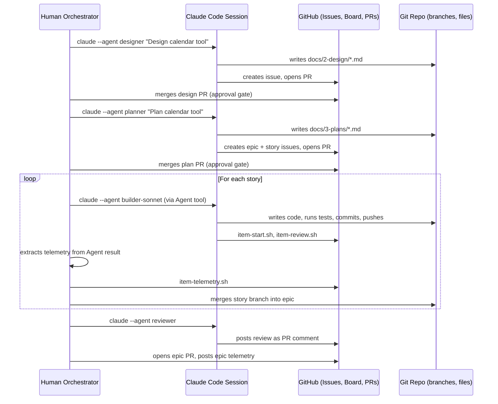
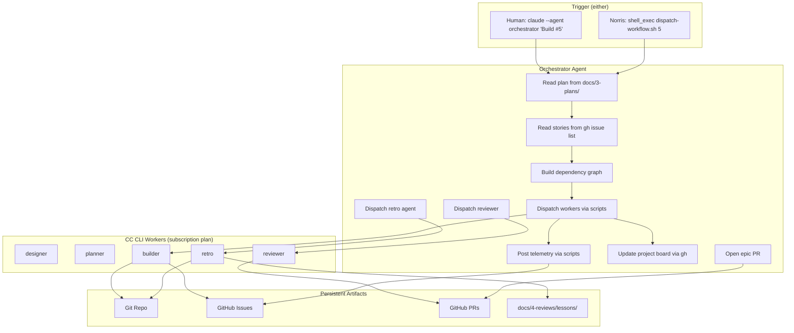
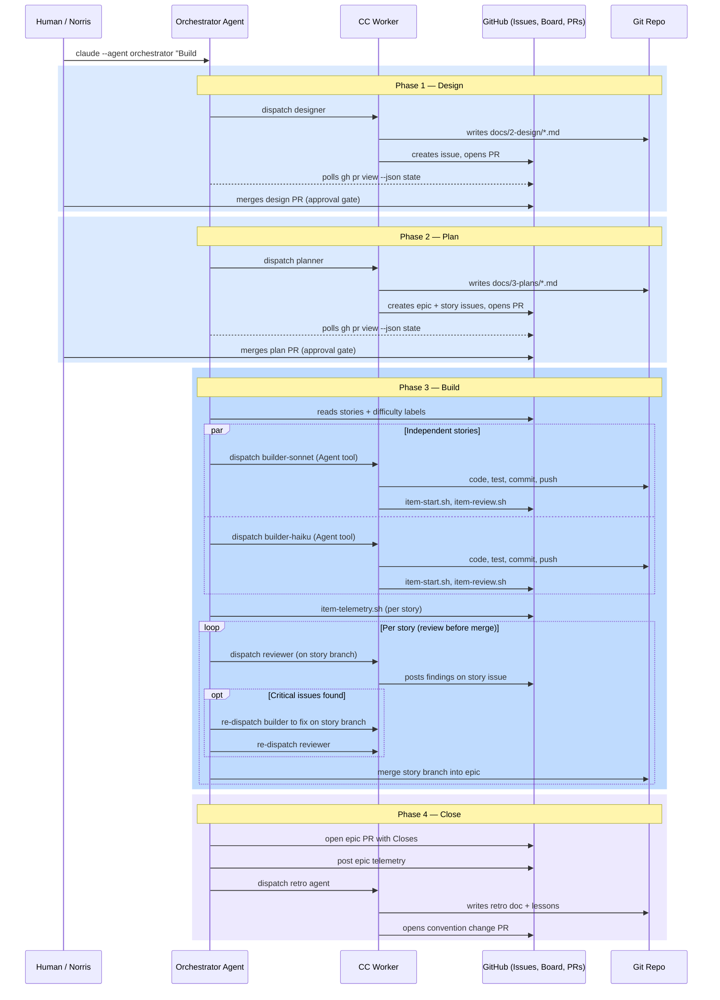
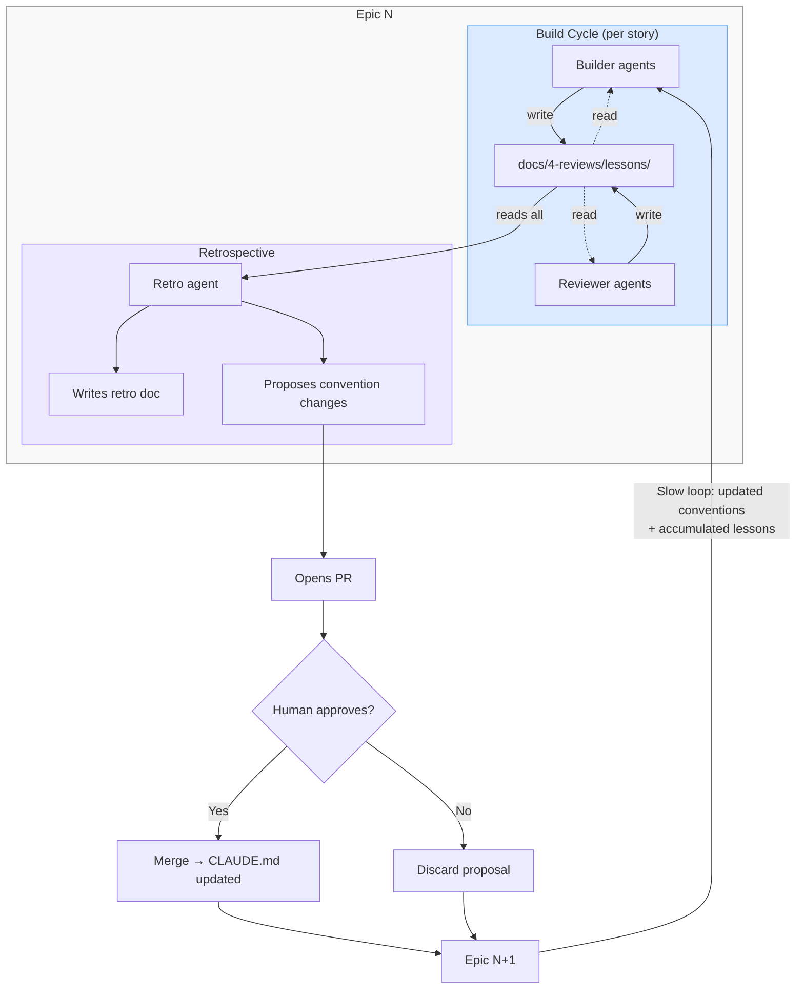

# Agentic SDLC Workflow v2 — Orchestration & Self-Improvement

## Overview

This project follows an **agentic SDLC** — a blueprint for AI-driven software development where specialized Claude Code agents handle design, planning, building, reviewing, and retrospectives. The [v1 design](2026-03-08-agentic-sdlc-design.md) established the blueprint: four agents, GitHub Issues as the source of truth, difficulty-based model routing, and helper scripts for telemetry — with manual human orchestration.

The NeuralNorris Calendar Tool build was the first end-to-end test of this blueprint. It proved the SDLC works — 12 stories, 167 tests, a working feature — but exposed a structural bottleneck: a human must sit between every agent transition, dispatching builders, parsing telemetry, merging branches, and updating the project board.

This v2 design iterates on the blueprint by replacing the human orchestrator with a CC CLI agent that dispatches workers as in-session subagents (via the Agent tool) or CLI scripts. Workers are self-sufficient — they read context from the repo and GitHub, produce side effects (code, commits, issue comments), and return only a success/failure signal. A retro agent closes a self-improvement loop by synthesizing lessons learned and proposing convention changes via PR. The blueprint is tool-agnostic: any AI agent capable of running shell commands and reading repos could orchestrate it. Eventually, an AI agent like NeuralNorris could trigger or drive the SDLC as orchestrator.

The key insight: **agents don't need to return data to the orchestrator.** Work products persist in the repo and on GitHub. The orchestrator only needs to know "did it succeed?" — verifiable via exit code, `gh issue view`, or `git log`.

## Problem Statement

The Calendar Tool build ([retro](../4-reviews/2026-03-09-e01-calendar-retro.md)) delivered 12 stories, 167 tests, and a working feature across 3 epics. It was the first end-to-end test of the agentic SDLC blueprint — and it exposed six structural problems:

| # | Problem | Evidence | Impact |
| - | ------- | -------- | ------ |
| 1 | **Human orchestrator bottleneck** | Human dispatched every agent, parsed results, ran telemetry scripts, merged branches, updated the board | Serializes parallel-capable work |
| 2 | **Broken telemetry in parallel dispatches** | `duration_ms` lost for 3 of 5 E01 stories | Unreliable cost/speed tracking |
| 3 | **Model routing not applied** | All E01/E02 stories used opus regardless of difficulty label | Wasted tokens on easy/medium stories |
| 4 | **Builder variant maintenance overhead** | Three identical agent files (`builder-haiku/sonnet/opus.md`) exist to work around the Agent tool's missing `model` parameter | Sync burden, forgot-to-sync failures |
| 5 | **No self-improvement mechanism** | 22 commits to CLAUDE.md/agent files — all applied manually by a human mid-flight | Knowledge doesn't compound |
| 6 | **Review as afterthought** | One end-of-epic review caught 3 critical bugs (DI registration, prefix stripping, CSRF) | Bugs compound across stories |

### Current Workflow (v1)



Every arrow from `Human` is a manual step. The human is the glue — every transition between agents requires intervention. The Agent tool has no `model` parameter, no dynamic agent loading, and no hook interception, so even the workarounds are manual.

### How Context Flows Today

Context already flows through **persistent artifacts**, not agent return values:

| Artifact | Where | Who writes | Who reads |
| -------- | ----- | ---------- | --------- |
| CLAUDE.md | repo root | human/retro agent | all agents |
| Design doc | `docs/2-design/` | designer | planner, builder |
| Plan + acceptance criteria | `docs/3-plans/` | planner | builder |
| GitHub Issues (labels, body) | GitHub | planner | orchestrator, builder |
| Story branches (code) | git | builder | next builder, reviewer |
| Issue comments (telemetry) | GitHub | scripts | orchestrator, retro |
| Epic branch (accumulated code) | git | builders (merge) | reviewer |

This is what makes v2 possible. Since all work products persist in shared storage, the orchestrator doesn't need agent return values — just an exit code and the ability to verify outcomes via `gh` and `git`.

## Goals & Non-Goals

### Goals

1. **Automate orchestration** — eliminate the human as the serial bottleneck between parallel-capable stories
2. **Fix telemetry in parallel dispatches** — `duration_ms` was lost for 3 of 5 E01 stories when dispatched in parallel
3. **Apply model routing** — map difficulty labels to models instead of using opus for everything
4. **Eliminate builder variant files** — remove the three identical `builder-haiku/sonnet/opus.md` files
5. **Add a self-improvement loop** — agents capture lessons in real-time; retro agent synthesizes and proposes convention changes
6. **Per-story review** — catch bugs closer to their introduction instead of one end-of-epic review

### Non-Goals

- Multi-repo orchestration — NeuralNorris is a single repo
- Cost tracking dashboard — telemetry comments on issues are sufficient for now
- Webhook-based approval gates — polling `gh pr view` is simpler and sufficient

## Design Overview

### Architecture



### Communication Model

```text
Orchestrator -> Worker:  dispatch script with issue number + model
Worker reads:            CLAUDE.md, plan doc, GitHub issue, existing code on branch
Worker produces:         commits, issue comments (via scripts), PRs
Worker -> Orchestrator:  exit code (0 = success, non-zero = failure)
Orchestrator verifies:   gh issue view (comments), git log (commits)
```

The orchestrator **never parses Claude Code's stdout**. It verifies outcomes through the same persistent artifacts that humans would check.

### Proposed Workflow (v2)

Compare with the [v1 sequence diagram above](#current-workflow-v1) — every `Human` arrow is now handled by the orchestrator agent.



In interactive mode, the only remaining `Human` arrows are the two approval gates (design PR merge, plan PR merge). In autonomous mode (`--autonomous`), even those gates are removed — the orchestrator auto-merges design/plan PRs via `gh pr merge`, enabling a fully unattended lifecycle from a single command:

```bash
# Autonomous (recommended) — full live UI with real-time progress
claude --agent orchestrator --dangerously-skip-permissions \
  "Execute backlog item #42."

# Or via CLI script (always shows progress)
./scripts/dispatch-workflow.sh 42 --autonomous
```

For CI/CD or headless compute, add `-p` to run without the interactive UI: `-p --verbose` for turn-by-turn text logging, `-p --output-format stream-json` for machine-readable streaming events (pipe to `tee` for log files), or `-p` alone for silent execution.

The designer and planner agents still follow their structured processes in autonomous mode — exploring approaches, documenting trade-offs, and flagging assumptions — but derive all requirements from the backlog issue instead of asking interactive questions.

## Detailed Design

### Orchestrator Agent

**File:** `.claude/agents/orchestrator.md`

**Role:** Drives the full lifecycle from design to retro, dispatching all other agents and managing GitHub state.

**Trigger:** `claude --agent orchestrator "Execute backlog item #5"` or Norris via `shell_exec`.

**Capabilities:**

- Detects existing artifacts (design docs, plans) and skips completed phases
- Dispatches designer and planner agents for design/plan phases (autonomous or interactive)
- Auto-merges design/plan PRs in autonomous mode via `gh pr merge`
- Reads `docs/3-plans/` to find the plan for the backlog item
- Reads GitHub issues to get story list, labels (difficulty), dependencies
- Builds a dependency graph from the plan's Mermaid diagram or `depends_on` fields
- Dispatches builders via Agent tool (in-session) or `scripts/dispatch-story.sh` (CLI)
- Posts telemetry via `scripts/item-telemetry.sh` after each worker completes
- Updates project board status via `gh project item-edit`
- Merges story branches into epic branch
- Dispatches reviewer after each story (or batch of parallel stories)
- Dispatches retro agent after epic completion
- Opens epic PR with `Closes #NN` links and changelog entry
- Posts epic-level telemetry on the PR

**Two modes — controlled by including the word `autonomous` in your prompt:**

| Mode | How to activate | Designer/Planner behavior | PR handling |
|------|----------------|---------------------------|-------------|
| **Autonomous** | Include `autonomous` in the prompt (e.g., `"autonomous — Execute backlog item #42."`) | Skip brainstorming skill and `AskUserQuestion`; derive all requirements from the backlog issue | Auto-merged via `gh pr merge` |
| **Interactive** | Omit `autonomous` from the prompt (default) | Ask clarifying questions via `AskUserQuestion`; use brainstorming skill for structured exploration | Wait for human to review and merge |

Both modes preserve structured thinking — the designer still explores approaches, documents trade-offs, and flags assumptions. The difference is whether the agent asks clarifying questions interactively or derives answers autonomously from the backlog issue.

**Examples:**

```bash
# Autonomous — full lifecycle, no human interaction
claude --agent orchestrator --dangerously-skip-permissions \
  "autonomous — Execute backlog item #42."

# Interactive — designer/planner ask questions, wait for PR merges
claude --agent orchestrator "Execute backlog item #42."

# Mixed — skip design/plan (already done), build autonomously
claude --agent orchestrator --dangerously-skip-permissions \
  "Execute backlog item #42. Skip design and plan."
```

**What it does NOT do:**

- Write code (dispatch the builder)
- Write design docs itself (dispatch the designer)
- Create plans itself (dispatch the planner)
- Parse CC CLI output beyond exit codes

**Dispatch mechanism (primary):** The orchestrator dispatches workers as in-session subagents via the Agent tool with `subagent_type: "builder-sonnet"` (or haiku/opus based on difficulty label).

**Dispatch mechanism (secondary — standalone terminal only):** For humans running builds from a terminal or CI. Not usable by agents due to nested session detection.

```bash
./scripts/dispatch-story.sh 26 --model sonnet --agent builder
```

**Parallel dispatch:**

For independent stories (no shared dependencies), the orchestrator runs multiple dispatch scripts concurrently:

```bash
./scripts/dispatch-story.sh 27 --model haiku --agent builder &
./scripts/dispatch-story.sh 28 --model sonnet --agent builder &
./scripts/dispatch-story.sh 29 --model haiku --agent builder &
wait
```

### Retro Agent

**File:** `.claude/agents/retro.md`

**Role:** After epic completion, compiles a retrospective and proposes workflow improvements.

**Trigger:** Dispatched by orchestrator as the final phase, or manually via `claude --agent retro "Retro for epic E01"`.

**Inputs (all from persistent artifacts):**

- Lesson files from the epic (see [Living Lessons](#living-lessons))
- Git log for the epic branch (commits, timestamps)
- GitHub issue comments (telemetry) and PR comments (review findings)
- CLAUDE.md and `.claude/agents/*.md` (current conventions, plus diffs during the epic)
- The plan doc for the epic

**Outputs:**

1. **Retrospective document** in `docs/4-reviews/lessons/<backlog-issue>-<slug>/YYYY-MM-DD-eNN-<slug>-retro.md` — synthesizes lessons, telemetry, review findings, and timeline into a single narrative. This becomes the primary reference for the epic, replacing individual lesson files (see [Lesson Retention](#lesson-retention)).

2. **Convention change proposals** via PR on `docs/retro-<epic>` branch — proposed edits to CLAUDE.md or agent files. Human approves via PR merge (same gate as design docs).

**What it does NOT do:**

- Modify CLAUDE.md directly (changes go through a separate PR)
- Block the epic PR (retro runs after the epic is complete)
- Make subjective quality judgments — focuses on measurable data (telemetry, bug counts)

### Builder & Reviewer Changes

**Builder:** The three variant files (`builder-haiku.md`, `builder-sonnet.md`, `builder-opus.md`) **stay** because the Agent tool's schema (`additionalProperties: false`) has no `model` parameter. In-session dispatch (the primary path) requires `subagent_type: "builder-sonnet"`, which needs the variant files to exist.

| Dispatch mode | How model is selected | Variant files needed? |
| ------------- | --------------------- | --------------------- |
| In-session (Agent tool) | `subagent_type: "builder-haiku\|sonnet\|opus"` | Yes |
| CLI (standalone terminal only) | `./scripts/dispatch-story.sh --model sonnet` | No |

The CLI path passes `--model` at dispatch time, bypassing the need for variants. But since in-session dispatch is the orchestrator's primary mode, the variant files and their sync convention remain.

The variant sync overhead is mitigated by the existing scripted sync command in CLAUDE.md.

**New builder instruction:** Search `docs/4-reviews/lessons/` for relevant lessons (`grep -rl "tags:.*builder"`) before implementing. Check for known pitfalls relevant to the current story.

**Reviewer:** The reviewer gains a new convention: **per-story review** instead of end-of-epic review.

The orchestrator dispatches the reviewer **before merging** each story branch into the epic branch. This keeps rollback trivial (just don't merge) and catches issues before they touch shared state. The reviewer:

1. Reads the diff between the story branch and the epic branch base
2. Checks against CLAUDE.md conventions and `docs/4-reviews/lessons/`
3. Posts findings as a comment on the story's issue (not the epic PR)
4. If critical issues found, the orchestrator re-dispatches the builder to fix on the story branch, then re-reviews
5. Once approved, the orchestrator merges the story branch into the epic branch

For the last story in an epic, the reviewer may optionally review the merged state to check cross-story integration.

### Post-Merge Automation

#### Problem

During the Calendar build, all 12 story issues and 3 epic issues remained OPEN after the epic PR was created. The `issue-merged.sh` script exists but only calls `gh issue close` — it never updates the project board status to "Done" (option ID `98236657`). Worse, when a PR is merged via the GitHub UI (not through an agent), nothing runs at all — issues stay open and the board is stale.

Two gaps:

1. **`issue-merged.sh` is incomplete** — closes the issue but doesn't set board status to Done
2. **No automation on GitHub UI merge** — only agents call `issue-merged.sh`; merging via the web UI skips it entirely

#### Solution

**1. Enhance `issue-merged.sh`:** After closing the issue, also set the project board status to "Done":

```bash
# Close the issue
gh issue close "$ISSUE_NUMBER" --repo "$REPO" --reason completed

# Set board status to Done
ITEM_ID=$(gh project item-list 7 --owner carlosboeing --format json --limit 100 \
  | jq -r ".items[] | select(.content.number == $ISSUE_NUMBER) | .id")
if [ -n "$ITEM_ID" ]; then
  gh project item-edit --project-id "PVT_kwHOADPMJc4BRg45" --id "$ITEM_ID" \
    --field-id "PVTSSF_lAHOADPMJc4BRg45zg_UfJc" \
    --single-select-option-id "98236657"
fi
```

**2. Add a GitHub Actions workflow (`auto-close-issues.yml`):** Triggers on PR merge to `main`, parses `Closes #N` patterns from the PR body, and closes each linked issue. This covers the GitHub UI merge path — no agent involvement required.

```yaml
on:
  pull_request:
    types: [closed]
    branches: [main]
```

The workflow only runs when `github.event.pull_request.merged == true`. For each extracted issue number, it closes the issue via `gh issue close`.

**Note:** The workflow does NOT update the project board status. The default `GITHUB_TOKEN` in GitHub Actions lacks the `project` scope required for `gh project item-edit` (GitHub Projects v2 are user/org-level resources). Board status updates are handled by `issue-merged.sh`, which runs locally with full `gh` access. The workflow is a safety net for issue closure only.

**3. Orchestrator convention:** After merging an epic PR (whether via `gh pr merge` or waiting for UI merge), the orchestrator calls `issue-merged.sh` for every epic and story issue linked in the PR body. `issue-merged.sh` handles both issue closure and board status update. The GitHub Actions workflow serves as a safety net for issue closure — if the orchestrator forgets or crashes, the workflow closes the issues on merge (board status is then updated manually or on next orchestrator run).

### Dispatch Scripts

#### `scripts/dispatch-story.sh`

New script that encapsulates the full story dispatch lifecycle:

```bash
#!/usr/bin/env bash
# Usage: ./scripts/dispatch-story.sh <issue-number> --model <model> --agent <agent> [--epic-branch <branch>]
#
# 1. Reads issue metadata (title, labels, body) from GitHub
# 2. Writes prompt file to .dispatch/story-<n>.md with full context
# 3. Invokes claude --agent <agent> --model <model> in headless mode
# 4. Captures exit code
# 5. On success: runs item-telemetry.sh, returns 0
# 6. On failure: posts failure comment on issue, returns 1
```

The prompt file (`.dispatch/story-<n>.md`) includes:

- Story title and acceptance criteria (from GitHub issue body)
- Relevant plan section (from `docs/3-plans/`)
- Known lessons for builders (from `grep -rl "tags:.*builder" docs/4-reviews/lessons/`)
- Epic branch name and story branch convention
- Link to CLAUDE.md (the agent reads it automatically via CC)

#### `scripts/dispatch-workflow.sh`

New script that orchestrates a full backlog item lifecycle:

```bash
#!/usr/bin/env bash
# Usage: ./scripts/dispatch-workflow.sh <backlog-issue-number> [--skip-design] [--skip-plan] [--autonomous]
#
# Phases:
# 1. Design (if not --skip-design): dispatch designer, wait/auto-merge PR
# 2. Plan (if not --skip-plan): dispatch planner, wait/auto-merge PR
# 3. Build: read plan, dispatch stories respecting dependency graph
# 4. Review: dispatch reviewer per story
# 5. Epic PR: open PR with Closes links, changelog, telemetry
# 6. Retro: dispatch retro agent
#
# --autonomous: Designer/planner skip interactive questions; PRs auto-merged
```

**Approval gates:** In interactive mode (default), the script pauses after design and plan phases, polling for human PR merge. In autonomous mode (`--autonomous`), design/plan PRs are auto-merged via `gh pr merge` immediately after the agent completes.

#### Norris Integration

Norris invokes the same scripts via `shell_exec`:

```bash
shell_exec(branch, "./scripts/dispatch-workflow.sh 5")
```

Required additions to `DevOpsConfig.ShellAllowlist`:

```json
[
  "dotnet build", "dotnet test", "dotnet restore",
  "dotnet publish", "dotnet ef migrations add",
  "./scripts/dispatch-story.sh",
  "./scripts/dispatch-workflow.sh",
  "./scripts/item-start.sh",
  "./scripts/item-review.sh",
  "./scripts/item-telemetry.sh",
  "./scripts/issue-merged.sh",
  "gh issue",
  "gh pr",
  "gh project",
  "gh api",
  "claude"
]
```

Additional config changes for Norris:

- `ShellTimeoutSeconds`: increase to 1800+ (stories can take 10+ minutes)
- `BranchPrefix`: relax from `norris/` to support `epic/` and story branches
- Auth: `claude setup-token` on the Pi for subscription-based CC CLI access

### Living Lessons

#### Problem

During the Calendar build, agents discovered 12 significant lessons — DI registration blind spots, prefix stripping bugs, CSRF validation gaps, telemetry failures — but none were captured systematically. The human had to retroactively write them all after the fact. Without a structured place to record lessons, knowledge from one story or epic doesn't reach agents working on later stories or epics.

#### Solution: Epic folders, one lesson per file, tag-based discovery

Agents write lessons as they discover them — one file per lesson, organized by epic, tagged for cross-cutting discovery. This avoids merge conflicts when parallel agents write simultaneously and keeps lessons browsable by epic.

```text
docs/4-reviews/lessons/
  5-calendar-tool/
    e01-calendar-core/
      2026-03-09-s01-di-registration-blind-spot.md
      2026-03-09-s01-prefix-stripping-across-layers.md
      2026-03-09-s02-telemetry-lost-in-parallel.md
      2026-03-09-s01-model-routing-not-applied.md
    e02-google-provider/
      2026-03-09-s03-token-refresh-race-condition.md
    e03-calendar-plugin/
  43-sdlc-v2/
    e01-dispatch-scripts/
    e02-orchestrator-retro/
```

**Folder convention:** `<backlog-issue>-<feature-slug>/eNN-<epic-slug>/` — backlog issue number as the top-level grouping, with epic subfolders beneath. The backlog issue number is globally unique (GitHub assigns it), so there are no collisions when epic numbers reset between features (e.g., both Calendar Tool and SDLC v2 have an E01). Epics within a feature map 1:1 to retro documents and represent a cohesive body of work.

**File naming convention:** `YYYY-MM-DD-sNN-<slug>.md` — ties each lesson to the specific user story where it was discovered. The story number is enough since the epic is already encoded in the parent folder. Stories are the smallest unit of work; some will produce lessons, many won't. The date prefix maintains chronological ordering, and the story reference (`s03`) lets anyone trace back to the exact issue, telemetry, and code change that triggered the learning.

**Why backlog-issue/epic folders, not role-based folders:** Lessons don't always fit one category. "DI registration blind spot" is both a builder issue and a testing gap. "Google API pagination" is about a specific technology, not a role. Role-based folders (`builder-pitfalls/`, `orchestrator-mistakes/`) force lessons into buckets that may not exist yet. The two-level hierarchy (backlog issue → epic) follows the natural structure of the work: features are the top-level grouping, epics are the cohesive bodies of work within them. Tags inside each file handle cross-cutting discovery — agents find relevant lessons by grepping tags, not by knowing which folder to look in.

**Benefits:**

- **No merge conflicts** — each lesson is an independent file. Parallel agents create independent files without contention.
- **Browsable by feature and epic** — `ls docs/4-reviews/lessons/5-calendar-tool/e01-calendar-core/` shows all lessons from that body of work.
- **No category debates** — agents just create a file in the epic folder and tag it.
- **Tag-based discovery** — agents find relevant lessons with `grep -rl "tags:.*builder" docs/4-reviews/lessons/` (all features) or `grep -rl "tags:.*builder" docs/4-reviews/lessons/43-sdlc-v2/` (current feature).
- **Git-native** — adding a lesson is adding a file. No merge resolution needed.

#### Lesson file format

```markdown
---
date: 2026-03-09
author: reviewer
story: "E03-S01 (#34) — CalendarToolPlugin with list and get functions"
tags: [builder, di, testing, runtime-failure, review]
severity: critical
---

# DI Registration Blind Spot

## What happened
Builder created service classes but didn't register them in
ServiceCollectionExtensions. 3 critical runtime failures found by reviewer.

## Root cause
Unit tests mock the DI layer, so missing registrations pass all tests.

## Prevention
- Builder MUST verify every new service is registered in the
  corresponding ServiceCollectionExtensions file.
- Reviewer MUST check DI wiring for any new service class.
```

Tags are freeform — agents add whatever tags make sense. Common tags will emerge organically (e.g., `builder`, `reviewer`, `testing`, `github-api`, `di`, `telemetry`). No predefined taxonomy.

#### How agents use lessons

| Agent | Reads | Writes | When it writes | Discovery method |
| ----- | ----- | ------ | -------------- | ---------------- |
| Builder | Yes (before starting) | Yes | When it encounters a bug, unexpected behavior, or missing convention during implementation | `grep -rl "tags:.*builder" docs/4-reviews/lessons/` |
| Reviewer | Yes (during review) | Yes | When it finds issues that represent a systemic pattern worth capturing | `grep -rl "tags:.*review" docs/4-reviews/lessons/` |
| Orchestrator | Yes | Yes | When dispatch or board operations fail unexpectedly | `grep -rl "tags:.*orchestrator" docs/4-reviews/lessons/` |
| Retro | Yes (all) | Yes (supplements) | When it identifies cross-story patterns that individual agents missed | Reads entire directory to synthesize |
| Designer | Yes | Yes | When it discovers constraints or trade-offs worth capturing for future designs | `grep -rl "tags:.*design" docs/4-reviews/lessons/` |
| Planner | Yes | Yes | When plan assumptions prove wrong or dependency graphs need revision | `grep -rl "tags:.*architecture" docs/4-reviews/lessons/` |

### Lesson Retention

Individual lesson files are valuable at the moment of discovery but lose their primary purpose once the retro agent compiles them. A three-tier retention model keeps the `lessons/` directory from growing unbounded while preserving the right level of detail at each stage:

| Tier | When | Lesson files | Primary source for agents |
| ---- | ---- | ------------ | ------------------------- |
| **Active** | During the current epic | Live — agents grep freely | Individual lesson files |
| **Compiled** | After retro runs | On disk but deprioritized | Retro doc (`docs/4-reviews/`) |
| **Archived** | After 3-5 epics | Moved to `lessons/archive/` or deleted | Retro doc only |

**Active (current epic):** This is the fast loop. Builders and reviewers write lessons as they discover issues, and agents working on later stories in the same epic grep them immediately. No gating, no compilation step.

**Compiled (retro complete):** After the [retro agent](#retro-agent) synthesizes lessons into the retro doc, that doc becomes the primary reference. Agents should prefer `docs/4-reviews/lessons/<backlog-issue>-<slug>/YYYY-MM-DD-eNN-*-retro.md` over grepping individual lesson files for completed epics. Individual lessons remain on disk for traceability — an agent can still drill into the original lesson for root cause detail that the retro summary omits.

**Archived (3-5 epics later):** By this point, any convention changes from these lessons have been merged into CLAUDE.md, and the retro doc captures the synthesized knowledge. The raw lesson files add no further value to agent discovery. They can be moved to `lessons/archive/` (preserving git history) or deleted outright. The retro doc is the permanent record.

**Agent instruction update:** Builder and reviewer grep instructions should scope to the current feature's lesson folder first (`docs/4-reviews/lessons/<issue>-<slug>/`), then fall back to the retro docs for older features. This keeps grep fast and avoids agents loading stale context from features whose conventions have already been codified.

### Self-Improvement Loop



Two feedback loops drive improvement:

- **Fast loop (within-epic, no gate):** Lessons written during story S01 are immediately available to builders and reviewers working on later stories in the same epic. Agents grep lesson files freely — no human approval needed.
- **Slow loop (cross-epic, human gate):** The [retro agent](#retro-agent) compiles lessons into a retro doc and proposes convention changes via PR. The human remains the approval gate.

**Overhead:** On subscription, the loop adds no marginal cost. The time overhead is: ~5K tokens of lesson context per builder/reviewer session (grows with lesson count, but agents only grep their tags), plus one retro session per epic (~5-15 minutes). Lesson writing within existing sessions is negligible. The three-tier retention model (see Lesson Retention) keeps grep fast as the project grows.

### Agent Self-Documentation

#### The 22-commit problem

During the Calendar build, the human orchestrator had to make 22 commits to CLAUDE.md and agent files because agents didn't update documentation when they encountered gaps or made decisions. Examples:

- The planner discovered that `gh project item-list` defaults to 30 items but didn't add `--limit 100` to the agent docs — the human had to.
- The builder discovered that DI registration was incomplete but didn't propose an instruction update — the human had to.
- The designer crossed phase boundaries (tried to write plans) but didn't add a guard rail to its own agent file — the human had to.

Every one of those 22 commits represents a case where an agent should have updated its own instructions but didn't.

#### Solution: "Document what you learn" instruction

All agents get a new standing instruction in their `.md` files:

```markdown
### Capturing Lessons

When you encounter a bug, unexpected behavior, missing convention, or
anything worth remembering for future work, create a lesson file
immediately — don't defer it.

**When to write a lesson:**
- You hit a bug that tests didn't catch (e.g., DI registration missing)
- A tool or API behaved unexpectedly (e.g., gh defaults to 30 items)
- You had to guess a convention that wasn't documented
- You found a security issue (e.g., missing CSRF validation)
- A command needed a flag you didn't expect
- Something took longer than it should have due to a gap in the workflow

**How to write a lesson:**
1. Create a file in `docs/4-reviews/lessons/<backlog-issue>-<feature-slug>/eNN-<epic-slug>/`
2. Use the naming convention: `YYYY-MM-DD-sNN-<slug>.md`
3. Add YAML frontmatter with: date, author, story, tags, severity
4. Write sections: What happened, Root cause, Prevention
5. Commit the lesson alongside your implementation work

**Example:** `docs/4-reviews/lessons/5-calendar-tool/e03-calendar-plugin/2026-03-09-s01-di-registration-blind-spot.md`

Lessons are your notes for future agents. Write them at the moment of
discovery — context is lost if you defer.

### Self-Documentation

When you encounter any of the following, you MUST update the relevant
documentation before completing your task:

1. **A convention you had to guess or figure out** — Add it to CLAUDE.md
   or your own agent file so the next agent doesn't have to guess.
2. **A command that needed a flag you didn't expect** (e.g., --limit 100)
   — Update the command example in CLAUDE.md or the agent file.
3. **An instruction in your agent file that was wrong or misleading** —
   Fix it directly.

Changes to CLAUDE.md and agent files should be committed alongside your
implementation work, not deferred. If the change is significant enough to
warrant team review, note it in your item-review.sh comment.
```

#### Scope by agent role

| Agent | Can update CLAUDE.md | Can update own .md | Can update other agent .md | Can create lesson files |
| ----- | -------------------- | ------------------ | ------------------------- | ---------------------- |
| Builder | Yes (conventions it discovers) | Yes | No | Yes |
| Reviewer | Yes (review conventions) | Yes | Yes (if review finding requires it) | Yes |
| Planner | Yes (project structure, commands) | Yes | No | Yes |
| Designer | Yes (design conventions it discovers) | Yes | No | Yes |
| Orchestrator | Yes (dispatch conventions) | Yes | No | Yes |
| Retro | Yes (proposes changes via PR) | Yes | Yes (proposes via PR) | Yes |

#### Guard rail: no breaking changes

Agents can **add** to CLAUDE.md and agent files but must not:

- Remove existing conventions without opening a discussion (PR with rationale)
- Change command formats that other agents depend on
- Modify GitHub project board option IDs or status definitions

Additive changes (new instructions, new examples, new warnings) are safe and should be committed inline. Subtractive or breaking changes must go through the retro agent's PR process.

### Document Metadata Standard

All docs in the project use **YAML frontmatter** for metadata. The H1 heading remains the human-readable title; frontmatter holds machine-parseable fields.

#### Common fields (all doc types)

| Field | Required | Description |
| ----- | -------- | ----------- |
| `date` | Yes | Creation date (YYYY-MM-DD) |
| `author` | Yes | Agent role or human name |
| `status` | Varies | `draft`, `approved`, `implemented`, `superseded` |

#### Type-specific fields

| Doc type | Location | Additional fields |
| -------- | -------- | ----------------- |
| Design | `docs/2-design/` | `status`, `retro` (optional link) |
| Plan | `docs/3-plans/` | `status`, `epic` |
| Retro | `docs/4-reviews/` | `backlog-issue`, `epic-pr`, `scope` |
| Lesson | `docs/4-reviews/lessons/` | `story`, `tags`, `severity` |
| ADR | `docs/6-adrs/` | `status`, `context` |

#### Example

```yaml
---
date: 2026-03-09
author: designer
status: draft
---

# Design Document Title
```

#### Why YAML frontmatter

The project currently uses three different metadata formats (blockquote bold, plain bold, bold list items). YAML frontmatter unifies them:

- **Machine-parseable** — `yq`, VS Code, Obsidian, and GitHub all render it natively
- **Cleaner grep** — no `**` bold noise in metadata fields
- **One format** — agents don't need to know which format a doc type uses

#### Migration

New docs MUST use YAML frontmatter. Existing docs are migrated opportunistically — when an agent edits an existing doc, it converts the header to YAML frontmatter in the same commit. Lesson files are converted as part of this design's implementation.

### Cost Model

#### v1 (API tokens)

Every agent call consumes API tokens at pay-per-use rates. The Calendar build consumed ~296K tokens for E03 alone at ~$3.57.

#### v2 (CC CLI on subscription)

| Activity | Cost model |
| -------- | ---------- |
| Orchestrator (CC agent or Norris planning) | Subscription (CC CLI) or minimal API (Norris) |
| Designer | Subscription (CC CLI) |
| Planner | Subscription (CC CLI) |
| Builder x N | Subscription (CC CLI) |
| Reviewer x N | Subscription (CC CLI) |
| Retro | Subscription (CC CLI) |
| GitHub operations (`gh` CLI) | Free |
| Telemetry scripts | Free |

**Net effect:** Near-zero marginal cost per story on a Max subscription plan.

#### Model routing

| Difficulty label | Model | Rationale |
| ---------------- | ----- | --------- |
| `difficulty/easy` | haiku | Scaffolding, config, simple CRUD |
| `difficulty/medium` | sonnet | Multi-file, standard patterns |
| `difficulty/hard` | opus | Cross-project, new abstractions |

The orchestrator reads the label from `gh issue view` and passes `--model` to the dispatch script. No more variant agent files.

## Migration Plan

### Phase 1: Scripts and lessons (no agent changes)

1. Create `scripts/dispatch-story.sh` wrapper
2. Create `docs/4-reviews/lessons/` directory structure with Calendar retro findings
3. Add `gh`, `claude`, and script paths to `ShellAllowlist`
4. Test: human runs `dispatch-story.sh` manually for one story

### Phase 2: Orchestrator and retro agents

1. Create `.claude/agents/orchestrator.md`
2. Create `.claude/agents/retro.md`
3. Update `builder.md` instructions to grep `docs/4-reviews/lessons/` for builder-tagged lessons
4. Update `reviewer.md` instructions to grep `docs/4-reviews/lessons/` for review-tagged lessons
5. Test: `claude --agent orchestrator "Build a simple story"` end-to-end

### Phase 3: Verify builder variant sync and CLI dispatch

1. Verify builder variants are byte-identical to `builder.md` (except frontmatter)
2. Update CLAUDE.md dispatch protocol to document both modes (Agent tool + CLI)
3. Test: orchestrator dispatches builder via Agent tool (in-session) and CLI (secondary)
4. Test: CLI dispatch with `--model` flag correctly routes to haiku/sonnet/opus

### Phase 4: Norris integration (optional, future)

1. Configure `claude setup-token` on Pi
2. Expand `ShellAllowlist` in production config
3. Increase `ShellTimeoutSeconds` for long-running CC CLI sessions
4. Relax `BranchPrefix` constraint
5. Add "repo root" execution mode to `ShellExecTool` for `gh` commands
6. Test: Norris receives "build backlog item #5" in chat and executes full workflow

## Risks & Mitigations

| Risk | Impact | Mitigation |
| ---- | ------ | ---------- |
| CC CLI subscription rate limits | Parallel builders may hit concurrent session limits | Dispatch with `SemaphoreSlim`-style concurrency cap; fall back to sequential |
| Long-running CC sessions timeout | Builder sessions on complex stories may exceed CC CLI limits | Set `--max-turns`; dispatch script detects timeout and retries or escalates |
| Retro agent proposes harmful convention changes | Bad proposals could degrade workflow quality | Human approval gate on all convention changes; retro can only propose via PR |
| Lesson files grow unbounded | Hundreds of lesson files could slow grep discovery | Three-tier retention model (see Lesson Retention): active → compiled → archived after 3-5 epics |
| Orchestrator dispatch failure mid-epic | Partial epic state with some stories complete, others not | Orchestrator reads GitHub state on restart; idempotent dispatch (skips already-completed stories) |
| Parallel builders create merge conflicts on epic branch | Two builders modify the same file | Dependency graph prevents overlapping stories; sequential merge into epic branch |

## Post-v2 Enhancements (Runs 2–4)

The original v2 design above was tested across four end-to-end runs. Each run validated core mechanics and exposed operational gaps that were fixed before the next run. This section documents every enhancement added since the original design — organized by concern area — so the full workflow can be replicated in a new project without re-learning these lessons.

### Run History

| Run | Backlog | Content Vehicle | Stories | Key Validation | Key Fixes |
|-----|---------|----------------|---------|----------------|-----------|
| 1 | #43 | Calendar Tool | 12 | First SDLC v1 test (manual orchestration) | Identified need for automated orchestrator |
| 2 | #57 | SDLC v2 Test | 3 | Agent tool dispatch, model routing | CLI nested session detection, variant files required |
| 3 | #89 | Mythical Creatures | 7 | Parallel dispatch, reviewer integration, full autonomous lifecycle | Board transitions, epic telemetry scoping, word count enforcement |
| 4 | #106 | Travel Advisory | 5 | Board transition fixes, scoped telemetry, all 3 model tiers | Builder self-merge prevention, gitignore conflicts, epic PR review gate |

### Orchestrator State Persistence

**Problem:** The orchestrator holds phase progress, story status, pricing, and telemetry in memory. If the session is interrupted (usage limit, crash, window closed), all of this is lost. Re-querying GitHub is slow and lossy (token counts aren't stored on issues).

**Solution:** The orchestrator persists its full workflow state to `.claude/state/<backlog>/orchestrator.json` (gitignored). The state file is versioned JSON (schema v1) with these sections:

| Section | Purpose |
|---------|---------|
| `session` | Backlog number, mode (autonomous/interactive), orchestrator model, start time, repo, git SHA |
| `pricing` | Token rates fetched from Anthropic's pricing page at session start (see Dynamic Pricing below) |
| `phases` | Status of each workflow phase (pending, in_progress, complete, skipped) |
| `epics` | Per-epic structure with issue numbers, branches, PRs, and per-story status/telemetry |
| `dispatches[]` | Append-only audit log of every agent dispatch with model, duration, tokens, tool uses, result |

**Lifecycle:** Create at Phase 0 → update after every checkpoint event (dispatch complete, status change, review verdict) → read on resume for instant recovery → clean up after epic PR merges.

**Fallback:** If missing, the orchestrator falls back to querying GitHub for issue comments and branch state. The state file is an optimisation, not a hard dependency.

**Extensibility:** The directory structure (`.claude/state/<backlog>/`) supports future per-agent state files as siblings (e.g., `builder-112.json`, `reviewer-112.json`). Schema version (`"version": 1`) enables forward-compatible changes.

### Dynamic Pricing

**Problem:** Token cost estimates were hardcoded in `item-telemetry.sh`. When Anthropic updated model pricing (e.g., Opus 4 at $15/$75 → Opus 4.6 at $5/$25), estimates became 3× too high.

**Solution:** `scripts/fetch-pricing.sh` fetches live pricing from `anthropic.com/pricing` at session start, parses model-versioned rates, and outputs JSON. The orchestrator stores the result in the state file under `pricing`. When posting telemetry, the orchestrator passes the rate to the script via `--rate <cents-per-M>`, overriding hardcoded defaults.

**Fallback chain:** Web fetch → hardcoded defaults in the script. The script always succeeds.

**Key insight:** `session.orchestrator_model` in the state file captures which model the orchestrator is running. Since non-builder agents use `model: inherit`, they inherit this model. Without recording it, cost estimates for design, plan, review, and retro phases are impossible to compute accurately after the fact.

### Telemetry System

The telemetry system evolved significantly across runs. `item-telemetry.sh` is the core script, which renders from a reusable template (`scripts/templates/telemetry.md`) — the single source of truth for all telemetry output format. The template uses `{{VAR}}` placeholders and `<!-- IF_X -->...<!-- END_X -->` conditional blocks, processed by a bash renderer in the script. To reuse in another project, copy the template and renderer function.

#### Parameters

| Flag | Purpose | Added in |
|------|---------|----------|
| `--model` | Model name (or `'mixed (sonnet, opus)'` for mixed epics) | v2 |
| `--duration` | Sequential sum of all story durations (ms) | v2 |
| `--wall-clock` | Actual elapsed time accounting for parallelism (ms) | Run 3 |
| `--tokens` | Total token count | v2 |
| `--tool-uses` | Total tool invocations | Run 3 |
| `--rate` | Blended rate override in cents/M tokens (from state file) | Run 4 |
| `--breakdown` | Markdown table rows for per-story detail | Run 3 |
| `--gantt` | Mermaid gantt chart body for timeline visualization | Run 4 |
| `--pr` | PR number to also post telemetry as a PR comment | Run 3 |

#### Output Format

All output is defined in `scripts/templates/telemetry.md`. The script generates:

1. **Metrics table** — model, commit, tokens, speed, est. cost, tool uses, duration
2. **Duration table** (when `--wall-clock` provided) — sequential vs. actual duration, time saved, speedup factor. Labels (e.g., "with parallelism", "Nx parallel speedup") go in the Metric column; Value column contains only numbers for machine-parseability
3. **Breakdown table** — per-story rows with Wave, Dispatch (parallel/sequential), Story, Model, Duration, Tokens, Est. Cost columns. Includes **Total** row (clean duration, no "seq" suffix), **Actual** row, and **Saved** row — labels in Story column, durations in Duration column
4. **Gantt timeline** (when `--gantt` provided) — Mermaid gantt chart visualizing all lifecycle phases
5. **Cost disclaimer** — automatically appended footer explaining estimates use published API pricing and subscription plans aren't charged per-token

**Design principle (Run 4):** Value columns contain only numbers or formatted values (e.g., `3m 24s`, `417K`, `~$0.12`). Annotations and labels go in the Metric or Story column. This enables future export to time-series databases or dashboards without stripping annotations.

#### Three Tiers of Telemetry

| Tier | Where | What | Posted by |
|------|-------|------|-----------|
| **Per-story** | Story issue comment | Single builder's metrics | Orchestrator via `item-telemetry.sh` |
| **Per-epic** | Epic issue comment | Scoped to stories in that epic only (no cross-contamination) | Orchestrator via `item-telemetry.sh` |
| **Full lifecycle** | Backlog issue comment + PR description | All phases (design, plan, build, review, retro) across all epics | Orchestrator manually |

**Scoping rule (Run 3 fix):** Each epic issue gets only its own stories in the telemetry breakdown. The backlog issue and PR are the only places where cross-epic aggregate telemetry belongs.

**PR telemetry placement (Run 4):** Full lifecycle telemetry goes in the **PR description** (appended with a `---` separator), not as a PR comment. This keeps it visible at the top of the PR page.

#### Full Lifecycle Telemetry

The backlog-level telemetry includes all agent work, not just builders:

| Phase | Agent | What to capture |
|-------|-------|----------------|
| Design | Designer | `duration_ms`, `total_tokens`, `tool_uses` from Agent tool result |
| Plan | Planner | Same |
| Build | Builders (per story) | Already captured via `item-telemetry.sh` |
| Review | Reviewers (per story + epic) | Same (even from failed/limited dispatches) |
| Retro | Retro agent | Same |

**Failed dispatch telemetry (Run 4 lesson):** The Agent tool returns metrics even when the agent fails or hits usage limits. Always capture them — zeroing them out underreports costs.

### Board Transition Ownership

**Problem (Run 3):** Stories jumped from Planned to Done, skipping In Progress and In Review. Both builder scripts and the orchestrator tried to update the board, creating race conditions.

**Solution:** The orchestrator owns all board transitions and serializes them. The GitHub Projects API does not handle concurrent `item-edit` calls reliably.

| Transition | When | Who |
|-----------|------|-----|
| Planned → Todo | After plan PR merge (autonomous) or human action (interactive) | Orchestrator |
| Todo → In Progress | Before dispatching a builder (sequentially, one story at a time) | Orchestrator |
| In Progress → In Review | After builder completes (sequentially, one story at a time) | Orchestrator |
| In Review → Done | After epic PR merges and `issue-merged.sh` runs | Orchestrator |

Builder scripts (`item-start.sh`, `item-review.sh`) still update the board as defense-in-depth, but the orchestrator is the source of truth.

**Parallel wave verification:** After a parallel wave completes, the orchestrator queries the board for all stories in the wave and fixes any that didn't transition correctly. This catches silent failures from concurrent API calls.

**Epic status sync:** An epic's board status reflects the aggregate of its stories — In Progress if any story is In Progress, In Review if all are In Review, Done if all are Done. The orchestrator updates the epic's status whenever a story transitions.

### Parallel Dispatch

**Validated in Run 3** (4 concurrent builders) and **Run 4** (3 haiku in Wave 1, sonnet + opus in Wave 2).

**How it works:** The orchestrator dispatches multiple Agent tool calls in a single response. Each builder works on its own story branch. After all complete, the orchestrator reviews and merges sequentially.

**Board status protocol for parallel waves:**
1. Set all stories to In Progress **sequentially** before any dispatch
2. Dispatch all builders **concurrently** via parallel Agent tool calls
3. After all complete, set all to In Review **sequentially**
4. Verify board status and fix any missed transitions

**Dependency graph:** The planner's plan includes a Mermaid dependency graph. Stories with no shared dependencies can run in parallel. The orchestrator reads this graph to determine wave composition.

**Dispatch strategy:** Splitting into waves (e.g., Wave 1 for independent stories, Wave 2 for stories with light dependencies) gives the orchestrator checkpoints to verify board transitions and telemetry before proceeding.

### Review System

**Per-story review is mandatory.** After each builder completes and before merging into the epic branch, the orchestrator dispatches the reviewer. There is no skip option.

**Epic PR review is a hard gate.** The epic PR must receive a reviewer verdict before merging. If the reviewer dispatch fails (e.g., usage limits), the PR is NOT auto-merged — it waits for human review.

**Fix cycle protocol:** If the reviewer returns `REQUEST_CHANGES`, the orchestrator re-dispatches the builder to fix (on the same branch), then re-dispatches the reviewer. Maximum 2 fix cycles per review. After 2 failures, the orchestrator posts a comment and requests human intervention.

**Run 4 lesson:** Builders should NOT merge their own story branches into the epic branch. The orchestrator does this after review passes. Add explicit prohibition to builder agent files.

### Epic PR Strategy

- **One PR per epic** to `main`, opened when all stories are merged into the epic branch
- **Squash merge** (`gh pr merge --squash --delete-branch`) to keep `main` history clean
- **Link all issues** in the PR body with `Closes #NN` for the backlog issue, every epic issue, AND every story issue. Omitting story issues leaves them open after the PR merges.
- **Changelog entry** must be added to the epic branch before the PR is opened

### Content Consistency Contract

**Problem (Run 3):** Parallel builders produced contradictory details about shared entities (the "Stoneback Leviathan" had different descriptions in two files).

**Solution:** The design doc specifies a set of shared facts (names, currencies, taxonomies, etc.) that are included in every story's acceptance criteria. Parallel builders produce consistent content by working from the same facts, without needing to read each other's output.

### Lesson System

Agents write lesson files as they discover issues — one file per lesson, organized by epic:

```
docs/4-reviews/lessons/<backlog-issue>-<slug>/eNN-<epic-slug>/YYYY-MM-DD-sNN-<slug>.md
```

- **YAML frontmatter:** date, author (agent role), story (issue ref), tags[], severity
- **Tag discovery:** `grep -rl "tags:.*builder" docs/4-reviews/lessons/`
- **Three-tier retention:** Active (current epic) → Compiled (after retro) → Archived (after 3-5 epics)
- **Retro synthesizes:** The retro agent reads all lesson files and produces a comprehensive retro doc. Convention changes are proposed via PR with human approval gate.

### Cost Model (Updated)

The original v2 cost model assumed subscription plans make per-story cost near-zero. This is true for execution cost, but **estimated API-equivalent cost is still tracked** for comparison and optimization:

| Model | Input/MTok | Output/MTok | Blended/MTok | Source |
|-------|-----------|-------------|-------------|--------|
| Opus 4.6 | $5.00 | $25.00 | $10.00 | anthropic.com/pricing (2026-03) |
| Sonnet 4.6 | $3.00 | $15.00 | $6.00 | anthropic.com/pricing (2026-03) |
| Haiku 4.5 | $1.00 | $5.00 | $2.00 | anthropic.com/pricing (2026-03) |

Rates are fetched dynamically at session start. The blended rate assumes ~75% input / 25% output token split. All telemetry posts include a disclaimer that these are API-equivalent estimates — subscription users are not charged per-token.

### Gantt Timeline Visualization

**Added in Run 4.** The full lifecycle telemetry includes a Mermaid gantt chart showing all phases — design, plan, build waves (parallel bars), review waves (parallel bars), fix cycles (`crit` style), epic reviews, and retro. This provides an at-a-glance view of where time was spent and how effectively parallelism worked.

**Dark/light mode theming:** GitHub renders Mermaid SVGs with transparent backgrounds and bakes in text colors at render time. Specifying any `theme` key (`default`, `base`, `dark`) in `%%{init}%%` overrides GitHub's auto-detection and breaks readability in one mode ([GitHub community discussion #35733](https://github.com/orgs/community/discussions/35733)). The solution: use `themeVariables` **without a `theme` key** — GitHub's Viewscreen auto-detects the user's dark/light preference for text, backgrounds, and axes, then applies custom bar colors on top. Bar fills use 600-level Tailwind shades optimized for ~4:1+ contrast with both white text (dark mode) and black text (light mode). No `section` directives — task labels are self-explanatory. Colors are defined in `scripts/templates/telemetry.md` (single source of truth).

**Label convention:** Labels follow `<ENN-SNN> <short label> - <duration>`. The orchestrator generates concise readable labels from issue titles using LLM judgement (not mechanical truncation). For non-story phases, use the agent role (e.g., "Designer (3m28s)").

### Known Platform Limitations (Claude Code, tested 2026-03)

| Limitation | Impact | Workaround |
|-----------|--------|------------|
| Agent tool has no `model` parameter | Can't override model at dispatch time | Builder variant files (`builder-haiku.md`, etc.) with different `model` frontmatter |
| Dynamic agent files not discovered mid-session | Can't create agent files during a workflow run | All agent files must exist before the session starts |
| `claude -p` can't run inside another CC session | Nested session detection prevents CLI dispatch from agents | Use Agent tool for dispatch; CLI scripts for standalone terminal use only |
| `PreToolUse` hook `updatedInput` crashes on Agent tool | Can't intercept/modify Agent tool inputs via hooks | Don't attempt to modify Agent tool inputs |
| GitHub Projects API doesn't handle concurrent `item-edit` | Parallel board updates silently fail | Serialize all board updates; verify after parallel waves |

## Key Decisions

| Decision | Rationale |
| -------- | --------- |
| CC CLI over native tool reimplementation | CC's agentic framework (Edit, Bash, Grep, error recovery) is battle-tested. Reimplementing it in Norris's DevOps tools would be inferior and expensive. |
| Exit code communication, not stdout parsing | Side effects (commits, issue comments) are the communication channel. Parsing CC output is fragile and unnecessary. |
| Shared scripts (either CC or Norris can call) | Maximum flexibility. Scripts are the orchestration API; the caller is interchangeable. |
| One lesson per file (not single LESSONS.md) | Avoids merge conflicts with parallel agents. Grep-friendly. Agents discover relevant lessons by grepping tags. Git-native (add file, no merge resolution). |
| Agents write lessons in real-time, retro synthesizes | Capture learnings at the moment of discovery — agents forget context if deferred. After compilation, the retro doc becomes the primary reference and old lessons are eventually archived. |
| Human approval gate for convention changes | The retro agent proposes, humans approve. Prevents runaway self-modification of the workflow. |
| Per-story review instead of per-epic | Calendar retro showed 3 critical bugs caught late. Earlier review catches bugs closer to their introduction. |
| Builder variants stay for Agent tool; CLI uses `--model` | Agent tool has no `model` parameter (`additionalProperties: false`). Variants are required for in-session dispatch. CLI dispatch uses `--model` as a secondary path. |
| Lesson folders grouped by backlog issue | Epic numbers reset per feature (both Calendar Tool and SDLC v2 have E01). Backlog issue numbers are globally unique, so `<issue>-<slug>/eNN-<epic>/` avoids collisions. |
| Review before merge (not after) | Keeps rollback trivial — just don't merge the story branch. Catches issues before they touch the epic branch. |
| GH Actions workflow only closes issues (no board update) | `GITHUB_TOKEN` lacks `project` scope for `gh project item-edit`. Board updates handled by `issue-merged.sh` locally. Workflow is a safety net for issue closure only. |
| Orchestrator owns all board transitions | GitHub Projects API fails silently under concurrent writes. Serializing transitions through the orchestrator prevents skipped states (Run 3 fix). |
| Dynamic pricing over hardcoded rates | Model pricing changes across generations (Opus 4 vs 4.6: 3× difference). Fetching from the web at session start keeps estimates accurate without manual updates. |
| State file per backlog (not global) | Isolates workflow state per feature. Multiple features can run concurrently without state collision. Directory structure supports future per-agent state files. |
| Squash merge for epic PRs | Collapses story branch merges into a single clean commit on main. Keeps main history readable while preserving full history on epic branches. |
| Non-builder agents use `model: inherit` | The user triggering the orchestrator decides the model tier for design, plan, review, and retro. No hardcoded model assumptions — flexibility over convention. |
| Telemetry in PR description, not comment | PR descriptions are visible at the top of the page. Comments get buried as discussion grows. Appending telemetry to the description ensures visibility. |
| Epic PR review is a hard gate | Run 4 merged PRs without reviewer sign-off when usage limits hit. Now: if reviewer dispatch fails, the PR waits for human review instead of auto-merging. |
| Consistency contracts for parallel builders | Shared facts in acceptance criteria prevent cross-story contradictions. Builders work from contracts, not from reading each other's output (Run 3 fix). |
| Template-driven telemetry rendering | A single template file (`scripts/templates/telemetry.md`) defines all telemetry output. The script renders from the template with conditional blocks and variable substitution. Eliminates format drift between code, docs, and live GitHub data — one file to change, one file to copy to a new project. |
| Clean Value columns (labels in Metric/Story) | Value columns contain only numbers or formatted values (e.g., `3m 24s`). Annotations like "(with parallelism)" and "(Nx parallel speedup)" go in the Metric or Story column. Enables future export to databases or dashboards without stripping text. |
| Gantt `themeVariables` without `theme` key | GitHub's Mermaid renderer overrides auto dark/light detection when any `theme` is specified. Omitting `theme` from `%%{init}%%` lets Viewscreen pick the right theme per user preference, then applies bar color overrides on top — the only approach that works in both modes. |

---

## Addendum: Single-PR Workflow (2026-03-10)

The original design specified one PR per epic to `main`. This was revised based on Run 4-5 experience:

**Change:** All work for a backlog item ships in a single PR from `backlog/<N>-<slug>` to `main`. Design docs, plans, stories, retro, and changelog are all on the integration branch.

**Rationale:**
- Reduces PR sprawl (Run 5 had 5 PRs for one backlog item: design, plan, 2 epics, retro)
- Single review point for the human — nothing merges to main until approved
- Retro and lessons ship with the code, not as a separate afterthought
- Simpler branch model: one integration branch instead of independent epic PRs

**Impact on phases:**
- Designer/planner PRs target the integration branch (not main)
- Epic branches are created from the integration branch
- Retro commits go on the integration branch (no separate PR)
- Orchestrator opens ONE PR and leaves it for human review

## Addendum: Checkpoint-Gated Phases (2026-03-10, Idea)

**Status:** Idea — not yet designed or implemented. Captured during Run 6 for future consideration.

**Problem:** The current orchestrator has two modes: fully autonomous (auto-merges everything) and interactive (asks questions, waits for human PR merges). There's no middle ground where a user can say "run autonomously, but pause at design for my review."

**Proposed concept:** User-defined **checkpoints** — phases where the orchestrator pauses for human review instead of auto-merging, even in otherwise autonomous mode.

```bash
# Autonomous but pause at design for human review
claude --agent orchestrator \
  "Execute backlog item #42 --checkpoints design"

# Autonomous but pause at both design and plan
claude --agent orchestrator \
  "Execute backlog item #42 --checkpoints design,plan"

# Fully autonomous (no checkpoints) — current behavior
claude --agent orchestrator \
  "autonomous — Execute backlog item #42"
```

**Behavior at a checkpoint:**
1. The agent completes the phase (designer writes design doc, opens PR)
2. Instead of auto-merging, the orchestrator leaves the PR open
3. A **notification hook** fires (webhook, Slack, email, terminal notification) to alert the human
4. The orchestrator waits for the human to merge the PR before proceeding
5. If the human requests changes (PR review comments), the orchestrator could re-dispatch the agent to address them

**Open questions:**
- How does the orchestrator "wait" in a CLI session? Poll? Long-lived process? Or save state and exit, resuming when re-invoked?
- Should checkpoints support post-build review (pause after all stories are built but before the backlog PR)?
- How are notification hooks configured? Per-user? Per-project? Environment variables?
- Could this integrate with NeuralNorris's own notification system (Twilio SMS, etc.)?
- Should there be a "review-then-continue" UX where the human approves in the terminal and the orchestrator resumes automatically?

**Relationship to interactive mode:** Checkpoints are a strict superset of the current interactive mode. Interactive mode is equivalent to `--checkpoints design,plan` plus interactive brainstorming questions. The checkpoint concept decouples "pause for review" from "ask questions during design."

## Related Documents

### Design docs

- [Agentic SDLC v1 Design](2026-03-08-agentic-sdlc-design.md) — Original blueprint: four agents, manual orchestration
- [Plugin Architecture Appendix](2026-03-10-agentic-sdlc-plugin-architecture.md) — MCP-based adapter interfaces for PM/code-hosting/docs
- [Self-Orchestration](2026-03-10-agentic-sdlc-self-orchestration.md) — NeuralNorris triggering its own SDLC
- [Issue Templates](2026-03-10-agentic-sdlc-issue-templates-design.md) — Work item templates (Goal/Epic/Task)
- [GitHub Issue Categorization](2026-03-10-agentic-sdlc-github-issue-categorization-design.md) — Label taxonomy and board categorization
- [Work Item Taxonomy](2026-03-11-agentic-sdlc-workitem-taxonomy.md) — Goal → Epic → Task naming decision
- [Extraction & Packaging](2026-03-11-agentic-sdlc-extraction-design.md) — Extracting the workflow into a standalone project

### Plans

- [Agentic SDLC v1 Plan](../3-plans/2026-03-08-agentic-sdlc-plan.md) — v1 implementation plan
- [Agentic SDLC v2 Plan](../3-plans/2026-03-09-agentic-sdlc-v2-plan.md) — v2 implementation plan
- [Self-Orchestration Plan](../3-plans/2026-03-10-agentic-sdlc-self-orchestration-plan.md) — Self-orchestration implementation
- [GitHub Issue Categorization Plan](../3-plans/2026-03-10-agentic-sdlc-github-issue-categorization.md) — Label/categorization implementation
- [Test Issue Cleanup Plan](../3-plans/2026-03-10-agentic-sdlc-test-issue-cleanup-plan.md) — Test issue hygiene

### ADRs

- [ADR-0002: Builder Agent Model Routing](../6-adrs/0002-agentic-sdlc-builder-agent-model-routing.md) — Difficulty-based model routing via builder variant files

### Workflow conventions

- [CLAUDE.md](../../CLAUDE.md) — Master instructions: branch conventions, PM conventions, work item hierarchy, dispatch protocol, telemetry, lesson conventions, documentation conventions, known Claude Code limitations, convention change propagation

### Agent definitions (`.claude/agents/`)

| File | Role | Description |
|------|------|-------------|
| `orchestrator.md` | Orchestrator | Drives full lifecycle: dispatches agents, manages board state, posts telemetry, handles phase gates |
| `designer.md` | Designer | Brainstorms features, writes design docs in `docs/2-design/`, opens design PR |
| `planner.md` | Planner | Creates implementation plans in `docs/3-plans/`, creates epic/story issues, sets difficulty labels, builds dependency graphs |
| `builder.md` | Builder | TDD implementation of stories: reads issue, creates branch, implements, runs tests, commits |
| `builder-haiku.md` | Builder (easy) | Builder variant routed to Haiku model for `difficulty/easy` stories |
| `builder-sonnet.md` | Builder (medium) | Builder variant routed to Sonnet model for `difficulty/medium` stories |
| `builder-opus.md` | Builder (hard) | Builder variant routed to Opus model for `difficulty/hard` stories |
| `reviewer.md` | Reviewer | Reviews code against conventions, checks architecture patterns, test coverage, security |
| `retro.md` | Retro | Synthesizes lessons and telemetry into retro docs, proposes convention changes via PR |

### Helper scripts (`scripts/`)

| File | Purpose | Norris-specific? |
|------|---------|------------------|
| `item-start.sh` | Posts "Work Started" comment on issue, records model/agent/timestamp | Yes — hardcoded `REPO` |
| `item-review.sh` | Posts "Ready for Review" comment on issue, records commit hash | Yes — hardcoded `REPO` |
| `item-telemetry.sh` | Posts telemetry (tokens, cost, duration, breakdown table, Gantt chart) to issue or PR | Yes — hardcoded `REPO`, board IDs |
| `issue-merged.sh` | Closes issue and sets project board status to Done | Yes — hardcoded `REPO`, project ID, field ID, status ID |
| `dispatch-story.sh` | CLI dispatch: reads issue, prompts builder agent via Claude CLI, posts telemetry on completion | Yes — hardcoded `REPO` |
| `dispatch-workflow.sh` | Full lifecycle CLI orchestration: design → plan → build → review → retro | Yes — hardcoded `REPO`, all board IDs |
| `setup-labels.sh` | Creates all GitHub labels (hierarchy/*, type/*, difficulty/*, backlog/*). Idempotent | Yes — hardcoded `REPO` |
| `fetch-pricing.sh` | Fetches Anthropic token pricing from pricing page, outputs JSON. Falls back to hardcoded defaults | Generic — no project refs |
| `setup-field-guide-issues.sh` | One-off script to create issues for a specific backlog item (#89). Not reusable | NeuralNorris-only — skip when porting |

### Script templates (`scripts/templates/`)

| File | Purpose | Norris-specific? |
|------|---------|------------------|
| `telemetry.md` | Markdown template for telemetry rendering: conditional blocks, variable placeholders, Mermaid Gantt theming | Generic — no project refs |

### Claude Code config (`.claude/`)

| File | Purpose | Norris-specific? |
|------|---------|------------------|
| `settings.json` | Tool permissions policy (allowed CLI commands) | Light — `dotnet` commands are .NET-specific |
| `settings.local.json` | Permission overrides for orchestrator (`gh project:*`, `gh issue:*`) | Generic structure |
| `launch.json` | VS Code debug configuration | Yes — `NN.Gateway`, port 5050. Skip when porting |
| `.gitignore` | Ignores `state/` and `worktrees/` directories | Generic |
| `state/` | Orchestrator state persistence directory (gitignored, runtime-only) | Generic structure |
| `worktrees/` | Git worktree checkouts for isolated agent work (gitignored) | Generic structure |

### GitHub workflows (`.github/workflows/`)

| File | Purpose | Norris-specific? |
|------|---------|------------------|
| `sentinel.yml` | AI-powered security review on all PRs to `main` | Yes — repo reference, NeuralNorris security checklist |
| `auto-close-issues.yml` | Safety net: closes issues when PRs merge (extracts `Closes #N` from PR body) | Generic |
| `ci.yml` | Build + test CI on push/PR to main | Yes — `NeuralNorris.slnx`, .NET 10 |

### CLAUDE.md section breakdown

`CLAUDE.md` is the master instructions file. It mixes workflow conventions with project-specific knowledge. The sections below indicate what to extract (workflow) vs what stays (project-specific).

**Project-specific sections (stays — rewrite for the new project):**

| Section | Why it stays |
|---------|-------------|
| `## Build & Run` | Build commands, EF migrations, Docker — entirely tech-stack specific |
| `## Architecture` | Project description, stack, dependency graph, architectural patterns, persistence — NeuralNorris-specific |
| `### Project Dependency Graph` | `NN.Gateway`, `NN.Agent`, `NN.Core`, etc. |
| `### Key Architectural Patterns` | Agentic loop, orchestration pipeline, tool system, context management, auth, config, personality, self-modification — all NeuralNorris application code |
| `### Persistence` | `NNDbContext`, `IdentityDbContext`, SQLite, auto-migration |
| `## Testing Conventions` | xUnit, NSubstitute, in-memory SQLite — tech-stack specific |
| `## CI` | `.NET 10`, `NeuralNorris.slnx` — tech-stack specific |
| `## Project Documentation` | Doc paths are generic, but the descriptions reference NeuralNorris docs |

**Workflow sections (extract to framework):**

| Section | What it defines |
|---------|----------------|
| `## Development Workflow` | Six agent roles table |
| `### Agents` | Agent table (designer, planner, builder, reviewer, orchestrator, retro) |
| `### For All Agents` | Check GitHub Issues first, never start without an issue, conventional commits, reference PROJECT.md, write lessons |
| `### Branch Conventions` | Integration branch, epic branches, story branches, merge strategy, delete-after-merge safety |
| `### GitHub Conventions` | Labels (hierarchy/*, type/*, difficulty/*), work item hierarchy (3 levels), issue naming, sub-issue linking, GitHub Project board, status field values + option IDs, helper scripts table, epic status sync, board transitions |
| `### Work Item Hierarchy` | Backlog Item → Epic → Story (3-level constraint), lifecycle mapping, planner constraints |
| `### Dispatch Protocol` | Model routing (difficulty → model), in-session dispatch, CLI dispatch, builder variants, telemetry, parallel dispatch, epic branch creation |
| `### Backlog PR Strategy` | One PR per backlog item, squash merge, `Closes #NN` linking, changelog, internal merges, per-epic telemetry, mixed-model epics, backlog-level telemetry, PR telemetry placement, cost disclaimer, orchestrator state persistence |
| `### Documentation Conventions` | Doc folder structure, doc approval workflow |
| `### Lesson Conventions` | Folder convention, file format, YAML frontmatter, tag discovery, who reads/writes, three-tier retention |
| `### Known Claude Code Platform Limitations` | Agent tool model parameter, dynamic agent files, PreToolUse hook, nested session detection |
| `### Convention Change Propagation` | Grep verification, workflow-specific files checklist, common propagation failures |
| `### Agent File Maintenance` | When to update agents, grep for affected references, builder variant sync |

**Notes:**
- `### GitHub Conventions` contains **both** generic workflow rules (3-level hierarchy, status transitions, label taxonomy) **and** GitHub-specific implementation details (project board IDs, option IDs, `gh` commands). When extracting, the generic rules go to the framework's `CLAUDE.md.template`, and the GitHub-specific details go to the GitHub PM adapter.
- The board status option IDs (`17425ce6`, `47fc9ee4`, etc.) and project ID (`PVT_kwHOADPMJc4BRg45`) appear in both `CLAUDE.md` and multiple scripts/agent files. These are the primary coupling points to NeuralNorris's specific GitHub Project.

### Porting checklist

Use this to copy files from NeuralNorris into a new framework repo. For each file, the "Action" column describes what to do with it. The full extraction architecture is in [Extraction & Packaging](2026-03-11-agentic-sdlc-extraction-design.md).

**Agents — copy and rewrite:**

| File | Action |
|------|--------|
| `orchestrator.md` | Copy. Remove all `gh` commands, board IDs, `carlosboeing` references. Replace with `sdlc.sh` adapter calls. Remove NeuralNorris architecture knowledge. |
| `designer.md` | Copy. Remove NeuralNorris project vision/architecture references. Keep design phase workflow. |
| `planner.md` | Copy. Remove `gh issue create`/`gh project` commands, board IDs. Remove .NET/C# architecture knowledge. Replace with adapter calls and "Read the project's CLAUDE.md". |
| `builder.md` | Copy. Remove .NET build commands, `NN.*` namespaces, DI patterns, xUnit/NSubstitute. Replace with "Read the project's CLAUDE.md for build commands, test framework, and conventions". |
| `builder-haiku.md` | Copy. Same changes as `builder.md` (sync from rewritten `builder.md`). |
| `builder-sonnet.md` | Copy. Same changes as `builder.md`. |
| `builder-opus.md` | Copy. Same changes as `builder.md`. |
| `reviewer.md` | Copy. Remove .NET patterns, DI checklist, NeuralNorris security checklist. Replace with "Read the project's CLAUDE.md for conventions". |
| `retro.md` | Copy. Mostly generic already — remove `carlosboeing/agentic-sdlc-workflow` reference. |

**Scripts — copy and rewrite:**

| File | Action |
|------|--------|
| `item-start.sh` | Copy. Replace hardcoded `REPO="carlosboeing/agentic-sdlc-workflow"` with adapter config lookup. |
| `item-review.sh` | Copy. Same — replace hardcoded `REPO`. |
| `item-telemetry.sh` | Copy. Replace hardcoded `REPO` and board IDs with adapter config. |
| `issue-merged.sh` | Copy. Replace hardcoded `REPO`, project ID, field ID, status ID with adapter config. |
| `dispatch-story.sh` | Copy. Replace hardcoded `REPO` with adapter config. |
| `dispatch-workflow.sh` | Copy. Replace hardcoded `REPO`, `carlosboeing`, all board IDs with adapter config. |
| `setup-labels.sh` | Copy. Replace hardcoded `REPO` with adapter config. |
| `fetch-pricing.sh` | Copy as-is. Already generic — no project references. |
| `templates/telemetry.md` | Copy as-is. Already generic — no project references. |

**Config — copy and adjust:**

| File | Action |
|------|--------|
| `settings.json` | Copy. Replace `dotnet` command allowlists with generic or empty — each adopting project fills in their build tool. |
| `settings.local.json` | Copy as-is. Generic structure. |
| `.gitignore` | Copy as-is. Generic (`state/`, `worktrees/`). |

**GitHub workflows — copy selectively:**

| File | Action |
|------|--------|
| `auto-close-issues.yml` | Copy as-is. Fully generic. |
| `sentinel.yml` | Copy. Replace NeuralNorris security checklist with a generic template. Replace repo reference. |

**Do NOT copy (NeuralNorris-specific):**

| File | Why |
|------|-----|
| `setup-field-guide-issues.sh` | One-off script for NeuralNorris backlog #89 |
| `launch.json` | VS Code debug config for `NN.Gateway` |
| `ci.yml` | NeuralNorris build/test CI (`.NET 10`, `NeuralNorris.slnx`) |

**CLAUDE.md — split into two files:**

Extract the workflow sections into a `CLAUDE.md.template` for the framework (see the CLAUDE.md section breakdown above for exactly which sections). The project-specific sections (`Build & Run`, `Architecture`, `Testing Conventions`, `CI`, `Persistence`) are not copied — each adopting project writes their own.

**Hardcoded values to parameterize during rewrite:**

| Value | Appears in | Replace with |
|-------|-----------|-------------|
| `carlosboeing/agentic-sdlc-workflow` | 7 scripts, `sentinel.yml` | Config: `SDLC_REPO` |
| `carlosboeing` | `orchestrator.md`, `dispatch-workflow.sh` | Config: `SDLC_GITHUB_OWNER` |
| `PVT_kwHOADPMJc4BRg45` | `orchestrator.md`, `builder.md` + variants, `dispatch-workflow.sh`, `issue-merged.sh`, `CLAUDE.md` | GitHub adapter config: `SDLC_PROJECT_ID` |
| `PVTSSF_lAHOADPMJc4BRg45zg_UfJc` | Same files | GitHub adapter config: `SDLC_STATUS_FIELD_ID` |
| 6 status option IDs | Same files + `CLAUDE.md` | GitHub adapter config: `SDLC_STATUS_*` |
| `.NET 10`, `dotnet`, `NeuralNorris.slnx` | `settings.json`, agents, `CLAUDE.md` | Removed — project's own `CLAUDE.md` |
| `NN.*`, `ITool`, `IKernelTool`, Blazor, EF Core, SQLite | Agents, `CLAUDE.md` | Removed — project's own `CLAUDE.md` |
