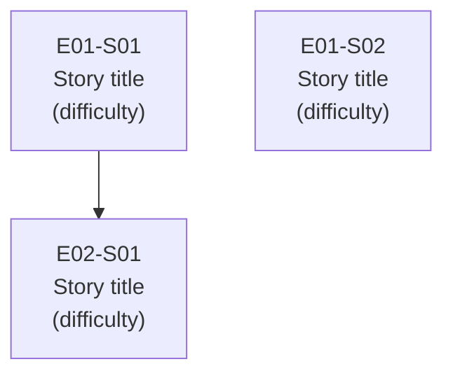

---

## date: 2026-03-10
author: orchestrator
status: draft

# Design: GitHub Issue Templates for Work Items

## Problem

Our GitHub issue descriptions have been inconsistent across 6 SDLC test runs. Run 1 (#57) had a clean, integrated format with dependency graphs in the body. Later runs lost this — Run 6 (#162) had the graph appended with a `---` separator that looks unprofessional. We have no formalised templates for any work item level.

The planner, designer, orchestrator, and humans all create issues but have no shared structure to follow. This leads to inconsistent quality, missing information, and dependency graphs that look bolted-on.

## Design Principles

Based on industry research (IEEE 1016, Google Design Docs, HashiCorp RFCs, Shape Up, SAFe, Martin Fowler's SDD exploration):

1. **Templates follow the information flow.** Each work item level has a specific role in the pipeline — the template matches that role, nothing more.
2. **Stories are self-contained micro-specs.** The builder reads ONE issue and has everything it needs. No upstream doc reading required in the normal case.
3. **Epics are organisational glue.** No agent consumes them directly. They exist for humans and board tracking.
4. **Lightweight structure wins.** Core sections are required; everything else is optional. Over-templating causes compliance theatre ("I'd rather review code than all these markdown files" — Fowler).
5. **Lower abstraction reduces interpretation errors.** One story = one spec = one deliverable (Tessl principle). The less an agent needs to interpret across documents, the better the output.
6. **All top-level headings use `##`.** The GitHub issue title renders as the page heading; `#` in the body creates a visual duplicate.
7. **No `---` separators for appended content.** Sections added later (by the planner) are a natural continuation of the body, not an afterthought.
8. **No emoji in headings.** Cleaner, more professional, easier to parse programmatically.

## Information Flow

```
Human / Product → Backlog item (the brief)
                      ↓
                Designer reads backlog item
                      ↓
                Design doc (the full SDD — docs/2-design/)
                      ↓
                Planner reads design doc
                      ↓
                Plan doc (decomposition — docs/3-plans/)
                + Story issues (self-contained micro-specs)
                + Epic issues (organisational glue)
                      ↓
                Builder reads ONE story issue → builds
```

### Who reads what


| Work item                         | Written by               | Read by        | Purpose                                                |
| --------------------------------- | ------------------------ | -------------- | ------------------------------------------------------ |
| **Backlog issue**                 | Human / product workflow | Designer       | The brief — "here's what I want"                       |
| **Design doc** (`docs/2-design/`) | Designer                 | Planner      | The full SDD — why, what, how, alternatives            |
| **Plan doc** (`docs/3-plans/`)    | Planner                | Orchestrator   | Decomposition, dependency graph, dispatch strategy     |
| **Story issue**                   | Planner                | **Builder**    | Self-contained micro-spec — everything needed to build |
| **Epic issue**                    | Planner                | Humans (board) | Grouping container for tracking and visibility         |


The key insight: **design detail lives in the design doc, execution detail lives in the story, and epics are just folders.**

## Proposed Templates

### Backlog Item — The Brief

The backlog item communicates intent. It can be created by a human, a Claude Code session, a product workflow, or any other process. The designer reads it and produces the detailed design doc.

Only **Overview** is required. The other sections are added when relevant — there's no penalty for skipping them.

```markdown
## Overview

<What are we building and why? Problem statement, motivation, user value.
Can be a single paragraph or several — length matches complexity.
This is the pitch.>

## Requirements

<What must be true when done? Functional requirements, constraints,
scope boundaries. Any format: bullets, numbered, prose.
Sub-sections (###) allowed for complex features.
Optional — skip for exploratory or test work.>

## Context

<Background information: architecture notes, dependencies on existing
systems, API contracts, related docs or ADRs, prior art.
Sub-sections (###) allowed.
Optional — skip when the overview says enough.>
```

**After the planner completes planning**, the following sections are appended to the backlog issue body as a natural continuation (no `---` separator):

```markdown
## Epics

### [#N/E01] <Epic title> — N stories

<Brief description of what this epic delivers.>

### [#N/E02] <Epic title> — N stories

<Brief description.>

## Dependency Graph



## Dispatch Plan


| Wave       | Stories                    | Dispatch   | Notes              |
| ---------- | -------------------------- | ---------- | ------------------ |
| **Wave 1** | E01-S01 (#N), E01-S02 (#N) | Parallel   | All independent    |
| **Wave 2** | E02-S01 (#N)               | Sequential | Depends on E01-S01 |


```

These appended sections are for **human visibility and orchestrator reference** — no builder reads them from the backlog issue.

**Section guide:**

| Section | Written by | Required? | Notes |
|---------|-----------|-----------|-------|
| Overview | Whoever creates the issue | **Yes** | The one section that must always exist |
| Requirements | Whoever creates the issue | Optional | Skip for test/exploratory items |
| Context | Whoever creates the issue | Optional | Skip when overview is sufficient |
| Epics | Planner (appended) | **Yes** | Added after plan is complete |
| Dependency Graph | Planner (appended) | **Yes** | Added after story issues are created |
| Dispatch Plan | Planner (appended) | **Yes** | Added after story issues are created |

---

### Epic — Organisational Glue

The epic groups related stories for human tracking and board management. **No agent consumes epics directly.** The orchestrator tracks epic status as an aggregate of story states, but reads the plan doc for dispatch logic — not the epic issue.

The epic template is intentionally minimal.

```markdown
<What this epic delivers — 1-3 sentences for human context.
How the stories in this epic relate to each other.>

**Epic branch:** `epic/eNN-slug` (from `backlog/<N>-<slug>`)

## Stories

| Story | Issue | Title | Difficulty | Depends on |
|-------|-------|-------|------------|------------|
| E01-S01 | #N | Story title | easy | — |
| E01-S02 | #N | Story title | easy | — |
| E01-S03 | #N | Story title | medium | E01-S01 |

<Dispatch note if relevant (e.g., "All stories are independent — parallel dispatch.")>

## Acceptance Criteria

- <Epic-level "done" — what's true when all stories are complete>
- <Integration or cross-story validation criteria>
- <Any aggregate quality bar>

Part of #<backlog>.
```

**Section guide:**


| Section             | Required?   | Notes                                                              |
| ------------------- | ----------- | ------------------------------------------------------------------ |
| Opening paragraph   | **Yes**     | Brief context for humans scanning the board                        |
| Epic branch         | **Yes**     | Reference for orchestrator and builders                            |
| Stories table       | **Yes**     | Structured overview with issue links, difficulty, and dependencies |
| Acceptance Criteria | Recommended | Epic-level criteria beyond individual stories                      |
| `Part of` footer    | **Yes**     | Quick navigation up the hierarchy                                  |


**Why a table for stories (not checkboxes):** The table shows difficulty and dependencies at a glance — information that checkboxes can't convey. GitHub sub-issues already track completion state, so checkboxes are redundant. The table is the reference; sub-issues are the live tracker.

**Why no dependency graph on epics:** The full graph lives on the backlog issue. The epic's Stories table has a "Depends on" column for intra-epic dependencies. A separate Mermaid graph on each epic would be redundant.

---

### Story — The Micro-Spec

The story is the **builder's single source of truth**. It must be self-contained — the builder reads this one issue and has everything needed to deliver. No upstream doc reading required in the normal case.

The Design section scales with difficulty: omitted for easy stories (AC is enough), recommended for medium, expected for hard. This follows the Tessl principle — lower abstraction at the point of execution reduces interpretation errors.

```markdown
<Why this story exists and what it delivers — enough context that
the builder doesn't need to read the parent epic or design doc.>

**Branch:** `eNN-sNN/slug` (from `epic/eNN-slug`)
**Difficulty:** easy|medium|hard
**Dependencies:** None | #N (story title)
**Design:** `docs/2-design/YYYY-MM-DD-slug.md`

## Design

<How to build this — files to create/modify, patterns to follow,
structural decisions, integration points. Scoped to this story only.
Optional for easy stories. Recommended for medium. Expected for hard.>

## Acceptance Criteria

- [ ] <Testable condition 1>
- [ ] <Testable condition 2>
- [ ] <Testable condition 3>

Part of #<epic>.
```

**Section guide:**


| Section             | Required? | Notes                                                    |
| ------------------- | --------- | -------------------------------------------------------- |
| Opening paragraph   | **Yes**   | Self-contained context — why and what                    |
| Branch              | **Yes**   | Builder needs this to create the branch                  |
| Difficulty          | **Yes**   | Determines model routing                                 |
| Dependencies        | **Yes**   | `None` is valid — always state explicitly                |
| Design link         | **Yes**   | Safety net — builder reads only if AC is ambiguous       |
| Design              | Optional  | Omit for easy, recommended for medium, expected for hard |
| Acceptance Criteria | **Yes**   | Testable checkboxes — the definition of done             |
| `Part of` footer    | **Yes**   | Quick navigation up to the epic                          |


**Design link rationale:** The story should be self-contained — the opening paragraph provides context, the Design section provides implementation guidance, and AC defines done. If the builder still hits ambiguity, the design doc link is the safety net. The builder's instructions should say: "If the acceptance criteria or design section are unclear, read the linked design doc for clarification — but you shouldn't need to in the normal case."

**Design vs AC — distinct concerns, deliberate ordering:**

- **Design** answers **"how should the builder get there?"** — implementation strategy, file layout, patterns to follow, structural decisions scoped to this story. Named "Design" to align with IEEE 1016, Kiro (AWS), and RFC conventions. For easy stories the path is obvious (omit Design). For hard stories the Design section is where the planner's thinking reaches the builder — distinct from the design doc because it's scoped to one story, not the whole feature.
- **Acceptance Criteria** answer **"what does done look like?"** — specific, testable, predefined conditions that the deliverable must meet to be accepted. They define scope and reduce ambiguity. They do not tell the builder *how* to build it.

**Design comes before AC.** This matches IEEE 1016 (Detailed Design → Quality Attributes), Kiro (Design → Test Plan), RFC format (Implementation → Success Metrics), and cognitive flow theory: the builder needs to understand the path before recognising the finish line. Reading AC without understanding the design forces backtracking.

**Acceptance criteria format:** Checkboxes over Given/When/Then. Our builders are AI agents that work from checklists. Given/When/Then is better for automated test suites with human developers — checkboxes are more natural for our workflow.

**"As a user..." format:** Not required. Use it when it adds clarity (user-facing features). Skip it for technical enablers, content creation, or infrastructure. The opening paragraph conveys intent flexibly.

---

## Comparison Across Levels


| Aspect                | Backlog                    | Epic                   | Story                        |
| --------------------- | -------------------------- | ---------------------- | ---------------------------- |
| **Role**              | The brief                  | Organisational glue    | The micro-spec               |
| **Read by**           | Designer                   | Humans (board)         | Builder                      |
| **Detail level**      | Light — communicate intent | Minimal — table + AC   | Self-contained — Design + AC |
| **Top heading**       | `##`                       | `##`                   | `##`                         |
| **Required sections** | Overview                   | Opening + Stories + AC | Opening + metadata + AC      |
| **Optional sections** | Requirements, Context      | —                      | Design                       |


The flow is consistent: **Why → What → How → Done**, at decreasing granularity. The design doc (not the issue) carries the full SDD thinking.

## What Changed from Current Practice


| Aspect                      | Before (Run 6)                                   | After                                                                   |
| --------------------------- | ------------------------------------------------ | ----------------------------------------------------------------------- |
| Dependency graph on backlog | Appended with `---` separator                    | Part of the body (no separator)                                         |
| Graph heading               | `## 📊 Dependency Graph`                         | `## Dependency Graph` (no emoji)                                        |
| Epic story list             | Checkbox list                                    | Structured table (Story, Issue, Title, Difficulty, Depends on)          |
| Epic dependency graph       | Separate Mermaid graph per epic                  | Removed — redundant with backlog graph + table "Depends on" column      |
| Backlog sections            | Ad-hoc, varied per run                           | Defined outline: Overview, Requirements, Context (+ planner appendix) |
| Story self-containment      | Builder sometimes needed to read epic/design doc | Story has full context + Design section + design doc link as safety net |
| Story metadata              | Varied                                           | Consistent: Branch, Difficulty, Dependencies, Design link               |
| Who creates backlog         | Assumed to be human in this workflow             | Explicitly anyone — human, CC session, product workflow                 |


## Anti-Patterns to Avoid

1. **Over-templating.** If a section is always "N/A", it shouldn't be in the template. Optional means optional.
2. `**---` separators for appended content.** The planner appends Epics/Graph/Dispatch as a continuation of the body, not a separated addendum.
3. **Emoji in headings.** Clean heading names are more professional and easier to parse.
4. **Duplicating sub-issue state.** Don't maintain `- [x]` checkboxes on epics for story completion — GitHub sub-issues already track this.
5. **Forcing user story format.** "As a cat, I want to review my human..." adds no value. Use natural language when the format doesn't fit.
6. **Making epics informative.** Epics are folders. Don't put design detail on them — it belongs in the story's Design section or the design doc.
7. **Expecting builders to read upstream.** If the builder needs the design doc to understand the story, the story is under-specified. The Design section carries the planner's implementation guidance; the design link is a safety net, not a primary source.

## Implementation

### Files to Update


| File                                   | Change                                                         |
| -------------------------------------- | -------------------------------------------------------------- |
| `.claude/agents/planner.md`          | Replace issue creation guidance with these templates           |
| `CLAUDE.md`                            | Add brief reference to issue template conventions              |
| `.claude/agents/builder.md` + variants | Add instruction: "Read the design doc link if AC is ambiguous" |


### Validation

Apply the proposed format to backlog #162 (Run 6) and its epics (#166, #167) to verify rendering on GitHub before updating agent files.

## Open Questions

1. **GitHub Issue Templates (`.github/ISSUE_TEMPLATE/`)?** Pro: enforces structure in the GitHub UI for humans. Con: agents create issues via `gh issue create --body` — templates only help manual creation. Worth adding if humans will create backlog items through the GitHub UI.
2. **Future HLD/LLD split?** The user noted the design doc may eventually split into a High-Level Design and Low-Level Design. The current template structure supports this — the backlog issue links to whatever design artifacts exist, and the story links to the relevant design doc. No template changes needed when this happens.

