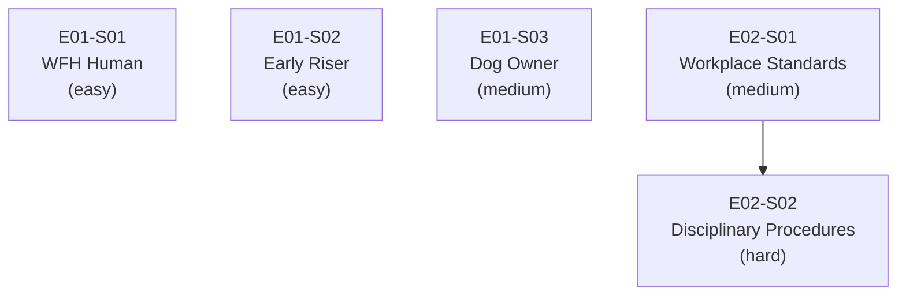

# The Cat's Employee Performance Review -- SDLC v2 Test (Run 6)

> **Status:** Draft

## Overview

Sixth end-to-end test of the Agentic SDLC pipeline. **First test of the single-PR workflow** -- all work ships in one PR from `backlog/162-cat-performance-review` to `main`. Nothing merges until human review.

The content vehicle is **"The Cat's Employee Performance Review"** -- annual performance reviews of humans, written by their cats. Voice: unimpressed middle-management tone from *Feline Resources Department -- Whiskers & Associates*, stamped "CONFIDENTIAL -- Cats Only. If You Are a Dog, Stop Reading."

This is a workflow stability test, not a creative writing project. Every design decision optimises for exercising SDLC mechanics with the new single-PR workflow.

### Why Run 6?

Run 5 validated the core pipeline mechanics (parallel dispatch, model routing, reviewer integration). Run 6 is the **first test of the single-PR workflow** introduced in the conventions update (#161). Key differences from prior runs:

| Feature | Before (Run 5) | Now (Run 6) |
|---------|----------------|-------------|
| PR strategy | Per-epic PRs to main | Single backlog PR to main |
| Design/plan PRs | Target main | Target integration branch |
| Integration branch | Not used | `backlog/<N>-<slug>` created in Phase 0 |
| Epic branches | Created from main | Created from integration branch |
| Retro | Separate PR | Committed on integration branch |
| Merge to main | Per-epic, auto-merged | Single PR, human-reviewed |

## Problem Statement

The single-PR workflow conventions were documented in #161 but have never been tested. Run 6 validates that the full lifecycle -- design, plan, build, review, retro -- works correctly when everything flows through an integration branch with a single PR to `main`.

## Goals

1. **Validate single-PR workflow** -- Integration branch, design/plan PRs targeting it, epic branches from it, single backlog PR to main
2. **Confirm parallel dispatch** -- At least one wave dispatches 2+ stories concurrently
3. **Exercise all three difficulty levels** -- easy (haiku), medium (sonnet), hard (opus)
4. **Complete telemetry with full lifecycle breakdown** -- All phases (design, plan, build, review, retro) captured in backlog telemetry, not just builds
5. **Backlog item on board from Phase 0** -- Proper status progression: Backlog -> Planned -> Todo -> In Progress -> In Review -> Done
6. **Design/plan issues get backlog label** -- Both tagged with `backlog/162-cat-performance-review` and moved to Done after merge

## Non-Goals

- Producing polished creative writing (content quality is secondary)
- Testing code compilation, DI wiring, or test execution (no C# code)
- Validating Norris integration or DevOps tools
- Stress-testing with more than 2 epics or more than 5 stories

## Content Design

### Theme: Feline Performance Management

All documents are issued by *Feline Resources Department -- Whiskers & Associates*. Every file carries the header "CONFIDENTIAL -- Cats Only. If You Are a Dog, Stop Reading." The tone is bored corporate middle-management -- performance metrics, improvement plans, and disciplinary notes -- applied to the absurdity of cats evaluating humans.

### Output Location

All files go in `test-output/cat-performance-review/`. This keeps them separate from prior test run artifacts.

## Epic & Story Structure

### Epic 1: Human Employee Reviews (3 stories, parallel-friendly)

Three independent performance reviews of different human archetypes. Each follows the same template, making them fully parallelisable.

#### E01-S01: Performance Review -- The Work-From-Home Human -- `difficulty/easy`

Create `test-output/cat-performance-review/review-wfh-human.md`.

**Content requirements:**

- Header: "CONFIDENTIAL -- Cats Only. If You Are a Dog, Stop Reading." and Feline Resources Department branding
- Title: "Annual Performance Review: The Work-From-Home Human"
- Employee name: a cat-assigned name (e.g., "Lap Provider #7" or "The Warm Keyboard Sitter")
- Sections:
  - "Lap Availability" -- rating and brief commentary (2-3 sentences)
  - "Performance Metrics" -- 3-4 metrics with ratings out of 5 paws (e.g., treat distribution frequency, door-opening response time, acceptable petting technique)
  - "Areas for Improvement" -- 2-3 bullet points
  - "Overall Rating" -- X/5 paws with one-sentence summary
- Deadpan HR tone throughout
- Total length: 100-200 words

**Why easy:** Highly formulaic. Fill in the template sections. Minimal creative latitude.

#### E01-S02: Performance Review -- The Early Riser -- `difficulty/easy`

Create `test-output/cat-performance-review/review-early-riser.md`.

**Content requirements:**

- Same template structure as E01-S01
- Title: "Annual Performance Review: The Early Riser"
- Employee name: cat-assigned (different from E01-S01)
- Must include at least one metric related to pre-dawn feeding schedule compliance
- Sections: Lap Availability, Performance Metrics (3-4 metrics), Areas for Improvement (2-3 bullets), Overall Rating (X/5 paws)
- Total length: 100-200 words

**Why easy:** Identical template to E01-S01. Same format, different human archetype.

#### E01-S03: Performance Review -- The One Who Got a Dog -- `difficulty/medium`

Create `test-output/cat-performance-review/review-dog-owner.md`.

**Content requirements:**

- Same base template as E01-S01/S02 PLUS two additional sections:
  - "Disciplinary Notice" -- 2-3 sentences about the severity of acquiring a canine and its impact on workplace morale
  - "Corrective Action Plan" -- 3 bullet points specifying required remediation steps (e.g., "Increase treat budget by 300% to compensate for emotional damages")
- Title: "Annual Performance Review: The One Who Got a Dog"
- Employee name: cat-assigned, with a note that the employee is "under review for potential termination"
- Must reference the dog as an "unauthorized workplace intruder" or similar corporate euphemism
- Overall Rating must be significantly lower than E01-S01/S02
- Total length: 150-200 words

**Why medium:** More sections than the easy stories. Requires maintaining the corporate HR tone while escalating to disciplinary language. The corrective action plan needs internal consistency with the performance metrics.

### Epic 2: HR Policies & Procedures (2 stories, dependency chain)

Feline workplace policies that reference the employee types from Epic 1. The second story depends on the first.

#### E02-S01: Feline Workplace Standards & Human Conduct Guidelines -- `difficulty/medium`

Create `test-output/cat-performance-review/workplace-standards.md`.

**Content requirements:**

- Header: "CONFIDENTIAL -- Cats Only. If You Are a Dog, Stop Reading."
- Title: "Feline Workplace Standards & Human Conduct Guidelines"
- Issued by: Feline Resources Department -- Whiskers & Associates
- Sections:
  - "Acceptable Human Conduct" -- 4-5 numbered rules (e.g., "Humans shall not initiate belly contact without written consent from the Feline Resources Department")
  - "Mandatory Human Obligations" -- 3-4 bullet points covering feeding schedules, lap availability quotas, and door-opening response time SLAs
  - "Prohibited Behaviours" -- 3 bullet points (e.g., introducing dogs, using the vacuum cleaner during designated nap hours, closing the bathroom door)
- Must reference at least two employee types from Epic 1 by their cat-assigned category (e.g., "Work-From-Home Humans", "Early Risers")
- Total length: 150-200 words

**Why medium:** Requires creating a structured policy document with internally consistent rules. Must cross-reference employee types from Epic 1 (by category name from acceptance criteria, not by reading files).

#### E02-S02: Disciplinary Procedures & Termination Protocols -- `difficulty/hard`

Create `test-output/cat-performance-review/disciplinary-procedures.md`.

**Content requirements:**

- Header: "CONFIDENTIAL -- Cats Only. If You Are a Dog, Stop Reading."
- Title: "Disciplinary Procedures & Termination Protocols"
- Issued by: Feline Resources Department -- Whiskers & Associates
- Sections:
  - "Offence Classification Table" -- a markdown table with 3 severity levels (Minor Infraction / Major Violation / Termination-Worthy Offence), example offences for each, and prescribed penalties
  - "Progressive Discipline Process" -- 4 numbered steps from verbal warning (hissing) through to termination (the cat leaves and never returns)
  - "Termination Protocols" -- 3 bullet points covering the procedure for when a human acquires a dog (references the Workplace Standards from E02-S01 and the Dog Owner review from E01-S03)
  - "Appeals Process" -- 2 sentences explaining that there is no appeals process because cats are never wrong
- Must reference the Workplace Standards document from E02-S01 at least twice
- Must reference the Dog Owner employee type from E01-S03
- Total length: 200-300 words (this is the longest story, intentionally exceeding the 200-word default for the hard difficulty)

**Why hard:** Longest story with the most cross-references. Must synthesise information from E02-S01 (workplace standards) and E01-S03 (dog owner). The offence classification table requires consistent internal logic across three severity levels. The progressive discipline section must escalate coherently. "Hard" label ensures opus gets exercised.

## Dependency Graph

**Parallel dispatch opportunities:**

- **Wave 1:** E01-S01, E01-S02, E01-S03 (all independent -- 3 stories in parallel)
- **Wave 2:** E02-S01 (references employee types from Epic 1 by category name from AC, not from files -- can run after Wave 1 or even in parallel with it, but kept sequential to test the dependency chain between E02-S01 and E02-S02)
- **Wave 3:** E02-S02 (depends on E02-S01 for workplace standards references)

**Note on parallelism:** All three Epic 1 stories are fully independent. Their cross-references are purely thematic (they share a template and tone) but have no content dependencies. E01-S03 mentions a dog, E01-S01/S02 do not reference each other. This gives a genuine 3-story parallel wave -- a stronger parallel test than Run 5's 2-story Wave 1.

E02-S01 references employee types from Epic 1, but only by category name specified in the acceptance criteria (e.g., "Work-From-Home Humans"), not by reading the actual files. It could theoretically run in Wave 1 as well, but keeping it in Wave 2 ensures a clean epic boundary and tests the sequential wave transition.

**Conservative fallback:** If parallel dispatch fails, all stories can run sequentially: S01, S02, S03, S04, S05.

## Difficulty Distribution

| Difficulty | Stories | Model | Count |
|-----------|---------|-------|-------|
| Easy | E01-S01, E01-S02 | haiku | 2 |
| Medium | E01-S03, E02-S01 | sonnet | 2 |
| Hard | E02-S02 | opus | 1 |
| **Total** | | | **5** |

All three difficulty levels are represented. The three Epic 1 stories form the parallel dispatch test in Wave 1 (2 easy + 1 medium). The hard story is the final story, exercising opus on the most complex cross-referencing task.

## Reviewer Integration

The reviewer is dispatched on every story branch. Checks:

1. **File exists** at the specified path in `test-output/cat-performance-review/`
2. **Section structure** matches the acceptance criteria (correct headings, required sections present)
3. **Word count** is within the specified range (100-200 for easy/medium, 200-300 for E02-S02)
4. **Cross-references** are present where required (employee type names, workplace standards references)
5. **Tone consistency** -- deadpan corporate HR voice maintained (not outright comedic or breaking character)
6. **Header present** -- "CONFIDENTIAL -- Cats Only" stamp on every document

The reviewer does not judge creative quality. It validates structural compliance with acceptance criteria.

## Single-PR Workflow Validation Points

These are the specific workflow mechanics Run 6 is designed to validate:

| Checkpoint | What to verify |
|------------|---------------|
| Integration branch exists before design starts | `backlog/162-cat-performance-review` created from main |
| Design PR targets integration branch | PR base = `backlog/162-cat-performance-review`, not `main` |
| Plan PR targets integration branch | Same as above |
| Epic branches created from integration branch | `git log --oneline backlog/162-cat-performance-review..epic/e01-*` shows divergence point |
| Story branches created from epic branches | Standard -- same as prior runs |
| Stories merge into epic branches | `--no-ff` merge into epic branch |
| Epic branches merge into integration branch | `--no-ff` merge into integration branch |
| Single backlog PR opened | One PR from `backlog/162-cat-performance-review` to `main` |
| Backlog PR includes `Closes` for all issues | Backlog, epics, stories, design doc, plan -- all listed |
| Retro committed on integration branch | No separate retro PR |
| Backlog PR stays open for human review | Orchestrator never auto-merges the backlog PR |
| Full lifecycle telemetry in backlog PR | All phases: design, plan, build waves, review, retro |

## Approaches Considered

### Approach A: Three Epic 1 stories in parallel, sequential Epic 2 (recommended)

- E01: 3 stories (2 easy + 1 medium) -- all in parallel (Wave 1)
- E02: 2 stories (1 medium + 1 hard) -- sequential (Waves 2-3)
- Total: 5 stories, 3 waves

**Pros:** Strongest parallel test with 3 stories in Wave 1 (vs 2 in Run 5). Clean epic boundary between parallel and sequential work. All three difficulty levels. Matches the backlog brief exactly (2 epics, 5 stories).

**Cons:** E01-S03 (medium) runs in parallel with two easy stories, meaning Wave 1 completes at the speed of the slowest story (the medium one). Slightly less efficient than putting E01-S03 in Wave 2.

### Approach B: Two Epic 1 stories in parallel, staggered rest

- Wave 1: E01-S01, E01-S02 (2 easy, parallel)
- Wave 2: E01-S03, E02-S01 (2 medium, parallel)
- Wave 3: E02-S02 (1 hard, sequential)

**Pros:** Each wave has stories of matched difficulty, potentially more efficient. Two 2-story parallel waves instead of one 3-story wave.

**Cons:** Weaker parallel test -- only 2 stories per wave, same as Run 5. Run 6 should push the parallel count higher to validate the mechanic more thoroughly. Also crosses epic boundaries in Wave 2 (E01-S03 and E02-S01 from different epics in parallel), which complicates branch management.

### Approach C: All 5 stories sequential

- No parallel dispatch at all. Every story runs one at a time.

**Pros:** Simplest possible test. No risk of parallel dispatch issues.

**Cons:** Does not test parallel dispatch, which is a key SDLC mechanic. The backlog brief explicitly requires "at least one wave of 2+ parallel stories." Rejected.

**Decision: Approach A.** Three stories in Wave 1 gives a stronger parallel test than prior runs. The epic boundary between parallel (E01) and sequential (E02) is clean and natural.

## Assumptions & Open Questions

### Assumptions

1. **Parallel dispatch works via the Agent tool.** Validated in Runs 3-5; Run 6 retests with 3-story parallelism.
2. **Content cross-references are semantic, not filesystem dependencies.** E02-S01 references employee types by category name from AC, not by reading files. E02-S02 references workplace standards by document name from AC. Builders work from acceptance criteria, not by reading other stories' output files.
3. **`test-output/cat-performance-review/` directory does not need to be pre-created.** Builders create it as part of writing files.
4. **The retro agent is committed on the integration branch** (not a separate PR), per the new single-PR workflow.
5. **Word count for E02-S02 is 200-300 words** -- intentionally above the default 100-200 range. The backlog brief says "100-200 words per story file" but also labels E02-S02 as hard. The extra length gives the hard story a meaningfully different scope from the easy/medium ones, which is the whole point of the difficulty label.

### Open Questions (would have asked the user)

1. **Should E01-S03 (Dog Owner, medium) run in Wave 1 with the easy stories or Wave 2?** Decision: Wave 1. It has no dependencies on the other Epic 1 stories. Running all three E01 stories in parallel gives a stronger test and is the natural grouping by epic.
2. **Is 200-300 words acceptable for the hard story?** The backlog says "100-200 words per story" but also says the designer may adjust. Decision: 200-300 for E02-S02 only, to give the hard label meaningful scope. If this is too long, the planner can tighten it to 150-200.
3. **Should E02-S01 reference Epic 1 reviews by reading the files or from AC?** Decision: from AC. This removes filesystem dependencies and allows Wave 2 to run without waiting for Wave 1's files to be committed. The AC specifies the category names (e.g., "Work-From-Home Humans") so the builder has everything it needs.

## Risks

| Risk | Impact | Mitigation |
|------|--------|------------|
| Single-PR workflow has untested edge cases | Integration branch conflicts, merge order issues | This is the test -- document all issues as lessons |
| 3-story parallel wave causes resource contention | Stories fail or timeout | Fall back to 2+1 split; document in lesson |
| Backlog PR `Closes` list is incomplete | Issues remain open after merge | Orchestrator must enumerate all issues (backlog + design + plan + epics + stories) |
| E02-S02 word count (200-300) exceeds budget brief | User objects to scope | Planner can tighten to 150-200 if needed |
| Epic branches created from wrong base | Merge conflicts | Orchestrator must `git checkout backlog/162-cat-performance-review` before creating epic branches |

## Estimated Cost & Duration

Based on prior run telemetry:

| Model | Stories | Est. Time/Story | Est. Total Time (seq) | Est. Cost/Story |
|-------|---------|-----------------|----------------------|-----------------|
| haiku | 2 | ~1 min | ~2 min | ~$0.03 |
| sonnet | 2 | ~1.5 min | ~3 min | ~$0.08 |
| opus | 1 | ~3 min | ~3 min | ~$0.75 |
| **Total** | **5** | | **~8 min seq** | **~$0.97** |

With parallel dispatch (Wave 1: 3 parallel, Wave 2: 1 sequential, Wave 3: 1 sequential): estimated wall-clock ~5-6 min for builds.

Target total agent time: 8-12 minutes (per backlog brief). This includes design, plan, build, review, and retro phases.
