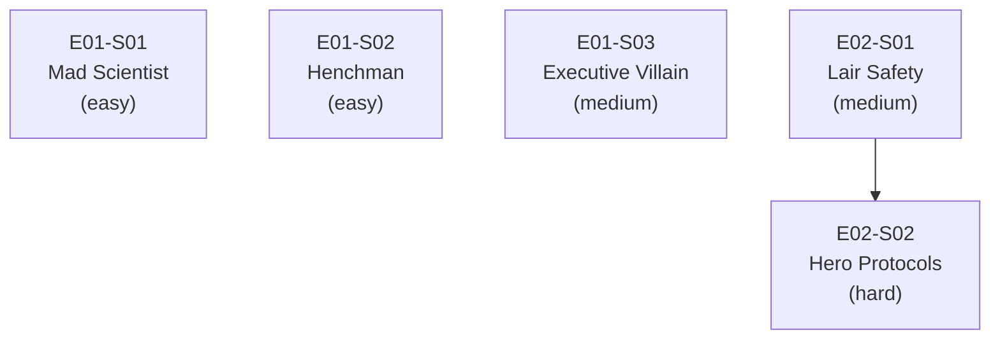

# The Supervillain Employee Handbook -- SDLC v2 Test (Run 5)

> **Status:** Draft

## Overview

Fifth end-to-end test of the Agentic SDLC v2 workflow. The content vehicle is **"The Supervillain Employee Handbook"** -- an internal onboarding manual for new hires at *DoomCo Industries -- World's Leading Evil Enterprise*. Voice: deadpan corporate HR meets cartoon villainy.

The content is intentionally short and structured. This is a workflow stability test, not a creative writing project. Every design decision optimises for exercising SDLC mechanics (parallel dispatch, model routing, reviewer integration, telemetry, board transitions) with completely different content from prior runs to avoid template bias.

### Why Run 5?

Run 4 validated parallel dispatch, reviewer integration, and model routing with the Mythical Creatures Field Guide. Run 5 retests the same pipeline features with fresh content and a tighter scope (5 stories instead of 7) to confirm stability and measure baseline execution speed.

## Problem Statement

The SDLC v2 pipeline needs a stability retest after Run 4 fixes. The test must exercise all core mechanics -- parallel dispatch, model routing (all three difficulty levels), per-story review, board transitions, and full lifecycle telemetry -- with novel content to prove the pipeline is content-agnostic.

## Goals

1. **Validate pipeline stability** -- All board transitions (Planned, Todo, In Progress, In Review, Done) complete without manual intervention
2. **Confirm parallel dispatch** -- At least one wave dispatches 2+ stories concurrently
3. **Exercise all three difficulty levels** -- easy (haiku), medium (sonnet), hard (opus)
4. **Complete telemetry** -- Every story gets Work Started + Ready for Review + Telemetry comments; epic and backlog telemetry posted
5. **Clean issue lifecycle** -- All issues auto-close when the epic PR merges

## Non-Goals

- Producing polished creative writing (content quality is secondary)
- Testing code compilation, DI wiring, or test execution (no C# code)
- Validating Norris integration or DevOps tools
- Testing more than 2 epics or more than 6 stories

## Content Design

### Theme: Corporate Evil HR Manual

The handbook is written by *DoomCo Industries -- Department of Villainous Human Resources*. Every document is stamped "CONFIDENTIAL -- Evil Eyes Only." The tone is corporate compliance boilerplate applied to absurd supervillain scenarios -- monologue etiquette, lair safety inspections, hero encounter protocols, henchman union regulations.

### Output Location

All files go in `test-output/doomco-handbook/`. This keeps them separate from prior test run artifacts.

## Epic & Story Structure

### Epic 1: Role Profiles (3 stories, parallel-friendly)

Three independent villain role profiles. Each follows an identical template, making them fully parallelisable and easy for the reviewer to validate against acceptance criteria.

#### E01-S01: Role Profile -- Mad Scientist -- `difficulty/easy`

Create `test-output/doomco-handbook/role-mad-scientist.md`.

**Content requirements:**

- Header: "CONFIDENTIAL -- Evil Eyes Only" and DoomCo Industries branding
- Title: "Role Profile: Mad Scientist"
- Department: Research & Doomsday Development
- Sections: Position Summary (2-3 sentences), Required Evil Skills (4-5 bullet points), Common Workplace Violations (3 bullets), Evil Performance Metrics (3 metrics with target values)
- Deadpan HR tone throughout
- Total length: 100-200 words

**Why easy:** Highly formulaic. Fill in the template. Minimal creative latitude.

#### E01-S02: Role Profile -- Henchman (General) -- `difficulty/easy`

Create `test-output/doomco-handbook/role-henchman.md`.

**Content requirements:**

- Same template structure as E01-S01
- Title: "Role Profile: Henchman (General)"
- Department: Operations & Minion Management
- Sections: Position Summary, Required Evil Skills, Common Workplace Violations, Evil Performance Metrics
- Must reference the Mad Scientist role in at least one bullet (e.g., "Must tolerate proximity to Mad Scientist experiments")
- Total length: 100-200 words

**Why easy:** Identical template to E01-S01. Same format, different role.

#### E01-S03: Role Profile -- Executive Villain (C-Suite) -- `difficulty/medium`

Create `test-output/doomco-handbook/role-executive-villain.md`.

**Content requirements:**

- Same template structure as E01-S01/S02 PLUS two additional sections:
  - "Monologue Requirements" -- 3-4 bullet points on mandatory monologue length, approved dramatic pauses, and villain catchphrase registration
  - "Direct Reports" -- a short org chart listing Mad Scientist and Henchman (General) as direct reports with a one-line description of each
- Title: "Role Profile: Executive Villain (C-Suite)"
- Department: Executive Villainy & Strategic Doom
- Must reference both the Mad Scientist and Henchman roles by name
- Total length: 150-250 words

**Why medium:** More sections than the easy stories. Requires cross-referencing the other two roles and writing the monologue requirements section with more creative content. The org chart must be internally consistent with the other profiles.

### Epic 2: Company Policies (2 stories, sequential)

Operational policies that reference the role profiles from Epic 1. The second story depends on the first (hero encounter protocols reference lair safety zones).

#### E02-S01: Lair Safety & Compliance Guidelines -- `difficulty/medium`

Create `test-output/doomco-handbook/lair-safety.md`.

**Content requirements:**

- Header: "CONFIDENTIAL -- Evil Eyes Only"
- Title: "Lair Safety & Compliance Guidelines"
- Issued by: DoomCo Health, Safety & Evil Compliance Division
- Sections:
  - "General Lair Safety" -- 4-5 numbered rules (fire exits near lava pits, proper labelling of doomsday devices, etc.)
  - "Department-Specific Hazards" -- one hazard entry per role from Epic 1 (Mad Scientist: chemical spills, Henchman: trap door proximity, Executive Villain: ego-related structural damage)
  - "Inspection Schedule" -- a small table with 3 rows: area, frequency, inspector title
- Must reference all three roles from Epic 1 by name
- Total length: 150-250 words

**Why medium:** Requires referencing all three Epic 1 roles coherently and creating a structured compliance document with consistent internal logic.

#### E02-S02: Hero Encounter Protocols & Monologue Best Practices -- `difficulty/hard`

Create `test-output/doomco-handbook/hero-protocols.md`.

**Content requirements:**

- Header: "CONFIDENTIAL -- Evil Eyes Only"
- Title: "Hero Encounter Protocols & Monologue Best Practices"
- Issued by: DoomCo Department of Villainous Human Resources
- Sections:
  - "Hero Alert Levels" -- a table with 3 levels (Yellow/Orange/Red), trigger conditions, and required response per role (Mad Scientist, Henchman, Executive Villain)
  - "Monologue Best Practices" -- 5 numbered guidelines for delivering a villain monologue during hero encounters (timing, dramatic pauses, never revealing the full plan, approved catchphrases, mandatory escape route check)
  - "Post-Encounter Debrief" -- 3 required steps after a hero encounter (incident report, lair damage assessment, morale recovery for henchmen)
  - "Emergency Evacuation" -- references the lair safety zones from E02-S01 and specifies evacuation order by seniority (Executive Villain first, naturally)
- Must reference all three roles from Epic 1
- Must reference the Lair Safety Guidelines from E02-S01 at least twice
- Total length: 200-300 words

**Why hard:** Longest story with the most cross-references. Must synthesise information from all prior documents (three role profiles + lair safety). The hero alert table requires consistent role-based responses. "Hard" label also ensures opus gets exercised in this test run.

## Dependency Graph

**Parallel dispatch opportunities:**

- **Wave 1:** E01-S01, E01-S02 (both independent, both easy -- 2 stories in parallel)
- **Wave 2:** E01-S03, E02-S01 (E01-S03 references the other roles by name from AC, not from files; E02-S01 references roles from AC -- both can run in parallel after Wave 1)
- **Wave 3:** E02-S02 (depends on E02-S01 for lair safety zone references)

**Note on parallelism:** E01-S02 references the Mad Scientist role and E01-S03 references both other roles, but these are semantic cross-references specified in the acceptance criteria, not filesystem dependencies. The builders write from AC, not by reading other stories' output files. This allows Wave 1 and Wave 2 to run in parallel.

**Conservative fallback:** If parallel dispatch fails, all stories can run sequentially in order: S01, S02, S03, S04, S05. The dependency chain still holds.

## Difficulty Distribution

| Difficulty | Stories | Model | Count |
|-----------|---------|-------|-------|
| Easy | E01-S01, E01-S02 | haiku | 2 |
| Medium | E01-S03, E02-S01 | sonnet | 2 |
| Hard | E02-S02 | opus | 1 |
| **Total** | | | **5** |

All three difficulty levels are represented. The two easy stories form the parallel dispatch test in Wave 1. The hard story is the final story in the pipeline, exercising opus on the most complex cross-referencing task.

## Reviewer Integration

The reviewer is dispatched on every story branch. Checks:

1. **File exists** at the specified path in `test-output/doomco-handbook/`
2. **Section structure** matches the acceptance criteria (correct headings, required sections present)
3. **Word count** is within the specified range
4. **Cross-references** are present where required (role names, lair safety references)
5. **Tone consistency** -- deadpan corporate HR voice maintained (not outright comedic or breaking character)

The reviewer does not judge creative quality. It validates structural compliance with acceptance criteria.

If the reviewer finds critical issues (missing required sections, wrong file path, missing cross-references), the builder is re-dispatched to fix. This tests the review-fix-review loop.

## Approaches Considered

### Approach A: Two epics, 5 stories, role profiles + policies (recommended)

- E01: Role Profiles (3 stories -- 2 easy + 1 medium, parallel-friendly)
- E02: Company Policies (2 stories -- 1 medium + 1 hard, sequential)
- Total: 5 stories

**Pros:** Tight scope matching the backlog brief (5-6 stories). Strong parallel test in Wave 1 (2 stories) and Wave 2 (2 stories). All three difficulty levels represented. Fastest execution time. Two epics keeps orchestration overhead minimal.

**Cons:** Only 2 stories in the largest parallel wave (vs 3-4 in Run 3/4). Slightly less parallel stress testing.

### Approach B: Two epics, 6 stories, adding a third policy

- E01: Role Profiles (3 stories)
- E02: Company Policies (3 stories -- adding "Henchman Union Regulations")
- Total: 6 stories

**Pros:** An extra story in E02 gives a wider difficulty spread. Could make the union regulations doc easy-difficulty, adding a third haiku story.

**Cons:** Adds scope and execution time without testing anything new. The sixth story doesn't exercise any untested SDLC mechanic. Run 5 is a stability retest, not a stress test.

### Approach C: Three epics, 6 stories

- E01: Role Profiles (2 stories)
- E02: Company Policies (2 stories)
- E03: Training Materials (2 stories)
- Total: 6 stories

**Pros:** Tests multi-epic orchestration with 3 epic branches and 3 PRs.

**Cons:** Violates the backlog brief (2 epics). Three epics adds orchestration overhead without proportional value. Prior runs have already validated multi-epic flows.

**Decision: Approach A.** Five stories across two epics is the tightest scope that exercises all required SDLC mechanics. The backlog brief calls for 5-6 stories and 2 epics -- this hits the lower bound, which is appropriate for a stability retest.

## Assumptions & Open Questions

### Assumptions

1. **Parallel dispatch works via the Agent tool.** Prior runs validated this; Run 5 is a stability retest, not a first attempt.
2. **Reviewer can validate markdown content structure.** The structural checks (file exists, headings match, word count in range, cross-references present) are straightforward text analysis proven in prior runs.
3. **`test-output/doomco-handbook/` directory does not need to be pre-created.** Builders create it as part of writing files.
4. **Content cross-references are semantic, not filesystem dependencies.** E01-S02 references the Mad Scientist by name, but does not need E01-S01 to exist on disk. Builders work from acceptance criteria.
5. **The retro agent is dispatched after completion** as part of the standard orchestrator workflow.

### Open Questions (would have asked the user)

1. **Is 5 stories sufficient or should we target 6?** The backlog says "5-6 stories total." This design picks 5 for speed. A sixth story (e.g., "Henchman Union Regulations") could be added if the user wants broader coverage. Decision: 5, because stability retests should be lean.
2. **Should Wave 1 have more than 2 parallel stories?** The design puts only E01-S01 and E01-S02 in Wave 1 (both easy). E01-S03 could theoretically join Wave 1 since its cross-references are from AC not files, but it's medium-difficulty and references the other roles, so placing it in Wave 2 feels cleaner. Decision: 2 parallel in Wave 1, 2 parallel in Wave 2.
3. **Combined PR or one per epic?** CLAUDE.md default is one PR per epic. Decision: follow the default.

## Risks

| Risk | Impact | Mitigation |
|------|--------|------------|
| Parallel dispatch instability | Stories run sequentially; no parallel validation | Fall back to sequential; document in lesson file |
| Reviewer finds nothing useful on creative content | Reviewer step adds time without value | AC are structural (headings, word count, cross-refs), not creative quality |
| 5 stories too few to catch edge cases | Misses race conditions that only appear at higher concurrency | Prior runs with 7-9 stories already tested this; 5 is sufficient for stability |
| Cross-references between stories are inconsistent | Reviewer catches name mismatches | AC specify exact role names; builders work from AC |

## Estimated Cost & Duration

Based on prior run telemetry:

| Model | Stories | Est. Time/Story | Est. Total Time (seq) | Est. Cost/Story |
|-------|---------|-----------------|----------------------|-----------------|
| haiku | 2 | ~1 min | ~2 min | ~$0.03 |
| sonnet | 2 | ~1.5 min | ~3 min | ~$0.08 |
| opus | 1 | ~3 min | ~3 min | ~$0.75 |
| **Total** | **5** | | **~8 min seq** | **~$0.97** |

With parallel dispatch (Wave 1: 2 parallel, Wave 2: 2 parallel): estimated wall-clock ~5-6 min instead of ~8 min.

Target total agent time: 8-12 minutes (per backlog brief).
