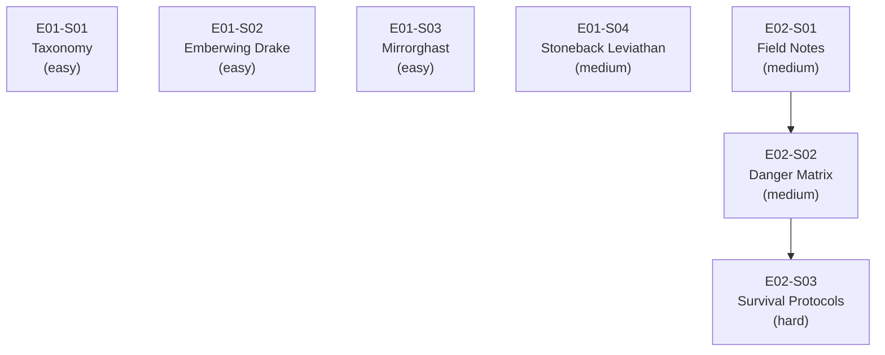

# Mythical Creatures Field Guide -- SDLC v2 Test (Run 3)

## Overview

This is the third end-to-end test of the Agentic SDLC v2 workflow. The content vehicle is a fictional naturalist's handbook -- the *Mythical Creatures Field Guide* -- a short reference document cataloguing fantastical creatures with the dry, methodical tone of a Victorian naturalist.

The content is intentionally simple. This is a workflow test, not a creative writing project. Every design decision below optimizes for exercising SDLC mechanics (parallel dispatch, reviewer integration, model routing, telemetry, issue lifecycle) rather than producing polished fiction.

### Why Run 3?

Run 2 (Poetry + Sci-Fi, backlog #57) validated model routing, telemetry completeness, and issue lifecycle. Two items remained unvalidated:

1. **Parallel dispatch** -- All 9 Run 2 stories ran sequentially due to CLI dispatch failures (nested session detection). The Agent tool was not available in that session.
2. **Reviewer dispatch** -- Skipped entirely in Run 2 (creative writing, no code to review). The per-story review loop was never exercised.

Run 3 is designed to force both of these through the pipeline.

## Problem Statement

The SDLC v2 pipeline has been validated on 6 of 8 checklist items. The two remaining gaps (parallel dispatch, reviewer integration) require a test workload with:

- At least one wave of 2+ independent stories (for parallel dispatch)
- Content structured enough for a reviewer to check against acceptance criteria (for reviewer dispatch)
- All three difficulty levels (easy, medium, hard) for continued model routing validation
- Short enough to complete in under 20 minutes of agent time

## Goals

1. **Validate parallel dispatch** -- At least one wave dispatches 2+ stories concurrently via the Agent tool
2. **Validate reviewer dispatch** -- Reviewer runs on every story branch before merge into the epic branch
3. **Confirm model routing** -- Easy/medium/hard stories route to haiku/sonnet/opus respectively
4. **Complete telemetry** -- Every story gets Work Started + Ready for Review + Telemetry comments
5. **Clean issue lifecycle** -- All story and epic issues close when the epic PR merges

## Non-Goals

- Producing a publishable field guide (content quality is secondary to workflow validation)
- Testing code compilation, DI wiring, or test execution (no C# code in this workload)
- Validating Norris integration (Phase 4 of SDLC v2 -- deferred)

## Content Design

### Theme: Victorian Naturalist's Field Guide

The guide adopts the voice of a fictional naturalist -- *Professor Aldric Thornwood, Fellow of the Royal Society of Cryptozoological Studies* -- documenting mythical creatures as though they were real wildlife specimens. This framing gives each story clear structural constraints (taxonomy format, field note format, survival protocol format) that a reviewer can check against acceptance criteria.

### Output Location

All files go in `test-output/field-guide/`. This keeps them separate from Run 2's `test-output/` files and makes cleanup straightforward.

## Epic & Story Structure

### Epic 1: Creature Compendium (4 stories)

The core reference section: a classification taxonomy and three creature profiles. The three profiles are fully independent of each other (they reference the taxonomy but do not depend on it being written first -- acceptance criteria include the taxonomy terms each profile must use). This makes E01 the parallel dispatch test epic.

#### E01-S01: Classification Taxonomy -- `difficulty/easy`

Create `test-output/field-guide/taxonomy.md`.

A one-page classification system for mythical creatures. Short, structured, formulaic.

**Content requirements:**

- Title: "Thornwood Classification System"
- 4 phyla: Draconiformes (dragon-like), Metamorphica (shapeshifters), Phantasma (spectral/ethereal), Megafauna Mythica (giant beasts)
- Each phylum has: Latin-style name, common name, 2-3 defining characteristics, 2-3 example species names
- A short (2-3 sentence) introduction in the professor's voice
- Total length: 150-250 words

**Why easy:** Highly formulaic structure. Fill-in-the-blanks taxonomy table. No narrative creativity required.

#### E01-S02: Creature Profile -- Emberwing Drake -- `difficulty/easy`

Create `test-output/field-guide/emberwing-drake.md`.

**Content requirements:**

- Title: "Emberwing Drake (*Draconis ignis*)"
- Sections: Classification (phylum + order from taxonomy), Physical Description (3-4 sentences), Habitat, Diet, Behaviour, Threat Level (1-5 scale with justification)
- Must reference phylum "Draconiformes" from the taxonomy
- Include one "Field Sketch" section with a text-art or ASCII diagram (simple, max 10 lines)
- Total length: 200-300 words

**Why easy:** Template-driven profile. Same structure as a wildlife field guide entry. Minimal creative latitude.

#### E01-S03: Creature Profile -- Mirrorghast -- `difficulty/easy`

Create `test-output/field-guide/mirrorghast.md`.

**Content requirements:**

- Title: "Mirrorghast (*Phantasma specularis*)"
- Same section structure as E01-S02
- Must reference phylum "Phantasma" from the taxonomy
- Include one "Field Sketch" section
- Total length: 200-300 words

**Why easy:** Identical template to E01-S02. Different creature, same format.

#### E01-S04: Creature Profile -- Stoneback Leviathan -- `difficulty/medium`

Create `test-output/field-guide/stoneback-leviathan.md`.

**Content requirements:**

- Title: "Stoneback Leviathan (*Megabesta lithodus*)"
- Same section structure as E01-S02/S03 PLUS two additional sections:
  - "Historical Sightings" -- a table of 3 sightings with date, location, observer, and brief description
  - "Interspecies Relationships" -- 2-3 sentences on how the Leviathan interacts with other creatures in the guide
- Must reference phylum "Megafauna Mythica" from the taxonomy
- Must reference the Emberwing Drake and Mirrorghast by name in the Interspecies Relationships section (demonstrates cross-referencing between independently written profiles)
- Include one "Field Sketch" section
- Total length: 350-500 words

**Why medium:** The cross-referencing and additional sections require more synthesis than the easy profiles. The builder must produce a coherent ecological narrative connecting three creatures.

### Epic 2: Field Operations Manual (3 stories)

The practical companion to the Compendium: field notes from an expedition, danger ratings, and survival protocols. Stories in this epic have a sequential dependency (field notes inform the danger assessment, which informs survival protocols).

#### E02-S01: Field Notes -- The Thornwood Expedition -- `difficulty/medium`

Create `test-output/field-guide/expedition-notes.md`.

**Content requirements:**

- Title: "Field Notes: The Thornwood Expedition, Day 12-14"
- Written as dated journal entries (3 entries, one per day)
- Each entry: 80-120 words, first-person, Professor Thornwood's voice
- Day 12: arrival at a location, signs of Emberwing Drake activity
- Day 13: encounter with a Mirrorghast (narrow escape)
- Day 14: distant sighting of a Stoneback Leviathan, expedition retreat
- Must reference all three creatures by their Latin binomial names at least once
- Include a "Supplies Consumed" table at the end (5 items with quantity)
- Total length: 350-500 words

**Why medium:** Narrative writing in a consistent voice across three entries. Must weave in specific creature references naturally.

#### E02-S02: Danger Classification Matrix -- `difficulty/medium`

Create `test-output/field-guide/danger-matrix.md`.

**Depends on:** E02-S01 (references expedition outcomes)

**Content requirements:**

- Title: "Thornwood Danger Classification Matrix"
- A structured matrix rating each of the 3 creatures on 4 axes: Aggression (1-5), Evasion Difficulty (1-5), Environmental Hazard (1-5), Predictability (1-5, where 1 is unpredictable)
- Each rating must include a one-sentence justification referencing either the creature profile or the expedition notes
- A composite "Encounter Risk" score (sum of 4 axes) with risk category: Low (4-8), Moderate (9-13), High (14-17), Extreme (18-20)
- A "Reviewer's Note" paragraph (2-3 sentences) from a fictional peer reviewer disputing one of the ratings
- Total length: 300-400 words

**Why medium:** Requires consistent internal logic across ratings. The justifications must reference specific details from earlier content.

#### E02-S03: Survival Protocols -- `difficulty/hard`

Create `test-output/field-guide/survival-protocols.md`.

**Depends on:** E02-S01, E02-S02 (references danger ratings and expedition outcomes)

**Content requirements:**

- Title: "Survival Protocols for Cryptozoological Field Work"
- An introductory paragraph (3-4 sentences) from Professor Thornwood
- One protocol section per creature (3 total), each containing:
  - "If you encounter a [creature]" -- 3-4 numbered steps
  - "Warning signs" -- 2-3 bullet points of environmental indicators
  - "Equipment required" -- 2-3 items with brief descriptions
- A "General Field Safety" section with 5 numbered rules applicable to all mythical creature encounters
- Protocols must be internally consistent with the danger matrix ratings (e.g., the most dangerous creature gets the most cautious protocol)
- Must reference the expedition notes at least twice (e.g., "As documented during the Day 13 incident...")
- A closing "Author's Note" (2-3 sentences) reflecting on the balance between scientific curiosity and personal safety
- Total length: 500-700 words

**Why hard:** Longest and most complex story. Requires synthesising information from multiple prior documents (creature profiles, expedition notes, danger matrix). Must maintain internal consistency across cross-references while sustaining the professor's voice. The "hard" label also ensures opus gets exercised.

## Dependency Graph

**Parallel dispatch opportunities:**

- **Wave 1:** E01-S01, E01-S02, E01-S03, E02-S01 (all independent -- 4 stories)
- **Wave 2:** E01-S04, E02-S02 (E01-S04 has no hard dependency on E01-S01/S02/S03 existing on disk, only semantic references; E02-S02 depends on E02-S01)
- **Wave 3:** E02-S03 (depends on E02-S01 + E02-S02)

The critical test is **Wave 1**: four independent stories dispatched in parallel via the Agent tool. If three of the four easy stories (S01, S02, S03) can run concurrently, that validates the parallel dispatch mechanism that Run 2 could not test.

**Conservative alternative (if parallel dispatch fails again):** Fall back to sequential dispatch. Wave 1 becomes 4 sequential stories. This still validates reviewer dispatch and model routing. Document the parallel failure in a lesson file.

## Difficulty Distribution

| Difficulty | Stories | Model | Count |
|-----------|---------|-------|-------|
| Easy | E01-S01, E01-S02, E01-S03 | haiku | 3 |
| Medium | E01-S04, E02-S01, E02-S02 | sonnet | 3 |
| Hard | E02-S03 | opus | 1 |
| **Total** | | | **7** |

This distribution mirrors Run 2's ratio (4 easy, 4 medium, 1 hard) but with fewer total stories. All three difficulty levels are represented. The three easy stories being in Wave 1 means the cheapest tier handles the parallel dispatch test.

## Reviewer Integration

Unlike Run 2, this run **must** dispatch the reviewer on every story. The reviewer checks:

1. **File exists** at the specified path in `test-output/field-guide/`
2. **Section structure** matches the acceptance criteria (correct headings, required sections present)
3. **Word count** is within the specified range
4. **Cross-references** are present where required (creature names, Latin binomials, expedition references)
5. **Taxonomy consistency** -- creatures reference the correct phylum from the taxonomy

The reviewer does not judge creative quality. It validates structural compliance with acceptance criteria.

If the reviewer finds critical issues (missing required sections, wrong file path, missing cross-references), the builder is re-dispatched to fix on the story branch. This tests the review-fix-review loop.

## Approaches Considered

### Approach A: Two epics, naturalist theme (recommended)

- E01: Creature Compendium (4 stories -- 3 independent profiles + 1 taxonomy)
- E02: Field Operations Manual (3 stories -- sequential dependency chain)
- Total: 7 stories

**Pros:** Strong parallel test (3-4 independent stories in Wave 1). Two epics keeps overhead minimal. Sequential E02 tests the dependency chain. Good difficulty spread.

**Cons:** Two epics means only one epic PR to validate (unless combined into a single PR).

### Approach B: Three epics, deeper structure

- E01: Taxonomy (2 stories)
- E02: Creature Profiles (3 stories)
- E03: Field Operations (3 stories)
- Total: 8 stories

**Pros:** Three epics tests multi-epic orchestration more thoroughly.

**Cons:** 8 stories is more than needed for a workflow test. Three epics adds orchestration overhead (3 epic branches, 3 PRs or a combined PR). E01 with only 2 stories doesn't exercise parallel dispatch well.

### Approach C: Two epics, parallel-heavy

- E01: 3 creature profiles + 1 taxonomy (4 stories, all independent)
- E02: 3 field operations stories (all sequential)
- Total: 7 stories

**Pros:** Identical to Approach A. Maximum parallelism in E01.

**Cons:** No meaningful difference from Approach A once you look at it closely. This is Approach A.

**Decision: Approach A.** Two epics with 7 stories is the right scope. Approach B adds a third epic without testing anything new. Approach C is identical to Approach A.

## Assumptions & Open Questions

### Assumptions

1. **Agent tool supports parallel dispatch in this session.** Run 2 could not test this because CLI dispatch failed and the Agent tool was not configured. This design assumes the orchestrator can dispatch multiple `subagent_type: "builder-haiku"` calls concurrently via the Agent tool.
2. **Reviewer can validate markdown content.** The reviewer agent is designed for code review, but the structural checks (file exists, headings match, word count in range, cross-references present) are straightforward text analysis.
3. **`test-output/field-guide/` is acceptable.** Nesting under `test-output/` keeps test artifacts grouped. If the team prefers a different location, the acceptance criteria paths need updating.
4. **No `.gitignore` entry for `test-output/`.** Run 2's files are still in the repo. This run adds to them. Cleanup is a separate concern.
5. **Content cross-references are semantic, not filesystem dependencies.** E01-S04 references the Emberwing Drake and Mirrorghast by name, but it does not need E01-S02/S03 to exist on disk. The builder writes the references based on the acceptance criteria, not by reading other files. This allows all E01 stories to be dispatched in parallel.

### Open Questions (would have asked the user)

1. **Should the reviewer be dispatched on every story, or only on a subset?** This design says every story. The user might prefer reviewer dispatch on only medium/hard stories to save time. Decision: every story, because the goal is to validate the reviewer integration.
2. **Single PR or one PR per epic?** CLAUDE.md says one PR per epic by default. For a 2-epic test, a single combined PR would be simpler. Decision: follow the default (one PR per epic) to test the standard workflow.
3. **Should this test also validate the retro agent?** Run 2 did not include a retro step. Decision: yes, the orchestrator should dispatch the retro agent after completion. This is part of the standard workflow.

## Risks

| Risk | Impact | Mitigation |
|------|--------|------------|
| Parallel dispatch fails again (Agent tool concurrency limits) | All stories run sequentially; no parallel validation | Fall back to sequential; document failure in lesson file |
| Reviewer finds nothing useful on creative content | Reviewer step adds time without value | Acceptance criteria are structural (headings, word count, cross-refs), not creative quality |
| 7 stories exceeds session token limits | Orchestrator runs out of context mid-epic | Each story is short (200-700 words output). Agent tool subagents have independent context. |
| Cross-references in E01-S04 are inconsistent with E01-S02/S03 | Reviewer catches names/details that don't match | Acceptance criteria specify exact creature names and phyla. Builders work from AC, not from each other's output. |

## Estimated Cost & Duration

Based on Run 2 telemetry:

| Model | Stories | Est. Time/Story | Est. Total Time | Est. Cost/Story |
|-------|---------|-----------------|-----------------|-----------------|
| haiku | 3 | ~1 min | ~3 min | ~$0.03 |
| sonnet | 3 | ~1.5 min | ~4.5 min | ~$0.08 |
| opus | 1 | ~3 min | ~3 min | ~$0.75 |
| **Total** | **7** | | **~10.5 min seq** | **~$1.08** |

With parallel dispatch in Wave 1 (3-4 stories): estimated wall-clock ~7 min instead of ~10.5 min.
