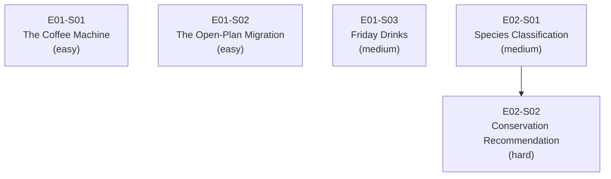

# The Office Worker: A Nature Documentary -- SDLC v2 Test (Run 8)

> **Status:** Draft

## Overview

Eighth end-to-end test of the Agentic SDLC v2 pipeline. The primary test objective is **validating worktree isolation for parallel builder dispatch** -- the top open defect from Run 7, where concurrent builders sharing a single working directory caused workspace collision (commit `c249257`).

The content vehicle is **"The Office Worker: A Nature Documentary"** -- David Attenborough-style narration scripts observing *Homo corporatus* in its natural habitat. Each episode treats a mundane office behaviour as if documenting a rare species in the wild. The comedy comes from the contrast between grandiose documentary framing and the banality of the subject.

### Why Run 8?

Prior runs validated pipeline mechanics with corporate handbooks (DoomCo), zoological field guides (Mythical Creatures), travel advisories (Intergalactic), HR reviews (Cat Performance), and academic reports (Alien Field Study). Run 8 retests the full autonomous lifecycle with fresh documentary-satire content while specifically exercising the worktree isolation fix for parallel dispatch.

## Problem Statement

Run 7 confirmed a defect where parallel builders sharing a single git working directory committed files from other stories onto the wrong branch. The `isolation: "worktree"` parameter was identified as the fix. Run 8 validates that this fix eliminates workspace collision while exercising the complete autonomous lifecycle.

## Goals

1. **Worktree isolation validation** -- All parallel builders dispatch with `isolation: "worktree"`, each story branch contains only its own files
2. **Full autonomous lifecycle** -- Design through retro without human intervention (except final PR merge)
3. **Parallel dispatch** -- Wave 1 dispatches 3 stories concurrently with worktree isolation
4. **All three difficulty levels** -- easy (haiku), medium (sonnet), hard (opus)
5. **Sequential dependency** -- E02-S02 depends on E02-S01, validating wave ordering
6. **Complete telemetry** -- Per-story, per-epic, and backlog-level telemetry posted
7. **Clean board lifecycle** -- All issues transition Planned -> Todo -> In Progress -> In Review -> Done

## Non-Goals

- Producing polished creative writing (this is a workflow test)
- Testing C# compilation, DI wiring, or unit tests (markdown only)
- Validating Norris runtime integration or DevOps tools
- Testing more than 2 epics or 5 stories

## Content Design

### Theme: Nature Documentary of the Modern Office

The documentary series follows a distinguished narrator observing the behavioural ecology of *Homo corporatus* -- the modern office worker. Each episode focuses on a specific habitat zone or social ritual, applying rigorous ethological methodology to scenes that are, fundamentally, deeply ordinary.

### Voice Guidelines

- **Tone:** Hushed, reverent, and deeply serious. Present tense, third person narration ("The male approaches the coffee machine..."). The narrator genuinely believes these are fascinating discoveries.
- **Latin nomenclature:** Subspecies and behaviours receive formal Latin names (e.g., *Homo corporatus managerius*, *ritualus caffeinatus*).
- **Production notes:** Occasional bracketed camera/sound directions: `[CAMERA: slow zoom on stapler]`, `[SFX: distant printer jam]`.
- **Species reference:** Office workers are always "the specimen," "the male/female," or the Latin subspecies name -- never by human name.
- **Register:** The gap between the grandiose narration and the mundane subject IS the comedy. Never break the fourth wall or acknowledge the absurdity.

### Output Location

All files go in `test-output/office-nature-documentary/`. Each story produces one markdown file.

### File Naming Convention

| Story | Filename |
|-------|----------|
| E01-S01 | `episode-the-coffee-machine.md` |
| E01-S02 | `episode-the-open-plan-migration.md` |
| E01-S03 | `episode-friday-drinks.md` |
| E02-S01 | `species-classification-report.md` |
| E02-S02 | `conservation-status-recommendation.md` |

## Epic and Story Structure

### Epic 1: Field Observations -- 3 stories (parallel)

Three independent documentary episodes on different office behaviours. All parallel (Wave 1). Tests worktree isolation with 3 concurrent builders.

#### E01-S01: "The Coffee Machine" -- `difficulty/easy`

Create `test-output/office-nature-documentary/episode-the-coffee-machine.md`.

**Content requirements:**

- Episode title formatted as a documentary heading
- Narrator observation (4-6 sentences): The territorial display and dominance hierarchy surrounding the communal coffee station. The alpha male asserts dominance by taking the last pod without replacing the box. Lesser males hover at a respectful distance.
- At least one Latin species/behaviour name
- At least one production note in brackets
- Total length: 100-200 words

**Why easy:** Single scene, single behaviour. Formulaic structure with no cross-references.

#### E01-S02: "The Open-Plan Migration" -- `difficulty/easy`

Create `test-output/office-nature-documentary/episode-the-open-plan-migration.md`.

**Content requirements:**

- Episode title formatted as a documentary heading
- Narrator observation (4-6 sentences): The seasonal desk-moving behaviour triggered by management reorganisations. The herd relocates en masse, clutching monitor arms and personal mugs. Territorial markings (family photos, novelty mugs) are transported with great care.
- At least one Latin species/behaviour name
- At least one production note in brackets
- Total length: 100-200 words

**Why easy:** Same template as E01-S01. Different subject, identical structure.

#### E01-S03: "Friday Drinks" -- `difficulty/medium`

Create `test-output/office-nature-documentary/episode-friday-drinks.md`.

**Content requirements:**

- Episode title formatted as a documentary heading
- Opening narration (2-3 sentences): Setting the scene -- 17:00 on the fifth day of the work cycle
- Courtship and bonding observations (3-4 sentences): The social rituals at the designated watering hole. The complex signalling system of "just one drink" declarations that invariably prove false
- Behavioural analysis (2-3 sentences): The role of the ritual in maintaining pack cohesion
- At least two Latin species/behaviour names
- At least two production notes in brackets
- Total length: 150-200 words

**Why medium:** Multiple sections with different narrative functions. Requires balancing multiple comedic threads (false promises, social hierarchy shifts, courtship displays). More creative latitude than the easy episodes.

### Epic 2: Analytical Documents -- 2 stories (sequential)

Formal species documentation with sequential dependency. Species classification first (Wave 2), then conservation recommendation referencing it (Wave 3).

#### E02-S01: "Species Classification Report" -- `difficulty/medium`

Create `test-output/office-nature-documentary/species-classification-report.md`.

**Content requirements:**

- Document header with formal classification report formatting
- Document ID (e.g., "Document: HC-CLASS-001") for cross-referencing
- Classification table with rows for: Species (*Homo corporatus*), Habitat Range, Subspecies (the Manager, the Developer, the Intern -- each with Latin names), Dietary Habits (meal deals, sad desk lunches), Threat Display Behaviours (passive-aggressive emails, CC-ing the boss)
- Researcher notes section (2-3 sentences): Brief commentary on the species' most puzzling traits
- Total length: 150-200 words

**Why medium:** Requires structured tabular content plus coherent researcher commentary. More format complexity than the episode scripts.

#### E02-S02: "Conservation Status Recommendation" -- `difficulty/hard`

Create `test-output/office-nature-documentary/conservation-status-recommendation.md`.

**Content requirements:**

- Formal recommendation header (elevated clearance: "Senior Researcher Eyes Only")
- Document ID (e.g., "Document: HC-CONSERVE-001")
- Executive summary (2-3 sentences): Summarises findings from the field observations and species classification
- Options analysis (3 options, 2-3 sentences each): (a) Full protection under the Endangered Habitats Act, (b) Controlled observation with minimal intervention, (c) Designation as a cautionary exhibit for other species
- Formal recommendation (2-3 sentences): The lead researcher's chosen option with justification
- Cross-references to the species classification report (by document ID: HC-CLASS-001) and at least one field observation episode
- Total length: 180-200 words

**Why hard:** Synthesises content from multiple prior documents. Requires internal consistency with cross-references. Multiple sections with different rhetorical purposes (summary, analysis, recommendation). The most structurally complex piece.

## Dependency Graph

E01-S01, E01-S02, E01-S03, and E02-S01 have no dependencies on each other. E02-S02 depends on E02-S01 (cross-references the classification report by document ID).

## Dispatch Plan

| Wave | Stories | Dispatch | Notes |
|------|---------|----------|-------|
| **Wave 1** | E01-S01, E01-S02, E01-S03 | Parallel (3 stories, **worktree isolation**) | All independent field observations |
| **Wave 2** | E02-S01 | Sequential | Species classification (no dependencies on Wave 1) |
| **Wave 3** | E02-S02 | Sequential | Depends on E02-S01 (cross-references classification report) |

**Note on Wave 2:** E02-S01 has no content dependency on Wave 1 reports, but it runs in Wave 2 because it belongs to a different epic and Wave 1 already has 3 parallel stories. The planner may choose to include E02-S01 in Wave 1 (4 parallel) or keep it in Wave 2 -- either is valid.

## Acceptance Criteria

### Per-Story

- [ ] Output file exists at the specified path in `test-output/office-nature-documentary/`
- [ ] Content is 100-200 words (180-200 for E02-S02)
- [ ] Documentary tone maintained throughout (hushed, reverent, present tense)
- [ ] Required Latin nomenclature present
- [ ] Required production notes present (for episode scripts)
- [ ] Cross-references correct (for E02-S02)

### Per-Epic

- [ ] All stories in the epic pass review
- [ ] Epic branch merges cleanly into integration branch

### Workflow (Primary Test Objectives)

- [ ] **Worktree isolation:** Parallel builders in Wave 1 use `isolation: "worktree"`
- [ ] **No workspace collision:** Each story branch contains only its own file (no cross-contamination from parallel builds)
- [ ] All board transitions complete (Planned -> Todo -> In Progress -> In Review -> Done)
- [ ] Per-story telemetry posted (Work Started + Ready for Review + Telemetry)
- [ ] Per-epic telemetry posted
- [ ] Backlog-level telemetry posted with full lifecycle breakdown
- [ ] Backlog PR opened targeting `main`, stays open for human review
- [ ] All issues listed in PR `Closes` footer for auto-close on merge

## Approaches Considered

### Approach A: Mirror backlog issue structure exactly (recommended)

Use the 2-epic, 5-story structure from the backlog issue with the exact dependency graph specified. Keep the dispatch plan as described (3 parallel in Wave 1, sequential Waves 2-3).

**Pros:**
- Backlog issue already has well-defined scope and dependencies
- 5 stories is proven to be a good test size from prior runs
- Tests both parallel (with worktree isolation) and sequential dispatch
- Matches the proven shape that prior runs used, isolating the worktree variable

**Cons:**
- No structural novelty (same shape as Runs 5-7)

### Approach B: Merge E02-S01 into Wave 1 for 4-way parallelism

Run 4 stories in parallel (Wave 1) and only E02-S02 sequentially (Wave 2).

**Pros:**
- Tests wider parallelism (4 concurrent builders with worktree isolation)
- Fewer waves means faster execution

**Cons:**
- E02-S01 belongs to a different epic, so parallel dispatch across epics adds merge complexity
- Marginal benefit -- 3 parallel already validates worktree isolation
- Introduces a new variable (cross-epic parallelism) alongside the variable under test (worktree isolation)

### Decision

**Approach A.** The primary test objective is validating worktree isolation, not maximising parallelism. Keeping the proven 3-parallel shape isolates the worktree variable -- if the run succeeds, we know worktree isolation fixed the Run 7 defect. The planner may choose to include E02-S01 in Wave 1 if they want to test wider parallelism, but the design does not prescribe it.

## Assumptions and Open Questions

### Assumptions

1. **Output directory creation:** Builders will `mkdir -p test-output/office-nature-documentary/` before writing files. Standard practice from prior runs.
2. **No C# code or tests needed:** Content-only test. Builders write markdown files, not source code. The pre-commit hook runs `dotnet test` but no code changes means tests pass trivially.
3. **Word count is approximate:** "100-200 words" is a guideline. Reviewers should accept content in the 90-210 range without flagging.
4. **Cross-references are by document ID:** E02-S02 references E02-S01's classification report by its document ID (HC-CLASS-001). It does not need to read the actual file -- it references the fictional document number.
5. **Latin nomenclature is invented freely:** Builders create plausible-sounding Latin names. Consistency across stories is nice but not required for a workflow test.
6. **Worktree isolation is an orchestrator concern:** The design specifies that parallel dispatch must use worktree isolation, but the implementation is the orchestrator's responsibility (passing `isolation: "worktree"` in Agent tool calls). Builders do not need to be aware of it.

### Open Questions

1. **Should E02-S01 run in Wave 1 or Wave 2?** The design recommends Wave 2 (matching the backlog issue), but the planner may choose Wave 1. Either is valid -- see Approaches Considered.
2. **Production note density:** The design requires "at least one" or "at least two" production notes per episode. Should there be a maximum? Left to builder discretion -- more is fine as long as it doesn't overwhelm the narration.
