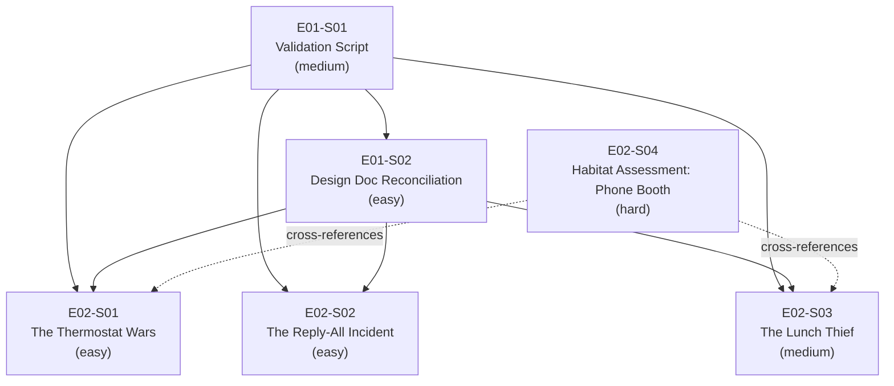

# Run 10 Design: Orchestrator Logging Validation + Office Nature Documentary (Season 2)

> **Status:** Draft

## Overview

Tenth end-to-end test of the Agentic SDLC pipeline. Two workstreams:

1. **Logging infrastructure** -- Validate and harden the two-layer diagnostic logging system (board-status.log + orchestrator.log) that was implemented during Run 9. The infrastructure already exists on `main`; this epic closes gaps between the original design doc and the actual implementation, adds a smoke-test validation script, and ensures the logging is exercised by the content waves that follow.
2. **Content** -- "Nature Documentary: The Open-Plan Office, Season 2" -- fresh episodes and analytical documents in the same universe as the Run 8 content. New scenes, new species behaviours, no overlap with existing files.

The logging infrastructure epic MUST complete before content stories begin, so the content build waves produce diagnostic data in `.claude/logs/`.

## Problem Statement

Run 9 exposed a board-status persistence issue: all story and epic issues remained at "In Progress" despite the orchestrator reporting successful transitions. The logging design doc (`docs/2-design/2026-03-13-orchestrator-logging.md`) was created to diagnose such failures. The infrastructure was subsequently implemented, but has not yet been exercised in a full autonomous lifecycle run with content stories generating real diagnostic output.

This run validates that:
- The logging captures all expected events during a real multi-story build
- The `item-set-status.sh` post-mutation verification correctly detects mismatches
- The PostToolUse hook filters and logs the right commands
- Content stories can be built and reviewed while logging is active (no hook interference)

## Goals

1. **Logging validation** -- Verify both log layers capture expected events during the run
2. **Gap closure** -- Fix the hook registration discrepancy (design doc says `Agent`, implementation uses `Task`) and add a validation script
3. **Full autonomous lifecycle** -- Design through retro without human intervention (except final PR merge)
4. **Fresh content** -- New episodes and documents that do not duplicate Run 8 files
5. **All three difficulty levels** -- easy (haiku), medium (sonnet), hard (opus)
6. **Parallel dispatch** -- At least one wave of 2+ parallel content stories with worktree isolation
7. **Clean board lifecycle** -- All issues transition Planned -> Todo -> In Progress -> In Review -> Done (verified by logging)

## Non-Goals

- Producing polished creative writing (this is a workflow test)
- Testing C# compilation, DI wiring, or unit tests (markdown and scripts only)
- Implementing log rotation or cleanup (logs are per-session and small)
- Auto-remediation on VERIFY_MISMATCH (diagnostic data collection only)
- Changing other scripts (`item-close.sh`, `item-start.sh`, etc.) -- they delegate to `item-set-status.sh`

---

## Epic 1: Logging Infrastructure Validation (2 stories, sequential)

This epic validates and hardens the existing logging implementation. Both stories modify scripts/config (not content), and must complete before the content epic begins.

### Current State Assessment

The logging infrastructure from the design doc is already implemented on `main`:

| Component | Design Doc Spec | Current State | Gap |
|-----------|----------------|---------------|-----|
| `scripts/item-set-status.sh` logging | File logging with verification | Fully implemented | None |
| `.claude/hooks/log-tool.sh` | PostToolUse hook with allowlist | Fully implemented | Minor: handles `Task` tool (actual CC API name), not `Agent` as design doc specified |
| `.claude/hooks/log-filter.conf` | Regex allowlist | Fully implemented | None |
| `.claude/settings.json` hooks | `PostToolUse` registration | Registered for `Bash` and `Task` | Format differs from design doc (actual CC hook API uses flat `matcher` string, not nested `toolName` object) |
| `.claude/.gitignore` | `logs/` entry | Present | None |
| Validation script | Not specified in design doc | Does not exist | New addition for this run |

### E01-S01: Logging Validation Script -- `difficulty/medium`

Create `scripts/validate-logs.sh` -- a post-run diagnostic script that reads both log files and reports whether expected events were captured.

**What the script does:**

1. Check that `.claude/logs/board-status.log` exists and is non-empty
2. Check that `.claude/logs/orchestrator.log` exists and is non-empty
3. Count board-status events by type: `START`, `MUTATION`, `VERIFY_OK`, `VERIFY_MISMATCH`, `SKIP`
4. Count orchestrator events by tool type: `Bash`, `Task`/`Agent`
5. Report any `VERIFY_MISMATCH` events with their full details (the key diagnostic signal)
6. Print a summary table to stdout

**Output format:**

```
=== Log Validation Report ===

Board Status Log (.claude/logs/board-status.log)
  Total entries:     42
  START:             14
  MUTATION:          14
  VERIFY_OK:         12
  VERIFY_MISMATCH:    2
  SKIP:               0

  ⚠ MISMATCHES FOUND:
  [2026-03-13T02:30:03Z] issue=18 status=in-review VERIFY_MISMATCH expected=In Review actual=In Progress
  [2026-03-13T02:31:05Z] issue=20 status=done VERIFY_MISMATCH expected=Done actual=In Review

Orchestrator Log (.claude/logs/orchestrator.log)
  Total entries:     87
  Bash commands:     73
  Agent dispatches:  14

=== End Report ===
```

**Why medium:** Requires parsing structured log formats, counting by category, conditional formatting for mismatches. Not trivial, but no external dependencies or complex logic.

**Acceptance criteria:**
- [ ] Script is executable and runs without errors when log files exist
- [ ] Script handles missing log files gracefully (reports "not found" instead of crashing)
- [ ] Mismatch events are surfaced prominently with full log line details
- [ ] Summary table is human-readable

### E01-S02: Design Doc Reconciliation -- `difficulty/easy`

Update `docs/2-design/2026-03-13-orchestrator-logging.md` to reconcile the design with the actual implementation.

**Changes:**

1. Update the hook registration section to reflect the actual Claude Code hook API format (flat `matcher` string, not nested `toolName` object)
2. Note that the tool is called `Task` in Claude Code's API, not `Agent` as originally assumed
3. Add a "Post-Implementation Notes" section documenting:
   - The implementation is on `main` as of commit `c7d2eda`
   - The validation script location (`scripts/validate-logs.sh`)
   - How to run the validator after a workflow session
4. Update the status from `draft` to `implemented`

**Why easy:** Text edits to an existing document. No logic, no scripts, no external dependencies.

**Acceptance criteria:**
- [ ] Hook registration code block matches actual `.claude/settings.json` format
- [ ] `Task` vs `Agent` naming discrepancy is documented
- [ ] Status updated to `implemented`
- [ ] Post-Implementation Notes section added

---

## Epic 2: Nature Documentary Content -- Season 2 (4 stories)

Fresh content in the "Nature Documentary: The Open-Plan Office" universe. Same voice, new scenes. All output goes in `test-output/office-nature-documentary/` alongside the existing Run 8 files. File names are prefixed with `s2-` to distinguish from Season 1.

### Voice Guidelines (inherited from Run 8 design, restated for builders)

- **Tone:** Hushed, reverent, deeply serious. Present tense, third person. The narrator genuinely believes these are fascinating discoveries.
- **Latin nomenclature:** Subspecies and behaviours receive formal Latin names (e.g., *Homo corporatus thermostatus*, *ritualus lunchbreakus*).
- **Production notes:** Bracketed camera/sound directions: `[CAMERA: ...]`, `[SFX: ...]`.
- **Species reference:** Office workers are always "the specimen," "the male/female," or the Latin subspecies name -- never human names.
- **Register:** The gap between grandiose narration and mundane subject IS the comedy. Never break the fourth wall.

### Content Rules

- Each story produces ONE markdown file, 100-200 words
- Output directory: `test-output/office-nature-documentary/`
- No C# code -- markdown only
- File names use `s2-` prefix to avoid collisions with Run 8 content

### E02-S01: "The Thermostat Wars" -- `difficulty/easy`

Create `test-output/office-nature-documentary/s2-episode-the-thermostat-wars.md`

**Content requirements:**

- Episode title formatted as a documentary heading
- Narrator observation (4-6 sentences): The eternal conflict over the office thermostat. One specimen (*Homo corporatus frigidus*) arrives in a parka while the neighbouring specimen (*H. corporatus tropicus*) operates a desk fan at maximum velocity. The thermostat itself is a sacred totem, adjusted furtively by competing factions during lunch breaks.
- At least one Latin species/behaviour name
- At least one production note in brackets
- Total length: 100-200 words

**Why easy:** Single scene, single behaviour, formulaic structure identical to Run 8 easy stories.

### E02-S02: "The Reply-All Incident" -- `difficulty/easy`

Create `test-output/office-nature-documentary/s2-episode-the-reply-all-incident.md`

**Content requirements:**

- Episode title formatted as a documentary heading
- Narrator observation (4-6 sentences): The catastrophic reply-all email event. A lone specimen accidentally broadcasts a private message to the entire herd. The ripple effect through the colony is observed: frozen screens, sharp inhalations, and the rapid onset of *silentium mortis* -- the death-quiet that follows a social catastrophe. The specimen retreats to the bathroom, a known refuge habitat.
- At least one Latin species/behaviour name
- At least one production note in brackets
- Total length: 100-200 words

**Why easy:** Same template as E02-S01. Different subject, identical structure.

### E02-S03: "The Lunch Thief" -- `difficulty/medium`

Create `test-output/office-nature-documentary/s2-episode-the-lunch-thief.md`

**Content requirements:**

- Episode title formatted as a documentary heading
- Opening narration (2-3 sentences): Setting the scene -- the communal refrigerator, a shared resource governed by an unwritten treaty
- The crime (3-4 sentences): The discovery that a labelled lunch has been consumed by an unknown predator. The victim's distress display (*lamentatium sandwichii*). The forensic analysis of crumb patterns and passive-aggressive note deployment.
- The aftermath (2-3 sentences): The escalation to all-staff email, the installation of a surveillance camera (a cardboard box with "CAMERA" written on it), the eventual cold peace.
- At least two Latin species/behaviour names
- At least two production notes in brackets
- Total length: 150-200 words

**Why medium:** Multiple narrative sections with different functions (setup, crime, aftermath). Requires maintaining comedic escalation across sections. More structural complexity than the easy episodes.

### E02-S04: "Endangered Habitat Assessment: The Phone Booth" -- `difficulty/hard`

Create `test-output/office-nature-documentary/s2-habitat-assessment-phone-booth.md`

**Content requirements:**

- Formal assessment header ("Senior Researcher Eyes Only", document ID: "HC-HABITAT-002")
- Executive summary (2-3 sentences): The phone booth -- once abundant in the open-plan ecosystem -- is now critically endangered. Remaining specimens are occupied 23.7 hours per day by individuals who "just need five minutes."
- Threat analysis (3-4 sentences): Primary threats include territorial squatting (*occupatio perpetua*), repurposing as crying rooms, and management proposals to convert them to "collaboration pods." Cross-reference the species classification report (HC-CLASS-001) regarding the Developer subspecies, which exhibits the highest phone booth dependency.
- Conservation recommendation (2-3 sentences): Formal recommendation for protected status under the Open Office Endangered Habitats Act. Proposed intervention: mandatory 15-minute time limits enforced by a passive-aggressive timer.
- Cross-references to HC-CLASS-001 (species classification from Run 8) and at least one Season 2 episode
- Total length: 180-200 words

**Why hard:** Formal document structure with multiple rhetorical sections. Cross-references to both Run 8 content (HC-CLASS-001) and Season 2 episodes. The most structurally complex piece, requiring internal consistency and the dry bureaucratic voice layered on top of the documentary narration.

---

## File Naming Summary

| Story | Filename | Difficulty |
|-------|----------|------------|
| E01-S01 | `scripts/validate-logs.sh` | medium |
| E01-S02 | `docs/2-design/2026-03-13-orchestrator-logging.md` (edit) | easy |
| E02-S01 | `test-output/office-nature-documentary/s2-episode-the-thermostat-wars.md` | easy |
| E02-S02 | `test-output/office-nature-documentary/s2-episode-the-reply-all-incident.md` | easy |
| E02-S03 | `test-output/office-nature-documentary/s2-episode-the-lunch-thief.md` | medium |
| E02-S04 | `test-output/office-nature-documentary/s2-habitat-assessment-phone-booth.md` | hard |

## Dependency Graph



**Dependency rationale:**

- E01 (logging) must complete entirely before E02 (content) begins -- the logging stories set up and validate the infrastructure that content stories exercise
- E01-S02 depends on E01-S01 (the reconciliation doc references the validation script)
- E02-S01, E02-S02, and E02-S03 are independent of each other -- parallel dispatch
- E02-S04 has soft cross-references to Season 2 episodes, but these are by fictional document ID and episode name, not by reading actual files. This means E02-S04 can technically run in parallel, but its content is richer if the referenced episodes exist. The planner may choose to run it in a separate wave.

## Dispatch Plan

| Wave | Stories | Dispatch | Notes |
|------|---------|----------|-------|
| **Wave 1** | E01-S01 | Sequential | Logging validation script (must exist before E01-S02) |
| **Wave 2** | E01-S02 | Sequential | Design doc update (depends on E01-S01) |
| **Wave 3** | E02-S01, E02-S02, E02-S03 | Parallel (3 stories, **worktree isolation**) | Independent content episodes |
| **Wave 4** | E02-S04 | Sequential | Habitat assessment with cross-references |

**Note on Wave 3:** Three parallel stories with worktree isolation re-validates the Run 8/9 fix. This is the same proven shape (3-way parallel) that worked in prior runs.

**Note on Wave 4:** E02-S04 runs last because its cross-references are richer when it can name specific Season 2 episodes. The planner may merge it into Wave 3 if they determine the cross-references are sufficiently formulaic (referencing by title string, not file content).

## Acceptance Criteria

### Per-Story

- [ ] Output file exists at the specified path
- [ ] Content is within the word count range (100-200 for episodes, 180-200 for assessment)
- [ ] Documentary tone maintained throughout (hushed, reverent, present tense)
- [ ] Required Latin nomenclature present
- [ ] Required production notes present (for episodes)
- [ ] Cross-references correct (for E02-S04)
- [ ] Validation script is executable and handles edge cases (for E01-S01)
- [ ] Design doc reconciliation is accurate (for E01-S02)

### Per-Epic

- [ ] All stories in the epic pass review
- [ ] Epic branch merges cleanly into integration branch

### Workflow (Primary Test Objectives)

- [ ] **Logging active during content build:** Both log files contain entries from the content story waves
- [ ] **Worktree isolation:** Parallel builders in Wave 3 use `isolation: "worktree"`
- [ ] **No workspace collision:** Each story branch contains only its own file
- [ ] All board transitions complete (Planned -> Todo -> In Progress -> In Review -> Done)
- [ ] Per-story, per-epic, and backlog-level telemetry posted
- [ ] Backlog PR opened targeting `main`, stays open for human review
- [ ] All issues listed in PR `Closes` footer for auto-close on merge
- [ ] `scripts/validate-logs.sh` produces a clean report when run after the session

## Approaches Considered

### Approach A: Logging epic validates and hardens existing implementation (recommended)

The logging infrastructure already exists on `main`. Rather than re-implementing it, create a validation script and reconcile the design doc with the actual implementation. This acknowledges the current state and adds value through testability.

**Pros:**
- Honest about what already exists -- avoids wasted builder effort re-implementing working code
- Validation script is genuinely useful for post-run diagnostics in future runs
- Design doc reconciliation closes the documentation gap (Agent vs Task naming, hook format)
- Content epic exercises the logging naturally, generating real diagnostic data

**Cons:**
- Logging epic is smaller (2 stories) than if it were a full implementation
- Less "implementation" to test the builder with

### Approach B: Re-implement logging from scratch on the integration branch

Ignore the existing implementation on `main` and have builders implement the logging design doc from scratch. This would involve deleting the existing files and recreating them.

**Pros:**
- Tests the builder's ability to implement scripts and hook configurations
- More stories to exercise the pipeline

**Cons:**
- Wasteful -- the implementation already works and has been tested
- Risk of introducing regressions (the existing code was debugged during Run 9)
- Artificially inflates the story count without adding value

### Approach C: Skip logging epic entirely, content only

Since logging is already working, skip the infrastructure epic and go straight to content. The content stories will exercise the logging passively.

**Pros:**
- Faster run with fewer stories
- Content is the real test payload

**Cons:**
- Misses the opportunity to validate logging correctness (we assume it works but have no diagnostic script)
- Doesn't close the design doc gap
- Doesn't test a mixed workstream (infra + content) which is the backlog issue's stated goal

### Decision

**Approach A.** The existing logging implementation works. The validation script adds genuine diagnostic value for this run and future runs. The design doc reconciliation closes a real documentation gap. The 2-story logging epic is appropriately sized for infrastructure hardening, and the 4-story content epic provides the main payload for exercising the pipeline.

## Assumptions and Open Questions

### Assumptions

1. **Logging infrastructure is fully functional.** The existing implementation on `main` (hooks, filter config, board-status logging, post-mutation verification) is working correctly. The validation script will confirm this assumption during the run.
2. **`Task` is the correct Claude Code API name.** The actual hook API uses `Task` (not `Agent`) as the tool name for agent dispatches. The design doc will be updated to reflect this.
3. **Season 2 content goes in the same directory.** Files are prefixed with `s2-` to coexist with Run 8 Season 1 files. No separate directory needed.
4. **Cross-references are by document ID and title.** E02-S04 references HC-CLASS-001 (from Run 8) and Season 2 episodes by title string. Builders do not need to read actual files -- they reference fictional document IDs and episode titles as specified in the story requirements.
5. **Word counts are approximate.** "100-200 words" is a guideline. Reviewers should accept content in the 90-210 range.
6. **Latin nomenclature is invented freely.** Builders create plausible-sounding Latin names. Consistency within a story is required; cross-story consistency is nice but not enforced.
7. **Output directory already exists.** `test-output/office-nature-documentary/` was created in Run 8 and persists on `main`.
8. **Pre-commit hook runs `dotnet test`.** Content-only stories (no C# changes) will pass trivially. The validation script story needs to ensure the script does not break any test expectations.

### Open Questions

1. **Should the validation script be run automatically by the orchestrator after the build?** The design assumes it is run manually post-session, but the planner could add a post-build step. Left to the planner's discretion.
2. **Should E02-S04 run in Wave 3 (parallel) or Wave 4 (sequential)?** The design recommends Wave 4 for richer cross-references, but Wave 3 is valid since the references are by title string, not file content. The planner should decide based on whether they want to test 4-way parallelism.
3. **Should the logging design doc reconciliation (E01-S02) update the `backlog` frontmatter field?** The current design doc has `backlog: 14` (Run 9). Since it is a shared infrastructure doc, it could be updated to `backlog: 27` or left as-is. Left to the builder's discretion -- either is valid.
