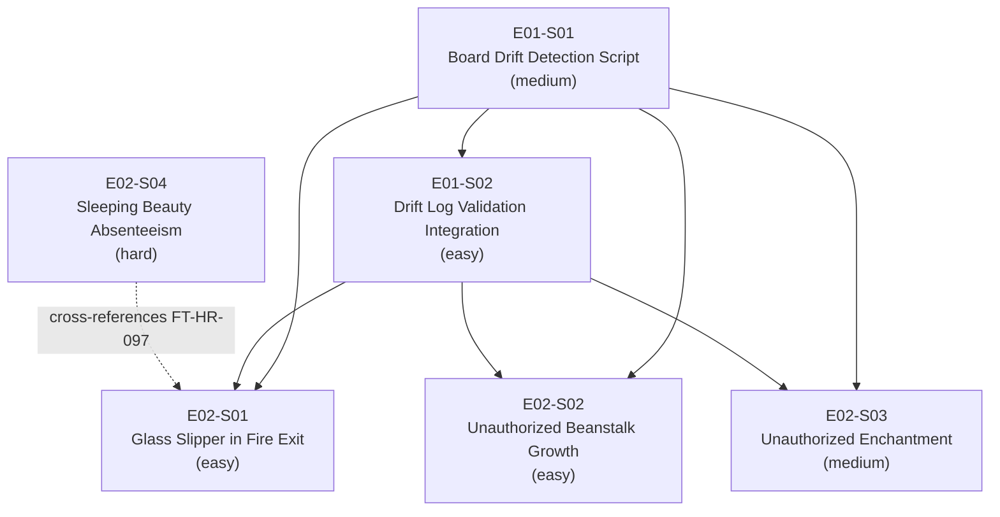

# Run 11 Design: Board Drift Detection + Incident Reports from Fairy Tale HR

> **Status:** Draft

## Overview

Eleventh end-to-end test of the Agentic SDLC pipeline. Primary test objective: **investigate the board status persistence bug** discovered in Runs 9-10, where `item-set-status.sh` mutations succeed and post-mutation verification passes (`VERIFY_OK`), but statuses revert to a previous value hours later.

Two workstreams:

1. **Infrastructure:** Create `scripts/check-board-drift.sh` -- a diagnostic script that sets a status, verifies immediately, waits, and verifies again at timed intervals to narrow down the drift window.
2. **Content:** "Incident Reports from Fairy Tale HR" -- formal workplace incident reports filed by the HR department of FairyTale Corp, a company that exclusively employs fairy tale characters. Short, formulaic documents (60-100 words each).

## Problem Statement

The GitHub Projects board status persistence bug has been observed across Runs 9 and 10. The symptoms are consistent:

1. `item-set-status.sh` sends a GraphQL `updateProjectV2ItemFieldValue` mutation
2. The mutation returns success (exit code 0)
3. A post-mutation verification query (1 second later) confirms the new status (`VERIFY_OK`)
4. Hours later, the status has reverted to its previous value

The existing `item-set-status.sh` script can detect *immediate* mismatches (within 1 second of mutation), but it cannot detect delayed drift. The `check-board-drift.sh` script will fill this gap by adding timed re-verification at 10s and 30s intervals, producing evidence of whether the reversion happens within seconds/minutes or over longer periods.

## Goals

1. **Board drift investigation** -- Create a diagnostic script that narrows the drift window
2. **Full autonomous lifecycle** -- Design through retro without human intervention (except final PR merge)
3. **Worktree isolation (retest)** -- At least one wave of 2+ parallel content stories
4. **All three difficulty levels** -- easy (haiku), medium (sonnet), hard (opus)
5. **Short execution time** -- Target 8-10 minutes total agent time

## Non-Goals

- Fixing the board drift bug (this is diagnostic data collection only)
- Auto-remediation or retry logic for drifted statuses
- Producing polished creative writing (this is a workflow test)
- Testing C# compilation, DI wiring, or unit tests (markdown and scripts only)
- Testing more than 2 epics or 6 stories

---

## Epic 1: Board Drift Detection Infrastructure (2 stories, sequential)

This epic creates a standalone diagnostic script and extends the existing validation script to report drift results. Both stories modify scripts (not content) and must complete before the content epic begins so the orchestrator can optionally invoke the drift checker during the content build.

### Existing Infrastructure Assessment

| Component | Current State | Relevance |
|-----------|---------------|-----------|
| `scripts/item-set-status.sh` | Fully functional: mutation + 1s post-mutation verify | Baseline -- drift checker wraps this |
| `scripts/validate-logs.sh` | Reports board-status.log event counts | Could report drift events if logged |
| `.claude/logs/board-status.log` | Captures START, MUTATION, VERIFY_OK/MISMATCH, SKIP | Drift checker should log to this same file for unified diagnostics |

### E01-S01: Board Drift Detection Script -- `difficulty/medium`

Create `scripts/check-board-drift.sh` -- a diagnostic script that exercises and monitors board status persistence.

**What the script does:**

1. Accept an issue number and target status as arguments
2. Call `item-set-status.sh` to set the status (reuses existing mutation + immediate verify logic)
3. Wait 10 seconds, then query the current status via the same lightweight GraphQL query used by `item-set-status.sh`
4. Wait 30 seconds (from initial set), then query again
5. Compare each re-verification result against the expected status
6. Print a timestamped report to stdout and append structured entries to `.claude/logs/board-drift.log`

**Interface:**

```bash
# Usage
./scripts/check-board-drift.sh <issue-number> <status>

# Example
./scripts/check-board-drift.sh 42 in-progress
```

**Output format (stdout):**

```
=== Board Drift Check ===
Issue:     #42
Target:    In Progress
Set:       OK (via item-set-status.sh)
+10s:      OK (In Progress)
+30s:      OK (In Progress)
Result:    NO DRIFT DETECTED
=== End Check ===
```

Or, if drift is detected:

```
=== Board Drift Check ===
Issue:     #42
Target:    In Progress
Set:       OK (via item-set-status.sh)
+10s:      OK (In Progress)
+30s:      DRIFT DETECTED (actual: Todo)
Result:    DRIFT DETECTED at +30s
=== End Check ===
```

**Log format (`.claude/logs/board-drift.log`):**

```
[2026-03-14T10:30:00Z] issue=42 target=in-progress set=OK verify_10s=OK verify_30s=OK result=NO_DRIFT
[2026-03-14T10:31:15Z] issue=42 target=in-progress set=OK verify_10s=OK verify_30s=DRIFT(actual=Todo) result=DRIFT
```

**Implementation notes:**

- Reuse the `fetch_item_info` GraphQL query pattern from `item-set-status.sh` (lightweight per-issue query, ~1 GraphQL point)
- The script should be self-contained -- it calls `item-set-status.sh` for the initial set, then handles its own timed re-verifications
- Log file is separate from `board-status.log` to keep drift diagnostics isolated from normal operational logs
- Exit code: 0 = no drift, 1 = drift detected, 2 = error (API failure, missing args)
- The ~40 second total runtime (10s wait + 20s wait) is acceptable for a diagnostic tool

**Why medium:** Requires timed delays, multiple GraphQL queries, structured logging, and coordinating with `item-set-status.sh`. More complex than a simple wrapper, but follows an established pattern.

**Acceptance criteria:**

- [ ] Script is executable and runs without errors
- [ ] Calls `item-set-status.sh` for the initial set (not reimplementing the mutation)
- [ ] Re-verifies at +10s and +30s intervals using lightweight GraphQL queries
- [ ] Logs structured entries to `.claude/logs/board-drift.log`
- [ ] Prints human-readable report to stdout
- [ ] Exit code 0 for no drift, 1 for drift detected
- [ ] Handles missing arguments gracefully (usage message + exit 2)

### E01-S02: Drift Log Validation Integration -- `difficulty/easy`

Extend `scripts/validate-logs.sh` to also report on the board drift log.

**Changes to `validate-logs.sh`:**

1. Add a third section after the existing Board Status Log and Orchestrator Log sections
2. Check if `.claude/logs/board-drift.log` exists
3. If it exists, count events by result: `NO_DRIFT`, `DRIFT`
4. If any `DRIFT` events exist, surface them with full log line details (same pattern as `VERIFY_MISMATCH` surfacing)
5. If the file does not exist, print "NOT FOUND -- no drift checks have been run"

**Expected output addition:**

```
Board Drift Log (.claude/logs/board-drift.log)
  Total checks:        3
  NO_DRIFT:            2
  DRIFT:               1

  WARNING: DRIFT DETECTED:
  [2026-03-14T10:31:15Z] issue=42 target=in-progress set=OK verify_10s=OK verify_30s=DRIFT(actual=Todo) result=DRIFT
```

**Why easy:** Adding a section to an existing script following an established pattern (the VERIFY_MISMATCH surfacing logic). Copy the pattern, change the file path and search terms.

**Acceptance criteria:**

- [ ] New section appears in validate-logs.sh output
- [ ] Handles missing drift log gracefully (prints "NOT FOUND")
- [ ] DRIFT events surfaced prominently with full log line details
- [ ] Existing sections unchanged (no regressions)

---

## Epic 2: Incident Reports from Fairy Tale HR (4 stories)

The HR department of FairyTale Corp has had a very difficult quarter. These are the official incident reports.

### Voice Guidelines

- **Tone:** Dry, bureaucratic, humourless corporate HR language. The narrator is an overworked HR professional who has processed too many enchantment-related violations this quarter.
- **Format:** Every report follows the rigid template specified in the backlog issue. No deviation from the form is permitted -- HR compliance demands consistency.
- **Register:** The comedy comes entirely from applying mundane workplace policy language to absurd fairy tale situations. Never acknowledge the absurdity. Treat enchanted sleep as "unauthorized use of company time." Treat dragon attacks as "failure to maintain a safe working environment." Treat magic bean cultivation as "unapproved modification of company property."
- **Witness statements:** Always from another fairy tale character in a mundane corporate role (e.g., "Jack, Senior Acquisitions Analyst" or "Snow White, VP of Operations").
- **HR recommendations:** Formal, proportionate to the violation category. "Mandatory re-training in the company's No-Magic-in-Common-Areas policy" or "Formal written warning per Section 4.2 of the Workplace Enchantment Guidelines."

### Content Rules

- Each story produces ONE markdown file, 60-100 words max
- All output goes in `test-output/fairy-tale-hr/`
- No C# code -- markdown content only
- File names follow the pattern `incident-report-XXX.md` where XXX is the report number

### Report Template

Every report must follow this exact structure (from the backlog issue):

```markdown
# INCIDENT REPORT

**Report No:** FT-HR-XXX
**Date Filed:** [date]
**Filed By:** HR Department, FairyTale Corp
**Subject:** [Character name]
**Violation Category:** [category]

## Summary

[2-3 sentences in dry corporate HR language]

## Witness Statement

> "[1-2 sentences from a witness]"
> -- [Witness name], [Job title]

## HR Recommendation

[1 sentence with the formal recommendation]

---
*This report is filed under the FairyTale Corp Workplace Conduct Policy, Section [X.X]*
```

### E02-S01: "The Glass Slipper in the Fire Exit" -- `difficulty/easy`

Create `test-output/fairy-tale-hr/incident-report-001.md`

**Content requirements:**

- Report No: FT-HR-001
- Subject: Cinderella, Events Coordinator
- Violation Category: Fire Safety Violation
- Summary: Cinderella has left a glass slipper in the fire exit for the third time this quarter. Previous verbal warnings on 14 January and 22 February have not resulted in behavioural change. The slipper constitutes an obstruction per Building Safety Code Section 3.1.
- Witness: Prince Charming, VP of Client Relations (suggests the slipper might be "a conversation piece" rather than a hazard)
- HR Recommendation: Formal written warning and mandatory completion of the Fire Safety Awareness module
- Policy reference: Section 3.1
- Total length: 60-100 words

**Why easy:** Single document following a rigid template. Fill in the fields, match the tone. No structural decisions.

### E02-S02: "Unauthorized Beanstalk Growth" -- `difficulty/easy`

Create `test-output/fairy-tale-hr/incident-report-002.md`

**Content requirements:**

- Report No: FT-HR-002
- Subject: Jack, Senior Acquisitions Analyst
- Violation Category: Unauthorized Modification of Company Property
- Summary: Jack has planted unauthorized magic beans in the office courtyard planter, resulting in an aggressive beanstalk that has breached the fourth-floor ceiling and is interfering with the HVAC system. Facilities has been unable to remove the growth. Giants have been reported on the roof.
- Witness: The Big Bad Wolf, Head of Security (reports structural concerns and "suspicious activity at altitude")
- HR Recommendation: Immediate removal of the beanstalk at Jack's expense and suspension of courtyard planter privileges
- Policy reference: Section 7.4
- Total length: 60-100 words

**Why easy:** Same template as E02-S01. Different subject, identical structure.

### E02-S03: "Unauthorized Enchantment in the Breakroom" -- `difficulty/medium`

Create `test-output/fairy-tale-hr/incident-report-003.md`

**Content requirements:**

- Report No: FT-HR-003
- Subject: The Wicked Witch of the West, Senior Chemist
- Violation Category: Unauthorized Magic Use in Common Areas
- Summary: The Wicked Witch has been using the breakroom microwave to brew potions during lunch hours, resulting in: (a) a persistent green mist that triggered the smoke alarm three times, (b) the transformation of the communal coffee mug into a frog (which remains at large), and (c) two colleagues being temporarily turned invisible. The breakroom has been declared a hazmat zone pending decontamination.
- Witness: Rapunzel, Facilities Manager (notes that the frog has been drinking from the water cooler and "seems to be enjoying its new life")
- HR Recommendation: 30-day suspension of breakroom privileges and mandatory re-training in the No-Magic-in-Common-Areas policy, with referral to the Enchantment Ethics Board
- Policy reference: Section 12.3
- Total length: 60-100 words

**Why medium:** More complex incident with multiple consequences listed. Requires condensing a richer scenario into the tight word count while maintaining the bureaucratic tone. The challenge is fitting the multi-part violation into the 60-100 word constraint without losing the humour.

### E02-S04: "The Sleeping Beauty Absenteeism Case" -- `difficulty/hard`

Create `test-output/fairy-tale-hr/incident-report-004.md`

**Content requirements:**

- Report No: FT-HR-004
- Subject: Sleeping Beauty, Junior Data Analyst
- Violation Category: Excessive Absenteeism / Unauthorized Use of Company Time
- Summary: Sleeping Beauty has been asleep at her desk for 97 consecutive business days, citing "enchantment-related medical leave" under the company's Curse Accommodation Policy (Section 9.1). Payroll has continued processing her salary. IT reports her laptop has been in sleep mode for the same period. Her team has redistributed her workload, but morale is declining. A prince from the Mergers & Acquisitions department has volunteered to "resolve the situation," but HR has flagged potential consent and fraternization policy concerns.
- Witness: Snow White, VP of Operations (notes "this is not the first time we have dealt with enchantment-based absenteeism" and references her own prior incident, FT-HR-097)
- HR Recommendation: Formal review of the Curse Accommodation Policy with Legal, pending determination of whether enchanted sleep constitutes a qualifying condition under the FairyTale Corp Extended Leave provisions
- Policy reference: Section 9.1
- Cross-reference: FT-HR-097 (Snow White's prior incident)
- Total length: 60-100 words

**Why hard:** Most structurally complex report. The summary must compress a multi-layered scenario (enchantment, payroll issue, fraternization concern, consent issue, cross-reference to prior incident) into the rigid 60-100 word constraint. The HR recommendation involves genuine policy ambiguity (does enchantment qualify as medical leave?) that must be rendered in completely straight-faced bureaucratic language. Requires balancing multiple comedic threads within severe word constraints.

---

## File Naming Summary

| Story | Filename | Difficulty |
|-------|----------|------------|
| E01-S01 | `scripts/check-board-drift.sh` | medium |
| E01-S02 | `scripts/validate-logs.sh` (edit) | easy |
| E02-S01 | `test-output/fairy-tale-hr/incident-report-001.md` | easy |
| E02-S02 | `test-output/fairy-tale-hr/incident-report-002.md` | easy |
| E02-S03 | `test-output/fairy-tale-hr/incident-report-003.md` | medium |
| E02-S04 | `test-output/fairy-tale-hr/incident-report-004.md` | hard |

## Dependency Graph



**Dependency rationale:**

- E01 (infra) must complete entirely before E02 (content) begins -- the drift detection infrastructure should be in place before the orchestrator exercises it during content builds
- E01-S02 depends on E01-S01 (the validate-logs extension references the drift log file that the drift checker creates)
- E02-S01, E02-S02, and E02-S03 are independent of each other -- parallel dispatch with worktree isolation
- E02-S04 has a soft cross-reference to Snow White's prior incident (FT-HR-097), which is a fictional document number, not an actual file. It can technically run in parallel, but its word-count challenge benefits from being last (the planner may choose to run it in a separate wave for scheduling simplicity)

## Dispatch Plan

| Wave | Stories | Dispatch | Notes |
|------|---------|----------|-------|
| **Wave 1** | E01-S01 | Sequential | Drift detection script (must exist before E01-S02) |
| **Wave 2** | E01-S02 | Sequential | Validate-logs extension (depends on E01-S01) |
| **Wave 3** | E02-S01, E02-S02, E02-S03 | Parallel (3 stories, **worktree isolation**) | Independent incident reports |
| **Wave 4** | E02-S04 | Sequential | Most complex report, cross-references prior incidents |

**Estimated execution time:**

- Wave 1 (medium): ~2 min
- Wave 2 (easy): ~1 min
- Wave 3 (3x parallel easy/easy/medium): ~2 min wall-clock
- Wave 4 (hard): ~3 min

Total: ~8 min agent time, ~8 min wall-clock (Wave 3 parallelism offsets Wave 1-2 sequential)

## Acceptance Criteria

### Per-Story

- [ ] Output file exists at the specified path
- [ ] Content follows the rigid HR incident report template exactly
- [ ] Content is within 60-100 word count range
- [ ] Bureaucratic HR tone maintained throughout (no winking, no breaking character)
- [ ] Witness statement from a named fairy tale character with a corporate job title
- [ ] Policy section reference included
- [ ] Scripts are executable and handle edge cases (for E01 stories)

### Per-Epic

- [ ] All stories in the epic pass review
- [ ] Epic branch merges cleanly into integration branch

### Workflow (Primary Test Objectives)

- [ ] **Board drift detection functional:** `check-board-drift.sh` runs without errors and produces structured output
- [ ] **Validate-logs reports drift:** New drift log section appears in validation output
- [ ] **Worktree isolation:** Parallel builders in Wave 3 use `isolation: "worktree"`
- [ ] **No workspace collision:** Each story branch contains only its own file
- [ ] All board transitions complete (Planned -> Todo -> In Progress -> In Review -> Done)
- [ ] Per-story, per-epic, and backlog-level telemetry posted
- [ ] Backlog PR opened targeting `main`, stays open for human review
- [ ] All issues listed in PR `Closes` footer for auto-close on merge

## Approaches Considered

### Approach A: Dedicated drift detection script + validate-logs integration (recommended)

Create `check-board-drift.sh` as a standalone diagnostic tool that delegates initial status-setting to `item-set-status.sh`, then independently re-verifies at timed intervals. Extend `validate-logs.sh` to report on the drift log. Keep the drift log separate from `board-status.log`.

**Pros:**
- Clean separation of concerns: `item-set-status.sh` remains the mutation script, `check-board-drift.sh` is purely diagnostic
- Separate drift log file prevents pollution of operational board-status logs
- The orchestrator can invoke the drift checker after critical status transitions without modifying `item-set-status.sh`
- Follows the established pattern where scripts are composable (drift checker wraps status setter)

**Cons:**
- Two scripts means a second GraphQL query pattern to maintain
- Separate log file means `validate-logs.sh` must check three files instead of two

### Approach B: Add timed re-verification directly to `item-set-status.sh`

Instead of a separate script, add `--verify-drift` flag to `item-set-status.sh` that enables the 10s/30s re-checks when passed.

**Pros:**
- Single script to maintain
- All verification in one place
- No separate log file needed

**Cons:**
- Adds 40 seconds to every status transition when enabled, slowing the pipeline significantly
- Mixes diagnostic tooling with operational tooling -- the flag would rarely be used in production but adds code complexity permanently
- Harder to test: you cannot invoke the drift check without also performing a mutation
- Violates single-responsibility: `item-set-status.sh` sets status; a separate script investigates drift

### Approach C: Inline drift checks in the orchestrator agent

Instead of a script, add instructions to the orchestrator agent to perform manual GraphQL queries at timed intervals after critical transitions.

**Pros:**
- No new scripts needed
- Orchestrator has full context about which transitions matter

**Cons:**
- Not reusable outside the orchestrator context
- Instructions get lost when the orchestrator agent file is updated
- Cannot be run manually by a human for ad-hoc testing
- Adds complexity to an already complex agent file

### Decision

**Approach A.** The standalone script is the right abstraction. It is reusable (humans can run it manually), composable (wraps `item-set-status.sh`), and keeps diagnostic concerns separate from operational concerns. The separate drift log file is a minor cost that pays for itself in clarity -- when investigating drift, you look at `board-drift.log`; when investigating operational issues, you look at `board-status.log`.

## Assumptions and Open Questions

### Assumptions

1. **The board drift bug is a GitHub-side issue.** The evidence from Runs 9-10 (mutations succeed, immediate verification passes, reversion happens later) strongly suggests this is a GitHub Projects API eventual consistency issue, not a bug in our scripts. The diagnostic script will help confirm this assumption.
2. **10s and 30s are useful checkpoints.** If drift happens within 30 seconds, these intervals will detect it. If drift happens over hours, this script will show "no drift" and we will know the reversion window is longer. Both outcomes are useful diagnostic data.
3. **The drift checker should not be invoked automatically during every build.** The 40-second overhead per check is acceptable for manual diagnostics but would add significant time if run after every status transition. The orchestrator may choose to invoke it once or twice during the run as a spot check.
4. **Content directory `test-output/fairy-tale-hr/` will be created by the builder.** Standard `mkdir -p` as in prior runs.
5. **Word counts are approximate.** "60-100 words" is a guideline. Reviewers should accept content in the 55-110 range without flagging.
6. **Cross-references are fictional.** FT-HR-097 (Snow White's prior incident) is a fictional document number. No actual file needs to exist.
7. **Report template is prescriptive.** All four reports must use the exact template structure from the backlog issue. The comedy comes from the content within the rigid form, not from deviating from it.
8. **Pre-commit hook runs `dotnet test`.** Content-only stories (no C# changes) will pass trivially. The script stories need to ensure no test regressions.

### Open Questions

1. **Should the orchestrator invoke `check-board-drift.sh` during the run?** The design assumes it is available for manual use, but the orchestrator could invoke it once after setting a critical status (e.g., after setting the backlog issue to "In Progress"). This would produce live drift data during the run. Left to the planner/orchestrator's discretion.
2. **Should E02-S04 run in Wave 3 (4-way parallel) or Wave 4 (sequential)?** The design recommends Wave 4 because E02-S04 is the hardest story and benefits from focused attention. The planner may merge it into Wave 3 if they want to test 4-way parallelism, since the cross-reference to FT-HR-097 is fictional and does not require any prior file to exist.
3. **Should the drift log be added to `.claude/.gitignore`?** The drift log is diagnostic data that should not be committed. The existing `.gitignore` covers `logs/` which includes `board-drift.log` if it is placed at `.claude/logs/board-drift.log`. The builder should verify this.
