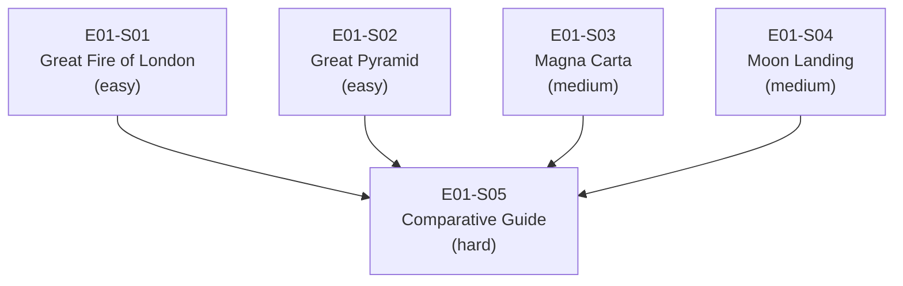

# Run 12 Design: Time Traveler's Yelp Reviews

> **Status:** Draft

## Overview

Twelfth end-to-end test of the Agentic SDLC pipeline. Primary test objective: **validate configurable workflow settings** introduced in PR #55, including scripts reading from `.claude/agentic-sdlc-config.json`, model routing from config, corrected Opus pricing, and YAML frontmatter-based plan detection.

Content theme: "Time Traveler's Yelp Reviews" -- formal customer reviews of historical events, locations, and eras written by time-traveling tourists. Reviews are written in authentic Yelp/TripAdvisor style (star ratings, "Was this review helpful?", management responses) while maintaining historical accuracy played for comedy.

## Goals

1. **Config validation** -- Verify all scripts read `github.repo`, `boardStatus.*`, and `modelRouting.*` from `.claude/agentic-sdlc-config.json` (no hardcoded values in script output)
2. **Model routing** -- Confirm `difficulty/easy` and `difficulty/medium` both dispatch `builder-sonnet`, and `difficulty/hard` dispatches `builder-opus`
3. **Pricing accuracy** -- Verify Opus telemetry uses ~$30/M blended rate (not the old $10/M)
4. **Plan detection** -- Verify Phase 3 uses YAML frontmatter grep (`^backlog: 56$`) rather than content grep
5. **Worktree isolation (retest)** -- At least one wave of 2+ parallel content stories
6. **All three difficulty levels** -- 2 easy, 2 medium, 1 hard (minimum from backlog requirements)

## Non-Goals

- Testing C# compilation, DI wiring, or unit tests (markdown content only)
- Cross-epic dependencies (all content is in a single epic)
- Testing more than 1 epic or 7 stories (keep execution time reasonable)
- Producing publication-quality creative writing (this is a workflow test)

---

## Epic 1: Time Traveler's Yelp Reviews (5 stories)

A single epic with all content stories. The reviews are written by time-traveling tourists who rate historical events, locations, and eras using the familiar conventions of modern review platforms.

### Voice Guidelines

- **Tone:** Earnest, slightly entitled modern tourist who cannot stop comparing the past to modern conveniences. The reviewer genuinely believes their feedback will help future time travelers.
- **Format:** Yelp/TripAdvisor review format with star ratings, date visited, reviewer pseudonym, review text, and helpful vote counts. Some reviews may include a "Management Response" from a historical figure.
- **Register:** The comedy comes from applying modern consumer expectations to historical events. Complaining about the lack of Wi-Fi at the Library of Alexandria. Giving the Black Death one star for "ruining the vacation vibe." Rating the signing of the Magna Carta as "a bit dry but historically significant."
- **Historical accuracy:** The underlying historical facts must be correct even when the tourist commentary is absurd. Dates, locations, key figures, and outcomes should be accurate.
- **Cross-references:** Hard stories must reference locations or events from easier stories, creating a sense that the same time-travel tourism company serves all these destinations.

### Content Rules

- Each story produces ONE markdown file
- All output goes in `test-output/time-traveler-reviews/`
- No C# code -- markdown content only
- File names follow the pattern: `review-NNN.md` for individual reviews, `guide.md` for the comparative guide
- Word counts: 150-250 for easy, 250-400 for medium, 400-600 for hard

### Review Template

Every individual review must follow this structure:

```markdown
# [Location/Event Name]

**Rating:** [1-5 stars, rendered as Unicode stars]
**Reviewer:** [Pseudonym]
**Date Visited:** [Historical date]
**Date Reviewed:** [Modern date]
**Trip Type:** [Solo / Couple / Family / Business / School Group]

---

## Review

[Review text in authentic Yelp voice]

---

**[N] of [M] people found this review helpful**
**Was this review helpful?** Yes / No / Report
```

Some reviews may optionally include a "Management Response" section after the review text, written by a historical figure defending their establishment/event.

### E01-S01: "The Great Fire of London -- 1 Star" -- `difficulty/easy`

Create `test-output/time-traveler-reviews/review-001.md`

**Content requirements:**

- Location: London, England
- Event: The Great Fire of London
- Date Visited: 2-5 September 1666
- Rating: 1 star
- Reviewer pseudonym: "ChronoNomad_42"
- Trip Type: Solo
- Review angle: Booked a "Historic London Weekend Getaway" package and arrived to find the city on fire. Complains about the lack of fire safety standards, the smell, the crowds fleeing, and the total absence of any organized evacuation plan. Notes that the bakery on Pudding Lane had terrible reviews even before the fire. Grudgingly admits the view of the flames from across the Thames was "admittedly spectacular."
- No management response
- Word count: 150-250

**Why easy:** Single review, straightforward template, one historical event. The humor is in the juxtaposition of tourist complaint language with a catastrophic historical event.

**Acceptance criteria:**

- [ ] File exists at `test-output/time-traveler-reviews/review-001.md`
- [ ] Follows review template structure
- [ ] Star rating rendered as Unicode stars
- [ ] Historical facts accurate (dates, Pudding Lane origin, fire spread)
- [ ] Word count 150-250
- [ ] Authentic Yelp complaint voice maintained

### E01-S02: "The Construction of the Great Pyramid -- 3 Stars" -- `difficulty/easy`

Create `test-output/time-traveler-reviews/review-002.md`

**Content requirements:**

- Location: Giza Plateau, Egypt
- Event: Construction of the Great Pyramid of Giza
- Date Visited: c. 2560 BCE
- Rating: 3 stars
- Reviewer pseudonym: "TemporalTourist_88"
- Trip Type: Couple
- Review angle: Impressed by the scale and ambition but deeply disappointed by the lack of amenities. No gift shop, no audio guide, no shade structures. The "all-inclusive resort" the brochure promised turned out to be a worker's camp with communal sleeping arrangements. Sunburn was severe. Complains that construction noise started at dawn and there was sand absolutely everywhere. Gives credit for the engineering achievement but docks stars for "poor visitor experience."
- No management response
- Word count: 150-250

**Why easy:** Same template, single event, straightforward comedic angle. The builder fills in the template and writes 150-250 words of tourist complaint.

**Acceptance criteria:**

- [ ] File exists at `test-output/time-traveler-reviews/review-002.md`
- [ ] Follows review template structure
- [ ] Historical facts accurate (approximate date, Giza location, construction details)
- [ ] Word count 150-250
- [ ] Tourist disappointment voice maintained throughout

### E01-S03: "The Signing of the Magna Carta -- 4 Stars" -- `difficulty/medium`

Create `test-output/time-traveler-reviews/review-003.md`

**Content requirements:**

- Location: Runnymede, England
- Event: Signing of the Magna Carta
- Date Visited: 15 June 1215
- Rating: 4 stars
- Reviewer pseudonym: "HistoryHopper_Prime"
- Trip Type: School Group
- Review angle: Brought a school group of teenagers who were mostly bored. The ceremony itself was anticlimactic -- "basically just some guys arguing and then signing a piece of paper." The meadow at Runnymede was lovely but there were no toilet facilities. Appreciated the historical significance but felt the event could have used better marketing -- "no banners, no merchandise, not even a commemorative parchment for the gift shop." Notes that King John seemed "visibly annoyed the entire time" and that the barons were surprisingly well-dressed. Includes a detailed complaint about the catering (or total lack thereof).
- Management Response from "King John, Proprietor" defending the event: insists the document was signed under duress, the catering budget was spent on the army, and he plans to appeal to the Pope to have the whole thing annulled (which is historically accurate -- Pope Innocent III did annul the Magna Carta weeks later).
- Word count: 250-400

**Why medium:** Requires a management response section (additional voice to maintain), more detailed historical context (the annulment by Pope Innocent III), and a longer word count. The school group framing adds a layer of comedic complexity (bored teenagers at a historic event).

**Acceptance criteria:**

- [ ] File exists at `test-output/time-traveler-reviews/review-003.md`
- [ ] Follows review template structure with management response section
- [ ] King John's response is historically plausible (annulment reference)
- [ ] Historical facts accurate (date, Runnymede location, barons, John's reluctance)
- [ ] Word count 250-400
- [ ] Two distinct voices maintained (tourist vs. King John)

### E01-S04: "The Moon Landing -- 5 Stars (with caveats)" -- `difficulty/medium`

Create `test-output/time-traveler-reviews/review-004.md`

**Content requirements:**

- Location: Sea of Tranquility, the Moon
- Event: Apollo 11 Moon Landing
- Date Visited: 20 July 1969
- Rating: 5 stars
- Reviewer pseudonym: "CosmicBackpacker_77"
- Trip Type: Solo
- Review angle: Overwhelmed by the experience but has practical complaints. The spacesuit was "not flattering" and there was "literally nothing to do" after the first hour of bouncing around. No restaurants, no nightlife, no cell service. Loved watching Armstrong's first step but notes that the flag planting felt like "a very long photo op." Impressed that NASA pulled it off with 1960s technology -- "I've seen better computing power in a smart toaster." Provides tips for future time-traveling visitors: bring snacks, the return trip is bumpy, and do NOT try to take moon rocks through temporal customs.
- Management Response from "NASA Public Affairs Office" thanking the reviewer for their feedback, noting that future missions will "take visitor amenities under advisement," and gently reminding visitors that the Moon is "a scientific research destination, not a resort."
- Word count: 250-400

**Why medium:** Similar complexity to E01-S03 -- management response, longer word count, two voices. The space setting adds a different flavor but the structural challenge is equivalent.

**Acceptance criteria:**

- [ ] File exists at `test-output/time-traveler-reviews/review-004.md`
- [ ] Follows review template structure with management response
- [ ] Historical facts accurate (date, Sea of Tranquility, Armstrong, Apollo 11 details)
- [ ] Word count 250-400
- [ ] Practical "travel tips" section adds variety to the review format
- [ ] NASA response is tonally distinct (professional, slightly defensive)

### E01-S05: "The ChronoTrip Comparative Guide -- Ancient Wonders vs. Modern Disasters" -- `difficulty/hard`

Create `test-output/time-traveler-reviews/guide.md`

**Content requirements:**

- Format: A comparative travel guide published by "ChronoTrip Temporal Tourism Agency" that aggregates and cross-references the reviews from earlier stories
- Must reference at least three of the four previously reviewed destinations by name, pulling specific details from those reviews (the Great Fire's smell, the Pyramid's lack of gift shop, the Magna Carta's missing catering, the Moon's lack of nightlife)
- Includes a "Top Tips from Fellow Travelers" section with advice quotes attributed to the reviewers from earlier stories (ChronoNomad_42, TemporalTourist_88, HistoryHopper_Prime, CosmicBackpacker_77)
- Includes a "Destination Comparison Matrix" -- a markdown table rating each destination on categories like Safety, Amenities, Historical Significance, Instagram-Worthiness, and Overall Value
- Includes a "Temporal Travel Insurance Disclaimer" section in fine-print style legal language, warning about the risks of temporal tourism (paradoxes, plagues, being conscripted into medieval armies)
- Includes a "Coming Soon" teaser for future ChronoTrip destinations (at least 2 fictional upcoming tours)
- Word count: 400-600

**Why hard:** This story requires cross-referencing content from all four easier stories, maintaining consistency with previously established details, and producing a longer multi-section document with several distinct tonal registers (marketing copy, aggregated reviews, legal disclaimer). The comparison matrix requires synthesizing information across all reviews into a structured format. The builder must read or infer the content of the other review files to ensure cross-references are accurate.

**Acceptance criteria:**

- [ ] File exists at `test-output/time-traveler-reviews/guide.md`
- [ ] References at least 3 of the 4 reviewed destinations by name with specific details
- [ ] Includes quotes attributed to reviewers from earlier stories (correct pseudonyms)
- [ ] Destination Comparison Matrix is a well-formed markdown table with at least 5 rating categories
- [ ] Temporal Travel Insurance Disclaimer uses legal/fine-print voice
- [ ] "Coming Soon" section teases at least 2 future destinations
- [ ] Word count 400-600
- [ ] Consistent tone throughout (professional travel agency marketing copy)

---

## File Naming Summary

| Story | Filename | Difficulty |
|-------|----------|------------|
| E01-S01 | `test-output/time-traveler-reviews/review-001.md` | easy |
| E01-S02 | `test-output/time-traveler-reviews/review-002.md` | easy |
| E01-S03 | `test-output/time-traveler-reviews/review-003.md` | medium |
| E01-S04 | `test-output/time-traveler-reviews/review-004.md` | medium |
| E01-S05 | `test-output/time-traveler-reviews/guide.md` | hard |

## Dependency Graph



**Dependency rationale:**

- E01-S01, E01-S02, E01-S03, and E01-S04 are completely independent of each other -- parallel dispatch with worktree isolation
- E01-S05 (the comparative guide) cross-references all four reviews and must run after them
- No inter-review dependencies: each review covers a different historical event

## Dispatch Plan

| Wave | Stories | Dispatch | Notes |
|------|---------|----------|-------|
| **Wave 1** | E01-S01, E01-S02, E01-S03 | Parallel (3 stories, **worktree isolation**) | 2 easy + 1 medium, respects `maxParallelBuilders: 3` |
| **Wave 2** | E01-S04 | Sequential | 1 medium, keeps Wave 1 at config max of 3 |
| **Wave 3** | E01-S05 | Sequential | Hard story, cross-references all 4 prior reviews |

**Why not 4-way parallel in Wave 1?** The config sets `maxParallelBuilders: 3`. Dispatching E01-S04 in a second wave also naturally separates the independent reviews from the dependent guide, giving the planner flexibility in wave sizing.

**Alternative dispatch (if planner prefers):** Wave 1 could include all four independent reviews (S01-S04) if `maxParallelBuilders` is raised or the planner determines 3 is advisory rather than a hard limit. The design supports either approach.

**Estimated execution time:**

- Wave 1 (2x easy + 1x medium, parallel): ~2 min wall-clock
- Wave 2 (1x medium): ~2 min
- Wave 3 (1x hard): ~3 min

Total: ~7 min wall-clock, ~11 min sequential agent time

## Acceptance Criteria

### Per-Story

- [ ] Output file exists at the specified path
- [ ] Content follows the review template (or guide format for E01-S05)
- [ ] Word count within the specified range for the difficulty level
- [ ] Historical facts are accurate
- [ ] Authentic Yelp/TripAdvisor voice maintained
- [ ] Star ratings rendered as Unicode stars (for reviews)

### Per-Epic

- [ ] All 5 stories pass review
- [ ] Epic branch merges cleanly into integration branch
- [ ] Cross-references in the guide are consistent with the individual reviews

### Workflow (Primary Test Objectives)

- [ ] **Config-driven model routing:** Easy and medium stories dispatch `builder-sonnet`, hard story dispatches `builder-opus` (verify in telemetry comments)
- [ ] **Config-driven pricing:** Opus telemetry shows ~$30/M blended rate, not $10/M
- [ ] **Config-driven board status:** `item-set-status.sh` reads option IDs from config
- [ ] **Plan detection:** Phase 3 matches on YAML frontmatter `backlog: 56` (not content grep)
- [ ] **Worktree isolation:** Parallel builders in Wave 1 use `isolation: "worktree"`
- [ ] **No workspace collision:** Each story branch contains only its own file(s)
- [ ] All board transitions complete (Planned -> Todo -> In Progress -> In Review -> Done)
- [ ] Per-story, per-epic, and backlog-level telemetry posted
- [ ] Backlog PR opened targeting `main`, stays open for human review
- [ ] All issues listed in PR `Closes` footer for auto-close on merge

## Approaches Considered

### Approach A: Single epic with 5 content stories (recommended)

One epic containing all reviews plus the comparative guide. Four independent reviews (parallelizable) followed by a dependent guide that cross-references them.

**Pros:**
- Simple structure with a clear dependency graph (4 independent -> 1 dependent)
- Single epic keeps orchestrator overhead low
- Natural parallelism in Wave 1 validates worktree isolation
- The hard story's cross-referencing requirement creates a meaningful dependency (not artificial)
- Matches the backlog minimum (2 easy, 2 medium, 1 hard)

**Cons:**
- Single epic means no cross-epic merge testing (but this is not a goal for Run 12)
- All content in one epic makes epic-level telemetry less interesting

### Approach B: Two epics -- Individual Reviews (E01) + Aggregate Content (E02)

Split reviews into E01 (4 stories: the individual reviews) and E02 (1 story: the comparative guide). E02 depends on E01 completion.

**Pros:**
- Tests cross-epic dependency handling
- Cleaner separation of individual vs. aggregate content
- Two sets of epic-level telemetry

**Cons:**
- Overhead of a second epic for a single story is not justified
- Cross-epic dependency adds orchestrator complexity that is not being validated in this run
- Runs 8-11 have already validated multi-epic workflows

### Approach C: Two epics -- Reviews by Era (Ancient + Modern)

Split into E01 (Great Fire, Great Pyramid -- ancient/early modern) and E02 (Magna Carta, Moon Landing, Guide -- medieval/modern). Adds a thematic split.

**Pros:**
- Thematic grouping adds narrative coherence
- Tests 2-epic workflow

**Cons:**
- Forced thematic split (Magna Carta is medieval, not modern; the grouping is arbitrary)
- Same cross-epic overhead concerns as Approach B
- Puts 3 stories in E02 with a dependency chain, reducing parallelism

### Decision

**Approach A.** A single epic is the right structure for this run. The primary test objectives are config validation and pricing accuracy, not multi-epic orchestration. Prior runs have thoroughly tested multi-epic workflows. The single-epic structure keeps the run fast and focused while still exercising parallelism (3-way Wave 1) and dependency handling (the guide depends on all reviews).

## Assumptions and Open Questions

### Assumptions

1. **Content directory `test-output/time-traveler-reviews/` will be created by the builder.** Standard `mkdir -p` as in prior runs.
2. **Word counts are approximate.** Reviewers should accept content within 10% of the specified range without flagging.
3. **Historical accuracy is important but not academic.** The reviews should get dates, locations, and key figures right, but do not need citations or footnotes. The comedy comes from the juxtaposition, not from scholarly precision.
4. **The comparative guide can infer review content from the design doc.** If the hard story's builder cannot read the actual review files (e.g., they were built in worktrees that are now gone), it can use the content requirements in this design doc to construct consistent cross-references. The planner should ensure the guide story runs after all review stories are merged into the epic branch so the files are available.
5. **Unicode star ratings** use the characters: full star, empty star (e.g., 3/5 stars). The exact Unicode characters are left to the builder.
6. **`maxParallelBuilders: 3` is a hard limit.** Wave 1 dispatches exactly 3 stories. If the planner or orchestrator wishes to dispatch 4, they must document the override.
7. **No infrastructure stories needed.** Unlike Run 11, this run has no script work -- all stories are content. The config changes being validated were shipped in PR #55 and are already on `main`.

### Open Questions

1. **Should Wave 1 include all 4 independent reviews (ignoring maxParallelBuilders)?** The config says 3 max, but the config field may be advisory. The design recommends respecting it, but the planner may override if testing 4-way parallelism is desired.
2. **Should the guide include a mock "ChronoTrip" branding header/logo?** The design describes the guide as a travel agency publication, but does not specify whether it should include ASCII art branding or a simple text header. Left to the builder's discretion.
3. **Should reviews include "photos" (placeholder image links)?** Real Yelp reviews often include photos. The design omits them for simplicity, but the builder could add `[Photo: <description>]` placeholders for flavor. Not required.
