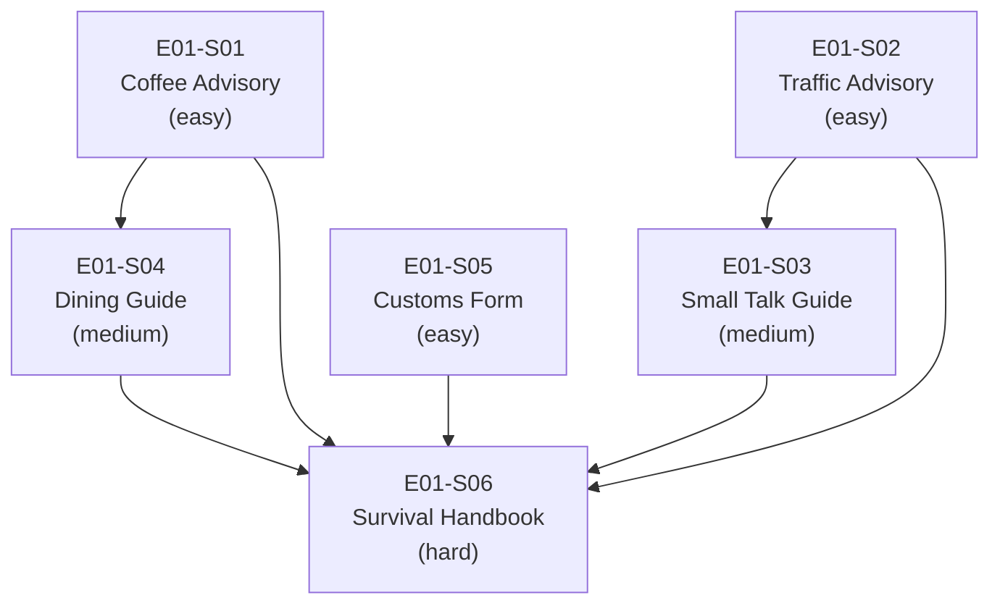

# Run 13 Design: Alien Tourist Bureau

> **Status:** Draft

## Overview

Thirteenth end-to-end test of the Agentic SDLC pipeline. Primary test objective: **validate runtime data consolidation and live pricing architecture** introduced after Run 12 -- all runtime files consolidated into `.agentic-workflow/`, live pricing fetched from anthropic.com/pricing, `--dispatches-from-state` for automated telemetry computation, and correct Opus 4.6 rates.

Content theme: "Alien Tourist Bureau" -- official travel advisories, visitor guides, and administrative documents issued by the Galactic Federation Bureau of Terran Tourism (GFBTT) for aliens visiting Earth. Documents are written in bureaucratic/governmental tone (think DMV meets Star Trek) with comedic observations about mundane human activities that aliens find baffling or hazardous.

## Goals

1. **Runtime data consolidation** -- Verify all scripts read/write to `.agentic-workflow/` (no references to `.claude/state/` or `.claude/logs/`)
2. **Live pricing** -- Confirm `fetch-pricing.sh` fetches pricing and writes `.agentic-workflow/pricing.json`
3. **Pricing accuracy** -- Opus telemetry uses correct $5/$25 rates (not stale $15/$75 from Opus 4.0)
4. **Automated telemetry** -- `--dispatches-from-state` produces correct aggregate telemetry without manual cost computation
5. **Board status at design start** -- Backlog issue set to In Progress at design phase start, not builder dispatch
6. **Board drift verification** -- Phase 8, step 7 drift verification runs at end of workflow
7. **No config pricing section** -- Pricing comes from live fetch only (config `pricing` section removed)
8. **All three difficulty levels** -- 2 easy, 2 medium, 1 hard (minimum from backlog requirements)

## Non-Goals

- Testing C# compilation, DI wiring, or unit tests (markdown content only)
- Cross-epic dependencies (all content is in a single epic)
- Testing more than 1 epic or 7 stories (keep execution time reasonable)
- Producing publication-quality creative writing (this is a workflow test)

---

## Epic 1: Alien Tourist Bureau Documents (6 stories)

A single epic with all content stories. Documents are issued by various departments of the GFBTT -- from travel advisories warning about specific hazards, to visitor guides explaining human customs, to administrative forms aliens must complete before planetfall.

### Voice Guidelines

- **Tone:** Dry, bureaucratic, officious. The bureau takes its work extremely seriously. Every trivial human activity is treated as a potential hazard requiring formal documentation. Think government safety bulletins crossed with David Attenborough narrating a nature documentary about humans.
- **Format:** Each document type has its own template (see below). All documents share a classification header with document number, issuing authority, and distribution level.
- **Register:** The comedy comes from treating ordinary human behavior as alien and dangerous. Coffee is a "volatile psychoactive stimulant." Handshakes are "ritualized physical contact of uncertain origin." Traffic is a "mass coordinated near-death experience." The bureau's recommendations are always slightly wrong or wildly overcautious.
- **Perspective:** Written by aliens who have studied Earth but fundamentally misunderstand it. They have excellent data but terrible interpretation. Their safety ratings are based on genuine alien physiology concerns (e.g., sensitivity to Earth's UV levels, confusion about human temperature preferences, inability to distinguish sarcasm from threats).
- **Cross-references:** Hard stories must reference specific document numbers and topics from easier stories, creating a sense of an interconnected bureaucratic filing system.

### Document Header Template

Every document must begin with this header:

```markdown
# [Document Title]

**Classification:** [UNCLASSIFIED -- FOR TOURIST USE / RESTRICTED -- DIPLOMATIC PERSONNEL ONLY / etc.]
**Document No.:** GFBTT-[DEPT]-[YYYY]-[NNN]
**Issuing Authority:** [Department Name], Galactic Federation Bureau of Terran Tourism
**Effective Date:** Galactic Standard Date [date] (Terran Equivalent: [Earth date])
**Distribution:** [All registered Terran visitors / Specific species / etc.]
**Supersedes:** [Previous document number or "None"]

---
```

### E01-S01: "Travel Advisory: The Substance Known as 'Coffee'" -- `difficulty/easy`

Create `test-output/alien-tourist-bureau/advisory-coffee.md`

**Content requirements:**

- Document type: Travel Advisory (safety warning)
- Document No.: GFBTT-HAZ-2026-001
- Issuing Authority: Department of Hazardous Consumables
- Classification: UNCLASSIFIED -- FOR TOURIST USE
- Content: A formal safety advisory warning alien visitors about Earth's most widely consumed psychoactive substance. Should cover: what coffee is (a "thermally activated plant extract"), how humans consume it (in "dedicated dispensaries" called "cafes"), the behavioral effects on humans (increased aggression, decreased patience, dependency withdrawal symptoms observable in pre-consumption morning hours), and recommended visitor protocols (do not interfere with a human's morning coffee ritual; do not suggest alternatives; maintain minimum safe distance of 3 meters from any human who has not yet consumed their daily dose).
- Include a "Risk Assessment Matrix" with categories: Toxicity (to common visitor species), Social Hazard Level, Addiction Potential, and Recommended Visitor Response.
- Word count: 150-250

**Why easy:** Single document type, straightforward template, one topic. The humor is in the bureaucratic overreaction to coffee.

**Acceptance criteria:**

- [ ] File exists at `test-output/alien-tourist-bureau/advisory-coffee.md`
- [ ] Follows document header template
- [ ] Includes Risk Assessment Matrix
- [ ] Bureaucratic tone maintained throughout
- [ ] Word count 150-250
- [ ] Document number matches specification

### E01-S02: "Travel Advisory: Navigating 'Traffic'" -- `difficulty/easy`

Create `test-output/alien-tourist-bureau/advisory-traffic.md`

**Content requirements:**

- Document type: Travel Advisory (safety warning)
- Document No.: GFBTT-HAZ-2026-002
- Issuing Authority: Department of Hazardous Consumables (cross-listed with Department of Terran Transportation)
- Classification: UNCLASSIFIED -- FOR TOURIST USE
- Content: A safety advisory about Earth's ground-based transportation system. Should cover: the concept of "traffic" (millions of humans voluntarily entering small metal boxes and propelling themselves at lethal velocities while separated from oncoming death by a painted line), the phenomenon of "road rage" (a common psychotic episode triggered by minor infractions of an unwritten social code), the bewildering system of "traffic lights" (a color-based behavioral control mechanism that humans obey more reliably than most of their laws), and the recommended visitor protocol (do not attempt to fly; do not teleport in view of humans; if you must use a human vehicle, the left pedal stops it and the right pedal makes it go -- do not reverse these).
- Include a "Danger Rating" by city (pick 3-4 real cities with humorous ratings).
- Word count: 150-250

**Why easy:** Same structure as S01 -- single advisory, one topic, straightforward template.

**Acceptance criteria:**

- [ ] File exists at `test-output/alien-tourist-bureau/advisory-traffic.md`
- [ ] Follows document header template
- [ ] Includes city-by-city Danger Rating table
- [ ] Bureaucratic tone maintained throughout
- [ ] Word count 150-250
- [ ] Document number matches specification

### E01-S03: "Visitor Guide: Understanding 'Small Talk'" -- `difficulty/medium`

Create `test-output/alien-tourist-bureau/guide-small-talk.md`

**Content requirements:**

- Document type: Visitor Guide (cultural briefing)
- Document No.: GFBTT-CUL-2026-001
- Issuing Authority: Department of Cultural Xenology
- Classification: UNCLASSIFIED -- FOR TOURIST USE
- Content: A comprehensive guide to the human social ritual known as "small talk." Should cover: the purpose of small talk (humans exchange meaningless information as a bonding mechanism -- "How are you?" does NOT require a medical status report), approved topics (weather, local sports teams, complaints about traffic -- cross-reference GFBTT-HAZ-2026-002), forbidden topics (income, age, weight, political alignment, whether the simulation hypothesis is correct), common phrases and their actual meanings (a "Phrase Translation Table" with entries like "We should get together sometime" = "We will never meet again"), and a flowchart for navigating a small talk encounter.
- Include a "Phrase Translation Table" (at least 6 entries) mapping human phrases to their actual meanings.
- Include a "Conversation Flowchart" section describing (in text or Mermaid) the decision tree for a small talk encounter.
- Word count: 250-400

**Why medium:** Longer document with multiple structured sections (phrase table, flowchart). Requires cross-referencing the traffic advisory (GFBTT-HAZ-2026-002). Two distinct content types (explanatory prose and structured reference material).

**Acceptance criteria:**

- [ ] File exists at `test-output/alien-tourist-bureau/guide-small-talk.md`
- [ ] Follows document header template
- [ ] Cross-references traffic advisory by document number (GFBTT-HAZ-2026-002)
- [ ] Includes Phrase Translation Table with at least 6 entries
- [ ] Includes Conversation Flowchart section
- [ ] Bureaucratic tone maintained throughout
- [ ] Word count 250-400

### E01-S04: "Visitor Guide: Terran Dining Protocols" -- `difficulty/medium`

Create `test-output/alien-tourist-bureau/guide-dining.md`

**Content requirements:**

- Document type: Visitor Guide (cultural briefing)
- Document No.: GFBTT-CUL-2026-002
- Issuing Authority: Department of Cultural Xenology (co-issued with Department of Hazardous Consumables)
- Classification: UNCLASSIFIED -- FOR TOURIST USE
- Content: A guide to Earth's bewildering dining customs. Should cover: the concept of "restaurants" (designated consumption zones where humans pay other humans to thermally process organic matter), the ritual of "tipping" (an informal taxation system based on the emotional state of the consumer), the menu (a document listing available organic compounds, often with misleading names -- "hot dog" contains neither thermal regulation equipment nor canine matter), and the phenomenon of "dietary restrictions" (humans voluntarily limiting their consumption options based on philosophical, medical, or social-status motivations that vary by region). Cross-reference coffee advisory (GFBTT-HAZ-2026-001) when discussing beverages.
- Include a "Menu Translation Guide" section explaining at least 5 confusingly-named Earth foods.
- Include a "Tipping Calculator" section with a simple table showing regional tipping norms.
- Word count: 250-400

**Why medium:** Similar complexity to S03 -- longer document, multiple structured sections, cross-reference requirement. The menu translation and tipping table add structured content variety.

**Acceptance criteria:**

- [ ] File exists at `test-output/alien-tourist-bureau/guide-dining.md`
- [ ] Follows document header template
- [ ] Cross-references coffee advisory by document number (GFBTT-HAZ-2026-001)
- [ ] Includes Menu Translation Guide with at least 5 entries
- [ ] Includes Tipping Calculator table
- [ ] Bureaucratic tone maintained throughout
- [ ] Word count 250-400

### E01-S05: "Form GFBTT-7G: Pre-Planetfall Customs Declaration" -- `difficulty/easy`

Create `test-output/alien-tourist-bureau/form-customs-declaration.md`

**Content requirements:**

- Document type: Administrative Form
- Document No.: GFBTT-ADM-2026-001
- Issuing Authority: Department of Planetfall Administration
- Classification: UNCLASSIFIED -- FOR TOURIST USE
- Content: A customs declaration form that all alien visitors must complete before entering Earth's atmosphere. The form is absurdly detailed and bureaucratic. Include fields for: visitor species and subspecies, number of limbs (with a note that "limb count may not change during visit without filing Amendment Form GFBTT-7G-A"), purpose of visit (checkboxes: Tourism, Research, Diplomatic, Culinary Tourism, Observing Humans For Entertainment, Accidentally Crashed And Need Repairs), items to declare (list of prohibited items: mind-control devices, temporal displacement equipment, universal translators set to "sarcasm mode"), and a loyalty oath swearing not to reveal the existence of extraterrestrial life to humans ("who are statistically not ready").
- The form should feel like a real government form -- checkbox fields, signature lines, and fine-print warnings.
- Word count: 150-250

**Why easy:** Despite being a different document type (form vs. advisory), the content is straightforward list-based humor. No cross-references required, no multi-section complexity.

**Acceptance criteria:**

- [ ] File exists at `test-output/alien-tourist-bureau/form-customs-declaration.md`
- [ ] Follows document header template
- [ ] Formatted as a form with checkbox fields and signature lines
- [ ] Includes prohibited items list
- [ ] Includes purpose-of-visit checkboxes with humorous options
- [ ] Bureaucratic tone maintained throughout
- [ ] Word count 150-250

### E01-S06: "The Complete Terran Survival Handbook (Abridged Edition)" -- `difficulty/hard`

Create `test-output/alien-tourist-bureau/handbook-survival.md`

**Content requirements:**

- Format: An official GFBTT handbook compiling and cross-referencing the advisories and guides from earlier stories into a comprehensive survival reference
- Document No.: GFBTT-PUB-2026-001
- Issuing Authority: Office of the Director-General, Galactic Federation Bureau of Terran Tourism
- Classification: UNCLASSIFIED -- FOR TOURIST USE
- Must reference at least four of the five prior documents by their document numbers (GFBTT-HAZ-2026-001, GFBTT-HAZ-2026-002, GFBTT-CUL-2026-001, GFBTT-CUL-2026-002, GFBTT-ADM-2026-001), pulling specific details from each
- Includes a "Quick Reference Card" -- a condensed table with columns: Topic, Document Reference, Threat Level, Key Recommendation
- Includes a "Frequently Asked Questions" section with at least 5 Q&A entries that reference situations described in earlier documents (e.g., "Q: A human offered me 'coffee.' Is this an attack? A: See Advisory GFBTT-HAZ-2026-001. While technically a psychoactive substance, humans consider offering coffee a gesture of friendship...")
- Includes a "Director-General's Welcome Message" -- a short introductory letter from the GFBTT Director-General welcoming visitors to Earth and attempting to be reassuring while accidentally highlighting every danger
- Includes a "Known Issues and Errata" section listing corrections to prior documents (bureaucratic self-correction humor)
- Word count: 400-600

**Why hard:** Cross-references all five prior documents by document number with specific details. Multiple distinct sections with different tonal registers (formal welcome letter, reference table, FAQ, errata). The builder must read or infer content from the other files to ensure cross-references are accurate and consistent. Longest word count.

**Acceptance criteria:**

- [ ] File exists at `test-output/alien-tourist-bureau/handbook-survival.md`
- [ ] Follows document header template
- [ ] References at least 4 of 5 prior documents by document number
- [ ] Includes Quick Reference Card table
- [ ] Includes FAQ section with at least 5 entries referencing prior documents
- [ ] Includes Director-General's Welcome Message
- [ ] Includes Known Issues and Errata section
- [ ] Word count 400-600
- [ ] Consistent bureaucratic tone throughout

---

## File Naming Summary

| Story | Filename | Difficulty |
|-------|----------|------------|
| E01-S01 | `test-output/alien-tourist-bureau/advisory-coffee.md` | easy |
| E01-S02 | `test-output/alien-tourist-bureau/advisory-traffic.md` | easy |
| E01-S03 | `test-output/alien-tourist-bureau/guide-small-talk.md` | medium |
| E01-S04 | `test-output/alien-tourist-bureau/guide-dining.md` | medium |
| E01-S05 | `test-output/alien-tourist-bureau/form-customs-declaration.md` | easy |
| E01-S06 | `test-output/alien-tourist-bureau/handbook-survival.md` | hard |

## Dependency Graph



**Dependency rationale:**

- E01-S01 and E01-S02 are fully independent (no cross-references)
- E01-S03 cross-references E01-S02 (traffic advisory document number) -- depends on S02
- E01-S04 cross-references E01-S01 (coffee advisory document number) -- depends on S01
- E01-S05 is fully independent (no cross-references to other documents)
- E01-S06 cross-references all five prior documents -- depends on S01, S02, S03, S04, S05

Note: The cross-references in S03 and S04 are by document number only (GFBTT-HAZ-2026-002 and GFBTT-HAZ-2026-001 respectively). The document numbers are specified in this design doc, so builders can include them without reading the actual files. However, the dependency ensures the referenced documents exist on the epic branch if the builder wants to verify content consistency.

## Dispatch Plan

| Wave | Stories | Dispatch | Notes |
|------|---------|----------|-------|
| **Wave 1** | E01-S01, E01-S02, E01-S05 | Parallel (3 stories, **worktree isolation**) | 3 easy, all independent, respects `maxParallelBuilders: 3` |
| **Wave 2** | E01-S03, E01-S04 | Parallel (2 stories, **worktree isolation**) | 2 medium, S03 depends on S02 (Wave 1), S04 depends on S01 (Wave 1) |
| **Wave 3** | E01-S06 | Sequential | Hard story, cross-references all 5 prior documents |

**Why this wave structure:**

- Wave 1 dispatches the three fully independent easy stories in parallel, saturating `maxParallelBuilders: 3`
- Wave 2 dispatches the two medium stories that each depend on one easy story from Wave 1. Both dependencies are satisfied after Wave 1 completes.
- Wave 3 dispatches the hard story last, after all five prior documents exist on the epic branch

**Alternative dispatch:** If the planner determines S03 and S04 can include their cross-references without reading the actual files (since the document numbers are specified in this design doc), then S03, S04, and S05 could all join Wave 1 for a single 5-story parallel wave followed by S06. However, this exceeds `maxParallelBuilders: 3` and would require two waves anyway. The 3-wave plan is cleaner.

**Estimated execution time:**

- Wave 1 (3x easy, parallel): ~2 min wall-clock
- Wave 2 (2x medium, parallel): ~2.5 min wall-clock
- Wave 3 (1x hard): ~3 min
- Total: ~7.5 min wall-clock, ~14 min sequential agent time

## Acceptance Criteria

### Per-Story

- [ ] Output file exists at the specified path
- [ ] Content follows the document header template
- [ ] Word count within the specified range for the difficulty level
- [ ] Bureaucratic/governmental tone maintained throughout
- [ ] Document numbers match the specification

### Per-Epic

- [ ] All 6 stories pass review
- [ ] Epic branch merges cleanly into integration branch
- [ ] Cross-references between documents are consistent (correct document numbers, referenced details match)

### Workflow (Primary Test Objectives)

- [ ] All scripts read/write to `.agentic-workflow/` (no `.claude/state/` or `.claude/logs/` references)
- [ ] `fetch-pricing.sh` fetches live pricing and writes `.agentic-workflow/pricing.json`
- [ ] Per-story telemetry uses correct Opus 4.6 rates ($5/$25) from cached pricing
- [ ] `--dispatches-from-state` produces correct aggregate telemetry
- [ ] Backlog issue set to In Progress at design phase start (not builder dispatch)
- [ ] Board drift verification runs at end of workflow
- [ ] Config has no `pricing` section -- pricing comes from live fetch only
- [ ] Easy and medium stories dispatch `builder-sonnet`, hard story dispatches `builder-opus`
- [ ] Worktree isolation used for parallel waves
- [ ] No workspace collision -- each story branch contains only its own file(s)
- [ ] All board transitions complete (Planned -> Todo -> In Progress -> In Review -> Done)
- [ ] Per-story, per-epic, and backlog-level telemetry posted
- [ ] Backlog PR opened targeting `main`, stays open for human review
- [ ] All issues listed in PR `Closes` footer for auto-close on merge

## Approaches Considered

### Approach A: Single epic with 6 content stories, 3-wave dispatch (recommended)

One epic containing all bureau documents. Three easy stories (independent), two medium stories (each cross-referencing one easy), and one hard story (cross-referencing all five). Three dispatch waves respect `maxParallelBuilders: 3` and natural dependencies.

**Pros:**
- 6 stories (vs. Run 12's 5) gives slightly more telemetry data points
- Three waves (vs. Run 12's 3) validate the same parallel patterns with a different wave structure (3-2-1 vs. 3-1-1)
- The document numbering system creates natural, meaningful cross-references (not forced)
- Three difficulty levels with 3 easy / 2 medium / 1 hard exceeds the minimum requirement
- Single epic keeps orchestrator overhead low

**Cons:**
- No cross-epic merge testing (not a goal for Run 13)
- 6 stories may run slightly longer than Run 12's 5

### Approach B: Two epics -- Advisories (E01) + Guides and Forms (E02)

Split by document type: E01 has the two travel advisories (easy), E02 has the guides, form, and handbook.

**Pros:**
- Tests cross-epic dependency (E02 guides reference E01 advisories)
- Thematic grouping by document type

**Cons:**
- The split is arbitrary -- all documents come from the same bureau
- Two-epic overhead is not justified for 6 stories
- Cross-epic dependency handling is not a Run 13 test objective
- Prior runs have tested multi-epic workflows

### Approach C: Single epic with 5 stories (matching Run 12's count)

Drop the customs form (S05) to match Run 12's story count exactly.

**Pros:**
- Identical story count makes run-to-run comparison easier
- Simpler dispatch plan (fewer waves possible)

**Cons:**
- Loses the variety of a third document type (form vs. advisory vs. guide)
- Drops below 3 easy stories, reducing Wave 1 parallelism to 2
- Less interesting content variety

### Decision

**Approach A.** Six stories in one epic with 3-wave dispatch. The primary test objectives are runtime data consolidation and live pricing -- not multi-epic orchestration. The 3-2-1 wave structure (vs. Run 12's 3-1-1) provides variety in dispatch patterns while respecting `maxParallelBuilders: 3`. The customs declaration form adds a third document type that enriches the content without adding structural complexity.

## Assumptions and Open Questions

### Assumptions

1. **Content directory `test-output/alien-tourist-bureau/` will be created by the builder.** Standard `mkdir -p` as in prior runs.
2. **Word counts are approximate.** Reviewers should accept content within 10% of the specified range without flagging.
3. **Document numbers are deterministic.** Builders use the exact document numbers specified in this design doc (GFBTT-HAZ-2026-001, etc.). This enables cross-references to work even if stories are built in parallel without reading each other's files.
4. **The survival handbook (S06) should read the actual files.** Since S06 runs in Wave 3 after all other stories are merged into the epic branch, the builder should read the five prior files to ensure cross-references pull accurate details. If files are unavailable for any reason, the builder can use this design doc's content requirements as a fallback.
5. **The GFBTT bureaucratic framing is self-contained.** No external world-building context is needed -- each document establishes its own premise. The "Galactic Federation" is a generic sci-fi government; no specific franchise is referenced.
6. **`maxParallelBuilders: 3` is a hard limit.** Wave 1 dispatches exactly 3 stories.
7. **No infrastructure stories needed.** All stories are content. The runtime consolidation being validated was shipped in prior work and is already on `main`.

### Open Questions

1. **Should the customs form include "official stamps" (ASCII art)?** The design describes checkbox fields and signature lines, but real government forms often have stamps or seals. Left to the builder's discretion -- simple `[OFFICIAL SEAL]` placeholder is acceptable.
2. **Should documents include a "revision history" footer?** Real government documents often track revision dates. This could add flavor but also adds word count. Not required, but builders may include it if within word limits.
3. **Should the survival handbook's FAQ answers be self-contradictory across entries?** This would add a layer of bureaucratic comedy (the bureau giving conflicting advice) but risks confusing the cross-reference consistency check. Recommendation: mild inconsistencies are acceptable as humor, but document numbers and core facts should remain consistent.
